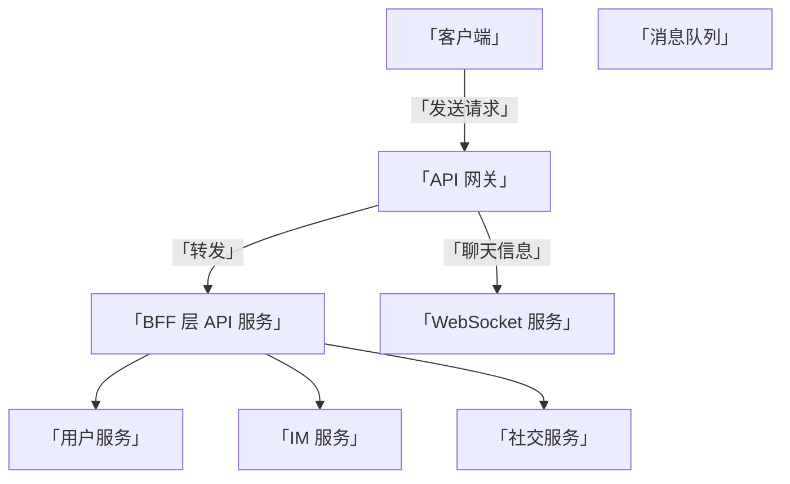

# 5-1-项目开展的业务需求与开展计划说明

从本章开始，我们正式进入项目实战阶段，重点讨论两个问题：一是项目要实现哪些业务功能，二是项目的结构与架构如何设计。

先看业务层面。本项目的核心是一个 IM（即时通讯）通信系统：用户登录到客户端之后，可以向自己的好友或者群发送聊天信息，这是最主要的功能需求。

从功能上可以将其归纳为三块业务。

第一是用户业务，涵盖登录、注册、个人信息详情、查找等功能。之所以需要查找，是因为只有先找到目标用户，才能与对方建立好友关系。

第二是社交业务，包含好友与群两部分。好友关系包括申请、列表等操作；群则包括用户加入了哪些群、退群、群列表、群申请等动作，这些都属于社交业务的范畴。

第三是聊天业务，又分为私聊和群聊。围绕聊天消息，还有聊天记录的管理；围绕聊天功能，还可以延伸出已读、未读等状态，这些都属于聊天业务。

介绍完整体业务之后，再来看项目的结构。

项目的结构如下。最下方是客户端，中间是网关层，具体来说是 API 网关。客户端将请求发送到 API 网关，由 API 网关转发给对应的 API 服务，这一层 API 服务称为 BFF 层。如果请求属于聊天信息，则会被转发到 WebSocket 服务。最后由 BFF 层去请求具体的微服务，完成相关业务功能。

此外还有一个消息队列，用于处理一些 EAP 任务。

以上就是要构建的项目结构。它还依赖 etcd、Docker、MongoDB 等基础组件，这些属于基础环境以及微服务层直接使用的部分，不单独列举，只作为整体结构的一部分呈现。

本课程的项目与之前的单点项目有一个明显的区别：架构中多了一层网关。这里有两个问题值得讨论：一是为什么要设计一个网关，不设计可不可以；二是为什么会多出一层 BFF 层，既然要构建的是微服务项目，这一层与整体架构有什么关系，又能提供什么帮助。

先说 BFF 层。在微服务架构中，服务是根据功能或者特定的维度拆分出来的。项目已经拆分出了三个服务：用户服务、IM 服务和社交服务，它们各自的职责很容易理解。

拆分完成之后，在其之上再单独建立一层 BFF 层，这一层的主要作用是聚合。以社交业务为例，群的创建和群的加入肯定需要与社交 API 服务对接；但除了社交 API 服务，这些操作也可能需要与 IM 的 RPC 服务对接，IM 服务负责了 IM 聊天的会话与聊天记录，群创建时的会话建立显然也需要关联起来。IM 的 API 服务与 IM 的 RPC 服务之间肯定有关联，但它们同时也与用户服务有关联。这种情况下，BFF 层的作用就体现出来了，即聚合：它帮助客户端聚合各个微服务中对应的业务，由 BFF 层统一汇聚，最终对外提供一个 API 接口供客户端使用。

如果没有 BFF 层，客户端通过网关请求时，这个网关就不仅仅是 API 网关，还承担了微服务网关的职责，会将请求直接打入微服务。此时客户端想要完成一次群的创建，就需要分别发起群的创建请求和群的会话建立请求，多个请求都会落到微服务中，客户端只能反复请求多次。

有了 BFF 层之后，聚合业务就可以放在这一层，这正是它的目的。BFF 层可以按功能进行建立。

再说网关的作用。当 API 服务部署到多台机器上之后，不同机器就有不同的访问方式，客户端需要知道每一个访问地址，这显然很繁琐。网关提供一个反向代理入口，同时能够注册多个 API 服务。客户端直接通过网关，就可以把请求转发到对应的目标机器上进行处理。

整体而言，后续项目将围绕上述业务以及这个项目架构展开设计与实现。
