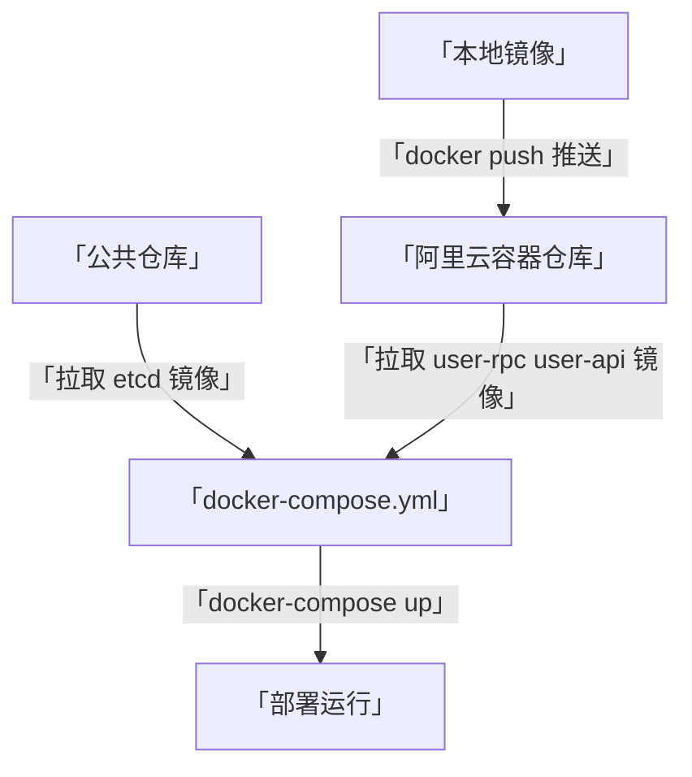

# 5-2-项目开展的基础环境构建

本节课准备项目开展所需的基础环境，核心有三个要点：代码仓库、容器仓库，以及仓库的推送与拉取。

第一项是服务器。课程中通过 VMware 构建两个 CentOS 系统：第一台用于项目的开发测试，第二台用于测试完成之后的整体联调部署，总共需要两个服务器。

除了服务器以外，还需要代码仓库和容器仓库。代码仓库方面，企业中既有私有的，也有直接使用第三方仓库的，这里使用码云上的仓库来作为私有仓库；容器仓库则使用阿里云的容器仓库作为私服，后续会根据容器仓库进行镜像的推送和拉取。

先看代码仓库。课程中的代码会放到 gitee 上，因此以码云作为示例进行演示。在码云上注册账号并创建一个仓库，仓库名加上 chat，可以填写一定的描述，仓库默认以私有方式创建，然后复制仓库地址。

创建完之后，根据页面的提示配置好 git 信息，将页面上提供的信息直接复制到系统中执行。每个人的结果不一样，执行后即可配置好系统的账号信息。接着创建一个仓库目录，让命令行进入该目录，执行 git init。初始化之后可以先添加一个文件，再回到码云页面，把剩下的信息复制好，执行这些设定命令：先通过 git add 把刚创建的文件添加，再执行提交，就可以把项目推送上去。整个过程如下：

```bash
        git init
        git config --global user.name 「金国」
        git config --global user.email 「17680143620@189.cn」
        git add .
        git commit -m 「first commit」
        git remote add origin https://gitee.com/dn-jinmin/easy-chat.git
        git push -u origin master
        ```

刷新页面可以看到代码已成功推送，git 仓库就准备好了。如果推送过程中遇到 `src refspec master does not match any` 的报错，说明远程仓库的 master 分支不存在，需要先创建或使用其他分支。

接下来是容器仓库。容器仓库使用阿里云上的仓库，登录自己的账号后进入容器镜像服务，可以申请一个免费的用于测试的容器仓库。使用前需要先创建一个实例，如果已有实例则可以直接使用，在其中可以管理项目中会用到的容器镜像。

进入命名空间（例如 easy-chat），确认没有问题之后，再回到镜像仓库。要注意仓库的创建需要区分测试和生产：测试环境下可能会有一些相应的配置，而生产环境会严谨一些，因此需要区分，以免混淆导致问题。

在命名空间下创建一个 user-rpc 的测试镜像仓库，选择创建镜像仓库、本地仓库。创建完之后，页面会给出对该镜像仓库进行推送的命令示例，先不用管。再创建一个 API 的镜像仓库，同样选择本地仓库。到此两个仓库就准备好了。

准备完之后有一个细节需要注意：整个仓库访问的凭证。这里使用固定密码更好，在控制台中设置固定密码，docker login 时使用该密码。文档中也有对这个过程的描述，将文档中的命令放到系统中执行即可。

仓库准备好之后，就需要把两个仓库应用起来。首先要做的是把本地镜像推送到仓库。目前创建的两个仓库中，一个是 API 的，一个是 RPC 的，接下来要做的事情就是将本地镜像推送到对应的仓库中。

进入任意一个仓库，页面会给出拉取和推送的命令，把信息复制下来并修改其中的内容，首先要更改的是镜像名。先查看当前自己的镜像名，以 Easy Chat 为例，之前的 Easy Chat 项目已经通过它构建了一些新的镜像，其中有一个 API 的和一个 RPC 的。复制镜像名，其后是版本号，使用默认的即可。把这两个修改后的命令放到容器中执行，再通过 docker images 查看，可以看到镜像标签已经修改。修改标签之后，根据提示直接执行 push 就可以了。

镜像仓库的登录、推送与验证命令如下：

```bash
        docker login --username=t_1478801769083_0 registry.cn-hangzhou.aliyuncs.com
        docker push registry.cn-hangzhou.aliyuncs.com/easy-chat/user-rpc-dev:latest
        docker-compose up -d
        docker-compose ps
        ```

把两个 push 命令复制并执行，两个镜像就推送上来了。回到仓库中查看，可以看到镜像版本信息，确认刚刚推送的镜像已经上传，说明推送没有问题。

接下来要拉取部署。首先把当前系统中正在运行的容器全部停止，通过 docker stop 停止完之后，再删除掉所有的镜像信息。可以先通过 docker ps 查看容器，然后查找所有镜像，同时按镜像 ID 输出镜像信息，根据查询到的所有镜像进行删除。如果还有镜像没有被删除，说明应该还有一些容器没有删完，在前面的命令中直接加上 -f 强制删除即可。要注意 -f 的操作不要随意使用，强制删除会影响到当前正在运行的系统。

回到项目中，进入 user 目录，修改 docker-compose 文件，把其中 user API 和 user RPC 的镜像改为阿里云仓库中推送的镜像地址，上面是 RPC 的，下面是 API 的，同时把最上面 etcd 的镜像名称标注好，这样一份 docker-compose 就准备好了：

```yaml
        services:
          user-rpc:
            image: registry.cn-hangzhou.aliyuncs.com/easy-chat/user-rpc-dev:latest
            container_name: user-rpc
            ports:
              - 「8080:8080」
            depends_on:
              - etcd
            networks:
              - user
          user-api:
            image: registry.cn-hangzhou.aliyuncs.com/easy-chat/user-api-dev:latest
            container_name: user-api
            ports:
              - 「8081:8081」
            depends_on:
              - etcd
            networks:
              - user
        ```

重新上传后，在容器中执行 docker-compose up，它会自动拉取新的镜像。etcd 的镜像很好理解，是从公共仓库中拉取；而 user API 和 user RPC 的镜像，则是从私有仓库中拉取。部署完成后可以看到，它们使用的镜像不再是本地的，而是推送后的镜像，说明这个操作没有问题，可以再测试一下。



到此，镜像仓库的推送与拉取已经实现，系统环境的需求已经准备好，可以开始后续的项目开发了。
