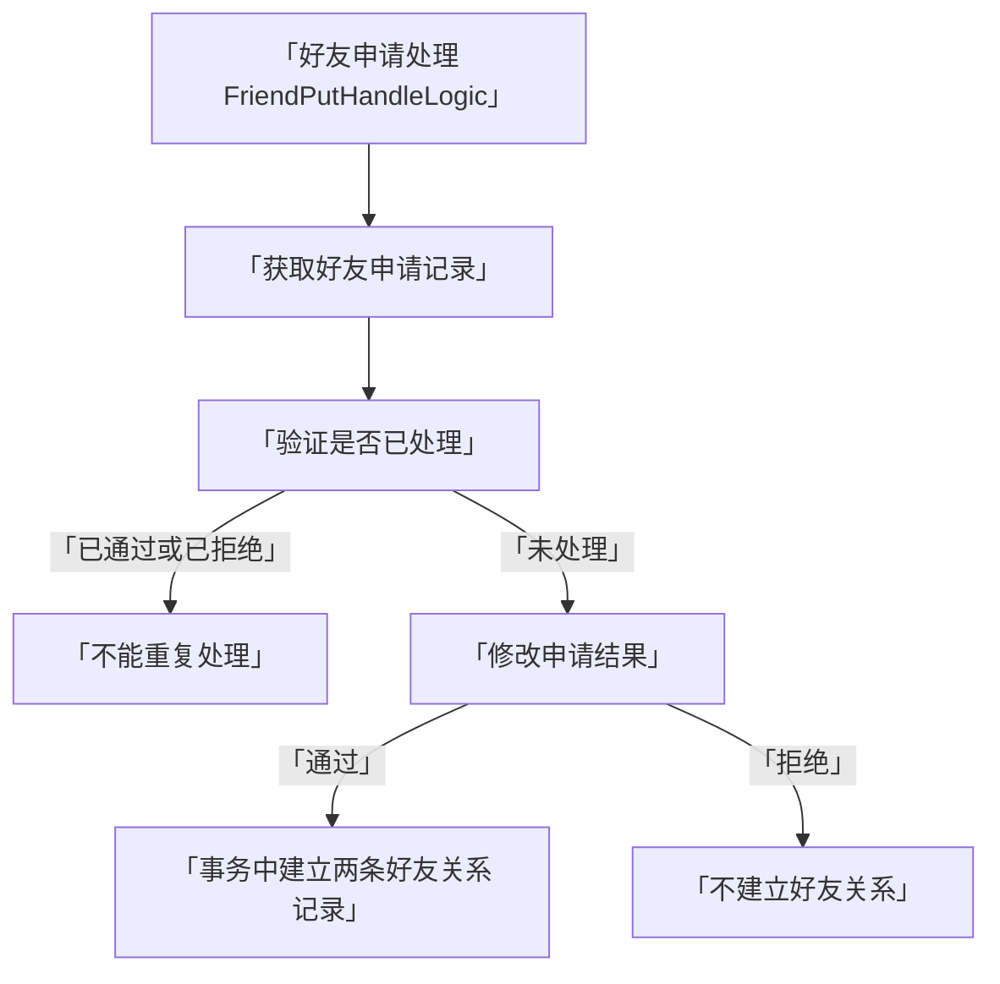

# 6-11-构建社交服务rpc服务并完成好友、群相关业务功能（下）

上一节完成了好友申请的业务，本节来完成第二个业务：好友申请的处理，对应的逻辑入口是 FriendPutHandleLogic。

```go
  func NewFriendPutHandleLogic(ctx context.Context, svcCtx *svc.ServiceContext) *FriendPutHandleLogic {
      return &FriendPutHandleLogic{
          ctx: ctx,
          svcCtx: svcCtx,
          Logger: logx.WithContext(ctx),
      }
  }
  ```

这个业务需要做三件事情。第一是获取好友的申请记录，这是第一步。第二是验证处理的方式，验证是否已经处理过，不能重复处理好友关系。第三是修改申请结果，如果申请通过，就需要建立好友关系，此时要建立两条好友关系记录。这一段处理需要用到事务，因为修改申请状态与建立好友关系必须保证原子性，不用事务的话无法保证数据的一致性。



先处理获取好友申请的记录。在模型中通过 FindOne 就可以查询到，根据好友请求的 ID 获取好友申请记录。FindOne 要求传递一个 int64 类型的参数，因此需要做一下类型转化，把请求 ID 传进去，然后验证错误。此处只需要判断错误是否为空，因为如果申请记录不存在，理论上也不会影响结果，这条记录本来就不能通过。把错误的描述更改一下即可。

```go
  func (l *FriendPutHandleLogic) FriendPutHandle(in *social.FriendPutHandleReq, out *social.FriendPutHandleResp, err error) {
      // todo: add your logic here and delete this line
      friendReq, err := l.svcCtx.FriendRequestsModel.FindOne(l.ctx, int64(in.FriendReqId))
      if err != nil {
          return nil, errors.Wrap(err, 「find friend request failed」)
      }
  }
  ```

然后验证好友申请的结果情况。做一下类型转化，得到 HandleResult，就能拿到申请的处理结果。再判断当前是否已经申请过、是否已经拒绝过，因此先在上面定义两个错误：第一个错误描述是好友申请已经通过，让它输出 message，使用系统统一的错误类型；第二个错误是请求已经被拒绝，肯定不能重复处理，描述就是好友申请已经被拒绝。定义好错误之后，在业务中使用这些错误做错误处理，把定义的错误输出出去。

如果申请通过，就需要记录两条好友关系记录，这里必须使用事务。在好友申请模型上增加对事务的支持，定义一个 Trans 方法。它传入的第一个参数是 ctx，第二个参数则是对数据进行处理的方法，属于一个函数的方法类型，要求返回一个异常。在逻辑层也需要引用这个函数类型，把它复制下来形成参数。调用 Trans 时就会开启对事务的处理，处理完之后提交。修改申请结果的方法同样需要增加事务处理，否则不会进入到事务中，所以要把 session 传进去，这样就可以支持到事务了。

```go
  func (m *defaultFriendRequestModel) Trans(ctx context.Context, fn func(ctx context.Context, session sqlx.Session) error) error {
      session, err := m.db.BeginTx(ctx, nil)
      if err != nil {
          return err
      }
      defer session.Commit()
      return fn(ctx, session)
  }
  ```

Update 方法目前没有支持事务，需要更改上面的接口，把 session 传进去。

```go
  func (m *defaultFriendRequestModel) Update(ctx context.Context, data *FriendRequest) error {
      // ... 代码省略 ...
      return err
  }
  ```

对于好友申请的处理，好友关系的建立需要两条数据，相当于两条 insert 语句。进到 friends 模型中增加这个 insert 的处理。因为它也需要支持事务，所以 session 肯定要传入进来，然后是 data，返回结果以及一个异常。实现上定义一个 strings.Builder，用来拼接生成的 SQL，毕竟是两条记录，所以增加两条数据，用参数来接收请求的参数值，可以做一下判空处理，如果传递的数据为空就返回。准备好一条 SQL 之后生成两条记录，把 SQL 的前缀填好，前缀中决定添加的表名、添加的字段，后面则是添加的数据。先把表名和字段定义好，注意这里要使用对应的类型，因为有一些字段不会自动设置，所以不用自己写。然后拼接后面的数据，根据当前传递的数据通过 for 循环来拼接，字段从上面再复制一下，以免写错，并和上面是一样的。这是第一条记录，然后添加字段值，也就是这里的字段数据。再判断一下结尾，结尾处就不要跟上那个逗号了，否则就跟上这个逗号。当前这个方式属于 MySQL 的批量执行方式，它的 SQL 写法就是 insert into 加表名，然后字段，在后面跟的就是具体的数据，这条语句会批量地执行。做完之后返回新增的结果，把参数传进去，这样一个批量新增的方法就写好了。

接下来回到业务中，把事务使用起来。好友申请请求中定义的这个事务还没有被使用，把它放到结果中，在这里使用，开启事务，把请求信息传进去，事务的处理如下。首先需要先进行修改，修改请求信息，调用请求模型的 update。这里有一个异常，多了个点，把参数填进去，把请求的值放进去。但是要注意，这个类型的处理结果是没有改的，所以要更改一下，把 HandleResult 也就是处理的结果，把 int64 类型的值，通过请求传进来的值做一个处理。处理完之后做异常处理，这里的异常处理也是数据库的异常，描述就是修改好友申请请求失败了，失败原因及请求的参数填好。在当前处理方式中，如果是不通过的、拒绝的，那么到这里就结束了，不是通过的话肯定不能建立好友关系。但如果是建立好友关系的，就要定义对好友关系的记录，把好友关系的数据记录下来。因此这里要定义两个模型，用来记录好友关系以及好友的数据，写一份，再复制一份，这两个对象交换一下就可以了，现在好友数据定义完成了。最后就是保证以批量执行的方式把它们插进去，把 session 传进去，做一下异常处理，这里的重点是好友关系的批量插入，在异常处就描述当前好友的批量插入失败了。这里的业务就完成了。

之后增加一个好友列表的查询。好友列表查询相对来说会简单很多，因为他只是根据某一个 UID 查询某一个用户的好友就可以了。同样在好友模型中增加一个对好友业务的查询，就是通过 FriendsListByUserId 来实现。

```go
  func (l *FriendListLogic) FriendList(in *social.FriendListReq, out *social.FriendListResp, err error) {
      friendsList, err := l.svcCtx.FriendsModel.FriendsListByUserId(l.ctx, in.UserId)
      if err != nil {
          return nil, errors.Wrap(err, 「list friend by uid failed」)
      }
      return &social.FriendListResp{Friends: friendsList}, nil
  }
  ```

它会返回查询中的好友模型列表。查询条件复制一下上面的这一段，把 ID 改为 uid，然后数据就是查询所有列表，不用限制，当前的 SQL 就定义完成。定义一个结果，再去进行查询，把参数都传一下，做一下错误处理。在业务中，定义一个对请求查询之后的结果接收，根据用户 ID 进行查询，如果查询不到，做一下错误处理，把错误处理的过程复制一下这一段，修改一下这里的描述。把查询结果的设置信息改好，现在再把结果输出去，就没问题了。

最后做一下测试。测试时先修改配置，因为默认使用的是 0.0.0.0，先把它改为 127.0.0.1，等上线时候再把它更改成 0.0.0.0，然后重新启动服务。进到 API POST 中进行测试，这里已经提前写好了。第一步是发起好友的申请，请求一下没有问题。再请求一下，有个问题，是数据库里面的配置问题，进到这里增加一下对时区格式化的处理。然后更改一下里面的内容，把 ID 改一下，ID 在这里已经生成了对应的 ID。再调用没有问题，好友的申请中存在一条生成的请求记录。然后再去通过，给请求 ID 为 5 调用，也没有异常，再来看一下，确实有生成两条记录。之后再来看好友的列表请求，有一个好友的关系列表。整体来说业务已经写好了。

本节课的内容并不是那么难，主要完成了社交服务中好友这一块的关系业务。其中值得注意的是，好友的设计有两种方案，我们在课程中采用的是冗余的设计方案。另一个讨论的地方是，我们在整个项目中对生成的模型加了一个前缀，前面没有解释为什么要这么做。这里的客户端在生成的时候也生成了一个前缀，为什么要对客户端也进行前缀，可以通过客户端的 API 来看一看。在 API 中往往会用到很多客户端，这些客户端如果在包名中引用对应的包，就要引用很多服务生成的包，这意味着它要有很多这样的包，那怎么去解决冲突呢，就是使用别名。但是写法上面会耗费一定的时间，虽然说这并不会影响最终的结果，但是在开发的时候会影响效率。因此为了解决问题，单纯的前缀就可以解决这个问题了，我们就可以不用去写别名了，这里也是一样的道理。

而在常量定义方面，模型中定义了一个常量块，用来定义该模型中所应用的一些常量属性。之所以这样定义，是因为在自己做项目时确实可以减少一定的开发时间。但是如果团队比较大，我建议大家把这些常量定义到 model 中，这样方便于进行项目的管理。

现在业务已经完成，在社交 RPC 服务的 ServiceContext 中增加 user-rpc 的客户端。因为它也需要做好错误处理，注意把包给它加进来。

```go
  type ServiceContext struct {
      Config config.Config
      userclient.User
  }
  ```

最后把代码同步到仓库中。本节课的主要任务就是完成社交服务的 RPC 开发与推送。
