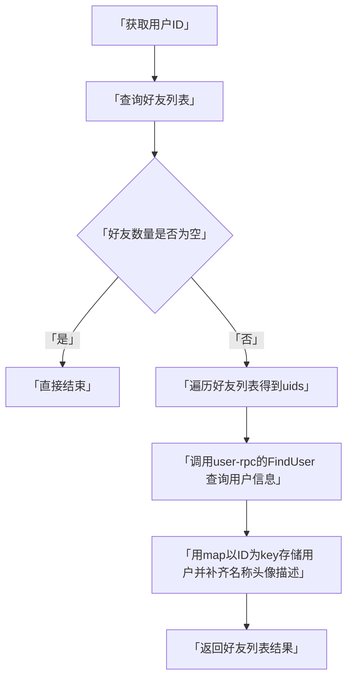

# 6-12-构建社交服务api服务并完成好友、群相关业务功能

上一讲已经将社交 RPC 服务构建好并完成了相关业务，本讲完成社交 API 服务的开发。内容有三部分：先构建 API，再针对 API 服务完成业务接口，最后针对服务调度中容易产生的疑问做总结性讲解。

先构建社交 API 服务。同样需要自己定义 .api 文件，文件内容已事先写好，复制一份放到项目中即可，其中包含整个 API 会用到的消息结构体与路由定义。定义完之后，基于 .api 文件构建 API 服务，命令在文档中已提供，复制过来在命令行执行，API 服务就构建完毕。

社交 API 服务需要调用 RPC 服务，接下来配置相关属性。进到配置文件，增加社交 RPC 服务的调度配置，使用 zrpc 提供的 RPC 客户端配置；再修改配置文件，创建 dev 作为开发环境的测试文件；然后改入口文件的配置项：先改端口，再从 RPC 服务的配置中复制出社交 RPC 服务的配置信息，确认无误。配置定义完之后，再定义 JwtAuth（复制 user-api 的配置信息即可）。配置项定义完成：

```go
        type Config struct {
            rest.RestConf
            SocialRpc zrpc.RpcClientConf
            JwtAuth struct {
                AccessSecret string
                //AccessExpire int64
            }
        }
        ```

再定义 ServiceContext，选用社交 RPC 服务的客户端，通过 New 方法创建 RPC 客户端。准备工作就完成了。

接下来是业务，与 RPC 一样以好友这一块为主：好友申请、好友申请处理、好友列表。先做好友申请：在 FriendPutInLogic 中只需要发起 RPC 请求。发起前先得到用户 ID，申请者肯定已登录，自然能拿到 ID；然后用社交服务完成申请，把请求信息、用户 ID、被请求的用户、请求时间等参数都传进去。API 中的服务调度就是这样，并不难。

好友申请处理与好友申请一样：在 API 服务中调用社交服务的好友申请处理方法，传入请求参数与 UID。完成之后是好友列表查询。

好友列表查询需要额外做一套业务。看好友表的设计：它主要记录好友 ID 和用户 ID，所以查询只会得到 ID 信息。但好友列表的响应不应该只是一串用户 ID，响应中定义的返回结果是好友列表，而一个好友对象理论上应包含 ID、名称、头像、描述等信息，否则前端页面无法展示。所以在当前功能里，还需要去用户服务获取这三项数据才能完成业务。

回到配置项，增加 user-rpc 的配置信息（复制 user 那份即可），再在 ServiceContext 中引用 user-rpc 的客户端，传入 RPC 客户端，完成。

继续好友业务。先获取好友列表：拿到用户 ID 后，通过社交模型提供的方法查询，传好参数并做好错误处理；如果好友数量为空，直接结束。有好友就需要获取好友的用户信息：先遍历好友列表，定义一个 uids 接收好友 ID 集合；然后用 uids 通过用户 RPC 服务的 FindUser 查询用户信息，FindUser 是之前在用户服务里已完成的功能，直接复用，传入 uids 并做好错误处理。

```go
        // 根据好友列表ID查询好友信息
        users, err := l.svcCtx.User.FindUser(l.ctx, &userclient.FindUserReq{
            Ids: uids,
        })
        if err != nil {
            return &types.FriendListResp{Err: err}
        }
        userRecords := make(map[string]*userclient.UserEntity, len(users.User))
        for _, u := range users.User {
            userRecords[u.Id] = u
        }
        ```

拿到好友用户信息后，需要根据用户信息与好友 ID 集合迭代，得到最终要返回的好友列表。两个数组的顺序是不确定的，为了减少迭代次数，先迭代用户集合，用一个 map 以 ID 为 key、用户对象为 value 存起来；再迭代好友列表，从 map 中补齐名称、头像、描述三项信息，把创建好的好友信息放入返回集合，结果返回，好友列表功能就写好了。

好友列表查询的整体流程如下：



进到 logic，把 user-api 中的鉴权和响应处理两个方法复制过来。服务可以启动了：除本服务外，还需要先启动 user RPC 服务，再启动社交 RPC 服务，这两个都没问题后再启动社交 API 服务。

回到 API 测试，添加社交服务的测试项，以好友申请为例：复制 URL 和鉴权信息，在 ApiPOST 中定义请求配置，鉴权地址默认 127.0.0.1:81，路由从 .api 定义中复制，请求方式为 POST。请求参数参考 friend/putIn 的定义，把三个值复制过来：

```json
        {
            「req_msg」: 「请求」,
            「req_time」: 「2023-04-05 10:00:00」,
            「user_id」: 「00000000000000000001」
        }
        ```

数据表里目前有两个用户（ID 1 和 ID 2），选 ID 为 2 的作为申请对象，填上时间值。登录用户需要把 user API 服务也启动起来（第一次登录提示密码不正确，是少输了一个 5）；登录后把环境变量改一下，登录信息会设置到环境变量并配置到头部供引用。发起申请，没有异常。

看数据表：好友申请表多了一条记录，说明申请进来了。处理请求要换另一个用户登录，用 PUT 接口测试好友申请处理。参数有两个：好友申请记录 ID 和处理结果。填入记录 ID（数据库中存在）与处理结果 2（表示通过），发起请求，没问题。刷新数据库，出现了好友记录，好友申请流程没问题。

再测好友列表查询：把接口复制过来（同样是 PUT），发起请求能查询到好友，功能验证通过，业务基本完成。

这一讲可能产生两个疑问。第一：获取好友列表时涉及用户详情，为什么不在社交 RPC 服务中直接调用用户表，那样不是更合适、更快吗？第二（与第一个相辅相成）：为什么不在社交 RPC 服务中直接调用用户服务的方法？

先看第一个。从设计上说，用户 RPC 服务和社交 RPC 服务广义上可以共享同一个数据库，也确实能完成业务开发。但按目前的设计，两个服务各自维护自己的数据库，互不直接操作。这与微服务本身的设计有关：理论上可以共用一个数据库，但微服务除了划分服务，也划分了数据库，数据库与服务一起划分在同一模块中维护。原因有三。

一是解耦。每个服务独立维护自己的数据库；如果共享数据库，服务之间对这份共享资源的依赖会加重，多个服务可能同时操作同一份数据，又不在同一台机器上，就会牵出分布式事务的话题。为了更好地管理，企业中通常按业务模块划分服务及其依赖的数据，由服务自己维护和管理，做到应用与数据层面的解耦。

二是灵活性。共享数据库会限制微服务的灵活与扩展，因为写数据时必须考虑其他服务的使用情况，否则容易产生冲突。

三是安全性。这主要看公司层面，并非所有公司都关注；但规模较大的公司会关注数据安全，发布之后各模块只维护自己的数据，只做自己的业务，核心信息互不干扰。如果能共享使用，意味着有能力知道其他模块的信息，一旦其中一个人出了问题，影响的就不是一个人、一个部门，而是整体。

所以微服务中，服务发布后各自维护自己依赖的数据库；其他服务需要它的资源，就走 RPC 调度。这就引出第二个问题：为什么不直接在社交 RPC 服务中调用用户 RPC 服务的方法，而要在 API 服务中完成？

假设用户服务调用社交服务的方法，业务支持的话是可以的；但社交服务反过来也可能调用户服务的方法，这就会造成相互对调。相互对调意味着相互依赖，任何一方出问题，两方都不可用。而且两个服务的操作相互直接协调调度，业务交织、边界不清晰，整条链路会复杂很多。

因此目前的设计以社交 API 服务作为 BFF（业务聚合层），把用户服务和社交服务中的业务聚合起来一起提供给用户，两个服务之间完全解耦、没有交集。这种设计风格最重要的一点就是解耦：程序更好解耦和扩展，容错率更高，用户服务的异常不会影响社交服务，只影响聚合层中对它的调用。监控也更直接：聚合层调用某个 RPC 服务的业务，哪个环节出问题在聚合层就能记录、跟踪；如果相互对调，异常可能由前一个或后一个操作引起，跟踪性差得多。此外还要考虑延迟、性能与维护扩展性。

总结：业务中服务与 RPC 服务之间的调度是允许的，但推荐尽量节省，相互调度会增加整个程序的复杂度；不过也不是要完全消除，确实更合适时还是应该用。本讲的核心是实现社交 API 服务，同时总结了两个问题：数据为什么不共享，服务间调度为什么不建议对调。
