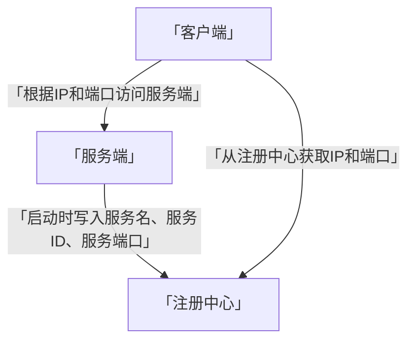

# 6-13-微服务治理之服务注册中心

在前面的课程中，我们已经把用户服务和社交服务开发好了，完成了相关的业务功能，本讲来谈一谈微服务中的服务注册中心。对于这个中心，我们要谈的话题就是：客户端和服务端在通讯的过程中，客户端是如何找到服务端的。

在前面的课程中，实际的过程是先启动了 RPC 服务，启动完之后，又把 API 服务启动完成了。在这过程中，它们到底做了些什么事情？API 服务又是如何找到 RPC 服务的？有同学可能会提到，我们是通过配置，在配置中填了 RPC 和端口，没错是这样的。但我们填的是服务的 IP 吗？答案是否定的，我们在配置中并不是填写了服务的端口和服务的 RPC。以 user-api 为例，在这里所填写的明显是 etcd 的地址，而非服务本身的 IP 和端口。

所以问题的关键就在这个地方：我们到底是怎么发现的？对于服务的发现，在企业中通常会有两种选择。第一种是在配置文件中定义好各个服务的地址集合，也就是用键值对的方式存储，比如 user RPC 服务的 IP 和端口，以及社交 RPC 服务中的 IP 和端口，把它存起来，放到自己的配置文件中，给它写死。这种方式是最早采用的方式。第二种方式采用动态的方式，服务动态地把自己的信息注册到服务注册中心中，也就是说我把我自己的信息存入到一个注册中心，此时你可以把这个东西理解为 Redis，我把我自己的信息写到 Redis 中，客户端从 Redis 中找到我的信息，然后根据我的信息去和我建立连接，这就是动态的方式。

值得注意的是，注册中心可以用 Redis 实现，但是我们很少用 Redis 去做这个事情。在图中可以看到，目前这里就有一个注册中心，像用户服务、社交服务、通信服务等等，这些服务在启动的时候，我们就把自己的信息写到注册中心去，写我的服务名、我的服务 ID、服务端口，都要写进去，客户端就可以从这里找出来，这样就可以找到。所以这就是注册中心。

那么这两种方式各解决什么问题？先来看静态的方式，客户端如何更好地找到服务端，它很直接、很直观地能够看到服务端，但是它不能够动态地去更改，比如说我要增加新的服务，我就必须要去更改配置、重启服务才行。动态就不一样了，服务只要启动了，就把信息写进去，客户端只认识注册中心这个地方，从这里读就可以了，这是它的一个特点。

现在我们来讲讲服务注册中心，在服务中这些注册流程是怎么做的。服务注册发现的流程如图所示：图中有一个客户端以及服务端，服务端会把自己的信息先写入到注册中心中，写进去之后，我们差不多就会记录好服务的 IP、端口，这些就会记录下来。那客户端就很简单了，它只需要从这里面得到 IP 和端口，再根据 IP 和端口，就可以去访问到服务端。这是一个非常直观的流程，但实际上，在实现的具体细节上，又分为两类：第一类是客户端发现，第二类是基于中心的发现。

服务注册发现的流程如下：

客户端发现的概念有点长，我们简单了解一下，就是客户端会直接从注册中心中获取所有的服务信息，然后自己内部去调度相关的服务。而基于中心的发现，调度方不需要知道怎么去找服务，它只需要由注册中心给你分配一个可用的、能连接的服务 IP 信息，那么再去访问目标服务就好了。这是两者的区别，它们区别的关键点在于：客户端发现是客户端自己把服务信息全部获取下来，而基于中心的发现则是由注册中心来分配。

现在我们来看一下具体实现。先看客户端发现，在这张图中，和前面那张图不一样的是，客户端中这里多了一个机制，这个机制我们称之为负载均衡机制。因为在注册中心中，服务你能够去确定它有多少吗？同一个服务，你能确定它能注册几个吗？这是不确定的，你可能同一个服务注册了服务一、服务二、服务三，注册三个。那么此时，这三个服务信息就会由客户端全部获取。现在有三个怎么调？很简单，通过负载均衡机制，从中选一个服务的地址，再由它建立连接，然后完成相关的业务。

所以在客户端发现中，客户端会自己去实现服务的负载均衡，可以去获取所有的服务信息，由它自己去维护这些信息。如果有新的信息变更，它还会去监听注册中心的变更，如果服务有变更了，就及时地更新本地的服务信息。所以这就是客户端发现的过程。

基于中心的方案，相对于客户端来说会轻松很多，客户端不需要去直接从服务当中获取所有的连接信息，它只需要通过注册中心，让注册中心分配一个合适能用的服务连接就可以了。注册中心它自己去实现这一套服务发现机制，从 S1、S2 中去选择一个合适的服务，分配给客户端，由客户端再根据服务的信息去进行连接。所以这是两者方案的区别。

在 go-zero 中，它采用了客户端发现机制，由自己内部去实现，因为它采用的思想是去中心化。而中心化的方式，虽然说在客户端中实现非常简单、快捷，但是它有个缺点，比较依赖于中心，如果中心出现了问题，那么你整个项目的程序，就可能也会直接出现问题。所以这是这种方案所存在的问题。

之后我们服务注册中心中各个方案之间的对比，在 PPT 中主要谈的是三个：ZooKeeper、etcd 和 Consul，这三者是在 PPT 中谈得比较多的。其中 etcd 是作为 go-zero 默认的服务发现机制。

先来看一下 ZooKeeper，它的特点是由 Java 编写，是一个老品牌，功能也比较齐全，运行的时间也比较久，所以说它是最稳定的一款服务注册中心机制。但是它的缺点也很明显，缺点就是复杂度比较大，维护力度也比较大，功能较为繁多，这是它的缺点。

而 etcd，它是由 Go 语言所开发的，它主要是基于键值对的数据结构存储，它的特点是分布式的配置系统。你可以把 etcd 的底层理解为一个分布式一致性的、采用键值对形式的数据存储工具。同时它内部也有一些像订阅机制这样的功能。go-zero 之所以选择 etcd，是因为 go-zero 本身采用的机制是客户端发现的机制，所以它会选择以 etcd 来进行存储相关的服务信息。

而 Consul，它也是由 Go 语言所开发的，相对而言，同比于 etcd 的话，它的功能会较多一些，带来的数据结构更为丰富，对服务发现机制，它提供了服务健康检测机制，同时也提供了一个比较好的 UI 界面，这是它的一个特点。当然，如果说使用 Consul 的话，就是采用了基于中心的服务发现方案。

那么在这三者方案之间怎么去选呢？因为我们应用的是 Go，所以一般来说我们主要是以 etcd 和 Consul 为主。虽然 ZooKeeper 它是最稳定的，但是它因为比较重，功能也繁多。所以在注册中心这一块，etcd 和 Consul 是比较好的选择。

而 etcd 和 Consul 怎么选，主要是看大家会选择哪一个服务发现方案。在服务发现方案中，如果你采用的是客户端发现方案，就可以用 etcd，这种方案的特点就是需要客户端自己去获取所有的服务信息，然后自己去实现服务发现，然后自己去实现负载均衡。所以它自己在客户端的实现是较为复杂的，虽说复杂，但目前来说，业界中也很多现成的这种组件可以用，因此用这种方案也没问题，这种方案的思想是去中心化。第二种是基于中心的，可以用 Consul，它的特点是可以帮助我们对服务去做一些健康检测，也就是我们自己就不需要去为服务的健康去操心了，我们只需要通过这一个中心，获取 IP 信息去连接服务实例就可以了。

那么这就是微服务中的服务中心，基本上就是本次课程的主要内容了。
