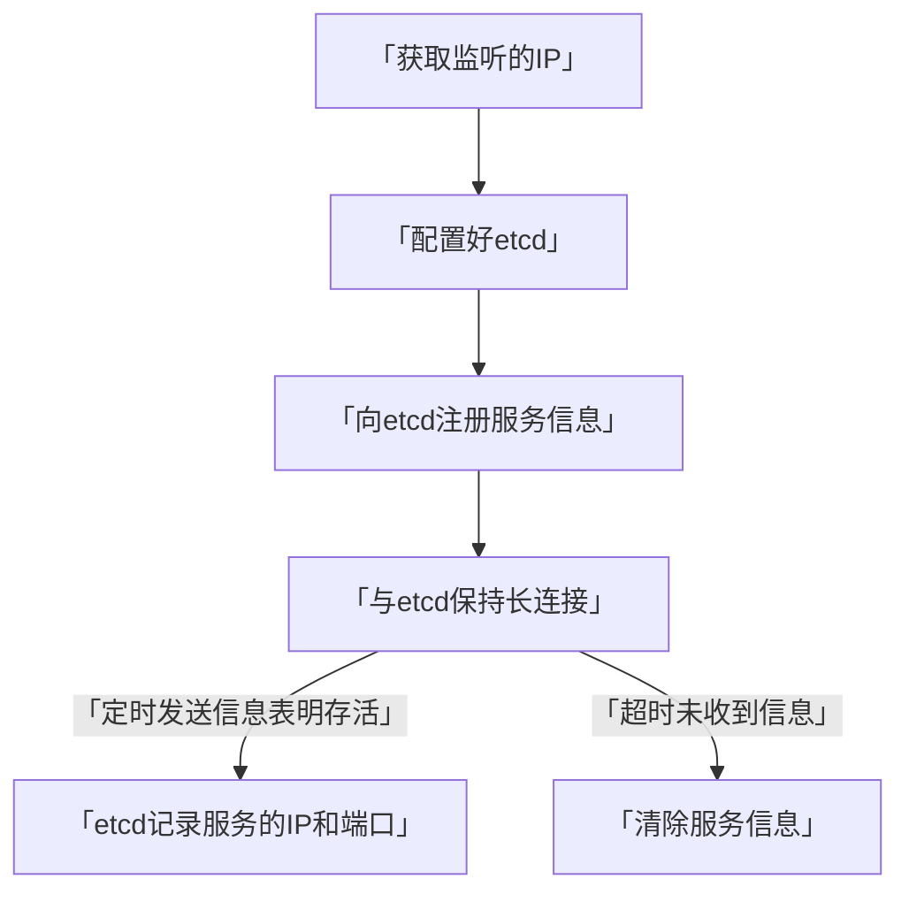

# 6-14-go-zero中微服务治理中心的具体实现原理

上一讲了解了微服务中服务注册的核心思想，本讲探究 go-zero 服务注册的实现原理。内容主要有两个话题：理解 go-zero 的服务注册；gRPC 服务发现的原理。

先看 go-zero 的服务注册具体怎么做。它包含四个过程：获取监听的 IP、配置好 etcd、向 etcd 注册、保持长连接。具体看代码，进入 server.go：这一行代码判断当前是否使用了 etcd，如果存在 etcd，就认为当前服务使用 etcd 作为服务发现机制。创建对象有两种方式：基于 etcd 的，和不基于 etcd 的。

看这个对象，它提供了 RegisterEtcd 方法，负责向 etcd 注册。方法第一行做的事是获取监听的地址：把监听地址切分，判断第一个字段是否为 0.0.0.0，不是就直接返回；是则表示监听所有地址，但 0.0.0.0 显然不能作为注册地址，所以要往下走：获取一个环境变量，如果设置了 IP 就用环境变量的值，没有设置就获取系统 IP 并返回。所以第一行的作用就是确定注册用的 IP。拿到监听 IP 之后就是注册，再保持长连接。整体并不复杂。

go-zero 服务注册的整体过程如下：

示意图中，server 向 etcd 注册服务信息，etcd 记录服务的 IP 和端口；客户端从 etcd 获取这些信息来访问服务、完成业务请求。结构上并不复杂。

其中有一个问题：假设服务宕机，客户端仍能从 etcd 拿到服务的 IP 和端口，仍会发起连接然后失败。如果这条信息不删除，客户端会一直获取、一直请求失败，整体上是一种浪费。所以服务停止后，这条信息理应被清除。go-zero 的做法是与 etcd 采用租约机制：保持长连接，定时向 etcd 发送信息表明自己存活。etcd 收到信息就认为服务存在，继续记录；超过一定时间没收到，就认为这条信息没必要存在，将其清除，客户端拿不到信息，也就无法再与服务端建立联系。这就是 go-zero 服务注册的具体实现，长连接的过程在配套文章里有更细的描述。

接下来看第二个话题：gRPC 的服务发现原理。在此之前先回顾 go-zero 的设计：go-zero 基于 gRPC 对外提供的扩展方式设计，服务发现就包含其中，本身依托于 gRPC 的服务发现机制完成。因此需要分析 gRPC 服务发现机制的原理，主要从两个话题展开：一是站在开发者角度，框架应该如何设计服务发现机制；二是 go-zero 在服务发现这块的具体流程，Resolver 的构建处理，请求调度如何完成。

这里先回答一个问题：为什么先谈「框架应如何设计」，而不是直接看源码？因为 gRPC 服务发现注册的源码颇为复杂、百步九折，直接分析调度链，讲着累、听着困，效果不一定好。换成从设计的角度思考，思路就能豁然开朗，理解 gRPC 为什么这么做。这也是读源码的关键：看源码不只是看调度链（调度链已备好示意图，图上很复杂），而是学它的设计思想，这一类问题它是如何解决的。代码只是这套思想的实现，遇到类似问题可以借鉴甚至复用。

回到正题：框架如何设计服务发现机制，有三个子问题。第一，注册中心的多样性如何适配，注册中心不只 etcd，还有 Consul、ZooKeeper，用 Redis、配置文件、数据库也都可以实现，多样性非常大。第二，如何维护服务列表并更新到最新。第三，请求调度如何获取连接。第三点不复杂，重点是前两个。

看结构图，关键位置都已标出，整体思想是：初始化服务，加载服务发现机制，维护服务列表，服务调度根据服务列表获取连接完成请求。整个调度中最复杂的就是「适配」：实现机制多样，每种方式处理大不相同，怎么适配是框架要解决的问题，可以用工厂、策略这些设计模式来解决。服务列表的维护采用定时加订阅的机制，值得稍微了解一下：以后自己业务中需要维护更新某段代码时，可以参考这种写法。

了解了要做的事情，现在进入 gRPC 源码。找到 gRPC 的源码包，根目录下有 resolver 包。顺便再谈源码阅读：阅读时结合 GOPATH 有助于理解。前面已经知道 ClientConn，还有一个关键角色 resolver.Builder，gRPC 包下的 resolver 包负责服务发现与服务更新，它自然要被 gRPC 使用；同时它本身需要可扩展，否则无法做自定义设计、无法支持更多方式。

为此 resolver 提供了 Builder 接口让我们自己实现，它要求实现一个 Build 方法，方法中会传入 target 和 ClientConn。接口里还有一个 UpdateState 方法，看源码就能找到。

这样设计的目的何在？回到前面的话题：gRPC 如何支持多样化的发现方式，关键就在这里。Build 做的事就是完成服务发现、服务更新。为什么能确定？看它的实现对象，gRPC 的实现对象即可。

再往下有个 Build，从名字可以看出它拿到的是地址，即服务器的地址。验证方式很简单：在里面加一个 Print 打印出来即可，可自行测试（已验证过）。

可以看到，这一套方法就是得到一个服务连接，然后把地址通过 ccResolverWrapper 提供的 UpdateState 方法完成更新。UpdateState 具体调用的是 ccResolver，ccResolver 又调用其属性对象的方法。

再看 ccResolverWrapper 的调度：它的 UpdateState 里有一段 updateResolverState 的代码，更新解析对象的状态，调用的是 cc，cc 实际就是客户端。

到此会发现一个新结果：ClientConn 内部引用 ccResolverWrapper，而 ccResolverWrapper 实现了 UpdateState 这个接口。三者关系是：ClientConn 持有 UpdateState 的接口，ccResolverWrapper 实现了这个接口。因此修改时实际调用的就是 ClientConn 中的方法，完成更新。

从这里可以品出 gRPC 这段设计用的思想：装饰模式。它不关心你的服务发现机制返回什么信息，把你自己丢给它，你处理完调用 UpdateState 设置好即可，它会把你处理的服务信息记录并更新。这里用的是装饰模式，而对多种服务发现机制的实现与支持，用的是策略模式。

由此基本看清 gRPC 如何支持多样化的服务发现机制：把自己作为属性交给它，由它调用自己的方法来设置，这就是装饰模式的设计思想。

另一个话题：这个过程中 gRPC 的 ClientConn 被调用，又去调用别人，包与包之间的嵌套调度如何解决？答案是 ClientConn 接口：由 ccResolverWrapper 实现 ClientConn 接口，作为参数传进去，最终实现调度。

最后，可以结合这份代码的整体流程实践：上面一段用于注册服务发现机制，中间一段用于找到并加载使用这个机制（resolver 多次实现了 resolver.Builder 接口，go-zero 就实现了这个机制），下面一段是服务更新，左边一段是调度。

gRPC 的服务发现，调度过程并不复杂：顺着流程最终会到 picker wrapper，它会涉及负载均衡机制，这是下一讲的内容。

本节核心：一是理解 go-zero 如何完成服务注册；二是 gRPC 如何实现服务发现。

源码阅读的推荐方式：一，先看文档，文档已经把阅读流程整理好；二，再看源码，文档与源码配合着读；三，结合讲解了解 gRPC 的设计思想。这里之所以能拎出 gRPC 设计思想的关键，是因为确实先通读了源码再总结出来；先把总结交给你、再由你自己去阅读源码，这才是品读源码的正确路径。
