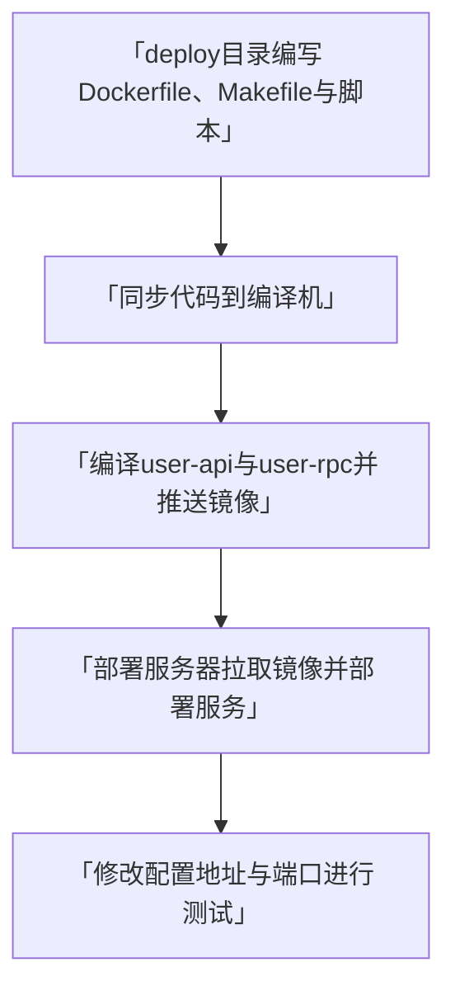

# 6-16-发布并部署用户服务与社交服务

前面已经把用户服务和社交服务构建完成，也了解了 go-zero 在服务发现与负载均衡上的实现原理，本章把用户服务和社交服务最终部署到系统中。内容主要有三个话题：先部署用户服务（包括 API 和 RPC），再配置好容器与主要的 RPC，最后调整服务的部署。

服务部署的过程大致相同。项目里定义了 deploy 目录，存放部署所依赖的 Dockerfile、Makefile 以及脚本，RPC 服务的文件已经提前编辑好了。复制一份 Dockerfile 改名为 user-api，用于部署 API 服务；再复制脚本并创建 API 的 Makefile，改一下服务类型即可；脚本同样复制粘贴后修改所依赖的仓库地址，配置好用户服务的端口，用户 API 服务的配置就基本完成。

之后在 Makefile 中进行引用：把各项文件复制一份、类型改为 API、增加对应命令让它可执行；部署脚本中同样增加 API 的脚本命令。将代码同步到编译机。

进到编译机，刚刚推送的项目已经在里面，接下来是编译。目前 user-api 和 user-rpc 都已编译并推送到镜像仓库。回到部署服务器，把镜像拉取下来进行部署。注意此时服务器上已经部署了 Redis、MySQL 以及 etcd，配置中也已连接它们，所以重点是部署服务本身。把部署信息同步到脚本，再把代码（主要是部署脚本）同步到部署服务器，进服务器执行部署。构建完成后查看服务情况，用户 API 和用户 RPC 都已能部署运行。

接下来测试：修改配置信息为当前部署环境的地址和端口，点击登录验证，没有问题。至此用户服务的部署完成。

用户服务的部署流程如下：

但目前的部署方式还有一个问题。比如对用户 API 服务做点改动：在代码里增加一个打印操作，期望在本地开发，通过 etcd 调用到服务器上的 user RPC，毕竟它已经在服务器上运行，不必在本地再起服务。尝试在命令行启动本地 user API，结果抛出连接失败的错误，再启动一次还是一样。

问题出在哪？假设服务器内部部署着 user RPC，本地的 user API 需要访问它。当前对 user RPC 的配置是监听 0.0.0.0 并对外绑定了一个端口，按理 user API 根据这个端口就能找到并访问服务。但实际上不能：user API 是从 etcd 中获取用户 RPC 服务的信息，而 etcd 里注册的是容器的 IP。为什么注册的是容器 IP？前面分析过的源码给出了答案：创建时会切分监听的地址，然后获取系统的环境变量配置并输出；如果没有配置 IP，就使用系统 IP，在容器里也就是容器 IP。所以 user API 拿到容器 IP 去访问，自然失败。

解决办法源码里已经指明：配置那个环境变量参数。进到部署脚本，增加一项配置，通过脚本参数把它设置到环境变量中，key 就是源码里输出的那个。同步到服务器后重新运行程序，输出的注册信息就是期望的 RPC 地址了。再启动本地的 user API 服务，正常；请求也通，把地址改为本地地址访问 user-api，没有问题。

剩下两个服务是社交服务的 API 和 RPC，部署方式相同：复制上面这些文件，修改里面的关键属性即可。社交服务的相关脚本已提前编写好（过程比较繁琐，直接复用了用户服务的那套），编译过程与 user 部分相似，只需替换关键配置参数。同步到测试环境和部署环境，执行脚本编译，编译完成后部署服务已经启动。测试：登录后获取好友列表，把地址改一下，请求好友列表的 API，没有问题。至此用户服务、社交服务都部署到了测试环境下。

本章就到这里。这一章主要是部署服务，实际操作中会有些繁琐，细节不少：配置里的端口、IP、连接这类属性一定要核对好；脚本编写要选对脚本。整体不复杂，但需要细心。如果出了错不知道怎么排查，可以把整个项目完整放到服务器上，重新执行一遍。
