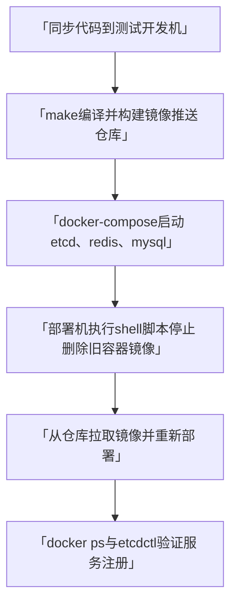

# 6-2-构建用户服务并编写服务部署脚本及dockerfile（下）

机器准备了两台，一个是 10，一个是 24。10 作为测试开发的环境，而 24 则作为整个项目会用到的部署环境，可以理解为一台测试机、一台开发机。

接下来把代码同步到 10 上面去。同步完成后，执行 make 来完成最后的编译。它的执行过程，是通过根目录的 Makefile，加载到内部的 user-rpc.mk，通过它来直接编译好整个项目程序，然后再构建好镜像，给镜像打个标签，再推送到仓库中。

不过，实际操作过程还漏了一个操作，就是对监听地址做修改，因为当前监听还是在本地。需要把它改成 10000。不修改监听和 etcd 的配置，服务是不好使的。

在执行过程中会发现，执行命令把要做的前面几个过程都做好了，这就是为什么要提前编写好部署脚本的原因。到此，程序已经基本能推送上去。

推送之后，距离把整个项目运行起来还差环境：etcd、redis 等一系列环境，也要跑起来。这些内容已经准备好了，即 etcd、redis、mysql 等镜像的构建。内容中包含了三个镜像，一个是 etcd，一个是 redis，还有一个是 mysql，整体没有特别复杂的地方。值得注意的是，它定义了一个目录，这一套过程中所涉及到的数据，都存到了这一个目录中。部署时要在对应的目录下进行。

```yaml
        version: '3'
        services:
          etcd: <6 keys>
          redis: <8 keys>
          mysql: <7 keys>
        networks:
          easy-chat:
            driver: bridge
        ```

梳理一下目前完成的事情：在 10 这台开发机器上面完成了用户服务的开发，然后通过 make，将开发后的程序编译成一个镜像容器，推送到了仓库中。接下来需要在 24 中去部署，部署就先把 docker-compose 中会用到的 etcd、redis、mysql 加载到系统环境中。

看到这个文件可能会有疑问：怎么没有看到 user RPC 的服务？不应该通过 docker-compose 去完成这个事情吗？整个 docker-compose 中只定义了 etcd、redis、mysql，没有定义 user RPC，原因和 docker-compose 的运行机制有关：如果本地不存在镜像，它会从仓库中拉取；如果本地存在镜像，它就会使用本地镜像来构建容器。这个特点恰恰和程序开发有关系。在程序的实际开发过程中，仓库是一个版本，本地开发是另一个版本。因为项目在开发过程中的测试阶段，会有大量的推送动作：修改一个 bug，验证完之后没有问题，提交一下，再进行测试，这就意味着会把本地的版本编译成容器，推送到仓库中。但测试的时候，肯定不是直接测试仓库，而是要根据在测试环境下面部署的程序进行测试，所以在测试环境下面，它会从仓库中拉取并部署起来，运行起来之后，测试就根据这台机器中所提供的服务信息来进行。

这个机制与 docker-compose 的行为有冲突吗？刚刚提到，docker-compose 会依据本地镜像进行构建，而当前的期望是让它重新拉取镜像，所以 docker-compose 没办法满足这个小需求。解决方式是在里面编写一个脚本，通过这个脚本去停止本地正在运行的服务，然后删除它所依赖的容器镜像，再从仓库中拉起来，重新部署。这就是部署上可以应用的一种方式。

docker-compose 准备好之后，就可以开始部署和发布过程了。把整个程序推送到部署环境下面去，推送之后，在部署环境拿到这个信息。还需要注意，在当前的这台机器下，要配置好 docker 的用户名和密码，因为要从私有仓库里面下载，这个信息肯定要配置好，不然就会出问题。配置完成后，进到程序中，执行 docker-compose up。结果这里抛出了一个网络错误，那是因为前面改用了 easy-chat，需要把这些信息统一地更改一下，把 easy-mouse 的改为 easy-chat。

另外还有一个细节需要注意：当前这里的 etcd，需要更改一下这里的值，因为这个值会在后期被 go-zero 用来与 etcd 保持一个长连接。如果里面没有指定好对外访问的地址，就会抛出错误。这里改为 etcd 的地址，这个地址就是 etcd 所绑定的地址。这样，go-zero 会去这个地址与 etcd 保持长连接，否则会出错，这里一定要注意。

准备完成之后，重新启动，构建所需要的容器。目前 etcd、redis、mysql 就构建好了，但从整体上会发现 etcd 好像不在。查看 etcd 的日志，它抛出的错误是：当前这个目录执行权限不足。很明显，这里是有问题的，需要给这个目录一个执行权限，因为它没有写的权限，所以出现了这个错误。之后再执行 docker-compose，此时 etcd 就可以正常运行了。目前三个服务就准备好了。

接下来要做的事情就是把 user RPC 从仓库中拉取下来并部署。但在拉取之前，值得注意的是，etcd 的端口地址实际上是 3379。因此要注意修改用户服务中 etcd 的一个配置项，这一点提前修改了。

```yaml
        Name: user.rpc
        ListenOn: 0.0.0.0:10000
        EtcD:
          Hosts:
            - 192.168.117.24:3379
        Key: user.rpc
        ```

可能会有疑问：不是在同一个机器上吗？为什么还要用 etcd 的 RPC 方式进行访问？之所以用这个方式访问，是因为不确定 etcd 会部署在哪一台机器上面，它可能在跨机器上面部署。所以像这些服务，尽可能使用统一的地址，或者说域名地址。

提交完之后再上传，然后重新执行这个 make 命令，让它在部署过程中能够正常使用。前面讲到了 shell 脚本，我们会通过这个 shell 把测试环境下的容器进行停止、删除，然后再从仓库中拉取，所以还需要去编写 shell 的内容。

接下来是 shell 的编写，user-rpc-test.sh 是要编写的 shell 文件。shell 命令已提前写好，将它复制过来。内容并不复杂，主要有五件事：前面主要是针对会用到的容器镜像，这里需要修改一下这个位置，把 easy-mouse 改为 easy-chat，此处也要修改为 dev，镜像仓库地址是没问题的。下面是容器名：先停止该容器名所对应的容器，然后再删除容器，再删除对应的镜像，重新拉取并部署。一些端口要更改，目前使用的是 10000 的端口。如果想要自己去指定配置的方式，这几点也可以指定配置。

写完之后，还需要一个总的 shell 脚本。因为这个 shell 脚本只能用于 RPC 测试的一个部署，但实际上除了 user RPC 以外，还有 user API、社交 API、社交 RPC，这些也需要去启动。因此再定一个总的脚本，让它针对所有要启动的服务去执行这一个 shell 脚本，这就是它的目的。这一个数组用来记录需要启动的服务脚本，目前是使用数组记录起来。通过 for 运行，执行每一个脚本，在执行的过程中，对每一个脚本先进行赋权处理，处理完之后再执行，就可以加载每一个脚本的执行。后续还可以做一件事：docker ps 将所有的容器打印出来，打印的是正在运行的容器，这样有助于验证这些脚本是否执行成功。然后再执行 etcdctl，通过 etcd 查找它所有的 key，看各个 RPC 有没有把服务注册到 etcd 中。这里会包含 RPC 启动脚本，后期也会包含 API 启动脚本。

```bash
        need_start_server_shell=(
          user-rpc-test.sh
        )
        for i in ${need_start_server_shell[@]}; do
          chmod +x $i
          ./$i
        done
        ```

在 Makefile 中，来启动这些脚本。增加一个 start-server 的目标，让它先 cd 到脚本目录，进到脚本目录之后，给这个总的脚本增加一个执行权限，然后再执行它，就可以完成所有服务的启动。

然后把它们放到 24 的机器上面，执行 Makefile start-server。执行时抛出了一个错误：未找到执行命令。问题就在这个地方，还需要加一个 ./，代表是当前目录下执行的。接下来就可以执行了。执行中，它会先去删除容器和删除镜像，然后去拉取新的镜像，拉下来部署，一次成功。

如何验证？需要定一个目录，这个目录就是 easy-chat，用于记录 easy-chat 项目会用到的测试的 API 接口，以及 gRPC 的测试。再定一个 user，用于记录 user 服务中的所有测试事项。先测试的是 gRPC：easy-chat、user-rpc、user.proto，导入进来之后这里会有一个 ping 接口。ping 接口其实是打印信息的，地址就是服务的地址，端口是 10000。看到有 output 的输出，就可以验证出当前服务构建成功了。

整体部署路线如下：



从整体路线上来说，本节课实际做的事情还是比较多的：先构建整个项目的基础结构，然后完成 RPC 服务的基础构建，目前是不包含任何的业务内容。在构建完之后，编写好 RPC 服务中所需要的那些脚本，包括 Dockerfile、Makefile，以及 shell 脚本。在操作过程中，一定要注意细节，根据文档的过程去执行。
