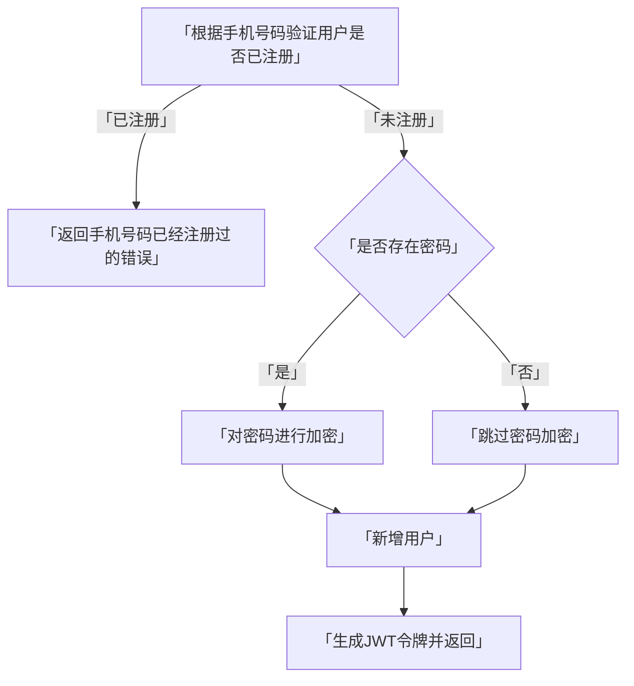

# 6-3-完成用户服务注册,登入功能（上）

上一集已经构建好了 user-rpc 服务，这一集来完成 user-rpc 服务中的注册与登录功能，内容主要有三个方面：构建用户表与用户模型，准备密码加密与 JWT 令牌生成的工具方法，最后完成注册业务。

## 用户表与用户模型

关于用户表，课程开始前已经提供了一份 SQL 脚本，把它复制到单元目录中创建的 user.sql 文件里。放好之后，再把这个 SQL 文件复制一份放到 mysql 中，创建好对应的表，用户表就创建好了。

有一个值得注意的地方是关于数据库的连接。查看 docker-compose，里面定义了 mysql 和 redis，在数据库连接上的配置中，这里定义了数据库的密码，这里定义了 redis 的密码，还写了一段注释说明端口。接下来就是根据 user.sql 去构建好用户的模型。

用户的模型会构建在与 API 和 RPC 同级的 model 目录下面。之所以这么选择，是因为当前的用户模型可能会在其他的地方使用到它的数据结构，为了方便，放在同级更加合适。

关于命令，文章中已经写好，直接复制过来执行：根据指定的 user.sql 文件来生成模型。执行之后，模型就生成完毕了，生成的用户模型和对应的模型接口都可以查看。

## 注册登录的业务流程

模型生成完之后，接下来完成注册和登录的功能。先看注册的业务，它主要有四个点。

第一，验证用户是否已经注册过，根据手机号码来验证，当然也有的会根据用户名。验证完之后，确定用户不存在，再判断是否存在密码，如果存在密码，就对密码进行加密。之所以有这一项判断，是因为目前的业务过程中，并不是所有场景用户注册都一定会输入密码，很多时候只是一个手机号码加验证码的方式就注册了。然后再去新增用户，再生成 token。生成 token 也并非必选项，而是要根据业务来，这里直接一起生成 token。

注册业务的整体流程如下：



## 用户模型改造

在开始注册之前，首先对用户模型进行修改，在用户模型中增加一个基于手机号码查询的方法，找到 FindOne。

将这一份方法复制一份，因为它的查询过程与根据 ID 的方式是一致的，唯一的区别就是传递的参数和查询的字段。所以把这里修改一下就可以了，把 ID 修改为手机号码，它就能根据手机号码来进行查询。再把这个方法在结果中绑定一次，模型的工作就完成了。

再来看业务。在业务中，需要对密码进行加密，肯定要有对密码进行处理的方法，还有生成 token 的方法。另外还有用户 ID 的生成，可以直接用自增 ID，也可以继续定义一个 UUID，这次用一个第三方库来解决这个问题。

## 密码加密

首先定义对密码的处理，在 pkg 中定义一个 encrypt 目录，用来记录加密和解密的一些算法。用哈希来作为整个程序加密处理的算法，代码在文档中已经准备好，并不复杂。这里会用一个第三方包提供的加密处理库，一段是进行哈希加密的，一段是进行哈希验证的。

        ```go
        func MD5(str []byte) string {
            h := md5.New()
            h.Write(str)
            return hex.EncodeToString(h.Sum(nil))
        }
        ```

        ```go
        func GenPasswordHash(password []byte) ([]byte, error) {
            // 实现哈希逻辑
        }
        ```

加密的方法就这样做好了。

## JWT 令牌生成

接下来准备 JWT 这一块的处理。JWT 在 RPC 服务里，主要是以生成为主，但是它的验证还是要基于在 API 中，API 中会有对应的中间件去进行验证，这一项在 go-zero 中已经完成了。因此只需要关注它的生成。

在生成之后，JWT 中往往会存储它的一个属性值，而在获取值的时候，JWT 的一个信息会放到 Context 中。

        ```go
        func (l *RegisterLogic) Register(ctx context.Context, req *pb.RegisterReq) (resp *pb.RegisterResp, err error) {
            // 判断手机号是否已存在
            if len(req.Password) > 0 {
                genPassword, err := encrypt.GenPasswordHash([]byte(req.Password))
                if err != nil {
                    return nil, err
                }
                userEntity.Password = sql.NullString{
                    String: string(genPassword),
                    Valid: true,
                }
            }
            // 生成 JWT 令牌
            token, err := GetJwtToken(secretKey, time.Now().Unix(), 3600, userEntity.Id)
            if err != nil {
                return nil, err
            }
            // 返回注册成功的响应
            resp = &pb.RegisterResp{
                Token: token,
            }
            return resp, nil
        }
        ```

所以这里直接一点，再定义一个 ContextData，然后在里面再定义一个 Token，用于生成 JWT。再定义一个 Data，用于获取 JWT 中的信息，Data 暂时不写，后面再写，先把 Token 这个类完善一下。

在 Token 中，首先定义一个常量，这个常量就是存放自己要额外在 JWT 中存放的数值，以 amok 作为它的 key。再给一个方法，这个方法就是生成 JWT 的 Token。在方法中，它会有几个参数：参数一就是密钥，这个密钥往往都是自己在服务当中所定义好的；Token 过期的细节，用一个 int64；之后就是 ID，ID 就是要存在 JWT 中的数据。它会有两个参数，一个是 string，还有一个是 error。

现在要创建好 JWT 的一个存储数据的对象，通过 jwt 来创建。这里有两个包，用第一个包就可以了，它是一个 Map 对象，通过一个 Map 来存储 JWT 里的一些信息。存储的信息主要包含过期时间，根据当前时间加上设置要过期的时间，就等于实际具体过期的时间；然后是生成时间，再是要存在 JWT 中的数据，存入 UID。

定义完之后，生成 JWT，通过这个方式给它创建好。这里设置的是它的一个加密的算法，用 HS256 的加密方式。设置好数值，最后在运行时生成了一个结果，它会根据 secret 去进行生成 token。这一个方法就写完了。

写完之后，再来生成一个 UID 的方法。uuid 是一个组件，它在使用的时候，会要求有两种类型，一种是 google/uuid，另一种是 uuid，它可以很快地生成不重复的 ID，同时 ID 具有一定的可靠性，所以会用这个组件。下面的这一段就是具体的内容，内容直接复制过来了。在里面，提供了初始化，来创建这个 uuid 的对象，它能获取一个 ID，一个不重复的 ID。三个方法就准备好了。

## 配置定义

准备好工具之后，接下来就是完成它的业务。为了完成业务，需要把它的配置定义好，配置中就需要定义 mysql、jwt 以及 redis 的配置信息。

首先定义 mysql 的配置，定义 mysql 的连接：用户名、密码，密码之前提过，在 docker-compose 中定义的；然后地址，这个地址是 docker 所在服务器的地址；然后端口，再是数据库，之后在后面会跟上一些编码等其他信息，就不往下写了。一个连接就定义到这里。

再定义好缓存的配置，缓存默认使用的是 redis，因此配置其实就是定义 redis 配置：服务器的地址。服务器地址定义完之后，定义好类型，当前并不是集群，所以是单节点；然后密码，再定义 jwt。先定义它的密钥，密钥就用 amok 来做，以及过期的时间，过期多久可以自己计算一下，当前计算值是以一天的一个时间，然后乘以 100，相当于说 100 天后过期。三个属性的配置就定义完成了。

再定义一下结构体，结构体 mysql，然后是缓存，看一下包的加载是否正确，没问题。然后 jwt，这里要改为 int64。

        ```go
        func GetJwtToken(secretKey string, iat, seconds int64, uid string) (string, error) {
            claims := make(jwt.MapClaims)
            claims[「exp」] = iat + seconds
            claims[「iat」] = iat
            claims[「identify」] = uid
            token := jwt.NewWithClaims(jwt.SigningMethodHS256, claims)
            return token.SignedString([]byte(secretKey))
        }
        ```

配置属性就定义完成了。

## 接入 ServiceContext

然后在 ServiceContext 中，就要把这个模型加进来，以便于在业务逻辑中去使用它。引入 user 模型的，在方法中先创建好连接，把这个连接再放进去，再把模型创建出来，把数据库的缓存配置填进去，模型就准备好了。

## 注册业务

最后就是注册的业务。注册业务不复杂，第一步，验证用户是否注册过。它会根据手机号码验证，所以首先会得到一个用户模型，根据用户模型中的手机号码来进行查询，把手机号码的参数传进去。

它会返回一个错误，注意判断一下这个错误会不会为空，同时也要判断一下这个错误不能是 model.ErrNotFound。如果它是 model.ErrNotFound，说明这个手机号码是没有注册的，所以用户会为空。注意一下这个地方，它是否存在，就是它的 user 模型不会为空，可以理解为当前这个用户是否存在。

在上面定义一个错误，手机号码已经注册过，把它引入一下。再把这个错误返回，这是第一步。

第二步，进行数据新增，定义用户数据，去完成新增的工作，把 user 的实际对象定义好。它会根据传入的参数赋值，首先是 ID，UUID，把各个字段的数据填上去，然后是头像、名称、手机号码、密码，还有状态。然后这里的对象，使用的是 sql.NullString，它会有两个参数：一个是值，它会根据各个类型去定义对应的值类型；第二个是是否写入，如果要写进去的话，应该先把值填好，然后第二个就是是否写进去，要改个 Valid，否则它不会把这个参数填到数据库中。

数据就定义完成了，再处理一下密码。密码先要判断是否传递了密码这个参数，因此只要判断密码长度是否大于 0，如果超过了，就根据加密算法，生成一个加密的密码。调用一下加密算法，把要加密的密码传进去，做一下错误的处理。密码加密成功之后，给它设置值。它会有两个值：String 就是字符串值，把要加密的密码设置进去；第二个值是是否写，改个 Valid。密码的加密就定义完成了。

然后再新增，调用模型的新增方法，新增就准备完成了。

最后再生成 token。用户新增完成之后，就可以生成 token 了。生成 token 的过程，会获取当前的时间，获取的是以秒为单位的时间戳。再生成 token，把 token 的相关配置传进去：先传的是密钥，然后再传当前生成的时间，以及过期的时间，还有一个是用户的 ID，就完成了，把 token 返回出去。过期时间设置好之后，注册就完成了。
