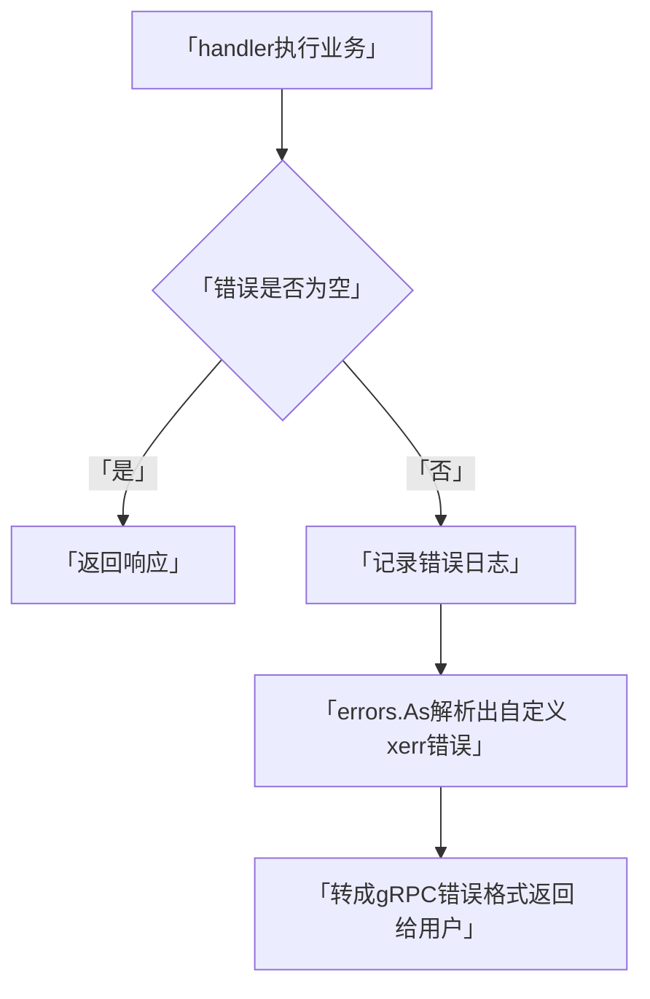

# 6-6-用户服务中搜索,用户信息功能实现（下）

## 错误处理对象

我们接下来沿用第三个方法，在这个方法中，我们提供过一个用于传递错误码及描述的工厂，来帮助我们创建一个错误的对象。这个错误的对象是由哪里创建的？调用的是 go-zero 的 errors，这个是 go-zero 的一个错误工具包，我们调用它，它会返回出错误的对象。看一下，结果不复杂，就是一个错误编码的对象。

然后为了解决，我们再创建一些可以快速创建错误对象的方法，比如数据库相关的错误，我们就不用传参了，因为错误描述已经写好了，这一创建，我们就直接把代表数据库的错误码传进来，然后再把它的错误描述也给它传进来。还有像内部的错误，也是一样的。这里后面的一些方法，根据它的功能需求来去定义。错误的处理对象就暂时定义到这个地方。

    ```go
    package xerr

    import 「github.com/zeromicro/x/errors」

    func New(code int, msg string) error {
        return errors.New(code, msg)
    }

    func NewDBErr() error {
        // 代码未完全展示，但意图是创建一个数据库相关错误
    }
    ```

## 登录业务的错误处理

要去使用它，怎么去使用？进到我们自己业务代码中。以登录为例，就是把它们所有的错误进行错误的处理，我们就去使用它。我们在错误处理的时候，使用一个 go-zero 中的包，先把它引入一下，引入新的包。这个 errors 的包，在这个包中，它丰富了对错误的一些优雅处理方式，而且这个包也是在很多的项目中我们都会去用的。

怎么去用它？通过用这个包之后，点一个 WithStack，它会包两层，一个是错误对象，一个是错误描述。这个描述是我们自己要输出的异常描述信息，可以理解为调试的描述信息，而这个错误对象，则是我们实际返回给用户的一段错误描述信息。所以这里有两个描述信息。此处的错误信息是什么？是不是也没找到？我们把上面的这个对象打开，把这里的改一下，错误码给它创建一下，生成一下错误码。这是一种错误码的创建，改为目前的方式来创建对象，就使用到了我们系统内部定义的错误处理对象了。创建完之后，再同时给它错误码。我们在这里把它使用起来，返回手机号没有注册的错误，在后面它会跟上一段对当前错误的描述。

因为目前这个错误不需要做什么描述，先把它改一下，用这个方式来记录下来。我们主要是描述它下面这个，这个才是意外性的错误。这种意外性的错误，我们就是要记录好它错误的原因。先改一下错误码，就是我们要输出的错误信息，然后再加一些描述，就是根据 FindOne 查找，然后来根据手机号码去进行查询。但是它出现了一个异常，此次的这个异常是怎么出现的？先根据这个查询条件，出现了异常，这就是错误的一个处理。把其他错误也给它更改一下，通常这里要改一下，这里是 token 的生成问题，如果 token 出现了异常。登录的错误处理完成。

    ```go
    var ErrPhoneNotRegister = xerr.New(「手机号没有注册」)
    var ErrUserPwdError = errors.New(「密码不正确」)

    type LoginLogic struct {
        ctx context.Context
        svcCtx *svc.ServiceContext
        logx.Logger
    }

    // 在业务逻辑中使用
    if err != nil {
        return nil, errors.WithStack(ErrUserPwdError)
    }
    ```

## 注册业务的错误处理

可以再把注册的也给它完成，这里也是同样道理。

    ```go
    if len(in.Password) > 0 {
        genPassword, err := encrypt.GenPasswordHash([]byte(in.Password))
        if err != nil {
            return nil, err
        }
        // ... 其他逻辑 ...
        if err != nil {
            return nil, err
        }
    }
    ```

接下来去测试，我们现在重点就是去看一下最终的效果。现在已经登录的错误处理完成之后，其他的就先不写了，其他业务的错误处理就留在课后把它们一一地补上去。

## 日志拦截器

错误处理完之后，我们还要把它再记录到日志中，这是我们接下来要做的事情。因为现在我们已经把用户的响应返回写好了，但是日志记录也需要记录了。怎么记录起来？可以用中间件，我们在整个项目的这里定一个中间件。之所以在外层定一个中间件，是因为当前的错误处理方式，它应该在其他服务中会使用到，所以说它应该是属于公共的。因此，我们定一个拦截器，这个拦截器放在外层 pkg 下面，作为整个项目都可以去使用的。然后它是属于 RPC 服务的拦截器，拦截器类型有两种，一种是 API 的，还有一种是 RPC 的，所以我们这里拦截器定义是 RPC。然后定义的是日志记录的拦截器，我们把这个拦截器定义好，拦截器的方法比较长，我们可以从这里引用去写就可以了。根据之前的分析，在 Server 中，它存在 Unary 拦截器的方法，就是这一个，把它点一下。然后看一下这个方法的要求，把这个都复制过去，不一定要到 grpc，我们只需要知道它是怎么来的就可以了。然后再引入对应的包，这里使用的是 gRPC 的。

    ```go
    func LogInterceptor(ctx context.Context, req any, info *grpc.UnaryServerInfo, handler grpc.UnaryHandler) (resp any, err error) {
        // 在这里处理错误
        if err != nil {
            return nil, errors.WithStack(ErrUserPwdError)
        }
        // ... 其他逻辑 ...
    }
    ```

这里也是 gRPC 的拦截器，就定义好了。要完成它的内容，它里面怎么写？首先先去完成业务，你要完成业务，才能处理错误。因此，先去完成 handler 的业务，而这个 handler 就是具体的执行业务的函数，把 ctx 和 req 分别给它传进去，再判断一下。如果说它的一个错误是为空的，说明是没有错误，就把响应返回出去，结束当前的运行。重点是后面做错误的处理，因为目前已知道，它其实肯定会有错误。所以就把它整个错误记录起来，做一个描述，这个描述就是 resp, err，在这里就可以记录到整个错误。但这样记录肯定还不够，我们还要考虑一下，根据不同的类型来处理。

## 错误类型转换

因为当前的错误类型，有我们自定义的错误类型，也就是在登录中，这里是我们自定义的错误类型。但是实际上 gRPC 要把它返回的话，是有自己的错误格式的。因此我们还需要将这一个错误的类型，转化成 gRPC 所需要的格式给它返回出去，并且替代这里面返回的这段描述，用我们自己要给用户返回的这种错误描述。

怎么做？因为这里我们使用的是 pkg 下面的 xerr，通过 errors.As 进行错误的解析。它会解释出我们传递的原本的错误因素，也就是最开始产生错误的原因。我们要把这个对象解释出来，通过 errors.As 这个方法来进行解析。然后我们会得到一个最开始产生错误的这个 xerr 的对象，它本身还是一个 xerr 的接口，所以还要做一次断言。这个断言，我们使用 go-zero 的 xerr，它应该是使用的这个对象，我们把它的地址复制一下，把它断言成 xerr。这个错误的对象用指针，如果说是，说明它是属于我们自定义的错误。因此，我们把这个错误信息给它设置到 status，通过这个 status.New 的方式，它会传进两个参数，一个是状态码，一个是错误描述。状态码的话，要通过 codes 来设置。错误的描述，这样就可以设置好了。现在我们需要把它在 rpc 服务中进行引用，引用完之后，再启动，加载包，没问题。

日志拦截器的错误处理流程如下：



## 测试验证

然后启动一下，启动完成，查询出现了失败，我抛出了一个数据库错误，它应该是跑到这里才对。但是目前来说，我们其实已经实现好了这一个错误处理。看，这一次的错误就会抛出手机号没有注册了，说明错误处理已经见效了，这是返回给用户的。然后我们在日志中，也确实有记录错误的因素，说明这次没问题了。

我们就到这里了。在课程中，用户服务主要实现根据用户名查询，以及用户手机号码查询，然后再做一下错误的处理和日志的记录。
