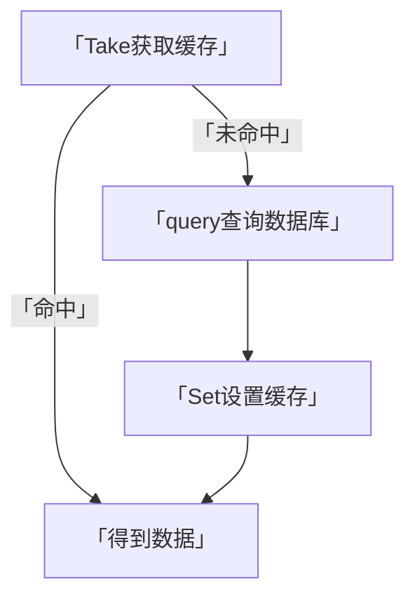

# 6-8-go-zero在数据层使用的缓存机制实现分析

我们分析了数据库与缓存一致性的话题，接下来看一下 go-zero 内部缓存机制是如何工作的。课程内容我们主要来看三个方面：缓存调用、读处理、写处理。

## 缓存调用

先看缓存的调用。我们回到模型中，在模型的上边，它定义了一些属性，这些属性中，就包含了一个 cache key 的前缀。而在其下，在一个创建模型的方法中，它传递了两个参数：第一个参数是数据库的连接，第二个参数是缓存的配置。在传进来之后，在这里就会创建一个 cache 的对象，它在创建的时候，就会根据数据库的连接及缓存配置进行创建。

而值得注意的是，我们从这里其实可以看到，整体当前的这个对象，就是缓存机制，它就是帮助我们去进行数据和缓存的直接的处理。它提供了很多的方法，这些方法也是我们会去调用到的。

我们以 FindOne 来看。

    ```go
    type Users struct {
        Id       string    `db:"id"`
        Avatar   string    `db:"avatar"`
        Nickname string    `db:"nickname"`
        Phone    string    `db:"phone"`
        Password sql.NullString
        Status   sql.NullInt64
        Sex      sql.NullInt64
        CreatedAt sql.NullTime
        UpdatedAt sql.NullTime
    }
    ```

在这一号，我们会得到缓存的 key。然后再通过调用到缓存机制的方法，这个方法它的主要作用是查询数据，它会把接收的对象，即缓存的 key，以及数据库的查询操作，要求给它传进去。传进去后，就可以去完成查询的工作。这是从这里，我们大概可以推测一下，它如果说没有在缓存的命中，它会从数据库中获取，这是一个非常简单的流程。

而在其他的操作层面，删除，它也是对缓存进行的操作，它会要求传递对于数据库具体执行的方法，然后也会要求传递一个 key，以便去删除某一项缓存。好了，这就是在上层代码的调用，调用的规格，还是调用这里面的方法。

但是我们在数据库操作的时候，仍然还会使用连接对象的操作，使用的是数据库连接对象的操作方法，来完成对数据库的操作的。

## 读处理

来看一看在读这一块的处理。以 FindOne 为例，调用这个 Take 方法，它会去获取数据。这个方法中的参数，它们分别具有的作用，context 以及数据的结果对象。

    ```go
    func (m *defaultUsersModel) FindOne(ctx context.Context, id string) (*Users, error) {
        usersIdKey := fmt.Sprintf(「%s%d」, cacheUsersIdPrefix, id)
        var resp Users
        err := m.QueryRowCtx(ctx, &resp, func(ctx context.Context, conn sqlx.SqlConn, v interface{}) error {
            query := fmt.Sprintf(「select %s from %s where id = ? limit 1」, cacheUsersRows, m.table)
            return conn.QueryRowCtx(ctx, v, query, id)
        }, usersIdKey)
        return &resp, err
    }
    ```

    ```go
    func (c cacheNode) Take(ctx context.Context, val any, key string, query func(any) error) error {
        return c.doTake(ctx, val, key, query)
    }

    func (c cacheNode) TakeWithExpire(ctx context.Context, val any, key string, query func(any) error, expire time.Duration) error {
        return c.TakeWithExpireCtx(ctx, val, key, query, expire)
    }
    ```

    ```go
    func (c cacheNode) Set(key string, val any) error {
        return c.SetCtx(context.Background(), key, val)
    }

    func (c cacheNode) SetWithExpire(key string, val any, expire time.Duration) error {
        return c.SetWithExpireCtx(context.Background(), key, val, expire)
    }
    ```

缓存的 key 具体在 model 中的查询方法，然后它被调用到一个内部缓存中的 doTake 的方法。这个方法是怎么来的？它是在前面通过 New 的时候创建的，在 New 的时候它就会去创建一个 cache 对象，这个 cache 对象会根据我们所传递的配置，会去看哪些属于集群的方式，还是单个节点的方式，它都在这里去判断，然后会创建出对应具体实际操作对象，这个就是创建一个单个节点。

得到对象之后，就可以调用它的方法。这个方法确定是怎么做的？在这个方法中，传参也还是和前面的这个缓存的处理是一样的。不过它在里面，它自己还调用了一个 Take，还有一个 SetCtx 的方法。这个 SetCtx 的方法是哪里的？是它自己的。这个 query 是获取数据的方法，而这个 SetCtx 其实通过名字可以看出来，是它自己的方法，用于数据缓存的。

我们现在来看这个 Take。在这个方法中，到这一段这里。在这一段中，它会去获取缓存，但是获取缓存失败了，它就会去进行查询，它查询调用的是这个 query，而这个 query 来的，从这里来。然后调用完之后，没有问题，就会去设置缓存，而这个设置缓存的方法是哪里来的？就在前面，这里传递的。调用了这个 Set 设置缓存的方法，通过它根据 key 和 value 去进行设置缓存。

所以，从读这一块可以看出来，它是在没有缓存的时候，此时它会去请求数据库，然后去设置缓存，下一次它就可以得到缓存。所以这就是 go-zero 它的一个缓存处理。



## 写处理

现在我们来看一下写操作。写操作使用的是先更新数据库，再加上缓存的删除。然后缓存的删除，会通过下一次在访问的时候，如果没有命中缓存，就会去设置缓存。

为此，我们可以看看它的删除，以 Delete 这个操作为例，这里会传递一个缓存的 key，用于删除缓存，它的操作就是这个 DelCtx 的方法。然后里面是具体对数据库的操作。

    ```go
    func (m *defaultUsersModel) Delete(ctx context.Context, id string) error {
        usersIdKey := fmt.Sprintf(「%s%d」, cacheUsersIdPrefix, id)
        _, err := m.ExecCtx(ctx, func(ctx context.Context, conn sqlx.SqlConn) (result sql.Result, err error) {
            query := fmt.Sprintf(「delete from %s where id = ?」, m.table)
            return conn.ExecCtx(ctx, query, id)
        }, usersIdKey)
        return err
    }
    ```

我们点击可以看一看，通过这里，确确实实已经能够看出来，它做的事情了。它做的事情先是执行数据库的操作，在数据库操作正确的情况下，就会执行删除缓存。它这里已经看出来它要做的事情了，很明了，就没有像读操作那么的复杂。就是你先操作数据库的，没问题，删除缓存。在写的操作中，也是用的这一个方式。

    ```go
    func (cc CachedConn) ExecCtx(ctx context.Context, execCtxFn func(ctx context.Context, conn sqlx.SqlConn) (sql.Result, error), keys ...string) (sql.Result, error) {
        res, err := execCtxFn(ctx, cc.db)
        if err != nil {
            return nil, err
        }
        return res, cc.DelCtx(ctx, keys...)
    }
    ```

因此，这是 go-zero 在写这一块的处理。好了，我们基本上已经了解了 go-zero 的缓存机制了，我们就到这里。
