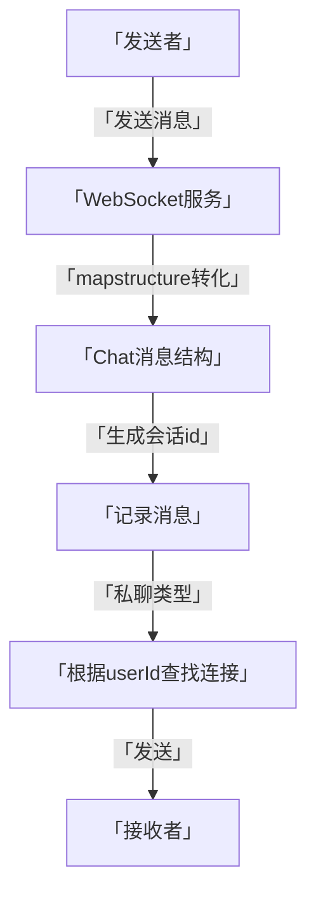

# 7-12-实现用户与好友私聊实现流程

这一篇主要有下面四个话题：先回顾私聊的实现功能，再针对私聊做数据存储和 ID 设计，然后优化服务接收私聊这一块的处理，最后实现私聊。

先看第一个话题，回顾私聊功能。在前面的文章中已经分析过，私聊实现其实并不复杂。在流程中，WebSocket 主要负责接收发送者所发送的消息，并从中获取到对应的消息 id，把消息转发给接收者；查找就是根据 userId 查找连接，并基于连接发送给接收者。过程并不复杂，但实践中主要有下面四个话题需要考虑。

第一是消息类型，消息会分为图片、文本、音频等相关的信息，每一种类型都有不同的处理。第二是消息会话，比如用户A和用户B在聊天的时候，要对他们的聊天会话进行标识。其次是发送的内容，以及对于用户的查找。目标用户的查找，就是根据客户端传递的 userId 查找对应的连接，以此将消息发送给连接即可。



回顾完之后，接下来确定数据的存储。数据存储也不复杂。这里定了一份数据，将其复制一下放到代码中：在 pkg/constants 中定一个 MType，再定一个 Chat 常量，它的作用是标识用户聊天过程中所发送的消息类型。这个字段用于定义各个消息类型，比如文本消息类型。

    ```go
    package constants

    type MType int

    const (
        Chat MType = iota + 1 // 定义消息类型常量
    )
    ```

同时，对于整个会话的 id，前面已经讲过方案：根据发送 id 和接收 id，两者通过运算最后得到一个具体的 id，以此作为会话的 id。

为此这里写了一个方案，将这个方法复制一下放到代码中。这个方法的作用是组合 id：根据第一个 id 和第二个 id 进行组合，采用排序的方式，根据两者之间的大小进行排序，以此来确定一个固定的 id。

这样，数据这一块的服务就处理完了，主要是定义好一个用于接收双方聊天消息的消息记录，其次再定义一个 id，以及这个用于组合 id 的方法。

现在进行请求消息的处理。请求消息的处理主要是接收消息，找到 WebSocket 的服务，在其中增加一个错误的类型。通信过程中可能会有一些错误，这个错误类型主要是给前端使用的，所以定义一个错误类型，再定义一个创建错误类型的方法，把错误传进来。这样类型就形成了 ERR 的错误类型，然后 Data 就通过 ERR 给它输出来。

再做一个小细节处理：作为连接，可以在其上定义一个 URL。在服务中处理连接时，就在连接中得到 URL，连接传进去了，再把当前自己的连接设置好它的 URL，这样有利于后期项目中获取。这两步只是对前面程序锦上添花，到此就完成了。

现在需要在 ws 中再定义一个消息结构体。之所以定义消息结构体，是为了接收消息聊天过程中相互之间发送的消息格式，也就是发送者向 WebSocket 推送的消息格式。由于有 data 的消息，所以要定义一个结构。消息格式定义一个 message：先定义消息体中的数据类型，再定义接收的消息内容 content，即聊天的消息。

这两个消息结构体有什么区别？前一个针对 Message 中的 Data，接收的 Chat 就是聊天的消息格式，用来接收具体的消息内容：这个消息的格式是怎样的、是什么类型、内容是什么样的。而 Chat 代表聊天，里面记录的是用户发送聊天会话、发送的目标以及发送方，所以要写上发送方。为什么要写发送方？因为 WebSocket 将消息推送出去，客户端也要知道是谁推送的，所以要有发送方，然后再跟上 Message，也就是上面那个消息体，最后是发送消息的时间。

但是又没有完全定好。此处是一个 Data，它是一个 interface，interface 通过 JSON 转化之后是 map[string]interface{} 数据结构，直接根据 Data 转化出来肯定转化不了。可以引用 mapstructure 这个组件来解决刚刚提到的问题，它可以将 map[string]interface{} 转化成需要的结构。再把各个标签贴上去：第一个是会话，然后是发送方的 id、发送方与接收方的 ID，以及 Message 和发送的时间。这样消息的结构体就基本定好了。

    ```go
    package ws

    import 「imoc.com/easy-chat/pkg/constants」

    type Msg struct {
        constants.MType `mapstructure:"type"`
        Content string   `mapstructure:"content"`
    }

    type Chat struct {
        ConversationId string `mapstructure:"conversationId"`
        SendId         string `mapstructure:"sendId"`
        RecvId         string `mapstructure:"recvId"`
        SendTime       int64  `mapstructure:"sendTime"`
        Msg            Msg    `mapstructure:"msg"`
    }
    ```

接下来写业务。在这里定一个会话。为什么在这里定会话而不在用户中？主要是因为消息本来就是在会话中完成的，而会话既有用户与用户之间的会话，也有群的会话，所以放到这里最合适。点一个 chat，在其中引入 context 和 websocket，进入路由中填一个路由，指定聊天的会话，路由就填写好了，剩下就是完成业务。

目前业务主要指私聊，后期会增加群聊，所以前面定义的消息结构体中也需要考虑这一点：先定义聊天的类型，其中有群聊的类型，还有聊天的类型，然后在此中进行引用，把标签加上。

那么这里面要做的事情，首先是定义一个 data，用于接收客户端所发送的消息信息，数据转化用前面所加载的 mapstructure 来做，把数据传进去再转化出来就没问题了。在输出的时候，为了让客户端也知道是什么错误，发送前面所定义的错误消息，然后再决定发送目标。这样就得到了由客户端所发送的消息。

    ```go
    func Chat(svc *svc.ServiceContext) websocket.HandlerFunc {
        return func(srv *websocket.Server, conn *websocket.Conn, msg *websocket.Message) {
            var data ws.Chat
            if err := mapstructure.Decode(msg.Data, &data); err != nil {
                srv.Send(websocket.NewRMessage(err, conn))
                return
            }

            switch data.ChatType {
            // 处理不同类型的聊天消息
            }
        }
    }
    ```

得到消息之后，自然要对消息进行处理，处理无非就是将消息写到数据库中。此时要回到 context 中，让它加载数据库的连接，并把模型加载好。加载的时候，其实还少做了一件事：目前只是定义了数据结构，还没有真正创建好模型。把这些新定义好的结构复制一下，放在这里创建好模型，再把数据结构放过去替换原来的结构，将原来这里删除，然后注意给一下包名，它实际上是 model，这个是构建生成的时候决定的。之后就没问题了。

再回到 ServiceContext 中引入模型。在配置中已经定义了对 mongoDB 处理的配置，连接 URL 连接数据库，此处要修改对 mongoDB 的连接配置。这里定义的配置用 ezchat，下面的地址就是 mongoDB 的连接地址、mongoDB 用户名和密码。密码方面，前面加了一个 mongoDB 的容器，文档中也有写，把这一段关于 mongoDB 容器的配置放到配置环境中。整体来说并不复杂：密码就是刚刚所看到的 mongoDB 的密码，地址是 192.168.117.24，端口是 47017。配置就定义完成了。

定义完成之后，需要在 ServiceContext 中加入创建：创建聊天模型，把刚刚定义的配置传进去，还要指定连接哪个集合，就是 chat，这样就完成了。

    ```go
    func NewServiceContext(c config.Config) *ServiceContext {
        return &ServiceContext{
            Config: c,
            ChatLogModel: immodels.MustChatModel(c.Mongo.Url, c.Mongo.Db),
        }
    }
    ```

可以对上面这个方法做一点优化。为什么做优化？因为创建的模型中要求自定义集合，但项目中应该是固定的集合，这种方式不太合理，所以定义一个固定的方式以便于后期使用。前面两个参数不变，后面的参数原本在 ServiceContext 中自己指定，把它放到模型创建这边来，ServiceContext 中直接调用即可，不用自己指定集合，这样有利于扩展和使用。

最后完善业务。在此处再定义一个 logic，用来处理业务，处理的业务主要是会话的业务。定义一个用于处理会话消息的业务结构体，在里面让它传递 Context、websocket 以及 Context，再提供一个 New 的方法，把这三个参数都传进来，然后一个一个地把它们设置起来。

在里面主要是针对群聊、单聊的处理：做一个分支，单聊的业务做单聊的事情，群聊做群聊的事情。所以定义一个专门用于处理单聊的方法，它传递的肯定是外面所计算的 Chat 以及 userId，userId 就是发送的用户。

方法里面要先判断 Chat 中是否设置好了想要聊天的会话，如果为空就生成一个聊天会话，生成方式是根据发送方的 id 以及接收方的 id 去设置。如此一来 Chat 就设置好了。得到之后，接下来要记录消息：定义一个消息格式，把消息记录进去，往下面的字段一个个把内容贴上来，发送方 userId、接收方、消息类型、消息的来源、消息内容、发送时间（以当前服务的时间为主）。消息格式定好之后，将其记录起来，最后把错误返回出去，一个消息的记录就完成了。

但具体的发送还是要回到上层处理。刚刚做的事情是消息记录，因此这里还要做一个判断，判断当前发送消息的类型。这里还要记录聊天的类型，所以再增加一个字段，用来表达当前发送消息的类型。目前只写了私聊，因此只处理私聊的业务。

接着定义刚刚逻辑中的会话处理逻辑：第一个参数是 context，第二个是 websocket 服务，第三个是 websocket 连接，调用其中的方法时把 data 和当前用户传进来。data 需要是 Chat 类型，处理完之后最终发送给目标，将消息发送给对方。

此次的消息结构体要这么定义：发送来源就是当前的用户；发送的目标是谁？这里需要根据 userId 进行发送，data 中已经指定了。还要指定发送的数据，发送数据就是上面这一条数据，重新定义一下：data 中的数据以及发送的消息改为当前的内容，就完成了发送。

基本上，除了消息结构及配置这一块之外，业务并不复杂：就是做一下消息会话及消息的记录，然后保证消息的发送。

现在将整个代码上传到部署的服务器上，让部署服务加载刚刚引入的 mongoDB 容器。目前它已经被用进来了，部署服务看一下，已经启动。数据库连接也已提前连接好，这是 mongoDB 的数据库。之后再启动服务验证一下。

进到服务中将其启动。因为前面下载了一个包，需要加载一下包中的其他依赖。启动之后，在服务中登录账号。先看有哪些账号，目前已经有 two 个账号，分别登录，登录成功。把 token 复制一份放到客户端中设置好，再去设置第二个。目前需要私聊，所以有两个用户：把第二个用户的账号复制放到用户登录中，再登录，第二个客户端也将其复制放到此处。分别让这两个客户端与 websocket 设定连接。连接建立之后，选择其中一个先发送消息。看发送消息的路由，路由完成之后是消息内容，内容就是 data，data 中要定义好具体的细节：websocket 中的字段可以不用定义，聊天的类型定义为私聊；然后是接收者，当前接收者是尾号 V2 的这个用户，把尾号 V2 的 userId 复制过来；具体的 message 定义一下消息类型和 content，content 给个 666，发送。

服务断开连接了。刚才说过应该会断开，因为还有心跳检测：现在检测超时，所以它会断开。将其先停止，这样方便后期调试，但业务中需要自己去使用。重新建立连接，这边也建立连接，建立连接之后发送消息。发送了，但接收方反而是自己，为什么会发给自己？现在这个类型是 ping 的方式，所以发送数据的时候报错了。问题在于这里为空。回到代码中，这里指定的发送人不对，应该是接收方，这里应该给 websocket 连接的 URL，这样才没问题。重启，再发个消息，重新连接，发送，再看这边能接收到什么，没问题了。再看此处，让它重新连一下，可以看到有新的数据，说明私聊功能已经实现了。

私聊功能并不复杂，主要是注意消息的格式与接收。这一篇的重点就是实现私聊的功能。
