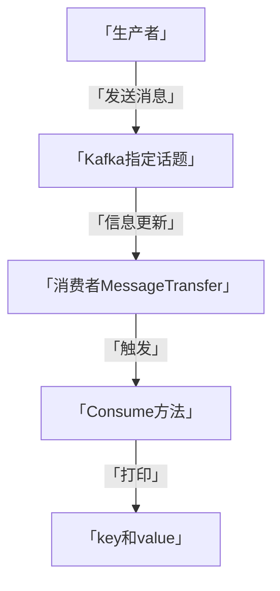

# 7-14-引入kafka消息中间件，并构建异步队列服务

前面的文章已经梳理了 IM 的收发模型，其中会用到消息队列，本节就来构建异步队列服务。

内容围绕两个话题展开：第一，消息队列方案不止 Kafka 一种，为什么选择 Kafka；第二，完成服务的构建。

先看第一个话题。业务中可选的消息队列有 Kafka、RabbitMQ 等，选择 Kafka 主要基于三点考虑：一是消息的顺序，这一点尤为重要，IM 中消息的发送顺序直接决定体验，一旦顺序出错，整个系统的体验会很差；二是消息的可靠性、持久性及吞吐量，这些因素 Kafka 都能很好地满足。这是选择 Kafka 的关键所在。

接下来构建消息队列服务。构建前需要先配置好 Kafka 的容器信息，Kafka 及 Zookeeper 已提前构建在容器中，Docker Compose 里也已经写好。其中需要注意的是，配置里填写的是当前宿主机的 IP，即对外能够访问到 Kafka 的地址。实际的消息队列部署中，如果不使用这个配置，会抛出一些错误，所以这里是需要更改的地方，其他没什么调整。容器构建好之后，就可以搭建服务了。

这里会有一个 task 作为任务服务，搭配 MQ 作为消息队列任务，再定义好它的配置。internal 整体的目录结构仍然保持 go-zero 的目录结构，保持一贯的风格，在整个系统的编写过程中会更顺手，然后定义里面的配置信息。

先定义结构。定义前需要在系统中引入 go-zero 中消息队列的扩展组件，代码中有提供一段代码供引入。然后定义好配置信息，定义一个 Config。先定义 Service，写 Config 的配置文件，即 go-zero 中的服务配置信息。

        ```go
        package config

        import 「github.com/zeromicro/go-zero/core/service」

        type Config struct {
            ListenOn string
        }
        ```

再定义消息转化的任务配置信息，这份配置使用的是 Kafka 的配置信息，需要根据它的定义去完善里面的配置描述。再定义一个配置文件，定义服务名以及监听端口 10091，然后一个个完善里面的内容，把描述复制过来并定义名称。其中 Brokers 定义的是 Kafka 的连接地址 192.168.117.24.9092，然后是分组，以及 Topic、消费者数量。至此配置定义完成，这份配置就是 Kafka 的消费者配置信息。

自然就需要定义 Kafka 的消费者。在 internal 中定义一个 Heart 作为业务的处理对象，在 Heart 中定义一个 MessageTransfer，接下来再定义一个 MessageChat 结构体。

        ```go
        package msgTransfer

        type Name struct {
        }
        ```

完善内容之前，里面会用到一些其他的配置和连接，也就是服务的上下文。所以在 internal 中还需要先定义整个系统的上下文 ServiceContext，目前先引入的就是配置文件，把配置文件传进来，返回 ServiceContext。除了 ServiceContext，再把日志加进来，提供一个构造方法将该对象创建出来，传入 ServiceContext，并把里面的属性信息创建出来。

目前只是定义了结构对象，那如何消费 Kafka 话题中的内容？这需要引入 Kafka 的消费方式。可以看一下这个组的内容，里面定义了一个 queue 作为消费者，并定义了一个接口，这个接口由消费者去实现，其作用是：所有消费者实现这个接口之后，当前的机制会去监听 Kafka 中的信息，如果发现消费者所指定的话题有信息更新，就会触发这个方法。所以需要在 MessageTransfer 中实现刚刚定义的接口，目前先做一个简单的空实现，输出信息时把 key 和 value 打印出来。至此一个消费者就定义好了。



        ```go
        type ConsumerHandler func(key, value string) error

        type ConsumerHandler interface {
            Consume(key, value string) error
        }

        type queueOptions struct {
            commitInterval time.Duration
            queueCapacity  int
            maxWait        time.Duration
            metrics        *stat.Metrics
        }
        ```

定义完之后，需要对当前的消费者去加载。值得注意的是，Kafka 的启动本身是一个服务，但这个服务是消费者。从 MQ 的角度来说，整个系统应该有很多个消费者，也有很多种类型的消费者，不止一个。考虑到这一点，在 Heart 下面建立一个 Listen 作为监听，在里面存放对各个消费者的加载，并一起启动起来。

具体编写方式：先定义一个 listen 监听的项，提供相应方法将 listen 创建出来，再提供 listen 的方法，以及一个返回多个服务对象的方法，也就是返回多个消费者。值得注意的是，返回的是 go-zero 那样的 Service 接口，使用 go-zero 的组件基本上都会用到这个接口。这个接口不复杂，只是要求服务都提供 Start 和 Stop 的方法。把 Kafka 的消费者传进去，把配置传进去，一个消费者就加载好了，而且这里可以加载多个消费者。

        ```go
        type Starter interface {
            Start() error
        }

        type Stopper interface {
            Stop() error
        }

        type ServiceGroup struct {
            services []Service
            stopOnce sync.Once
        }

        func NewServiceGroup() *ServiceGroup {
            sg := &ServiceGroup{}
            sg.stopOnce = sync.Once{}
            return sg
        }
        ```

完成之后需要编写 main。可以参考 IM 服务中的 websocket，因为里面的 server 跟 task 是一样的，同样需要加载配置文件，只是配置文件中的名称要改一下，然后这里的包名、main 函数，至少前面的这一段可以直接拷贝过来。接着调用得到一个 listen，再得到一个服务组的对象，从 listen 中把服务信息加到服务组中，由服务组统一管理所有的服务，最后打印一个描述：启动 MQ，通过服务组启动注册的所有服务。至此这个服务就写好了。

        ```go
        func main() {
            var configFile = flag.String(「f」, 「etc/dev/task.yaml」, 「the config file」)
            flag.Parse()

            var c config.Config
            if err := c.Load(configFile); err != nil {
                log.Fatal(err)
            }

            ctx := svc.NewServiceContext(c)
            listen := handler.NewListen(ctx)

            serviceGroup := service.NewServiceGroup()
            for _, s := range listen.Services() {
                serviceGroup.Add(s)
            }

            fmt.Println(「Starting...」)
            serviceGroup.Start()
        }
        ```

将其运行起来，没有报错误。测试时进到 Kafka 中，通过模拟生产者向 Kafka 发送消息，看消费者能不能接收到。有一条命令可以向 Kafka 对应的话题中发送数据，在 Kafka 中执行该命令，写入信息 hello world，可以看到消费者能收到消息，说明当前的服务监听是成功的，构建也是成功的。后面的文章将进一步完善当前的服务。
