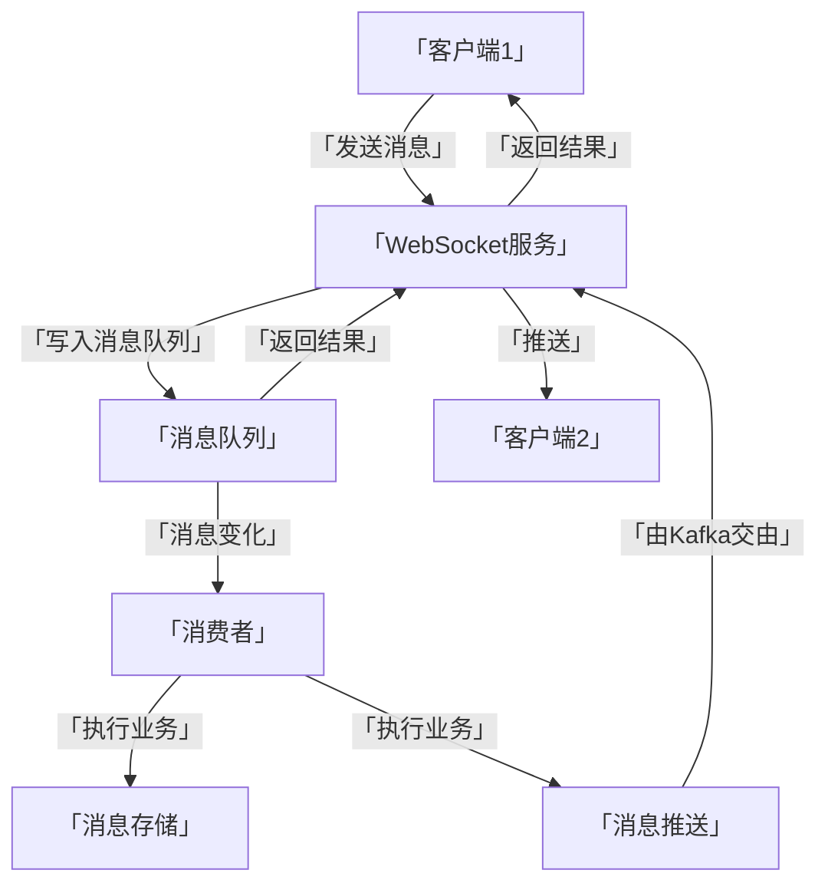

# 7-15-基于kafka异步数据存储落地及消息通信（上）

本节内容分为四个部分：先对功能进行分析，看如何实现；然后构建 WebSocket 客户端，完成 MQ 中的相关业务；再构建 WebSocket，将消息写入消息队列中，实现消息的转发。

第一个话题是实现分析。前面的内容中已经分析了消息的收发模型，如图所示，主要目的是客户端 1 向客户端 2 发送消息。发送流程中，客户端 1 首先发送消息给 WebSocket 服务，WebSocket 接收到消息之后，会将消息写入消息队列中。消息队列接收消息之后，会根据接收消息的情况返回结果，WebSocket 也会把结果返回给客户端，此时就完成了一个发送动作。

对客户端来说，这个过程的时间消耗比较短，所以客户端 1 在消息发送之后是否成功，可以很快得到结果。消息队列接收到消息之后，下面会有一个消费者监听队列中消息的变化，发现队列中有数据时，就会执行相关的业务，业务中涉及消息的存储以及消息的推送。这两个过程都完成后，消费者的任务就结束了。推送时，由 Kafka 将消息交由 WebSocket 来推送，WebSocket 会根据发送的用户推送给对应的用户，也就是客户端 2。



结合图来看：WebSocket 会自己启动一个 WebSocket Server 对象，MQ 也会启动一个 MQ Server 对象，各自代表自己的服务。需求是：WebSocket 中需要将消息写入 MQ 消息队列中；MQ 通过队列接收消息并进行处理。所以 WebSocket 中自然需要有一个 MQ 的客户端对象，来将消息发送到队列中；同理，MQ 需要将消息推送给 WebSocket，也需要一个 WebSocket 客户端来完成推送动作。

除了上面的任务以外，还可能调用其他 RPC 服务的方法来完成。本节的核心重点就是中间这一段 MQ。

接下来完善里面的内容，首先创建 WebSocket 客户端。MQ 服务中会使用 WebSocket 客户端对象完成对 WebSocket 服务的消息推送，但实际项目中，WebSocket 客户端的使用可能并不只这一个场景，还可能在其他地方被设计并使用，所以理论上这个客户端对象应该能够被公共使用。

因此可以这样定义：进到 WebSocket 中创建一个客户端，以便被其他服务使用。先定义接口，接口的作用本来就是约束，可以先定义这个客户端要做的事情：第一个是关闭连接；第二个是发送消息，定义一个发送消息的方法，参数是任意类型；还有一个接收消息的方法。这两个方法有所不同：发送消息的参数是本地调用客户端推送的消息，而接收消息是把数据传进来做反序列化写进去的，实际上有区别。

```go
type Client interface {
    Close() error
    Send(v any) error
    Read(v any) error
}
```

接口定义之后，需要实现这个接口。定义一个实现接口的客户端结构体，里面要有 WebSocket 连接对象，还有一个 host，即连接服务的地址。客户端还可能有一些 dail options 的相关配置，所以也定义 dail options。这里定义一个 dailOptions 结构体，包含 header，代表请求头，后面肯定会用到请求头的参数，可以先定义好；其次是请求 WebSocket 的 pattern。

```go
type dailOptions struct {
    pattern string
    header http.Header
}
```

定义完结构之后，围绕这个结构体再定义一个方法，即 newDailOptions，把 dailOptions 传进来提供应用的方法：把参数传进去，初始化并设置参数值，再把结果返回出去。同时从原有的方法中复制一个出来，两者的写法差不多，只是要把这里改为客户端的，当前的 options 对象也要更改为客户端的。更改完之后，再添加一个设置 header 的方法，把 header 参数复制过来，更改一下参数，完成 Option 的写法。

```go
func newDailOptions(opts ...DailOptions) dailOption {
    o := dailOption{
        pattern: 「/ws」,
        header: nil,
    }
    for _, opt := range opts {
        opt(o)
    }
    return o
}
```

回到客户端中，进行初始化，创建客户端：传入 host 和 option 参数，返回客户对象。先得到一个 option，得到参数之后再创建客户对象，设置好里面所有的属性值，先把 host 和 option 设置好。

```go
func NewClient(host string, opts ...DailOptions) *client {
    c := client{
        Conn: nil,
        host: host,
        opt: opt,
    }
    conn, err := c.dail()
    if err != nil {
        panic(err)
    }
    c.Conn = conn
    return &c
}
```

客户端的连接对象怎么得到？为客户端增加一个 dail 方法，作用是建立与 WebSocket 服务的连接。gorilla/websocket 组件本身提供了示例，示例中就是建立一个连接对象，把地址复制过来，这是一个 WebSocket 的请求地址，再通过下面的信息去建立连接。可以把它复制过来，更改里面的参数：host 使用当前连接的信息，请求的这一项是 WebSocket，header 也要更改。连接的地址就得到了，再通过 WebSocket 默认的 Dialer 去连接，它会返回一个连接对象，把结果返回出去，连接就建立了。这一段可以参考它的示例，示例写得比较简单，这里也是从示例中获取的。

完善上面的这段内容，就可以得到一个连接对象：存在异常时直接 panic 抛出错误，正常时设置好对应的连接再返回结果。客户端的创建就定义好了。

接下来实现客户端中定义的三个方法。先完成发送。发送并不难，首先要做的是把参数转化成 JSON，目前统一的序列化方式都是通过 JSON 进行的，所以第一步是参数转化。转化成 JSON 之后就要发送了，连接对象中有一个 WriteMessage 方法，向连接写入消息，把 data 传进去即可完成发送。

但这样发送可能异常报错，所以可以在后端中再增加重连发送。增加这一项是因为后期还有很多情况会对 WebSocket 服务重启来调试，所以这一项不仅做容错，也方便后期调试程序。在其下再做一次连接的建立，并用这个连接再次发送一次消息：复制里面的连接对象，再发送一次消息。发送消息的方法就写好了。

发送消息方法写完之后，自然还需要接收消息的方法。从连接对象中调用 ReadMessage 接收消息，得到消息后做好错误处理，然后把它做反序列化的转化即可得到消息，没有其他事情。

最后提供一个关闭的方法。连接对象本身就有 Close 方法，在此处调用并处理好异常即可。

接下来完成 MQ 中的业务。在此之前有一个细节需要注意：客户端连接 WebSocket 需要鉴权，进行 token 校验，这一点是确定的。那么自己定义的 Kafka 消息队列对象是否也要鉴权？肯定需要。如果不鉴权，就无法知道是哪个客户端在连接，以及这个客户端是否允许连接，所以推送时必须鉴权。

这个功能怎么实现？可以在用户服务启动的时候生成一个超级的 token 供 Kafka 使用，Kafka 根据这个 root token 进行一系列相关的处理，所以需要在用户服务中做一点修改。

进到用户服务，也就是 RPC 服务。要做的事情是在用户服务中生成一个 JWT 的 token，且这个 token 是 root 权限的。首先修改配置：配置中原本有一个关于 Redis 的配置信息，token 肯定需要存放到 Redis 中，所以再增加一个 Redis 配置。然后在 model 层定义对 Redis key 的存储，定义 Redis 的 key，当前是 Redis 系统角色的 token，即系统服务 root token。

在 ServiceContext 中提供一个设置 root token 的方法，返回一个 error。

```go
func (svc *ServiceContext) SetRootToken() error {
    // 写入 redis
}
```

设置的方式是生成 JWT 的 token，然后写入 Redis，分为两个过程。因此上面需要一个 Redis 的连接对象，在这里进行创建。

```go
type ServiceContext struct {
    Config config.Config
    redis.Redis
    models.UsersModel
}
```

```go
func NewServiceContext(c config.Config) *ServiceContext {
    sqlConn := sqlx.NewMySQL(c.Mysql.DataSource)
    return &ServiceContext{
        Config: c,
        Redis:  redis.Redis{...},
    }
}
```

创建好 Redis 连接对象之后，完成该设置。得到 token 可以通过 SetJWTToken 的方法，把参数放进去，然后是生效时间以及过期时间，过期时间可以写多一点，最后是传递的 key。这个 key 使用超级角色的 key：定义一个系统可以使用的超级角色 key，涉及系统、root 与 userId，此处使用刚刚定义的 userId。
