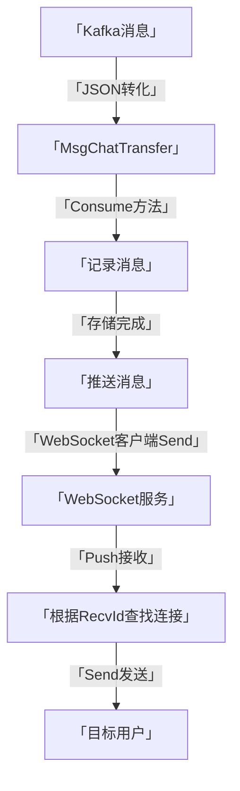

# 7-16-基于kafka异步数据存储落地及消息通信（中）

先做好异常的处理。root token 生成完成之后写到 Redis 中：通过 Redis 的 Set 进行设置，准备好 key，前面已经定义好了，再把 token 写进去，这一段就完成了。

完成之后再进到启动方法中。启动方法里 ServiceContext 已经创建好了，在此处调用刚刚定义的 SetRootToken 方法，出现异常直接抛出即可。到此，user 服务就完成了。

然后把代码同步到服务器中部署。通过 SSH 连接服务器，执行 `docker ps` 查看容器状态，确认环境准备就绪；进入 easy-chat 项目目录，Makefile 中的 release-test 目标会调用 user-rpc-dev、user-api-dev 等子目标来完成部署，最后执行 `cd /deploy/script && chmod +x release-test.sh && ./release-test.sh`。当下部署的就是 user 这个服务。

除了 user 服务需要更改之外，还要做什么？回到流程中：Kafka 接收的消息应该事先定义好消息的格式，约定好才好处理。接下来进到 types 中，定义 MQ 消息格式，用来存放消息。当前消息格式就是消息转化的格式，与 WebSocket 中定义的格式很多地方是相似的：消息类型一致，发送方和接收方一样，这些都是需要的；此外发送时间、发送内容、类型等也是需要的，基本上与需求一致，只不过要把标签改成 json tag。消息格式就定义完成了。

还要做什么？看图中这一段，要进行数据落地。数据落地用到的是 MongoDB，所以需要用到 MongoDB 的服务，接下来更改配置信息，加上对 MongoDB 的支持。

配置文件 task.yaml 中，服务监听地址为 0.0.0.0:10091。先定义好数据相关的配置：对 Redis 和 MongoDB 的支持。有个小细节值得注意：当前用的是 redisx 这个名称，主要是因为如今用 redis 会有冲突的问题，系统服务中已经用到 redis 这个属性，所以最好不用。再增加一个 WebSocket 客户端的 host，目标服务地址是 0.0.0.0:10090。三个配置就定义完成了。

修改配置文件：在配置对象中增加刚刚定义的配置项，分别是 Redis、MongoDB 与 WebSocket。定义完成之后，在 servicecontext.go 中给 ServiceContext 增加各个客户端：首先是 WebSocket，然后是 Redis，再次是 MongoDB 的连接，完成各个客户端的创建。先完成 Redis 的创建，然后是 MongoDB 服务的创建，最后是 WebSocket 的客户端。WebSocket 的客户端肯定需要用到 token，为此增加一个获取 token 的方法 GetSystemToken，返回 string 和 error。获取 token 通过 Redis 提供的 Get 方法，key 就是前面定义的常量，即可获取到。

获取之后要更改一下写法：在此处调用获取 token 的方法，即 `token, err := svc.GetSystemToken()`，做好处理，直接抛出一层异常。得到 token 之后怎么设置？客户端是通过头部传输的，前面在 WebSocket 客户端中已经定义好了头部的传输方式，只要把头部传进去即可。但客户端里面要用到头部，需要对头部的传输进行运用，这里有一行代码需要补上：写入头部，token 就放到这里面。

回到 ServiceContext 中，就可以通过它得到客户端连接。在 ServiceContext 中设置好 WebSocket 的头部：先创建头部对象，再用 Set 方法设置头部的值。头部的值要注意标签不要写错，这个标签不太醒目，把标签复制过来，参数是 token，再设置进去。然后创建 WebSocket 客户端，给客户端一个别名方便后面调用，把客户端的地址（ws 的 host）传进去，再传入头部，把当前的 ServiceContext 传进去，ServiceContext 就创建完成了。

接下来在当前的 IM 服务中完成业务，业务处理不会太复杂。进到 msgchattransfer.go 中，定好相关的参数，创建 MsgChatTransfer 实例（NewMsgChatTransfer(svc)），实现 Consume 方法，即 `func (m *MsgChatTransfer) Consume(key, value string) error`。先进行数据的转化：Kafka 收到的消息是 String 类型，需要转化成所需要的数据，而这个 String 是 JSON String，所以通过 JSON 来转化。转化得到数据之后，就需要记录数据。

记录数据的过程，前面已经写过这段业务，直接挪过来即可，不用重写。进到这个业务中，把这段信息复制一下，在此处定义一个记录消息的方法，把消息格式的指针传进来，粘贴好。userId 是传进来的，从 data 中取 SendId 就是 userId，其他没有特别要改的。注意，这个地方也要改，它是传进来的，不能自己生成，那不合理。然后是新问题：在前面增加一个 context 参数传递，解决 context 传递问题。

整体并不复杂，消息存储就写完了。存储写完之后，在上面直接调用即可，把参数传进去，再做一层处理。存储完，自然就要推送消息。

推送消息要怎么推？格式是什么样的？可以这样写：ServiceContext 中定义了 WebSocket 的客户端，在 WebSocket 的 Send 方法上进行推送即可。里面的消息结构当然还是用 WebSocket 的那个 Message，这个格式不能变。发送的消息格式要用 data 来写；发送的方法不再是前面的消息格式，而应该叫 Push，即消息转化后推送的方法，所以这里推送的是 Push；消息的 id 来源是当前系统的角色；数据就是 data。推送过去之后，那一边就可以接收。

当前这一段服务基本写好了，可以启动起来看有没有异常，测试放到最后一起做。

接下来处理 WebSocket 与消息队列之间的消息交互。WebSocket 中还要做一件事：在 push.go 中定义一个 Push 来接收推送过来的消息，因此需要完善这个 Push 结构。这个 Push 结构应该和这里的结构一样，直接复制出来，再把里面的标签设置好，不能用这些标签，还是用 JSON 的标签。

定义完之后，再定义一个 Push 用于消息的转发和处理，这里面的事情会简单很多。定义 WebSocket 的处理方法 `Push`，它接收 ServiceContext 并返回 websocket.HandlerFunc。先接收参数，做好信息处理，把参数转换出来再返回，返回 error，把 error 返回出去。得到数据之后，需要通过它得到要发送的目标。目标怎么得到？通过发送目标的 userId 得到，即通过 data 中的 RecvId，用 `rconn := srv.GetConn(data.RecvId)` 得到连接。如果连接为空，肯定是离线状态，离线暂时不处理，后面会讲解，只需要知道：获取到的目标连接为空，肯定是离线了。再来一个打印，把 Push Message 的 data 打印出来。最后是发送，通过 Send 发送：发送的用户，发送的内容，里面还有消息内容及发送的类型、时间以及确定发送的消息，具体发送的消息及发送的处理数据才是最重要的。这一段就完成了。还要增加对它的引用：在 handler 中通过 push.Push 来注册这个推送的处理方法。

