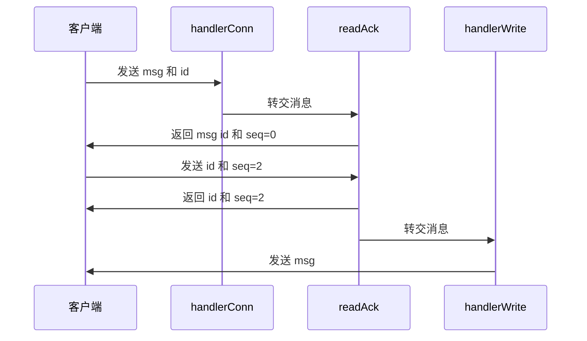

# 7-18-消息收发ACK（上）

本节内容分为如下几个环节：首先对 ACK 的实现进行分析；然后对连接的属性进行设置，并配置好 Option 与消息发送的相关属性；最后实现消息的 ACK 机制。整体内容会有点难，需要仔细理解。

先对消息的收发 ACK 机制进行分析。ACK 机制实际分为两种情况：第一种是客户端发送消息，服务端进行 ACK 的确认；第二种是服务端发送消息，客户端发送 ACK 的确认消息，共两种情况。

ACK 的应答方式分为三种：第一种是不采用 ACK 机制；第二种是只应答一次，即发送者向接收者发送消息，接收者向发送者回复一个「收到」，整个流程就结束了；第三种是在第二种机制之上，发送者还给接收者回复一个确认的信息。

从业务角度来说，第二种相当于折中。折中方案中先学习客户端向服务端发送消息、由服务端进行 ACK 的确认，这一项在整体业务角度非常重要，消息必须由客户端发送到服务端，这个机制必不可少。第二种情况相对来说次要一些，因为服务端向客户端发送消息，可以由客户端主动拉取消息来代替这一功能。

接下来分析代码，看如何入手。进入代码找到 handlerConn，它主要针对连接进行处理。从代码的执行流程来说，首先通过 conn.ReadMessage 读到消息，得到消息之后进行消息的序列化，序列化完成后根据消息的内容进行相应的处理，这就是 handlerConn 要做的事情。

```go
switch message.FrameType {
case FramePing:
    s.Send(Message(FrameType: FrameType, conn)
case FrameData:
    if handler, ok := s.routes[message.Method]; ok {
        handler(s, conn, message)
    } else {
        s.Send(Message(FrameType: FrameData, Data: fmt.Sprintf(「不存在的执行方法 %s 请检查」, message.Method)), conn)
    }
}
```

现在需要能进行 ACK 的确认。上面代码中的 conn.ReadMessage 是服务端读取客户端发送的消息，得到消息之后进行 Message 转化，消息转化之后此处应该给客户端回复一个 ACK，告诉客户端「我已经收到消息了」。ACK 确认成功之后，才进行下面的任务处理。

从整体的代码执行角度来说，handlerConn 可以分为三个操作：第一，获取客户端发送的消息，并进行消息的格式化处理；第二，对消息读取后的信息进行 ACK 确认；第三，对确认后的消息进行任务的处理。

先定义好对消息读取的 ACK 确认方法，不着急完善里面的内容；第二个方法则是 ACK 确认之后的任务处理，即 handlerWrite。所以此处可以先定义两个方法：任务处理的 handlerWrite，读取的 ACK 确认 readAck。

```go
func (s *Server) readAck() {
    // ... 代码逻辑 ...
}
```

定义完之后看流程。图中绘制了客户端、handlerConn、readAck、handlerWrite。流程是：客户端向服务端发送消息，包含两个信息，消息内容和消息 id，这是正常流程。正常流程中，handlerConn 接收消息之后，会将信息传递给 handlerWrite 处理，这是没有进行 ACK 确认时的流程，此时消息只有 Message 和 id 两个信息。

下面是开启了 ACK 确认的情况。与上边的差异是发送过程中多了一个序列号，这个序列号就是用来进行 ACK 确认的。流程中，客户端向服务端发送消息，包含消息 id、消息以及消息序列号，handlerConn 接收消息之后交给 readAck 机制进行 ACK 的处理。在这一段处理过程中，它会判断当前是不是客户端的回复，或者是不是需要进行 ACK，要做这些验证。确定没问题之后，它自己要向客户端返回一个 ACK 的信息，并给这个序列号做加一的处理，目前序列号只是为 0，加一表示「我收到了」。客户端本身在发送完之后会陷入一个 ACK 的等待状态，此时它会接收到由 readAck 机制返回的新消息，新消息中传递了 id 和序列号。消息内容可以被传递，在本地缓存即可；id 和序列号是需要传递的，因为通过 id 来确认消息，通过序列号来确定当前 ACK 的确认情况。

如果说有三次握手，那么客户端会再次返回一个确认，readAck 机制收到之后也会进行验证，最终确定这个消息是可靠的，就进行消息的处理。序列图中标注了消息的 id、序列号 seq 以及「ack 等待」、「ack 处理」、「ack 验证」等状态，完整的三次通信为：客户端发送 msg 和 id，handlerConn 将消息转交给 readAck，readAck 处理并返回 msg、id、seq=0；客户端再次发送 id、seq=2，readAck 处理并返回 id、seq=2，最终由 handlerWrite 发送 msg。流程可以分为这几个环节展开，这就是接下来要执行的具体流程。



现在对连接的属性进行设计。从上面的分析可以知道这些都是耗时任务，并且具有迅速的流程。再看连接的属性：理论上它在服务端，但消息是不是应该在连接属性中记录？应该根据连接属性来记录它自己接收的消息，以及读取的消息及读取消息的处理情况，这几个信息都要记录起来。所以需要修改连接对象的属性值。找到连接对象，肯定要记录，所以在连接对象中增加一个读消息的队列。之后还要记录好它的序列化，用 map 来存储，map 中的 key 是消息的 id，value 是具体消息。但它们有并发的可能，所以还要加一把锁。

除了这三个以外还要定义什么？看图中，readAck 与 handlerWrite 之间如何通讯？很显然，从运行角度来说它们属于异步运行，异步运行通过 go 开启一个协程即可，协程与协程之间肯定要通过 channel 来通讯，所以此处会有一个 channel 进行通讯。回到当前的连接对象中，定义一个通道，用于 ACK 之后将消息发送给任务处理。这样会定义出四个属性。

到这里要注意创建出来：第一个是队列，然后创建好对消息序列化 id 的记录，给消息的通道定一个容量 1。对 message 这个通道给它一个容量是有好处的：第一，可以减少数据流中的阻塞情况；第二，因为只有一个容量，可以保障收和发的实时性。这是一个很巧妙的设计。

前面定义的这几个属性创建之后，进入下一个过程：对 Options 进行配置，并进行消息属性的处理。进到代码中，需要对 ACK 的机制定义各个类型，因为它的应答方式有多种。进到服务端的 message.go 中，在上面定义一个 ACK 类型 AckType int。它的应答方式理论上三种：第一是不进行 ACK 的确认；第二是只有一次应答；第三是严格性的模型，应答之后客户端也回复一个收到。

```go
type AckType int
const (
    NoAck AckType = iota
    OnlyAck
    RigorAck
)
```

可以为其提供一个 toString 的方法，对每个类型进行分支判断，输出对应的信息。默认都是不开启的，toString 就定义好了。定义完成，它的引入肯定也要通过 Option 的操作去配置，所以进到 Options 中，选择 serverOption。进来之后对 ACK 机制进行加载，定义 ACK 的类型；ACK 在应答的时候要考虑等待的超时，所以定义一个 ACK 的超时时间。如果超过一个时间客户端或服务端没有返回，就认为这个 ACK 的确认失败了，这条消息不能处理。所以它应该有两个值：一个是 ACK 的模式，第二个是 ACK 等待的超时时间。

复制上面的这一段内容，更改下面的属性。对此处的超时应该定义一个默认的常量，默认 ACK 超时的时间暂时定义为 30 秒，在属性初始化的时候设置好，此处就完成了。

然后消息本身也要进行优化。在消息中要考虑 ACK 发送消息类型，找到消息，在上面定义 ACK 类型的消息。ACK 的消息类型定义好之后，再定义一个不进行 ACK 确认的消息类型，这是为了避免某些场景并不需要 ACK 确认，当然这并不影响。

```go
type FrameType uint8
const (
    FrameData FrameType = 0x1
    FramePing FrameType = 0x2
    FrameAck FrameType = 0x3
    FrameNoAck FrameType = 0x9
)
```

内容定义完之后还有什么要补充的？还有消息本身。消息中除了消息 id 和 ACK id 之外，还要保存序号，所以要考虑序号的问题，即 ACK 的序号，可以给个 int；以及 ACK 在确认过程中所涉及的时间，以及错误的统计。增加这两项具有扩展性：第一项用于记录由服务端或客户端向目标方发送 ACK 的时间；第二项则是统计发送完之后的失败情况，统计有多少次失败，如果失败次数达到一定程度就停止发送。这是非常关键的细节点。

整体在 Option 和消息属性这一块就定义完了，接下来实现 ACK 的机制。
