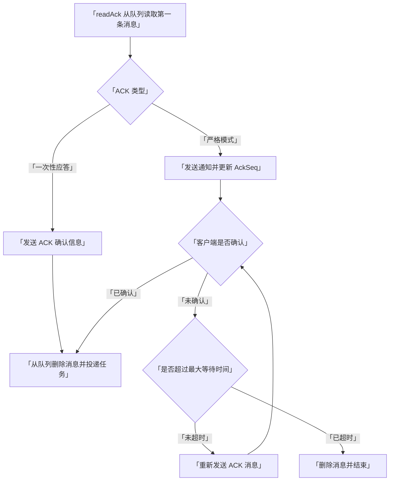

# 7-20-消息收发ACK（下）

那就是 select，它不会一直卡在这里，就结束了，并且会抛出相关的错误。所以在这个 select 中就有这几个流程。

现在来验证一下，计算当前发送的时间差。先假设客户端发布的结果是已经再次确认了，先获取之前记录的 ACK 信息，即之前记录的序号，此处得到的是客户端的序号。得到客户端的序号之后，再根据当前系统记录的序号，两者直接进行验证。如果它大于系统中的序号，就认为它已经确认了。确认之后，此时就可以进行删除及发送了，然后进行上面的这一个过程，再往下走这些流程，输出：确认成功了，把消息打印出来，ACK 成功了。readAck 的核心实现如下：

```go
        func (s *Server) readAck(conn *Conn) {
            // 读取消息并处理
            conn.readMessage = conn.readMessage[1:]
            conn.message = message
            s.Info(「message ack RigorAck success mid %v」, message.Id)
            continue
        }
```

这就是没有确认的情况，即刚刚看到的这个流程。那就要获取一下时间，获取当前要超时的时间。它根据 ACK 的超时时间来计算，还有多久超时：

```go
        if message.AckSeq > message.AckSeq {
            // 处理超时或重复确认
            val := s.opt.ackTimeout - time.Since(message.ackTime)
            if message.ackTimeout < 0 {
                // 删除消息
                delete(conn.readMessageSeq, message.Id)
            }
        }
```

它如果没有超时，就保留 ACK 的这个时间；上面这种情况是超时了，下面这种情况是没有超时，一共两种情况。超时的就要去结束，Delete 从这个消息的序号中删除，并且要从对面消息中删除，再结束。未超时的话，就可以重新发送一次 ACK 的消息。发送消息还是上面这一段，再发送一次，不用再进行 ACK 的增加了，只要发送就可以了，这里的发送由 handlerWrite 完成：

```go
        func (s *Server) handlerWrite(conn *Conn) {
            for {
                select {
                case <-conn.done:
                    return
                case message := <-conn.message:
                    // 处理消息
                }
            }
        }
```

然后再睡眠一定的时间，还是睡眠上面的这个时间，可以给它多一点，300 毫秒。到此，一个 ACK 的机制就写好了。

流程相对来说会比较多，但整体并没有太复杂，一定要跟着流程去分析。

最后实践一下刚刚所说的流程。功能已经实现了，开始测试。先启动服务，启动服务之后，进入到 API POST 中，连接，发送，能够收到消息，当前显示的是在线人数。针对这个消息进行验证，主要是验证消息的确认。回到代码中，找到消息的入口，目前已经设置了消息的验证，是不进行验证的：

```go
        case RigorAck:
            if message.AckSeq == 0 {
                // 处理确认消息
                conn.readMessage = conn.readMessage[1:]
                conn.message = message
                s.Info(「message ack RigorAck success mid %v」, message.Id)
                continue
            }
```

所以它能够立马发布消息。像这样，进行注释，重启服务，重启之后再重新建立连接，发送消息，发送了消息之后，这里卡住了。看一下代码：这个代码中如果没有注释运行，消息就会卡在这里。重启代码，刚刚把这里注释运行，再发送。

发送的消息中，这是客户端发送的消息，这是 ACK 发送的消息。这一条是最终的结果，从代码上可以看出是没问题的，也是 ACK。

接下来测试 RigorAck 模式。进入到入口，出来的是这个 RigorAck 模式。在 RigorAck 模式中，ACK 就不是刚刚那个样子了，还要在消息中增加一个新的信息。先复制一下，方便后面的操作。模式要改一下，此时增加一个 ACK 的消息，即模式 V2，方法可以没关系，主要是这一个 ACK 的机制。

现在重新启动服务，启动完之后，对这条消息，连接，发送。

现在有个问题：发送完之后，因为客户端一直没有给服务端回复确认消息，服务端就会向客户端不停地发送消息。当前它的间隔时间比较短，所以发送得比较多。建议在测试的时候，将这里更改成 1 秒。上面的这一段发送也要根据时间来判断，如果它发送超过了一个最大的额度，也可以让它中止。所以就像刚刚说的，它会发送很多。

重新连接，发送。时间更改之后，改为 3 秒钟发送一次，相比下来要少一点。把这一段复制一下，因为这些 ACK 要发送确认信息。发送，但是没有效果。还少了一个 ACK 的确认信息，这个信息要给它打上，不然不生效。目前来说，已经停止发送了，因为它已经超过 10 个了。

再请求一下，把刚刚的 ACK 信息发送过去。发送了，它就会返回所想要的结果，并且停止 ACK 的重发。功能就已经写好了。

整个课程到这里就结束了。可以看一下文档，文档中对刚刚所写的流程进行了总结。这里采用读-写机制，需要考虑程序的结束，而程序的退出往往是在客户端关闭的时候。这里会涉及到 map 与 slice 的读写问题，在运用锁机制的时候，需要考虑每个流程及分发的锁机制释放问题。数据读取应该一条一条地处理，这样可以保障数据的处理顺序。要考虑如果一直没有 ACK 的确认信息发送的情况，还要注意程序的密集 IO 运行问题。

实现流程上，先定义 readAck 方法，在方法中定义 select 处理连接关闭的情况。设置锁，以免并发写问题，然后验证是否存在新的消息，如果没有则可以让程序睡眠一定的时间，避免非空的 select 执行任务给其他协程执行。获取第一个消息，然后依据 ACK 的类型处理：如果是应答，发送 ACK 的确认信息，然后从队列中删除数据，并投递任务；如果是三次通信，发送一次通知之后，更新内部 msg 的 seq 信息，然后迭代请求消息发送后客户端的 ACK 情况，如果客户端收到确认，则从队列中删除消息并投递任务，如果未收到确认，则每隔一定的时间再发送一次，直到收到确认结果或者超过 ACK 等待的最大时间。



一定要注意分析好它的思路，这个思路还是相对比较复杂。在机制上来说，它们之间都是通过协程进行通信，所以这里会涉及到并发的编程，刚刚做的就是并发的编程。每个机制之间有一个细节需要注意：因为是使用了协程，实现的时候要考虑当前整个机制各个节点的结束，并且要注意锁的设计，每个节点要做好锁的释放，这是一定要注意到的。

在数据上，因为是一条一条地处理，要保持好数据处理的顺序，同时还要考虑数据的生命周期。在前面实现流程中还有一个小细节：当前的 ACK 中，在连接对象里消息的序号是不断增加的，但这个序号什么时候消费没有讲。它最好的消费在哪里？一定不在读取的 ACK 中消费，而是在任务处理完成之后处理，即下面这一段任务处理完了再处理，以避免重复数据的发生。所以在这里还要增加一下 ACK 消息的清理：开启锁，delete 删除连接对象中消息的序号记录，再放锁。

另外，如果是服务端向客户端发出消息，服务端对客户端的 ACK 机制，实现流程与下面的这一段没有太多差异，可以参考后自己尝试实现。两者并没有特别大的差异，基本非常相似。

基本到这里了。再次强调，使用刚刚的流程时，应该注意好程序的密集型 IO 的执行，即在无 ACK 的情况下可能会有重复的消息以及消息序号。还有分支上面的锁释放也需要注意，编写的时候容易发生锁等待的问题。

下面还有对前面方法的一点优化：在发送过程中可能存在失败的问题。把失败的次数记录起来，判断一下，如果达到了最大次数就中止。这个也值得课后自己尝试，并不复杂，大的核心还是上面这一段内容。
