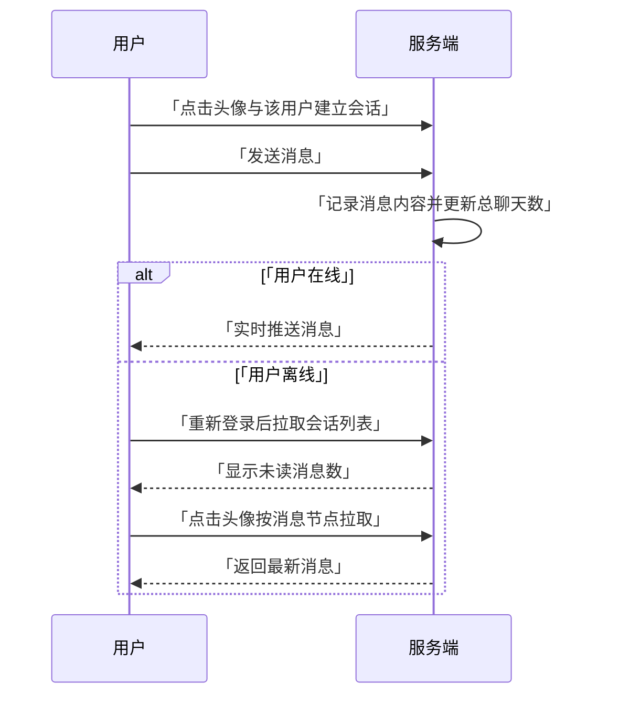

# 7-21-离线消息与历史消息分析

上一节实现了消息的 ACK 机制，可以保障消息在传输过程中的可靠性。本节分析离线消息与历史消息，内容从五个话题展开：消息的投递方式有哪些情况；离线消息与历史消息的区别；业界采取什么方案来解决；消息记录该如何读取；最后结合整套业务进行分析。

先看第一个话题：消息的投递方式。投递方式有两种情况：消息发送之后，如果用户在线，称之为在线消息；用户离线，所发送的消息就是离线消息。

对在线消息来说，服务端接收到消息之后，会实时性地发送给目标客户端，目标客户端接收到消息之后，立马展示给相关的接收者。这是在线消息投递的情况。

离线消息有点区别：服务端接收到消息之后，确定客户端不在线，处于离线状态，将消息写入离线数据库中记录起来。客户端想读取离线消息怎么办？从客户端的角度来说，离线消息是一条聊天消息记录，肯定要获取、读取并展示。因此这时服务端会从离线数据库中获取对应的消息并发送给客户端，客户端就可以得到离线消息。但要注意一个前提：客户端是离线之后又重新登录，登录之后才去从离线数据库中拿取最新的消息。这就是投递上存在的两种情况。

而历史消息与离线消息有什么区别？从理论上讲，服务端向不在线的客户端发送消息时，这条消息称之为离线消息，因为客户端已经离线，无法接收到要推送的这条消息。但前面已经提到，这条消息对客户端而言是一条新的聊天记录，客户端是需要读取到的。

历史消息的区别点在于：它已经被客户端接收并读取了。两者的区别就是：消息在推送之后有没有被客户端读取到，读取了叫历史消息，未读取可能就是离线消息。

但从本质上而言，它们其实都可以理解为客户端所接收到的消息。接下来看业界该如何设计。

对上面两个话题的讨论可以分为两种情况：情况一，聊天记录无关紧要，即所发送的聊天消息读取之后，记录可留可不留；情况二，需要查阅历史记录。

先看第一种情况，聊天记录无关紧要时该如何设计。这种情况下面，服务端针对历史消息和离线消息该如何处理？先讨论离线消息。虽然前面已经提到聊天记录无关紧要，但如果消息类型是离线消息，它对客户端而言是一条新的记录，客户端应该要读取到这条离线消息，所以离线消息一定要记录起来。服务端对离线消息可以当成一条新的记录，整一个离线消息的数据库来存储离线消息的记录，这是可以采取的方案。

历史消息可以采取两种设计。历史消息一定是服务端推送给客户端的过程是成功的，客户端属于在线接收之后能够查阅聊天内容，这条消息就会变成历史消息。此时客户端可以选择将这些信息在本地存储为聊天记录，想要查询历史消息时，只需要去本地获取聊天记录即可。服务端也可以记录历史消息及聊天记录。记录完之后，因为已经讲到消息是无关紧要的，消息随着时间的推移会越来越多，所以服务端可以对聊天记录只保留前三个月的数据，这是可以的。这是消息无关紧要的情况下，服务端和客户端可以采取的做法。典型代表产品如 QQ 和微信，就采取了这些方案。

第二种情况是需要查阅历史消息，即聊天记录需要被客户端反复读取。此时服务端与前面设计的区别只有一个地方：不需要设置一个时间去存起来，只需要做记录就可以了。用户读取本地的聊天记录，如果有就返回；如果没有，以读取的节点为起点，从服务端的聊天记录中去读取，从而获取历史的聊天记录。这就是对所提到的话题在业界中的设计。

还有一点需要注意：目前的业界中，无论聊天记录怎么记录、有什么需求，大部分聊天记录都会存在一定的时效性。以丁利文为例，它的时效性是半年，它也会记录好数据，但超过半年就没有记录，因为历史消息一般很少去查阅。如果聊天内容涉及了业务，往往会根据聊天记录生成对应的一些报表记录。因此对聊天记录本身而言，往往都会设有时效性。

了解完业界的设计之后，接下来考虑消息该如何读取。前面图中主要表达的是对消息的存储，可以看到离线消息、聊天记录这两者是分开存储的。所以在读取这块，会有两种设计方式：一种是分开存储来推送消息；第二种是基于用户列表来驱动聊天记录。图中绘制的是采取方案一，即把历史消息和聊天记录分开。

这种情况有一个好处：客户端可以很清楚前一段时间到底有多少记录没有读取到，只从历史数据库中读取，非常快、非常简单简洁。但缺点也有：历史消息会和聊天记录存在一定的冗余。如果历史消息一直未被读取，冗余量是非常庞大的。假设这个用户已经有两年、三年的消息都没有读取，属于历史消息，此时用户要获取之前没有读取的消息，量非常大，可能是海量级的数据推送给用户，会导致用户崩溃，因为一下子要读取的历史消息非常多。这是方案一存在的问题。

方案二采用的是会话记录。简单来说，对用户建立一个会话列表，记录好友的 ID，以及与这个好友当前聊天的消息记录，或者消息记录的 ID、消息记录的节点，都会有一个记录，以便读取到这个信息之后获取相关的历史消息。这种方案的好处是：前面的设计中不需要区分离线消息还是历史消息，统一只需要一个聊天记录。因为已经有了一个表，记录了好友 ID、消息 ID 或者消息节点这两者之间的关系。需要查询某一个用户的聊天记录，只需要根据好友 ID，从会话列表，即会话记录，中查询节点，再根据节点获取相关的聊天记录。

这种方式的好处是可以减少冗余，同时也可以避免用户长时间未在线、突然上线就被推送海量离线消息。当然，实际上它的处理会有一定的复杂。

那么在项目中会采用哪种方案？我们会采用会话记录表的方式来记录用户的消息，记录整个用户的聊天记录情况。

接下来结合整个业务进行分析。图中最上面的一栏描述的是动作，或者事实上的状态、节点等情况。第一栏是指用户在登录之后，需要给某个用户发送消息，即登录 IM 系统，点击某一个用户的头像，然后给他发送消息的动作。

点击打开之后会触发一个事情：与该用户建立一个会话。你和这个发送消息的目标之间就建立了一个会话，这里会记录好。会话记录好之后，接下来就发送消息。发送的时候已经确定了要发送的人，就可以发送了。

接下来，业务中会记录发送消息的内容，并且会更新接收方在会话这一块的总聊天数。如果用户的状态是在线，这些消息就会立马推送给对应的用户，是实时性的。如果是离线用户，离线用户怎么读取？他在下一次上线的时候需要知道自己的离线消息，此时他会根据自己和发送者所建立的聊天会话，看有没有新的消息。怎么知道？关键位置在这里：总聊天数。接收方的会话列表中会更新总聊天数，所以接收者登录之后，列表会有一个详细的数字显示，你有几条消息没有接收。点击头像查看最新的消息，根据聊天会话中所记录的消息节点，从数据库中拉取最新的消息。

拉取也有技巧。比如消息在一年前，已经有 1000 条消息，是直接拉取吗？不是，而是对消息记录根据时间排序，分页地拉取，直到分页的最后一页刚好在这个节点上。所以拉取的时候不是一下子全部拉取过来，这里一定要注意。

这样就可以得到历史消息了。会话该如何更新？会话的更新主要在操作过程中：前面提到会去新增与某个用户的聊天记录，而在此处，会话的记录应该清零。所以更新主要取决于发送和读取之后这两个位置，同时创建会话也是更新的一部分。这就是业务中如何设计、如何解决离线消息与历史消息读取问题。

到此，结合业务分析完了。重点在于离线消息和历史消息该如何实现：实现方案是采取用户会话列表来进行记录，同时依据图中展示的流程来解决消息的读取问题。
