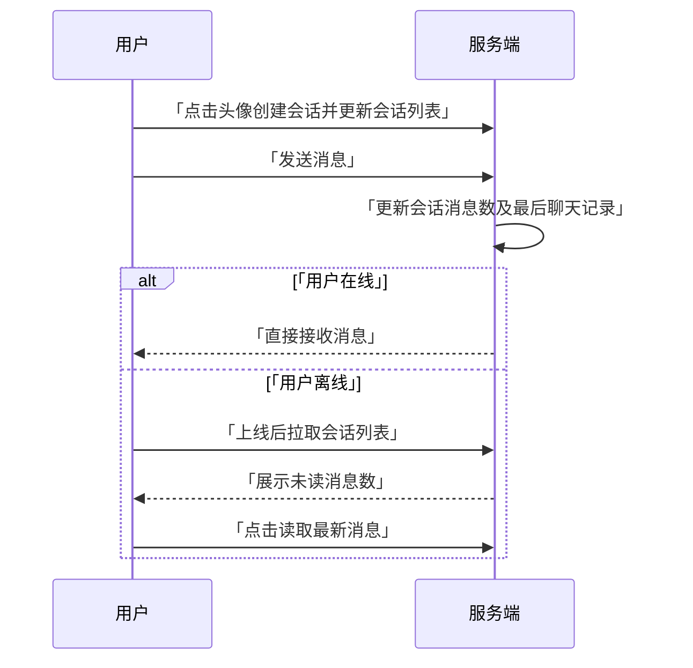

# 7-22-实现用户拉取离线消息

前面分析了用户的离线消息与历史消息的读取问题，接下来基于这三个点实现用户拉取离线消息：第一，im-rpc 服务的开发；然后实现消息的新增，及 im-rpc 服务 API 的开发功能。

先回顾之前的流程，分析几个关键点。第一，在用户端，用户点击某一个头像，动作的目的是建立该用户与目标的会话，所以这里会做两个事情：创建会话并更新会话列表。发送消息的时候，已经和用户建立了会话，由第一个点建立完之后，再通过聊天界面向用户发送消息。发送消息时，后台会更新该会话中的消息数及最后的聊天记录。消息总数主要用于判断给用户有多少消息是未读的；最后的聊天记录主要用于界面展示，让用户知道最后一条消息是什么，可以是自己发送的，也可以是目标发送的。

如果用户是在线状态，可以直接接收；用户如果是离线状态，那么在上线的时候会去拉取有没有新的消息。怎么拉取？这个过程中，他会先获取一个会话列表，在会话列表中，根据会话中记录的聊天总数及最后的消息来进行展示。此时可以在界面中显示一个红色的点点，描述有几条消息是未读的，用户就会点击这个消息去读取。所以在拉取的时候，消息是被用户收到的消息，是被动拉取的。当然，消息也可能在本地，但离线消息一定是从服务端拉取过来的。

这就是离线和在线两者的接收情况。



会话的更新分为两种：定时和操作。图中这里就是操作，即更新这个会话。定时是怎么样的？用户看了某一段消息，看完一个消息就向服务端推送「我看了某个消息」；如果短时间内他有一百万条消息，就要推送百万次，量级非常大。这个操作本身不是特别关键，但也有一定的用户体验价值。在这种情况下面，可以选择定时：通过客户端缓存一定时间内的用户操作，把这个操作打包起来，把所有已经看过的消息信息记录下来，再推送给服务端，这样可以大大减少不必要的消耗。这就是会话里的更新。

整体而言，这是接下来要实现的功能。现在来完成 RPC 服务。RPC 服务中应该如何完成业务？前面的图中包含了几个业务的创建：消息记录及离线消息的拉取，以及会话的拉取、会话的更新。来看一下文档。

业务一，消息的读取总是从最新的消息往前读取，读取方式是分段的。这符合目前主流 IM 服务的设计。账号离线之后收到了几百条消息，从程序上来说有两种处理：第一种是直接性的，登录的时候把所有消息都送给你；第二种是点击目标头像之后，才用刚刚提到的方式一段一段拉取。肯定来说，第二种会更好：前一种会存在大量离线消息，会导致后端卡顿甚至直接崩溃；而这种本身能够符合业务需求，所以读取的时候，根据消息的时间段往前一段一段地读取出来。这是第一个业务。

消息读取的时候，业务二就是会话的更新。会话更新应该更新什么内容？更新的序号、已读的量及是否显示。如果把这个会话删除了，就是一个不显示的状态。已读量记录当前会话你自己读取的消息有多少。已读量的关键，是用来计算你会有多少消息。这一点会根据它的设计来查看。

第三点是获取会话列表。获取会话列表时，会根据会话列表中的总消息量及你自己的消息量来计算是否有未读消息，以及未读消息多少条。

第四点是消息的发送。消息发送之后，就要去更新会话了。这里只更新用户与目标所建立的会话的总消息量，而不会去更新目标用户的已读消息和未读消息等计算方式。注意：在线消息会直接发送给目标用户，所以目标用户肯定能接收到在线的消息；离线则可以按照第三点的业务来展开。业务四的一个细节，它与业务二和业务三是有关联的。

业务五是设置会话。要注意：用户点击目标头像之后会去建立会话，会话建立之后，只会在用户自己这一端显示出该会话。但目标怎么知道？这里一定要注意：只有当你发送了消息之后，目标才会去显示这个会话。所以在 IM 中，会有各自的业务。

再来看数据模型。数据模型中有三个关键性的结构：聊天消息的记录，前面已经提过；上面则是两个会话，这是总会话。会话 ID 会根据用户 ID 与好友 ID 生成一个唯一的 ID 作为会话 ID，另外还有聊天类型以及消息的总数。前面业务二的讨论中提到的消息已读量是指什么？对这张表来说，它是单纯的会话表，你和用户建立之后的会话表，它不会直接和某一个用户关联起来，而是作为一个总记录，记录总的消息量及最后一条消息：

```go
        type Conversation struct {
            ID primitive.ObjectID `bson:"_id,omitempty" json:"id,omitempty"`
            ChatType constants.ChatType `bson:"chatType,omitempty" json:"chatType,omitempty"`
            IsShow bool `bson:"isShow,omitempty" json:"isShow,omitempty"`
            Total int `bson:"total,omitempty" json:"total,omitempty"`
            Seq int64 `bson:"seq,omitempty" json:"seq,omitempty"`
            Msg <ChatLog> `bson:"msg,omitempty" json:"msg,omitempty"`
            UpdateAt time.Time `bson:"updateAt,omitempty" json:"updateAt,omitempty"`
            CreateAt time.Time `bson:"createAt,omitempty" json:"createAt,omitempty"`
        }
```

会话表中的消息序号，在当前可以不用记录，因为这里已经记录了最后一条。那这个地方会怎么用？还有一个结构，是用户和会话进行关联的。注意，此处是一个集合。前面业务二的讨论中，它会记录总的消息已读量级，因为此处引用的结构就是它。所以这里的字段在此处就会改为用于记录已读的消息量。这样会有一个点：当前的这份记录中，它会根据这个会话列表，后期会话 ID 会与它关联起来，它自己也会记录一份，还会记录一个总的消息量，作为当前用户已读的量。而此处则是一个单独的用户与目标所建立的会话，它是实实在在总的消息。因此这两个进行运算，就知道有多少消息未读、多少消息已经读完。同时在此处它还会记录消息的读取节点。这就是设计的结果。

数据模型结构了解完之后，接下来构建 imrpc 的 proto 文件。构建该服务肯定需要编写一份 proto 文件，文档中已经提供了，复制过来粘贴。文件内容中定义好了要实现的方法，从上面就有四个：获取会话记录（聊天记录）、建立会话、获取会话列表、更新会话列表，提供四个方法。同时还要建立对应的模型，文档中已经提供了相关的命令，复制一份，把模型建立起来。有三个模型，其中聊天记录的模型已经建立了，不用反复建立。再把上面的结构复制过去，建立之后一定要改一下上面的包的引用，这个模型也要更改，还有包的引用问题。目前模型就构建好了。

模型中应该添加什么样的方法？主要有三个方法。第一个是查询消息的记录。前面提到，业务中需要根据聊天的时间往前分段去读取，所以需要提供一个 List By Send Time 的方法，读取消息的记录，并且要分段。参数中要求传递会话的 ID、开始时间与结束时间，还有一次读取多少的量，即分页的关键字段。这是用到的第一个方法。这个方法以复制方式弄过来，本身并不复杂，放到消息的记录中，在模型中添加一个方法。仔细看这个方法的内容：首先定义方法，参数就是刚刚强调的这几个，会话 ID、消息的发送时间与结束时间，这样可以做一个范围的查询，以及每一段读取的量。读取的时候先做一些排序，注意这里要做一个排序，同时定义了一个常量，指定一次性读取多少条消息，以免没有传的时候，用这个常量来做分页。接下来设置条件，条件无非是根据会话 ID、发送时间做一个范围性的查询。最后查询数据，获取数据再返回出去。这是用到的第一个方法，本身并不复杂。

第二个方法是查询会话，会话的查询以及会话的修改有两个方法。先看会话的查询，同样复制过来，重点放在业务上。这两个方法中，第一个的作用主要在于：当用户获取了他自己的会话列表之后，它其实是一个集合，但这个集合中包含的只是用户自己的记录，而不是会话实实在在的记录。所以还需要根据用户会话列表来查询所有相关的会话，以此判断这个用户的已读消息量、消息的读取情况。所以需要提供这一个方法：

```go
        func (m *defaultConversationModel) FindOne(ctx context.Context, id string) (Conversation, error) {
            oid, err := primitive.ObjectIDFromHex(id)
            if err != nil {
                return nil, ErrInvalidObjectId
            }
            var data Conversation
            err = m.conn.FindOne(ctx, bson.M{「_id」: oid}).Decode(&data)
            switch err {
            case nil:
                return data, nil
            case mongo.ErrNotFound:
                return nil, ErrNotFound
            default:
                return nil, err
            }
        }
```

同时在其下还提供了一个修改的方法，主要修改会话本身自己的消息记录：总的消息肯定要加一，再设置最后一条消息的记录。之后还有一个方法，根据用户 ID 查询用户对应的会话列表，也不难，把模型中的方法复制过来。复制过来之后，把所有的方法放到对应的接口，主要是给 app 使用的，这个接口肯定要放，还有此处的。方法就放到了所有的接口中，模型到此就完成了。

自然就要完善业务。完善业务之前，先把配置增加进来，目前定义的还没有写任何配置，所以现在需要把配置加进来。引入 MongoDB 的配置，更改里面的配置属性，server 是 MongoDB 的，再定义对应的配置结构，即 MongoDB 的配置结构。在 ServiceContext 中，对配置及模型去进行加载，即下面这一项，同样复制过来：

```go
        type ServiceContext struct {
            Config config.Config
            immodels.ChatModel
            immodels.ConversationsModel
            immodels.ConversationModel
        }
        func NewServiceContext(c config.Config) *ServiceContext {
            return &ServiceContext{
                Config: c,
            }
        }
```

再对它们分别进行初始化。在这些模型中提供了对应的一个方法，定义一下，用来创建对应模型，进到各自的模型中。它要求传递两个参数：第一个 url，第二个 db，再返回给模型。此处就是把会话的集合进行一个封装：只针对 MongoDB 的模型，在创建的时候不用再自己输入集合对象。回到 ServiceContext 中，没有报错就没问题了。模型上下文都准备好了，接下来就要完成业务了。
