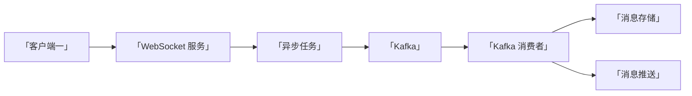

# 7-26-本章总结

本章主要围绕六个话题展开：构建 WebSocket 服务并实现用户登录后连接到 WebSocket；对该连接做心跳检测；完成私聊的实现；针对通讯过程处理收发模型；实现 ACK 机制；之后针对离线消息进行读取。

先看第一个内容：构建 WebSocket。构建 WebSocket 的时候，首先要理解 WebSocket 的协议。WebSocket 协议本身仍然基于 HTTP，所以 WebSocket 与 HTTP 存在一定的关系：主要在于 WebSocket 建连接的时候，会使用 HTTP 协议再到服务端建立连接；建连接之后，会使用这个通道继续保持通信，而底层还是会有 TCP 和 IP。这是 WebSocket 的协议。

对于 WebSocket 服务的构建，可以看代码。因为在 go-zero 中没有提供 WebSocket 服务的构建，所以对于这种自定义的服务，在结构上还是尽量与 go-zero 所提供的结构保持一致，这是其一。其二，在 WebSocket 的服务核心层，定义了一个 WebSocket 服务核心对象，封装了针对 WebSocket 会有的一些操作，包括 Server 和 Connect。其中还有一点需要注意：对于像 Server 中的一些属性设置，都统一定义了一个 Option，利用 Option 来动态地设置属性值。Option 在很多框架组件中都会运用到，这个设计可以了解。对于整个 WebSocket 服务的构建，一定要注意构建的过程：先定义好服务对象，完成服务最基础的方法，也就是处理服务任务的方法，然后再基于它针对所存在的问题，一步一步地扩展、封装和完善服务内容。

再看用户的连接。图中左侧描述了客户端与服务端连接的时候，首先会通过 HTTP 协议与服务端连接，连接之后会一直使用 HTTP 协议创建的这个连接通道来保持长连接，相互继续发送消息。右侧这幅图描述的是用户登录服务之后如何连接 WebSocket：用户首先需要在用户服务中登录，登录之后得到一个 token，然后用这个 token 来登录 WebSocket。WebSocket 属于内部服务，肯定不能随便登录，因此在 WebSocket 中需要对用户的登录做鉴权。这一点可以看代码。

代码中此处就是处理用户登录 WebSocket 之后他的任务。在其上做的一个事情是封装了认证服务：在 server 的服务中，使用了 Authentication 接口，通过这个接口提供的 Auth 方法来进行鉴权。此处就是定义的 Authentication 接口，它提供两个方法：一个是鉴权，一个是获取用户 ID。用户登录之后，服务需要得到用户的 ID，所以肯定与这个 Authentication 关联起来，因此这里会提供一个 userId 的方法来获取用户 ID。

        ```go
        type Authentication interface {
            Auth(w http.ResponseWriter, r *http.Request) bool
            UserId(r *http.Request) string
        }

        type authentication struct{}

        func (authentication) Auth(w http.ResponseWriter, r *http.Request) bool {
            return true
        }

        func (authentication) UserId(r *http.Request) string {
            query := r.URL.Query()
            if query != nil && query[「userId」] != nil {
                return fmt.Sprintf(「%v」, query[「userId」])
            }
            return 「」
        }
        ```

当鉴权成功之后，才记录连接，并进行相关的任务处理。这就是用户连接登录。

用户连接登录之后，连接已经记录到 server 的服务对象中。但连接存在一定的问题：如果他长时间未通讯，服务端会断开与客户端的连接，这是系统默认设置，默认一分钟；其次，客户端或服务端因为一些特殊情况断开连接，也是可能发生的。存在这两种情况，所以业界中对于连接都会使用心跳检测。心跳检测有两个核心功能：第一保持连接存活，第二检查空闲。

保持连接存活，主要是避免前面讲到的太长时间未通讯会断开的情况，所以给他发送一个心跳包，告诉他还在，不要断开连接。检查空闲，主要在于如果客户端没有再给服务端发送消息，就可以断开与客户端的连接，把连接删除释放。这就是心跳检测的两个核心功能。

实现的时候，是基于 gorilla 长连接来实现的。gorilla 的长连接提供了一个定时器，用于检测连接空闲状态。这个定时器一旦被触发，会去检测当前的连接是否是空闲状态：如果不是，会重新设置下一次检测的时间；如果是，会计算当前时间与上一次空闲时间的差值，是否超过了系统约定的时间。超过了就要对这个连接关闭；没有超过，就根据这个时间差重新设置下一次检测的时间，再进行上面的流程。

具体的时序放在连接对象中，这里有一个 KeepAlive 的方法，使用了 TCP 长连接处理的方式。

对于私聊的时序：私聊在业务中是一个非常关键性的核心业务。它的业务主要是发送者向接收者发送消息，过程中会得到 userId 和 friendId，userId 为发送者的，friendId 为接收者的。发送者会将自己要发送的信息封装，通过 WebSocket 转发给接收者。消息的格式有消息类型、消息会话 ID、消息记录及消息的发送。所以实际上所谓的私聊，关键因素就在于根据 friendId 查找对应的接收者，再根据发送者所指定的相关数据格式，推送给对应的接收者。这就是私聊实现的关键。

私聊实现的时候，有一点需要指出：客户端与服务端该如何保存数据。业界中，如果对聊天记录没有任何要求，程序上可以让它直接缓存在客户端。但如果对聊天记录有要求，要求能够存储半年以上的聊天记录，又该如何设计？因此业界提出了两个话题：一个叫读扩散，另一个叫写扩散。

此图为读扩散。图中，用户 A 会和用户 B、C、D 分别建立对应的会话，以此会话来存储相互之间发送的聊天记录，而群则只维护一个会话。读扩散是在哪里扩散的？其实是在群这里。因为群中的用户肯定很多，少则两三个，多则几万个，但会话记录只有一个，存储在这一个会话中，几万个用户同时读取这一条记录，同时读取这个会话中的这一条或这一些记录，就产生了读的扩散。所以读扩散其实讲的就是群：私聊并不复杂，无论建立了谁的会话，都不会有影响，就是在群这一块才产生这么一个讨论。

再看第二种情况：写扩散。写扩散有一定区别：用户自己会有一个属于他自己的会话，在自己的会话中，会记录他所说的所有消息，其中包含了用户 A 和用户 C 及群的聊天记录。这种情况扩散在哪里？还是以群为例：群中一万个人，每个用户有自己的一个会话，向群中发送一条消息，这条消息就向一万个人的会话中写入一条数据，可以想象这个扩散的量级也是非常大的。

读扩散和写扩散都有各自的优缺点。读扩散的优点在于写会很轻松，没那么复杂、很轻量；缺点在于读的压力会很大。写扩散的优点在于读取很轻松，因为是以用户为单位读取自己的消息；但压力在于写：每个用户都会写入同一条消息，写的压力也非常大。

对于读扩散与写扩散本身，业界没有一个绝对的结论，两者方案都可以应用，关键在于应用之后如何解决该方案所带来的问题。我们在项目中主要采用读扩散。

私聊实现之后，就要注重消息的收发及 ACK 机制。消息的收发模型主要是保障消息发送和推送之后，消息的收与发能够更加高效、可靠；ACK 则是保障消息能够很好地接收到。讨论这两个话题，主要是因为存在如下问题：第一个问题是阻塞及延迟，前面私聊实现的时候，收与发都在同一个方法中，当任务接收到所有的消息之后，还要去执行其他任务再发送，这过程中自然会影响对发送者发送之后消息的回复、接收者对消息的接收。消息丢失主要是任务处理的时候存在异常，自然会影响消息的收发。灵活性与扩展性及难以实现幂等也是很正常的，因为只在一条线上面去实现。

针对如上四个比较典型的问题，我们提出了新的收发模型。收发模型本质的目的就是客户端一向客户端二发送消息。客户端一会将消息发送给 WebSocket 服务，WebSocket 接收消息之后，通过异步任务将消息推送给 Kafka；Kafka 接收之后，在后台起一个 Kafka 的消费者，来消费由 WebSocket 所推送的任务，比如完成消息的存储及消息的推送这两个功能。在这个收发模型中，可以很明显地发现：收与发这两个职责是分开的，不是合在一起的。此时如果发的处理压力比较大，可以在这里进行集群；收的压力比较大，可以在那里进行集群，都是可以的。并且在返回结果这一块，客户端一发送完结果之后，可以很快地得到一个响应，消息是否发送成功了。这就是我们会用到的收发模型。



收发模型讲过之后，还有一个细节：一条消息是否发送成功了，因此就需要一个 ACK 的机制。ACK 机制实际上参考的是 TCP 的握手，TCP 的握手本身是可靠的：一个消息发送之后，会进入一个 ACK 的等待，如果在等待时间内超时了、没有收到结果，会重新发送消息；当服务端返回结果，证明消息接收成功了。此处是对 ACK 等待的进一步细化：客户端再返回一个结果给服务端，告诉他已经知道你收到消息了，有一个三次握手的过程。

最后是实现离线消息。离线消息的实现，最关键的问题并不在于代码，而在于业务的梳理。此处是用户与目标建立会话的第一个环节：他会选择某一个用户，点击他的头像，此时就可以触发对于会话的建立。会话建立成功之后，在聊天界面就可以给对应的目标发送消息。业务中会记录消息内容及最后一条消息，以及聊天总数。用户属于在线的情况直接推送；属于离线的时候，用户会拉取自己的会话列表，迭代这个会话列表中的所有会话，计算是否存在已读消息，在界面中展示；用户根据界面中的提示，点击某一个会话，拉取最新的消息。这是离线消息的读取。

会话的更新，我们一般推崇在客户端用定时去请求一次，可以大大减少不必要的消耗。之所以采用定时的，是因为用户可能在短时间内收到很多消息，也会查阅很多会话记录，此时量级非常大、频率也非常大，大多发生在短时间内。因此在短时间内将操作过程产生的结果记录下来，发送给服务端，由服务端来进行处理。这是关于会话的更新。

整体就是本章的核心内容：主要实现私聊，并围绕私聊来实现心跳检测、消息的收发模型，以及对离线消息的读取。
