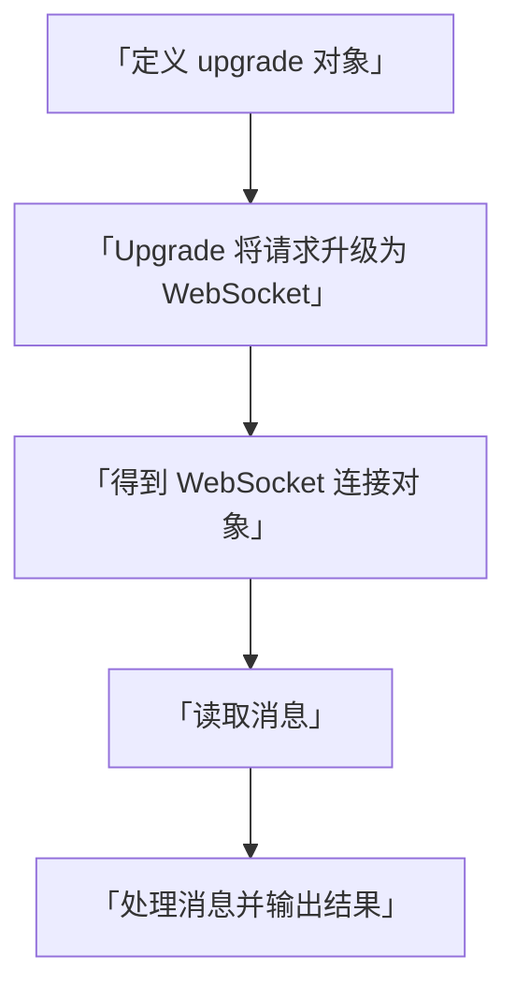

# 7-3-websocket应用案例

先理解 WebSocket 第三方库的应用，再基于第三方库构建应用案例。

        ```go
        import 「github.com/gorilla/websocket」
        ```

        ```go
        var upgrader = websocket.Upgrader{}
        ```

要注意，Go 语言的标准库没有实现 WebSocket 协议，因此需要使用第三方库。Go 语言中 WebSocket 的实现主要有两个库，两者都实现了 WebSocket 协议，业界应用也很广泛，这里选用 `gorilla/websocket`，因为相对来说用得更多。

使用这个库时，先把它引用到项目中加载，然后在依赖中查找第三方库。库中提供了很多方法，建议先看库自带的使用示例。

示例分为客户端和服务端两部分。以服务端为例，从上至下看整体结构：第一行定义的是访问的 IP 和端口，然后创建一个 WebSocket 的处理对象，再通过 upgrader 将接收到的请求信息升级为 WebSocket，之后进行 WebSocket 的处理，如接收请求、输出请求。

        ```go
        c, err := upgrader.Upgrade(w, r, nil)
        if err != nil {
            log.Println(「upgrade:」, err)
            return
        }
        ```

从示例可以看出，WebSocket 的使用非常简单：定义一个 upgrader 对象，再根据请求和响应将其升级为 WebSocket，然后对接收请求和输出响应结果做处理即可。

接下来基于这个示例做一个应用测试：在 test 目录下创建一个用于测试的 WebSocket 程序。定义 main 方法，把示例中的 upgrader 对象复制过来，再定义一个处理方法 ServerWS，表示针对 WebSocket 的处理。示例的处理是基于 HTTP 协议启动的，所以这里同样基于 HTTP 请求的方法类型，并定义 ws 描述：启动 WebSocket，服务器地址 0.0.0.0，监听地址 1234，一个简易服务就定义完了。处理方法内部同样可以参考示例：这一行代码的作用是将 HTTP 协议升级成 WebSocket，所以要先调用 upgrader 的 Upgrade，升级完成后会得到一个 WebSocket 连接对象和一个错误信息，先处理错误，此时就得到了一个客户端连接。

得到客户端连接之后就要做任务处理，下面就是任务处理的方法。启动程序后通过 ApiPost 测试：输入 WebSocket 访问地址，建立连接，再发送消息，消息能够接收并成功发送，说明 WebSocket 的应用案例基本完成。整体而言并不复杂，参考官方示例即可实现。

示例中这段代码的作用是把 HTTP 协议转换成 WebSocket 协议，并返回一个 WebSocket 连接对象，之后基于这个连接对象去读取消息、处理消息。



另外值得注意的是，读取消息会返回三个值：第一个是消息类型，第二个是消息内容，第三个是异常。查看源码注释可以知道，这个类型是文本类型或者二进制类型，由此就能看出返回的 message 类型是什么。

        ```go
        for {
            mt, message, err := c.ReadMessage()
            if err != nil {
                log.Println(「read:」, err)
                break
            }
            log.Printf(「recv: %s」, message)
        }
        ```

        ```go
        err := c.WriteMessage(mt, message)
        if err != nil {
            log.Println(「write:」, err)
            break
        }
        ```

查看类型定义可以发现，类型中有文本、二进制等，这两个就是作为数据的消息类型。知道了类型的含义，就能用于构建 IM 系统的应用。

        ```go
        http.HandleFunc(「/echo」, echo)
        http.ListenAndServe(addr, handler)
        ```
