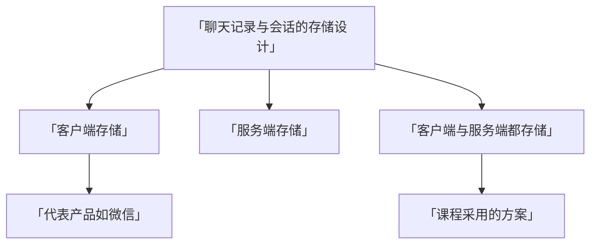

# 7-4-im服务业务

先回顾 IM 通信服务的设计。IM 服务可以分为 IM API、IM RPC 以及 IM WS，客户端在联系时会通过 API 获取相关的聊天记录，通过 IM WebSocket 服务来进行聊天。本节及后面的课程会重点讲解 IM WebSocket 服务。IM 服务的业务包括如下内容：发送对象有群和好友；消息有在线消息、已读未读等状态；消息的特征是实时性，以及消息只会增加、不会删除；对于聊天栏，也就是用户的聊天会话记录，则有会话列表、消息数量这些业务。这是整个 IM 服务中包含的一些关键业务。

在这些业务中，聊天记录和聊天会话是重点：聊天记录存储的是用户在聊天过程中发送的信息，聊天会话则记录了用户与哪些对象进行聊天，用户每次打开时也会通过聊天会话去查询相关的消息。所以聊天会话与聊天记录是整个 IM 服务中非常关键的两个业务。

对这两者的设计，可以采用客户端存储或服务端存储。客户端存储即聊天记录、聊天会话列表都存储于客户端，代表产品如微信。另一种是采用服务端存储，即聊天信息、聊天记录都存在于服务端而不只在本地，代表产品钉钉就是这样做的。以客户端存储方式为例，客户端和服务端通讯时，客户端在本地会保留聊天记录的消息；服务端也需要保留信息，保留的是离线消息，用户离线时收不到消息，就无法把消息存到本地，所以服务端要建立离线消息的数据框架。用户上线后，把离线消息推送给用户，再从离线消息中删除该条记录。会话也是同样：如果离线消息数量多，推送给客户端时也会显示出有多少消息等待被阅读。

再看服务端保存与客户端保存结合的方案。客户端与服务端通讯时，客户端仍然会在本地保留一份联络记录，这份保留带有时间信息：以用户第一次打开程序的时间点为准，之后的联络记录都会保留；之前的则不会，需要从服务端拉取后保留进来。服务端本身也会保留聊天记录。这样做的好处是：客户端存了一份消息，有就从客户端读取，客户端没有就从服务端读取，此时就能查看历史消息。课程中采用的正是这种方案，即在客户端和服务端都存储这一份聊天记录。

针对消息记录，存储引擎上也可以讨论一下，主要分为 MySQL 和 MongoDB 两个。MySQL 是关系数据库，比较适合结构化的数据，有良好的事务处理；缺点在于大量数据时可能存在性能瓶颈，需要考虑分库分表来解决，但 MySQL 分库分表之后带来的问题也比较多。MongoDB 是一种文档型数据库，适合非结构化或半结构化的数据，相比 MySQL 具有更好的可扩展性和高可用。当前要存储的是聊天记录和用户的聊天列表，选哪个好？课程中选择 MongoDB，因为聊天记录不涉及复杂计算，但聊天记录的增加、消息的增加都很频繁，用 MongoDB 以非结构化的方式存储会更合适；用户聊天会话记录的更新也比较频繁，MongoDB 同样合适。这不是绝对的设计定式，而是在当前业务下用 MongoDB 更直观、更合适。

聊天记录表在设计上还有一个话题，就是 ID 的设计。这里有两种方案：第一种是基于发送方 ID 与接收方 ID 计算后生成一个特定的 ID；第二种是基于关联的方式，通过一个关联表来使得用户与这一条聊天记录关联起来。当前业务选择第一种方案。因为用户和某一个人聊天时，在页面上需要先选择这个聊天会话才能获得消息，如图所示，一定要点击该用户的聊天会话才能获取对应的聊天消息。所以查询方式往往都是由发送方和接收方组成的聊天会话去得到聊天消息，不会有其他特殊性的查询，用第一种方式更好。这就是聊天记录 ID 的设计。

本节内容并不复杂，主要讲的是 IM 服务业务中数据这一块的设计。下一节开始就真正进入 IM 服务的开发工作了。
