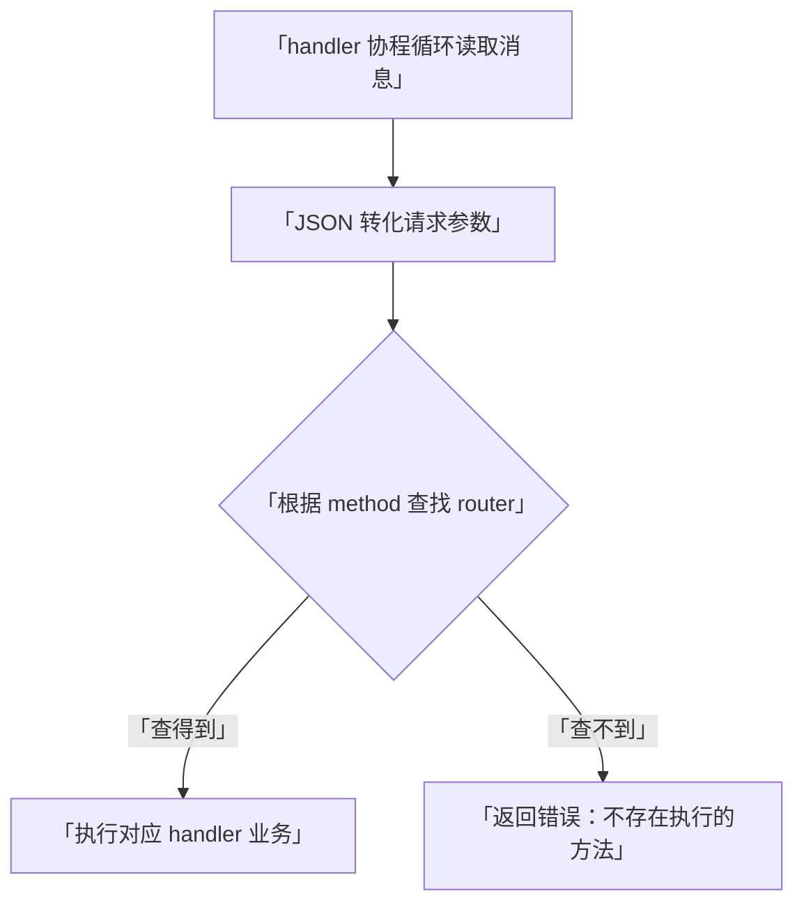

# 7-6-im服务业务功能（中）

请求方在请求之后，可能是希望服务处理并返回相关的数据值，这种时候使用当前请求用户的连接对象放在参数里比较合适。

至此路由初步定义好了，现在回到服务对象中。服务要做的事情是对刚才定义的路由进行加载：在服务中定义一个 router 属性，用它存储具体要执行的路由，key 是方法名，handler 是具体要执行的实际方法。自然还需要一个添加路由的方法，所以往下定义 addRouter，传递的参数是一个 router 值。添加路由的过程中，就是给 server 中的 router 赋值：按方法名对应到方法对象。由于 router 是一个 map，需要进行初始化，不初始化会抛出异常。

再往下就是接收请求并处理请求，根据请求查找路由并执行。定义一个方法 handler，根据连接对象进行处理，连接对象用 conn 表示，以协程去运行，这一段就是根据连接对象进行任务处理。

handler 内部要用 for 循环：如果不用 for，读取一次就结束了，当前连接只能完成一次任务。因此在 for 中通过连接对象读取消息、获取请求数据。得到消息之后一定要注意异常处理：消息读取失败时应该关闭这个连接，这里先留出关闭连接对象的位置，后面再写。

得到消息之后要进行消息转化。目前定义的传参方式以 json 为主，转化也通过 json 进行，转化过程中难免有异常，别忘了异常处理：当前异常主要是 json 数据转化中的问题，把请求的参数也打印出来。完成之后，就需要根据请求的方法去分发路由并执行。查找路由通过 router 进行，根据请求中的 method 查找：如果查得到，就执行相关的业务，把 s、当前的 conn 以及得到的消息都传进去；如果查不到，就返回一个错误，描述为：当前查找不到，不存在执行的方法，请检查。到此基本上一个路由就定义完成了。

handler 中请求的处理流程如下：



整体服务并不复杂。定义完成之后进入下一个环节：对连接进行存储，并设置好鉴权。这里的连接对象就是 websocket.Conn。

    ```go
    func (s *Server) Start() {
        http.HandleFunc(「/ws」, s.ServerWs)
        s.Info(http.ListenAndServe(s.addr, handler:nil))
    }

    func (s *Server) addConn(conn *websocket.Conn, req *http.Request) {
        // 从请求中提取用户ID
        uid := s.authentication.UserId(req)
        // 使用互斥锁对连接对象进行存储
        s.RWMutex.Lock()
        s.connections[uid] = conn
        s.RWMutex.Unlock()
    }

    func (s *Server) handlerConn(conn *websocket.Conn) {
        for {
            msg, err := conn.ReadMessage()
            if err != nil {
                s.Error(「websocket conn read message err %v」, err)
                return
            }
            // 处理消息
        }
    }
    ```

    ```go
    package websocket

    import 「net/http」

    type Authentication interface {
        Auth(w http.ResponseWriter, r *http.Request) bool
    }

    // UserId 方法用于从 HTTP 请求中提取用户 ID
    func (a *Authentication) UserId(r *http.Request) string {
        // 从请求头中提取用户 ID
        return r.Header.Get(「X-User-Id」)
    }
    ```

为什么要考虑对连接对象的存储？在 websocket 中，客户端向服务端发送请求时，首先通过 HTTP 协议请求，确定可以连接之后就会保持长连接状态。此时有一个需要注意的问题：这个连接要一直被使用，而服务有很多个时连接就有很多个，如果不进行管理，代码会写得很混乱，所以过程中一般需要记录好连接。再看业务：客户端连接服务端之后，设计的查询方式有哪些？可以根据连接对象查找相关的 UID，查出哪些用户在线；也可以根据 UID 查找连接对象，发送相关的消息。这两个场景在业务需求上都是会有的。

连接对象的存储有两种方式：一种是从 conn 到 UID，即实际连接对象到用户 ID；另一种是从用户到连接对象。这两种方式最适用的是 map。实际执行过程中对它们的读写很容易产生并发情况，怎么保证线程安全？需要加锁，这里引入读写锁，能够保证两者在处理过程中线程安全。

接下来对这两个 map 通过 make 进行初始化，然后添加记录方法。添加一个 addConn 方法来添加连接对象，传递的参数一个是 websocket.Conn，一个是请求信息。

这里又有一个问题：连接对象的用户 ID 从哪里得到？目前这个方法无法往下写，因为拿不到用户的 ID。设想一下：客户端会去登录用户服务器，用户服务器返回登录之后的 token；现在需要在 IM 服务中进行获取，自然客户端也会把这个 token 传给 IM 服务进行鉴权，鉴权成功之后就可以登录到 IM 服务中了，鉴权的方式同样是通过 token。现在肯定不会真的去写这个逻辑，只是先明确有这个需求。

要更好地解决这个问题，需要抓住其中几个关键操作。第一是鉴权，鉴权要依据 token，token 通过请求头或请求参数传递。IM 鉴权时就可以根据 request 请求对象获取到这个 token；获取之后，每种鉴权方式不一样，返回给服务的 ID 的操作方式也不一样。所以这里有两个非常关键的方法：一个是鉴权，另一个是鉴权之后获取用户 ID。

据此可以这样设计：定义一个接口，功能就是鉴权，约定鉴权的方式。注意这里定义的是接口。它的传输带有响应，之所以有响应，是可能在处理中直接返回给用户失败的原因；最关键的请求对象之外，返回参数是一个 bool，表示是否通过；再来一个 UserId 方法，根据请求参数进行获取。在接口之下再提供一个实现，可以理解为默认的实现方式。

实现中先实现上面的方法，让它一直返回 true，表示鉴权一直可以通过；然后实现获取 ID 的方法：如果请求参数中 header 已经带有用户 ID，就以它来获取，加一个判断，header 不为空并且请求参数中包含了 UID，就使用它作为 UID 返回出去；否则直接以实际值作为用户 ID。一个默认的实现就写好了。

回到 server.go 中使用它：在字段中定义一个 authentication，目前先用默认的方式。回到下面的方法中，此时就可以获取到请求的 UID 了，获取之后开始加锁，对获取到的连接对象进行存储，别忘了解锁，这里用的是写锁，一个存连接对象与 ID 的绑定关系，另一个存 ID 和连接对象的绑定关系，到此完成。之后再提供 Get 方法，也分两种：根据 UID 获取连接对象，传递 UID 返回连接对象；根据 conn 获取 UID，传递 conn 自然返回 UID。

读的时候要注意开锁，此处用读锁，同样别忘了释放锁，接着查询即可。至于根据 conn 获取 UID 的方法，这里就不写了，在文章中提供，可以查看。
