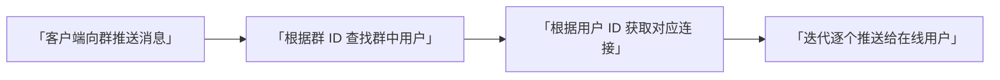

# 8-1-理解用户与群组聊天功能的实现思路

本节进入 IM 群聊功能的开发，先理解用户与群组聊天功能的实现思路。内容主要围绕两个话题：第一，群的消息该如何存储；第二，如何更新及维护消息记录。

先看消息的存储。私聊部分已经处理过这个问题，群聊和私聊在功能上具有相似的特点，区别在于群是面向一个集合类的所有用户发送消息。而群内所有用户看到的消息是一样的，因此群消息只保存一份，基于读扩散来实现。

消息的存储结构沿用私聊时使用的结构体，代码如下：

        ```go
        type ChatLog struct {
            ID          primitive.ObjectID `bson:"_id,omitempty" json:"id,omitempty"`
            ConversationId string         `bson:"conversationId" json:"conversationId"`
            SendId       string          `bson:"sendId" json:"sendId"`
            RecvId       string          `bson:"recvId" json:"recvId"`
            MsgFrom      int             `bson:"msgFrom" json:"msgFrom"`
            MsgType      constants.Mtype `bson:"msgType" json:"msgType"`
            ChatContent  string          `bson:"chatContent" json:"chatContent"`
            MsgContent   string          `bson:"msgContent" json:"msgContent"`
            SendTime     int64           `bson:"sendTime" json:"sendTime"`
            Status       int             `bson:"status" json:"status"`
            Day          int64           `bson:"day" json:"day"`
            // TODO: Fill your own fields
            UpdateAt     time.Time       `bson:"updateAt,omitempty" json:"updateAt,omitempty"`
            CreateAt     time.Time       `bson:"createAt,omitempty" json:"createAt,omitempty"`
        }
        ```

这个结构体中有一个消息类型字段（MsgType），通过它判断当前的消息是群消息还是私聊消息。另外有一个接收 ID（RecvId），群聊中不再使用用户 ID，而是改为群 ID。业务处理时先根据它判断消息类型，再根据 ID 做相应的处理。

消息的发送与私聊也相似。过程中首先由客户端向群推送消息，推送之后需要给对应的在线用户发送相关的记录：先根据群的 ID 查找群中有多少用户，再根据用户 ID 获取对应的连接，最后迭代地逐个推送。所以群聊功能与私聊相比，主要区别就在这一步。

群聊消息的发送流程如下：



了解完功能与消息的存储之后，再看如何更新和维护消息记录。

消息的更新和维护主要针对历史消息。群中同样要考虑用户能接收历史消息，因为一个用户不可能时刻在线，一个群中总有用户对某些消息是未读的。

对照图来看消息的处理和维护：此处是用户与好友，属于私聊；此处是用户群，属于群聊。用户加入或创建某一个群时，就会创建相应的会话。如果是创群，群本身会生成一个单独的会话，同时群与创建者会生成对应的会话；如果是加群，用户与群也会生成对应的会话。这就是用户与群在会话上的创建和生成。

发送消息的过程与私聊一致。会话记录聊天记录、更新消息总数，并记录最后一条消息。用户在线就推送；用户离线，则照之前的过程读取离线消息，更新也采用之前的方式。

总体而言，群聊与私聊在具体功能上差别不大，主要差别有两点：一是功能实现之后需要迭代对应的用户；二是建立群聊时的触发动作发生在创群和加群这两个时机，其余部分保持一致。

通过本节，我们了解了用户与群组聊天功能的基本实现过程。
