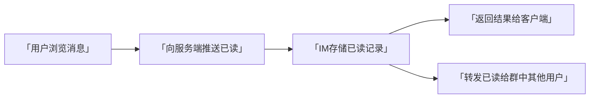

# 8-4-消息已读未读问题该如何实现？

IM 的群聊业务功能已经完成，本节讨论消息的已读与未读该如何实现。内容主要分为两点：第一，交互流程，理解已读未读是在什么时候触发的；第二，已读与未读在程序中如何存储更节省空间。

先看交互流程。有一点需要注意：已读未读这个功能在业务上并不是必需品，要看业务场景而定。程序如果是面向接收者、给接收者更好的体验，那么就不要设置已读；如果程序面向发送者，比如需要向下属推送一条工作通知，那么已读就很重要，需要知道哪些人已读了这条消息。所以要看程序面向接收者还是发送者，面向发送者时，已读是一个不错的功能。

继续讨论交互流程。用户会在页面中浏览信息，比如在聊天界面中浏览了一些消息，他会向服务端发送消息，把这条消息标记为已读并记录下来。用户点击一条新的消息，就代表已经看过这条消息，要把这条记录推送给服务端。所以动作就是：用户浏览消息时，向服务端推送该消息的已读记录。服务端返回结果给客户端，同时会将用户的已读记录推送给其他人，这样其他人也就知道这个消息有多少人已读了。

上面描述的流程可以对照下图理解，它的主要应用场景是群。因为已读未读对私聊而言并不复杂，只需在数据中增加一个简单的状态即可实现；但群聊不同：客户端会获取到用户已读的消息，把消息发送给 IM，IM 接收到之后就知道该记录已被某个用户已读，会在自己的数据中存储一份，也会把结果发回客户端，告诉客户端操作成功。然后 IM 会把这条消息的已读记录转发给群中的其他用户，每个用户都会收到一次通知，得知某个用户对这条消息已读。这就是具体的交互流程。

再看存储的思路。存储主要考虑群聊已读消息：一个群有 N 个用户，对一条消息就会有 N 个人的已读状态，而且群用户会进群和退群，这时该如何存储？

在存储设计上，第一种方案是记录 ID 的方式：建立一个已读列表，把这条消息的已读情况记录下来，记录对象就是用户的 ID。这样，一个群有多少消息，就会对应多少个已读列表，每个列表存放着已读用户的 ID。

第二种方案是记录已读列表，并以群列表作为接收列表。它与第一种相似，但有一点不同：这里是两个列表，一个是已读列表，一个是接收列表，发送给谁记录一次，谁已读了再记录一次。两个列表对照，就能很容易看出多少人未读、多少人已读。另外，第二种方案可以把接收列表改为群列表：群是固定的，虽然会有进出，但频率一般不会特别大，极端情况也没关系，只要以群列表作为接收列表，配合已读列表对比，一样能知道有多少人已读和未读。这两种方案都可行；就推荐而言，这种方案更实用，因为它比第一种更节省空间。

第三种方案是在第二种方案的基础上做的优化，将已读列表改为 bitmap 存储。bitmap 是计算机中一个较小的存储单位，只存储 0 和 1 两个值。存储方式是：假设有一份 bitmap，以 ID 来做运算，假设空间固定有 600 或者更多，只需要计算这个 ID 在 bitmap 中的哪一个位置，将其标记为 1。这种方案非常节省空间，与 Redis 的布隆过滤器是同一个道理，正是利用这种方式来减少空间。目前的程序会采用 bitmap 来存储已读记录。

如果需要知道有多少人已读未读怎么办？bitmap 中记录了已读的标记，只需对照这个群的列表，以 ID 做运算，判断对应位置是 1 还是 0：1 是已读，0 是未读，就能清楚地统计出已读和未读的数量。值得注意的是，三种方案都可以实现这一功能，从业界实践来说，推荐第二种或第三种：课程中会用第三种，因为第三种更节省空间；第二种比较符合应用场景，相比于第一种能大大减少不必要的空间。至于客户端的显示，只需服务端将 bitmap 发送给客户端，客户端根据群列表计算有多少用户已读和未读，就可以在界面中显示出来。

最后思考一个问题：课程中为什么不使用 Redis 的 HyperLogLog 存储类型，而是使用 bitmap？首先，HyperLogLog 与 bitmap 在 Redis 中有一定相似性，但 HyperLogLog 是一种概率型的数据结构，根据复杂的计算和存储机制，会存在一定的误差，并且在存储上需要更多的空间；而 bitmap 相当于一种简单的传统数据结构，用一块数据就可以实现，非常简单，实际上用一个连续性的二进制来表示即可，并且可以很精确地统计已读和未读的数量，这是它的优势。

那么课程中是使用 Redis 的 bitmap，还是自己实现？答案是自己实现。因为 Redis 的 bitmap 有自己的方法和处理，限制相对较多；自己实现也并不困难，课程中会实现一个符合自身需求的、比较精简的版本再进行应用。其次，使用 Redis bitmap 还需要考虑它的交互问题，总体上会增加一定的复杂度。

关于消息已读未读这个话题，本节就讲到这里。
