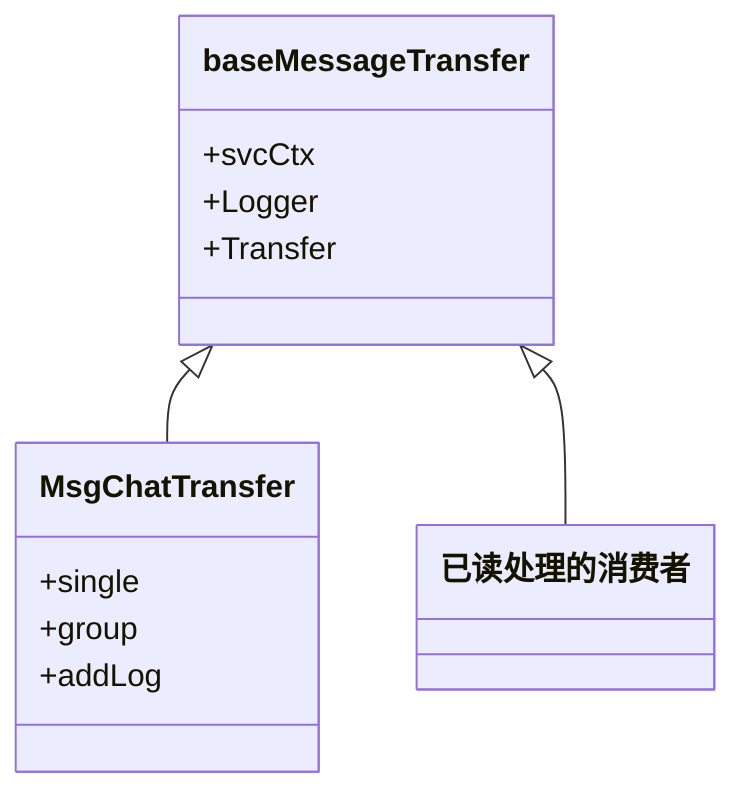

# 8-6-实现群聊消息已读未读（上）

本节课通过三个环节来讲解：首先对数据结构进行处理，因为消息的已读未读必然涉及相关的接收及数据记录；然后再让 WebSocket 与 Task 分别支持已读与未读。先对数据结构进行处理。

数据结构处理要进到 IM 的模型，找到消息模型，在其中增加一个字段，用来记录消息已读。完成之后再回到 WebSocket 的数据传输类型。这里还需要定义一些数据类型：对照图来看，客户端要向服务端告知哪些消息是已读的，服务端就需要一个字段来接收客户端已读的消息请求。回到代码，增加一个用于处理已读消息的结构：先定义聊天类型，然后是接收者的 ID、会话 ID，重点是消息 ID，必须知道有哪些消息需要已读，所以要把消息 ID 传递进来；而接收者 ID 只是说明把当前的已读结果要推送给谁。已读消息请求的结构就定义到这里。

WebSocket 的数据传输类型定义在 ws.go 中，Chat 与 Push 两个结构体的字段都通过 mapstructure 标签完成映射：

```go
type Chat struct {
    ConversationId string `mapstructure:"conversationId"`
    SendId string `mapstructure:"sendId"`
    RecId string `mapstructure:"recvId"`
    SendTime int64 `mapstructure:"sendTime"`
    Msg string `mapstructure:"msg"`
}

type Push struct {
    ConversationId string `mapstructure:"conversationId"`
    constants.ChatType `mapstructure:"chatType"`
    SendId string `mapstructure:"sendId"`
    RecId string `mapstructure:"recvId"`
    RecIds []string `mapstructure:"recvIds"`
    SendTime int64 `mapstructure:"sendTime"`
    constants.MType `mapstructure:"mType"`
    Content string `mapstructure:"content"`
}
```

现在再次对 Task 增加相关的结构，支持已读的处理。已读这件事，IM 的 WebSocket 已经新增了一个方法去处理，为了不与这里冲突，Task 同样也增加一个方法来处理已读，即增加一个消费者来处理已读的事件，它需要会话 ID、发送者 ID 以及消息 ID。这些结构定义在 mq.go 中，其中 MsgChatTransfer 是消息转发沿用的传输结构，MsgMarkRead 则是新增的、用于承载已读事件的结构：

```go
type MsgChatTransfer struct {
    ConversationId string `json:"conversationId"`
    constants.ChatType `json:"chatType"`
    SendId string `json:"sendId"`
    RecId string `json:"recvId"`
    RecIds []string `json:"recvIds"`
    SendTime int64 `json:"sendTime"`
    constants.MType `json:"mType"`
    Content string `json:"content"`
}

type MsgMarkRead struct {
    // ... (未完全展示)
}
```

结构定义好了，接下来对 Task 进行处理。已经有一个消息队列用于处理消息转发，现在需要增加一个新的消息队列用于处理已读和未读，而处理完之后的结果也需要重新转发给对应的目标。这两者只是在处理过程中所涉及的业务有一点差别，最终的结果都是发送，所以将两者共同的发送方法封装起来，封装到一个 Base 结构体中：定义一个 Transfer 来代表整体的发送业务逻辑，再让这两个类分别继承这个 Base 结构体，避免重复写代码。



现在进行调整，进到代码中。第一步，在 msgTransfer 中定义一个 MessageTransfer，再定义一个 baseMessageTransfer，它的参数就是 svcCtx 以及日志，并为它提供一个 new 方法：

```go
type baseMsgTransfer struct {
    svcCtx *svc.ServiceContext
    logx.Logger
}

func (m *baseMsgTransfer) new() {
    // ... (未完全展示)
}
```

方法定义完之后，再定义 MsgChatTransfer，这个 Transfer 用于转发消息。转发时需要区分是群聊还是私聊，分别提供对应的处理方法。私聊的处理从原消息转发逻辑中复制过来，没有特别的调整；再复制一份用于处理群聊的，群聊的处理同样可以直接复制过来：

```go
func (m *MsgChatTransfer) single(data *mq.MsgChatTransfer) error {
    return m.svc.WsClient.Send(websocket.Message{
        FrameType: websocket.FrameData,
        Method: 「push」,
        FormId: constants.SYSTEM_ROOT_UID,
        Data: data,
    })
}

func (m *MsgChatTransfer) group(ctx context.Context, data *mq.MsgChatTransfer) error {
    users, err := m.svc.Social.GroupUsers(ctx, &socialclient.GroupUsersReq{
        GroupId: data.RecvId,
    })
    if err != nil {
        return err
    }
    data.RecvIds = make([]string, 0, len(users.List))
    // ... (后续代码未完全展示)
}
```

消息记录与会话状态更新的公共逻辑则统一由 addLog 承担，它负责将消息记录到 ChatLog 表中，并更新会话的状态：

```go
func (m *MsgChatTransfer) addLog(ctx context.Context, data *mq.MsgChatTransfer) error {
    chatLog := immodels.ChatLog{
        ConversationId: data.ConversationId,
        SendId: data.SendId,
        RecId: data.RecvId,
        ChatType: data.ChatType,
        MsgFrom: 0,
        MsgType: data.MType,
        MsgContent: data.Content,
        SendTime: data.SendTime,
    }
    err := m.svcCtx.ChatLogModel.Insert(ctx, &chatLog)
    if err != nil {
        return err
    }
    return m.svcCtx.ConversationModel.UpdateMsg(ctx, &chatLog)
}
```

整体上没有特别的问题，在这里调用即可，这样一个 baseMessageTransfer 就写好了。回到原来的消息转发消费者，做如下更改：删除它的私聊和群聊的处理，以及 addLog 这一段处理，然后让它创建的时候使用 baseMessageTransfer，并填写好要发送的数据：聊天的类型、发送者、接收者、接收者列表、发送的时间，以及消息类型、发送的内容。再更改服务上下文的引用为 svcCtx。这就是调整后的整体结构。

整体调整完之后，接下来增加对已读与未读的处理。进到配置文件，在配置文件中增加一个用于接收已读未读的消费者，定义完成之后填好对应的配置。配置没问题之后，创建好对应的消费者，它就是用于处理已读与未读的。

对于已读未读还有一个要注意的地方：此处属于新消息，新消息发送之后，正常来说也需要记录一下已读的数据情况。因此要通过 bootmap 得到默认已读的对象，发送消息本身它自己肯定是已读的，把它设置进去。如果发送者自己都不是已读状态，这个事情就有意思了。

回到上面继续完善内容，把已读处理这部分拆出来。定义对已读处理的消费者，它同样使用 baseMessageTransfer，其声明的对象是一个接口，即 Kafka 的消费者接口。这里报异常是因为当前这个对象还没有实现下面的接口，属于正常情况，在下面定义对该接口的实现即可。最后打印一条信息，标明当前这个是用于处理消息的已读未读接收的消费者。
