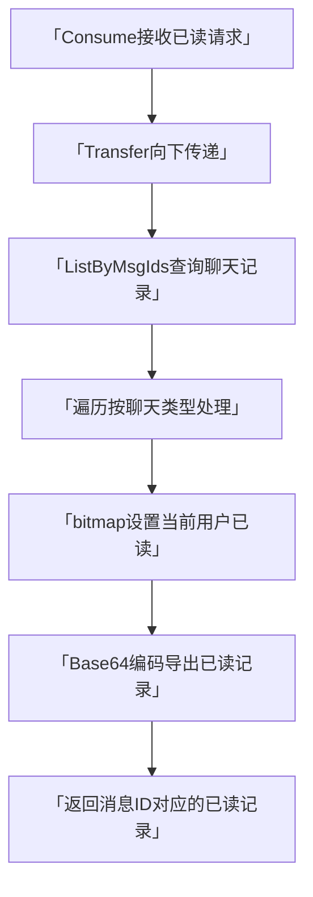

# 8-7-实现群聊消息已读未读（中）

接下来接收消息，过程和前面的处理相似，将其复制过来。Consume 方法的作用是接收由 WebSocket 发送的已读未读处理请求，把接收到的 JSON 字符串反序列化为 mq.MqMarkRead 结构体，并做好错误处理，处理完之后交给 Transfer 去处理：

```go
func (m *MsgReadTransfer) Consume(key, value string) error {
    var data mq.MqMarkRead
    ctx := context.Background()
    if err := json.Unmarshal([]byte(value), &data); err != nil {
        return err
    }
    return m.Transfer(ctx, &data)
}
```

这里通过 Transfer 方法将数据继续向下传递：

```go
return m.Transfer(ctx, &data)
```

再往后看。后面的内容中，发送也是需要的，这段内容与前面具有相似性，除了下面的属性之外基本一致，可以先将其注释掉。重点就是这一段业务处理：此处属于消费者，会接收到由 WebSocket 发送的已读未读的处理，自然要去更新这个用户对这些消息的已读未读记录。

所以再提供一个方法，用来修改聊天记录中的已读。它更新完这个用户对这一系列消息的已读之后，已读情况需要返回给接收者，可能是群，也可能是其他私人用户。一个用户可能看一个会话中的很多条聊天记录，这种情况就会有一组消息 ID；这组消息 ID 的已读记录发生了变更，就要返回出来做更新，发送给对应的用户。所以最好用一个 map：以消息 ID 做 key，value 则是已读记录。发送给接收者之后，接收者就可以据此知道这些消息已经被哪些人已读了。此处走的是 MQ，下一步推送给 WebSocket，再从 WebSocket 转发给接收者，过程上没有问题；尽量让它以 Stream 的方式传输更合适，所以 value 的结果也是 Stream 类型，两者都用 Stream 传输。

定义一个响应的结果，然后根据消息 ID 进行查询。这里少了一个方法，根据 ID 集合获取对应的消息，补上它，根据 ID 集合进行查询并返回结果。这个方法就是 ListByMsgIds，它根据消息 ID 集合从数据库中查询对应的聊天记录：

```go
func (m *defaultChatLogModel) ListByMsgIds(ctx context.Context, msgIds []string) ([]*ChatLog, error) {
    ids := make([]primitive.ObjectID, len(msgIds))
    for _, id := range msgIds {
        oid, err := primitive.ObjectIDFromHex(id)
        if err != nil {
            return nil, err
        }
        ids = append(ids, oid)
    }
    filter := bson.M{
        「_id」: bson.M{
            「$in」: ids,
        },
    }
    // ... (省略查询执行代码)
}
```

处理一下它的 ID。这里的 IDs 有点冲突，把 ID 传进来，返回两个结果：一个是 ID，第二个是异常。处理完之后增加一个过滤，然后查询，查询完把结果返回出去。再把方法增加到 interface 中，就可以了。

同时再增加一个方法，用于修改已读，修改 ID 记录中的已读记录，参数是 ID 和已读的记录。修改时第一个参数是查询的结果，第二个参数是要修改的内容，在数据层中实现，返回异常。所以要添加两个方法：一个用于查询 ID，一个用于修改当前记录的已读信息。

回到前面，使用刚刚定义的这些方法：先把 ID 传进去做好查询，然后处理已读。现在已经得到了一堆聊天记录，每一条都含有已读记录的字段，所以要遍历每一个聊天，依据聊天类型进行相应的处理，群聊和私聊这两个字段肯定是不一样的。这些逻辑封装在 UpdateChatLogRead 方法中：

```go
func (m *MsgReadTransfer) UpdateChatLogRead(ctx context.Context, data *mq.MqMarkRead) (map[string]string, error) {
    res := map[string]string{}
    chatLogs, err := m.svcCtx.ChatLogModel.ListByMsgIds(ctx, data.MsgIds)
    if err != nil {
        return nil, err
    }
    for _, chatLog := range chatLogs {
        switch chatLog.SingleChatType {
        case constants.SingleChatType:
            readRecords := bitmap.Load(chatLog.ReadRecords, chatLog.SendId)
            chatLog.ReadRecords = readRecords
            res[chatLog.HexId] = base64.StdEncoding.EncodeToString(chatLog.ReadRecords)
        }
    }
    return res, nil
}
```

如果是私聊，简单地把唯一（的已读状态）设置一下就可以了；群聊则需要根据聊天记录中所记录的已读记录进行解析，得到已读列表，再通过它计算并设置当前用户（使用发送者）为已读状态，然后导出写回到记录中，这样就处理好了。

处理好之后，在返回的结果列表中也记录一下：根据聊天消息的 ID 做 key，采用 Base64 将这些二进制数值进行转化，保障网络传输过程中的精度；同样也可以根据 Base64 将其再转化回二进制，以此列明哪些消息被读、哪些消息未读，再修改聊天记录。之后返回 res 结果，已读就修改完了。



在集成调用业务这里，把刚刚订阅到的两个结果传进来，返回的应该叫做已读记录。那这个已读记录怎么发送出去呢？可以在字段中增加已读记录的发送，同时再增加一个字段叫内容类型，标明要发送的内容的类型。再定义一个常量，用于记录内容的类型：第一个类型表示内容属于消息聊天，第二个类型标记为已读：

```go
type MType int
const (
    TextType MType = iota
    GroupChatType MType = iota + 1
    SingleChatType MType = iota + 2
)

type ContentType int
const (
    ContentChat ContentType = iota
)
```

回到这里，内容类型字段使用刚刚定义的类型，属于已读记录的内容类型，把已读记录放进来即可。这里还有一个消息节点先不创建。到此，消息队列这边的已读处理大体完成，剩下的就是去 WebSocket 中增加对已读的记录。
