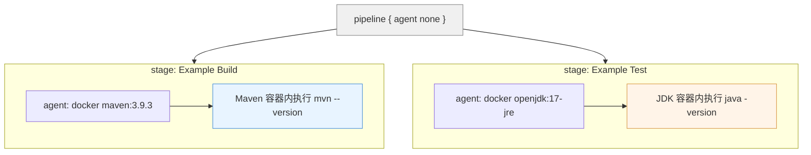

# 11. Jenkins 构建代理与 options 全局配置：从节点选择到构建行为管控

## 纲要

- **`agent` 决定"在哪跑"**：可选配置，不写默认 `any`；四种写法 `any` / `none` / `{ label 'xxx' }` / `{ node { label + customWorkspace } }`
- **`any`、`none`、`label` 的本质区别**：`any` 任意可用节点、`none` 全局不指定由各 stage 自己声明、`label` 精确指定标签节点
- **全局代理 vs 局部代理**：全局代理对所有 stage 生效；**局部代理优先**，配了就用局部的，没配才回落到全局
- **标签名是"变量"不是"名称"**：新建节点时那个 input 框只是显示名，真正用于匹配的是 **Label**，填错就匹配不上
- **`options` 是流水线的全局行为开关**：七项常用行为——重试、超时、时间戳、并行快速失败、禁用并发、构建保留数、跳过默认检出
- **局部配置优先于全局**：`timeout` / `retry` 既可写在 `options` 也可包在具体 step 外层，就近原则生效
- **自由式项目配这些要东拼西跑**：流水线在 `options` 一处统一管理，直观、简洁、可进 Git——这是 Pipeline 相对自由式的又一优势

## 一、构建代理：流水线跑在哪个节点上

### 1.1 agent 是什么

在 Jenkins Pipeline 中，**构建代理是通过 `agent` 块来定义的——它决定在哪一个节点执行这个 pipeline 脚本**。

两个基本认知：

- **`agent` 是可选配置**；
- **如果不提供 `agent` 块，它默认使用 `any` 代理**——意味着在多个节点的情况下，它会使用**任意一个可用的节点**来执行。

### 1.2 四种写法

```groovy
agent any                                    // 任意可用节点
agent none                                   // 全局不指定，由各 stage 自己声明
agent { node { label 'labelName' } }         // 指定标签节点
agent { label 'labelName' }                  // 上一行的简写，二者等价
```

**还可以加自定义工作空间**：

```groovy
agent {
    node {
        label 'my-defined-label'
        customWorkspace '/some/other/path'
    }
}
```

> 前两种写法（`agent { node { label 'x' } }` 与 `agent { label 'x' }`）**用法完全一样**，后者是简写形式。

### 1.3 三种 agent 取值的语义

| 取值 | 语义 | 典型场景 |
|---|---|---|
| `any` | 在**任意一个可用节点**上执行 | 单节点或不挑环境 |
| `none` | **全局不指定代理**，由每个 stage 自己声明 | 不同 stage 需要不同工具链镜像 |
| `label 'xxx'` | 只在**带指定标签**的节点上执行 | 精确控制构建环境（如需 GPU、特定 JDK） |

### 1.4 全局代理与局部代理

**代理分为全局代理和局部代理：**

- **全局代理**：定义在 `pipeline` 层，**所有的步骤都会在这个代理节点执行**；
- **局部代理**：定义在 `stage` 层，**该步骤会优先在局部代理这个节点执行**；没有配置局部代理的步骤，则使用全局代理。

这个机制最经典的用法是**一个流水线里用多个工具链镜像**：

```groovy
pipeline {
    agent none                          // 全局不指定
    stages {
        stage('Example Build') {
            agent {
                docker {
                    label 'slave'
                    'maven:3.9.3-eclipse-temurin-17'
                    // 如果需要加参数
                    // args '-v /path/to/mount:/tmp'
                }
            }
            steps {
                echo 'Hello, Maven'
                sh 'mvn --version'
            }
        }
        stage('Example Test') {
            agent { docker 'openjdk:17-jre' }
            steps {
                echo 'Hello, JDK'
                sh 'java --version'
            }
        }
    }
}
```

Build 阶段在 Maven 容器里跑，Test 阶段在 JDK 容器里跑——**每个 stage 用不同镜像，互不污染，且节点上无需预装 Maven/JDK**。



### 1.5 配置并使用代理标签

**第一步：在 Jenkins 建节点并定标签。**

**管理 Jenkins → 节点和云管理 → 新建节点**，给节点名称、选"固定节点"（或通过 Java Web 启动代理），**在这里定义标签（Label）**，保存。

**第二步：在目标服务器启动节点。**

点进刚建的节点，把页面生成的那串命令复制下来，到目标服务器上粘贴执行，这台服务器就会作为 Jenkins 的一个节点启动。

**第三步：在流水线里引用标签。**

```groovy
pipeline {
    agent any
    stages {
        stage('Build') {
            agent {
                node {
                    label 'your-label'      // 填第二步复制的标签名
                }
            }
            steps {
                sh 'echo hello'
            }
        }
    }
}
```

> **最大的坑：标签名是"变量"，不是"名称"。** 课件特别强调——新建节点时你填的那个名字只是显示用的名称，**真正用于匹配的是 Label 字段**。把显示名当标签填进流水线，会一直匹配不上。
>
> 另外，如果标签对应的节点没有启动，流水线会报"节点不在线"，这不是配置错，是节点没起来。

## 二、options：一条流水线的全局行为开关

### 2.1 options 解决什么问题

有些行为是**整条流水线通用**的，不适合写在某个 stage 里。比如：

- 失败了要不要重试？
- 最多跑多久？
- 日志要不要带时间戳？
- 保留多少个构建历史？
- 能不能同时跑多个构建？

**这些统一放在 `options` 块里配置**，定义在 `pipeline` 层：

```groovy
pipeline {
    agent any
    options {
        // 全局行为配置放这里
    }
    stages {
        ...
    }
}
```

### 2.2 七项常用行为

```groovy
options {
    retry(3)                                          // ① 失败重试
    timeout(time: 1, unit: 'HOURS')                   // ② 超时时间
    timestamps()                                      // ③ 日志时间戳
    parallelsAlwaysFailFast()                         // ④ 并行快速失败
    disableConcurrentBuilds(abortPrevious: true)      // ⑤ 禁用并发构建
    buildDiscarder(logRotator(numToKeepStr: '10'))    // ⑥ 构建保留数
    skipDefaultCheckout()                             // ⑦ 跳过默认检出
}
```

逐项拆解：

**① `retry(3)` —— 失败时重试整个管道指定的次数。**

适合应对偶发抖动（网络超时、临时资源不足）。课件里演示：克隆一个不存在的仓库必然报错，配置 `retry(3)` 后能看到控制台打出三次重试。

> **注意**：`retry` 是"失败后整体重来"，不是"重试失败的那一步"。对确定性错误（代码编译不过）重试没意义，反而浪费时间。

**② `timeout(time: 1,unit: 'HOURS')` —— 配置执行的超时时间。**

整个流水线如果构建一小时还没完成，就超时，**整个流水线自动停止**。单位可选 `MINUTES` / `SECONDS` / `HOURS`。

课件演示：命令实际是 `sleep 5`，配 `timeout(time: 3,unit: 'SECONDS')`，构建直接被超时终止。

> **生产必配**：没有超时的流水线，一个卡住的步骤能挂几天，占着 executor 不释放。

**③ `timestamps()` —— 控制台日志添加时间戳。**

构建完成后在控制台看日志，**每行前面会显示这行是什么时候打印的**。排查"哪一步突然变慢"时非常有用。

**④ `parallelsAlwaysFailFast()` —— 并行执行时，有一个失败则流水线马上退出。**

并行跑三个步骤，其中一个失败，**整个流水线立即终止**，不等其他两个跑完。省资源，也避免无意义的等待。

**⑤ `disableConcurrentBuilds(abortPrevious: true)` —— 终止旧构建，只保留最新的构建。**

当前构建还没跑完，你又点了一次新构建，**旧的这个构建会被自动取消**。

课件演示得很直观：连续点多次构建，默认情况多个构建同时在跑；打开这个选项后，**旧构建立刻被终止，只保留最新那个**。

> **适用场景**：同一个项目频繁提交时，避免老的构建白白消耗资源。**不适用**：需要保留每次构建历史的审计场景。

**⑥ `buildDiscarder(logRotator(numToKeepStr: '10'))` —— 只保存最近 N 个构建。**

构建历史超过 10 个之后，**自动删除更早的**。课件里从 1~27 个构建，加上这个配置后再构建，列表变成 19~28，正好 10 个。

> 这是防止 Jenkins 磁盘被构建历史撑爆的关键配置，**生产环境必须加**。

**⑦ `skipDefaultCheckout()` —— 跳过默认检出代码。**

默认情况下运行流水线，**它会自动帮你拉取指定的 Jenkins 流水线代码**（即 Pipeline script from SCM 配的那个仓库）。

加上这个选项后，它**不会自动拉**，你需要在流水线脚本里手动写 `checkout scm` 才会检出。

> **什么时候用手动？** 当你的 `Jenkinsfile` 和业务代码**不在同一个仓库**时，默认检出只会拉 `Jenkinsfile` 所在仓库，业务代码需要你在脚本里显式克隆。反之如果同一个仓库，让它默认拉就行。

### 2.3 局部配置：就近原则，优先生效

`timeout` 和 `retry` 既能写在 `options`（全局），也能包在具体 step 外层（局部）：

```groovy
pipeline {
    agent any
    stages {
        stage('Stage 1') {
            steps {
                timeout(time: 3, unit: 'SECONDS') {
                    sh 'sleep 4'                 // 睡 4 秒 > 3 秒超时，必然失败
                }
            }
        }
        stage('Stage 2') {
            steps {
                retry(2) { sh 'echo hello' }
            }
        }
    }
}
```

**优先级规则**：**如果配置了局部配置，它优先局部配置生效；如果没有配置局部，默认就使用全局配置。**

课件演示：全局不配超时，但在 Stage 1 里配 `timeout(3s)` 而实际 `sleep 30`，该阶段直接超时失败，其他阶段不受影响。

### 2.4 为什么这些配置必须用 Pipeline 而不是自由式项目

课件做了个对比实验，结论很明确。

自由式项目要配这些行为，得**东一块西一块**：

- 时间戳 → 去"构建环境"里勾；
- 超时 / 丢弃旧构建 → 去"全局"里配；
- 不同构建行为散落在完全不同位置的配置页。

**三个问题**：

1. **配置凌乱**：没有一个统一入口，不直观；
2. **Jenkins 挂了全丢**：配置存在 Jenkins 数据库里，重装后几十个构建要重新点一遍；
3. **不好管理、有安全隐患**：散落的配置难以 Review，密码类配置容易失控。

而用流水线，**所有行为在 `options` 一处统一配置和管理**，直观简洁、修改方便、放在 Git 仓库里易管理也更安全。

## 三、常见报错与排查

| 现象 | 根因 | 解法 |
| --- | --- | --- |
| 报"缺失请求参数 agent.node" | `label` 拼错（如写成 `BEL`） | 改回 `label`，用"检查语法"验证 |
| 流水线一直排队不执行 | 标签节点未启动 | 在目标服务器执行节点启动命令 |
| 报"节点不在线" | 标签匹配到的节点没运行 | 确认节点已起，或改用 `agent any` |
| `retry` 配了但没重试 | 错误是确定性的且首次就失败在解析期 | `retry` 只包运行期失败；检查语法错误 |
| `timeout` 不生效 | 写在了 `options` 外或单位错 | 放 `options` 内，单位用 `HOURS`/`MINUTES`/`SECONDS` |
| 构建历史爆磁盘 | 没配 `buildDiscarder` | 加 `buildDiscarder(logRotator(numToKeepStr: 'N'))` |
| 多个构建同时跑互相干扰 | 没禁并发 | 加 `disableConcurrentBuilds(abortPrevious: true)` |
| 代码没被拉下来 | 加了 `skipDefaultCheckout` 但没手动 checkout | 脚本里补 `checkout scm` |

## 四、面试考点与追问

**Q1：`agent any`、`agent none`、`agent { label 'x' }` 的区别？**
`any` 在任意可用节点执行；`none` 是全局不指定，要求每个 stage 自己声明 agent（用于多工具链场景）；`label 'x'` 只在带指定标签的节点执行。不写 agent 默认等价于 `any`。

**Q2：全局代理和局部代理的优先级？**
配在 `pipeline` 层的是全局代理，对所有 stage 生效；配在 `stage` 层的是局部代理。**局部优先**——该 stage 用局部代理，未配局部的 stage 用全局代理。

**Q3：`options` 里哪些配置是生产环境必须加的？**
至少三个：`timeout`（防止卡死的步骤永久占用 executor）、`buildDiscarder`（防止构建历史撑爆磁盘）、`timestamps`（日志可定位时序问题）。高并发项目再加 `disableConcurrentBuilds(abortPrevious: true)`。

**Q4：`retry` 和 `timeout` 能配在哪些位置？优先级如何？**
两者既能配在 `options`（全局）也能包在具体 step 外层（局部）。**局部配置优先生效**，未配局部时才回落全局。这个就近原则适用于所有支持双层配置的指令。

**Q5：`skipDefaultCheckout()` 的作用与使用场景？**
默认流水线会自动检出 SCM 里配置的仓库代码。加上它则跳过自动检出，需要脚本里手动 `checkout scm`。适用场景：`Jenkinsfile` 与业务代码不在同一仓库，需要分别检出；或想用自定义的检出逻辑（指定分支、浅克隆、子模块）。

**Q6：为什么说 Pipeline 的 options 配置优于自由式项目？**
三个理由：**统一入口**（所有行为在 `options` 一处，直观简洁）；**可版本化**（配置即代码，进 Git 可 Review、Jenkins 可无状态重建）；**安全**（避免敏感配置散落在数据库里难以审计）。自由式项目的行为配置分散在"构建环境""全局"等多个页面，Jenkins 一挂全丢。

## 📎 文本↔代码关联

本篇对应课件源码（`code/3-基础-Jenkins/`，已做去品牌化处理）：

| 代码文件 | 正文提及 | 内容 |
| --- | --- | --- |
| `code/3-基础-Jenkins/课件/教学课件.md` | 第 1.2 / 1.4 节 | 构建代理五种写法 + `agent none` 多镜像 stage 完整示例 |
| `code/3-基础-Jenkins/课件/教学课件.md` | 第 2.2 / 2.3 节 | `options` 七项全局行为 + 局部 `timeout`/`retry` 示例 |
| `code/4-进阶-Jenkins/Jenkinsfile/Jenkinsfile-静态代理节点` | 第 1.5 节 | 静态代理节点上的 Jenkinsfile 样例 |
| `code/3-基础-Jenkins/Jenkinsfile/Jenkinsfile-流水线基础（基础课程所有笔记都在此文件）` | 第 1.5 / 2.2 节 | 含 `options`（`buildDiscarder`/`timestamps`/`skipDefaultCheckout` 等）的完整生产模板 |

**技术点总结**：`agent` 决定流水线在哪跑——`any` 任意节点、`none` 全局不指定（交给 stage）、`label` 精确匹配标签；**标签是变量不是显示名**，这是最常踩的坑。全局代理对所有 stage 生效，**局部代理优先**。`options` 是流水线全局行为开关，生产必配三件套是 `timeout`（防卡死占资源）、`buildDiscarder`（防磁盘爆）、`timestamps`（日志可定位）；`retry`/`timeout` 支持双层配置且**局部优先**。这些配置用 Pipeline 而非自由式项目的根本原因是：统一入口、可版本化、更安全。

