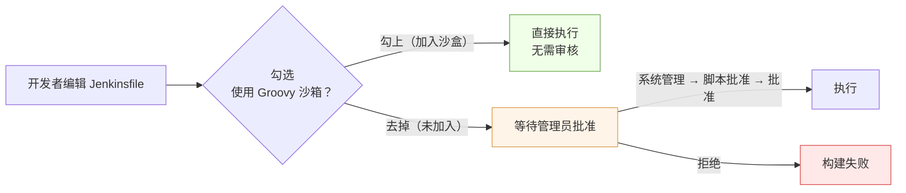

# 12. Jenkins sh 步骤引号用法与 Groovy 沙箱审核机制

## 纲要

- **`sh` 步骤有四种引号写法**：单引号、双引号、三单引号、三双引号——差别只在**换行**与**内部同类引号转义**
- **单双引号不能换行**：要换行必须加反斜杠转义符，否则语法错误
- **内部同类引号必须转义**：外层单引号里再用单引号、外层双引号里再用双引号，都要加 `\`
- **三引号（`'''` / `"""`）是唯一能自然换行的写法**：不需要任何转义，写多行脚本首选
- **Jenkins 会自动缩进三引号内容**：顶格书写时要手动移到最左，否则脚本首行带空格
- **Groovy 沙箱是安全审核机制**：对 Pipeline 脚本做人工审批，批准后才能执行
- **沙箱复选框的位置与语义**：勾上=加入沙盒免审核；去掉=每次编辑都要重新审批
- **生产实践**：频繁迭代的流水线应勾上沙箱复选框，否则每改一行就要批一次，效率无法接受

## 一、sh 的四种引号写法

`sh` 是 Pipeline 里执行 shell 命令的步骤。命令字符串有四种写法，规则其实只有两条。

### 1.1 规则一：能不能换行

| 写法 | 能否换行 | 换行方式 |
|---|---|---|
| `sh '...'`（单引号） | ❌ 不能 | 必须加 `\` 转义符 |
| `sh "..."`（双引号） | ❌ 不能 | 必须加 `\` 转义符 |
| `sh '''...'''`（三单引号） | ✅ 可以 | 直接换行，无需转义 |
| `sh """..."""`（三双引号） | ✅ 可以 | 直接换行，无需转义 |

### 1.2 规则二：内部同类引号要转义

- 外层是**单引号**，里面又用单引号 → 里面的要加 `\` 转义；
- 外层是**双引号**，里面又用双引号 → 里面的要加 `\` 转义；
- 外层单引号 + 里面双引号 → **不需要转义**；
- 外层双引号 + 里面单引号 → **不需要转义**。

一句话：**只有"同类相撞"才需要转义。**

### 1.3 四种写法对照示例

```groovy
pipeline {
    agent any
    stages {
        stage('Quotes') {
            steps {
                // ① 外层单引号，内含双引号 -> 不需要转义
                sh 'echo "hello world"'

                // ② 外层单引号，内含单引号 -> 需要转义
                sh 'echo \'hello world\''

                // ③ 外层双引号，内含单引号 -> 不需要转义
                sh "echo 'hello world'"

                // ④ 外层双引号，内含双引号 -> 需要转义
                sh "echo \"hello world\""

                // ⑤ 三单引号 -> 可换行，无需转义
                sh '''
                    echo "line 1"
                    echo 'line 2'
                    ls -la
                    pwd
                '''

                // ⑥ 三双引号 -> 可换行，无需转义
                sh """
                    echo "line 1"
                    echo 'line 2'
                """
            }
        }
    }
}
```

### 1.4 三引号的自动缩进陷阱

课件里专门提到一个细节：使用三引号时，**Jenkins 会帮你进行缩进**。

意思是：三引号块里的内容如果本身有前导空格，Jenkins 会保留这些空格传给 shell。对于 `#!/bin/sh` 这类**首行必须是顶格**的脚本，前导空格会导致解释器报错。

> **规避方法**：写三引号脚本时，**把内容移到最顶格**，不要依赖编辑器自动缩进。这也是 Tekton 的 `script` 字段第一行必须写 shebang 的同类问题。

### 1.5 选型建议

| 场景 | 推荐写法 |
|---|---|
| 单行简单命令 | `sh '...'` 或 `sh "..."` |
| 命令里要插 Groovy 变量 | `sh "..."`（双引号才做变量展开） |
| 多行脚本（安装依赖、构建、部署） | **`sh '''...'''` 或 `sh """..."""`** |
| 脚本内含大量引号 | 三引号，免去转义地狱 |

> **重点记第三条**：真实项目里 `sh` 步骤九成是多行脚本，三引号是主力写法。不会用三引号，写复杂流水线时会非常痛苦。

## 二、Groovy 沙箱：Pipeline 脚本的审核机制

### 2.1 沙箱是什么

**Groovy 沙箱（Groovy Sandbox）是 Jenkins 的一种安全机制**，它可以通过沙箱对你的 Pipeline 脚本进行一个**审核功能**——审核通过之后才可以使用流水线的脚本。

为什么需要它？因为 Pipeline 脚本本质是**在 Jenkins 主控节点上执行的 Groovy 代码**。如果没有任何约束，一个有恶意的或不小心写错的脚本可以：

- 读 Jenkins 上的凭据并外传；
- 执行任意系统命令；
- 删除 Jenkins 配置或其他 Job。

沙箱的作用是**给脚本加一道人工闸门**：不是谁写的脚本都能直接跑，必须经过批准。



### 2.2 复选框在哪，勾与不勾差什么

位置：**编辑流水线页面下边的一个复选框——"使用 Groovy 沙箱"（Use Groovy Sandbox）**。

| 状态 | 行为 |
|---|---|
| **勾上**（加入沙盒） | **不需要审核**，脚本有权限直接操作 |
| **去掉**（未加入沙盒） | **每编辑一次，都需要先批准**，这个脚本才可以使用 |

### 2.3 批准的入口

**系统管理 → 脚本批准（Script Approval）**，里面会列出所有等待批准的脚本，可以：

- **批准运行（Approve）**：批准后该脚本即可构建；
- **拒绝运行（Reject）**：脚本无法执行。

### 2.4 完整走一遍

**场景一：未加入沙盒，编辑后构建。**

1. 把"使用 Groovy 沙盒"复选框**去掉**，点保存，再点构建；
2. 构建**立即报错**——提示脚本没有批准使用；
3. 去 **系统管理 → 脚本批准**，找到等待批准的脚本，点**批准**；
4. 回到流水线再点构建，**正常执行**。

**场景二：再次编辑，又要批。**

1. 在脚本里再加一行，保存后构建；
2. **又报同样的错**——因为每次编辑都产生了新的待批准签名；
3. 再去脚本批准一次，构建才通过。

**场景三：勾上复选框，不再有提示。**

1. 把"使用 Groovy 沙盒"复选框**勾上**；
2. 再加一行、保存、立即构建；
3. **这次构建没有任何限制**，直接通过。

### 2.5 生产实践建议

课件给了明确结论：

> 因为你把这个复选框去掉的话，那你**每一次的编辑都需要审核批准，这样就比较繁琐**，所以我们需要把它勾上。

**但这里要补一个安全视角的提醒**：勾上沙盒等于**放弃人工审核这道闸门**。合理的实践是分场景：

| 场景 | 建议 |
|---|---|
| 团队内部、可信人员维护的流水线 | 勾上沙盒，保证迭代效率 |
| 多人可编辑、权限较松的 Jenkins | **不勾**，强制每次变更走审批 |
| 生产发布类高危流水线 | **不勾**，且配合 RBAC 限制可编辑者 |

> **核心权衡**：沙箱是"效率"与"安全"的开关。全勾上图省事，就丧失了脚本审核的意义；全不勾，日常迭代会被审批拖死。按流水线的敏感度分别配置才是正解。

## 三、常见报错与排查

| 现象 | 根因 | 解法 |
| --- | --- | --- |
| `sh '...'` 报 `unexpected EOF while looking for matching` | 单引号未闭合或内部引号未转义 | 内部同类引号加 `\` |
| 多行命令语法错误 | 单/双引号里直接换行 | 改用三引号，或加 `\` 续行 |
| 脚本报 `bad interpreter: No such file` | 三引号内容有前导空格，shebang 不在行首 | 三引号内容顶格书写 |
| 构建报"脚本没有批准使用" | 未勾沙盒且脚本未批准 | 系统管理 → 脚本批准 → 批准 |
| 每次改流水线都要批一次 | 未勾"使用 Groovy 沙盒" | 勾上复选框（需评估安全影响） |
| 双引号里 Groovy 变量没展开 | 用了单引号 | 变量展开必须用双引号 `"${VAR}"` |

## 四、面试考点与追问

**Q1：`sh` 步骤单引号、双引号、三引号的区别？**
单双引号都不能换行（需 `\` 转义），且内部同类引号要转义；三单引号/三双引号可自然换行、无需转义。另外双引号会做 Groovy 变量展开，单引号不展开。

**Q2：为什么多行 shell 脚本推荐用三引号？**
两个原因：① 无需反斜杠续行，可读性好；② 内部引号不需要转义，避免转义地狱。代价是 Jenkins 会保留内容的前导缩进，所以脚本要顶格写。

**Q3：Groovy 沙箱解决什么安全问题？**
Pipeline 脚本是在 Jenkins 主控节点上执行的 Groovy 代码，无约束时可读凭据、执行任意命令、破坏配置。沙箱引入人工审批：未加入沙盒的脚本必须经管理员批准才能执行，防止恶意或错误脚本直接运行。

**Q4："使用 Groovy 沙盒"复选框勾上与去掉的区别？**
勾上=脚本加入沙盒，有权限直接执行，无需审核；去掉=脚本未加入沙盒，每次编辑都会产生新的待批准签名，必须经"系统管理 → 脚本批准"批准后才能构建。

**Q5：生产环境应该怎么配沙箱？**
按敏感度分档：内部可信流水线勾上（保证迭代效率）；多人可编辑的 Jenkins 不勾（强制审批）；生产发布类高危流水线不勾并配合 RBAC 限制编辑者。全勾丧失审核意义，全不勾拖死迭代。

**Q6：三引号内容为什么有时会导致 `bad interpreter` 错误？**
因为 Jenkins 会把三引号块内的前导空格原样传给 shell。如果脚本首行是 `#!/bin/sh` 且带了前导空格，shell 就找不到解释器。规避方法是三引号内容顶格书写。

## 📎 文本↔代码关联

本篇对应课件源码（`code/3-基础-Jenkins/`，已做去品牌化处理）：

| 代码文件 | 正文提及 | 内容 |
| --- | --- | --- |
| `code/3-基础-Jenkins/课件/教学课件.md` | 第 1.3 节 | `credentials()` / `environment` 中 `sh` 与引号的实战用法 |
| `code/3-基础-Jenkins/Jenkinsfile/Jenkinsfile-流水线基础（基础课程所有笔记都在此文件）` | 第 1.5 / 2.4 节 | 完整生产级 Jenkinsfile，含 `sh` 多行脚本与 `environment` 块 |

**技术点总结**：`sh` 步骤的引号规则只有两条——**单双引号不能换行**（需 `\`）、**内部同类引号必须转义**，而三引号（`'''`/`"""`）可自然换行且免转义，是多行脚本的主力写法，但要注意 Jenkins 保留前导缩进、脚本需顶格。Groovy 沙箱是 Pipeline 脚本的人工审核闸门，复选框勾上免审核、去掉则每次编辑都要经"系统管理 → 脚本批准"；生产应按流水线敏感度分档配置，而非一律勾上。

