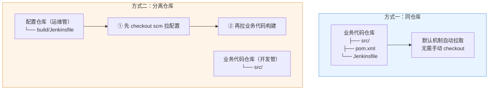

# 19. Jenkinsfile 的两种存储方式与 Jenkins CLI 命令行构建

## 纲要

- **为什么不放 Jenkins 页面**：配置存在 Jenkins 数据库里，管理麻烦、Jenkins 一挂全没、不安全也不易管理——必须抽离进 Git
- **两种存储方式**：与业务代码**同仓库**（默认机制自动拉代码）或**分离仓库**（配置仓库归运维、业务仓库归开发，需手动 `checkout scm`）
- **Script Path 的坑**：默认是根目录的 `Jenkinsfile`，放子目录必须写路径如 `build/Jenkinsfile`，且**目录名必须英文**
- **`skipDefaultCheckout()` 的语义彻底搞清**：注释掉=自动拉整个仓库；打开=不自动拉，需手动 `checkout scm`
- **同仓库就注释掉它，分离仓库就打开它**——这是唯一需要记住的决策规则
- **Jenkins CLI 用一条命令远程触发构建**：`java -jar jenkins-cli.jar -s URL -auth user:pass build job -p k=v`
- **CLI 五类常用命令**：`build` / `copy-job` / `create-job` / `delete-job` / `disable-job` / `enable-job`
- **CLI 需要 Java 环境**，且 `-p key=value` 的 key 必须是流水线里已定义的参数名

## 一、Jenkinsfile 该放哪里：先看不放的后果

目前我们把流水线脚本放在 **Jenkins 的配置页面**里，这样管理是非常麻烦的。而且：

- **如果 Jenkins 挂了**，那我们可能所有配置、所有脚本都没有了——**很不安全**；
- 也不容易管理：脚本散落在各个 Job 配置里，没有版本、无法 Review、改错无法回滚。

> **所以我们需要把这个流水线脚本抽离出来，放在 Git 仓库里面**，专门创建一个仓库来存储这个流水线脚本。而这个流水线脚本文件就叫做 **`Jenkinsfile`**。

后面我们统一使用 **Git 仓库来单独存储流水线脚本**，而不再放在 Jenkins 里面。

## 二、两种存储方式

| 方式 | 结构 | 拉代码 | 管理者 |
|---|---|---|---|
| **同仓库** | `业务仓库/` 下同时放业务代码和 `Jenkinsfile` | **默认机制自动拉**，无需手动 checkout | 开发 |
| **分离仓库** | `配置仓库/`（只放 Jenkinsfile）+ `业务仓库/`（只放代码） | **需手动 `checkout scm`** | 配置仓库归运维、业务仓库归开发 |



### 2.1 方式一：与业务代码同仓库

**优势**：**不需要再单独使用 `checkout scm`**——会有默认的机制来拉取你的代码下来，然后直接操作构建即可。第一步"拉代码"这个步骤就不需要再操作了。

### 2.2 方式二：与业务代码分离

**流程**：`Jenkinsfile` 第一步就需要通过 `checkout scm` 把**配置仓库**的代码拉下来，然后再进行构建。

**优劣**：

- **配置分得比较散**，你需要**每个仓库维护一份**；
- 但**比较灵活**，可以单独管理这些配置（运维统一管 Jenkinsfile，开发只管业务代码）。

> 课件原话：**这个 Jenkinsfile 其实各有利弊，就看你们怎么权衡了，两种方法都可以使用。**

### 2.3 分离方式的实践建议

课件提到一个常见组织方式：**把配置仓库指定到一个"基础链仓库"（基线仓库）里面**——这个仓库里有一个 `build` 目录，`build` 目录就放这个 `Jenkinsfile`，而代码也可以放在这个仓库里面。

## 三、配置 Jenkins 从 SCM 读取 Jenkinsfile

### 3.1 配置项逐项说明

在流水线配置里：

1. **Pipeline definition** 选 **`Pipeline script from SCM`**；
2. **SCM** 选 `Git`；
3. **Repository URL** 填存放 Jenkinsfile 的仓库地址；
4. **Credentials** 选该仓库的凭据（之前创建好的用户名密码）；
5. **Branches to build** 指定分支（如 `*/main`）；
6. **Script Path** —— **这是最容易出错的一项**。

### 3.2 Script Path 的规则

| 情况 | Script Path 写法 |
|---|---|
| Jenkinsfile 在仓库**根目录** | 直接写 `Jenkinsfile`（默认值） |
| Jenkinsfile 在**子目录**（如 `build/`） | 写 **`build/Jenkinsfile`**（必须加目录名） |

> 课件原话：如果需要存放在指定的路径的话，**我们需要加上目录名**。如果不需要配置指定路径的话，我们就直接写 `Jenkinsfile` 就行了，但是它是默认放在仓库的根路径。

**命名铁律：目录必须用英文。** 课件实操时用了中文目录名，结果**页面显示乱码、构建出问题**，最后只能改回英文才能正常工作。这和前面视图/文件夹的规范是同一条——**Jenkins 对中文路径的处理有缺陷**。

### 3.3 完整实操步骤

```bash
# 1. GitLab 建群组（如 jenkins-pipeline-group）
# 2. 群组下建项目（如 jenkins-pipeline），专门存 Jenkinsfile
# 3. Web IDE 里建目录（英文，如 build）
# 4. 在 build/ 下新建 Jenkinsfile，粘贴流水线内容，提交
# 5. Jenkins 流水线配置：
#    - Pipeline script from SCM → Git
#    - Repository URL: http://gitlab.example.com/jenkins-pipeline-group/jenkins-pipeline.git
#    - Credentials: 选该仓库管理员凭据
#    - Branch: */main
#    - Script Path: build/Jenkinsfile
# 6. 保存 → 构建验证
```

**验证成功的标志**：Jenkins 直接去读该仓库该分支该目录的这个文件，构建正常。

**一个附加好处**：用 Jenkinsfile 配置的流水线，Jenkins 会**自己识别配置并自动显示**那些选项——比如丢弃旧的构建、参数化构建等，**不需要像自由式构建那样一个一个去配置**。

## 四、`skipDefaultCheckout()` 与 `checkout scm` 的配合

前面讲过 `skipDefaultCheckout()` 的作用，这里结合两种存储方式给出**唯一的决策规则**。

### 4.1 两个配置的语义

| 配置 | 行为 |
|---|---|
| **`skipDefaultCheckout()` 被注释掉** | 构建时**默认自动拉取当前仓库的全部内容**（针对 SCM 配的那个仓库） |
| **`skipDefaultCheckout()` 生效（打开）** | **不自动拉代码**，需要脚本里手动拉 |

手动拉取的指令是 **`checkout scm`**：

```groovy
pipeline {
    agent any
    options {
        skipDefaultCheckout()          // 打开：不自动拉
    }
    stages {
        stage('Clean') {
            steps {
                cleanWs()              // 先清空（此时 LS 什么都没有）
            }
        }
        stage('Checkout') {
            steps {
                checkout scm           // 手动拉取仓库
                sh 'ls -la'            // 能看到整个仓库内容
            }
        }
    }
}
```

课件实测：清理工作空间后 `ls` 是空的；执行 `checkout scm` 后，**整个仓库内容又被拉下来**，`ls` 能看到。

### 4.2 决策规则（背这一条就够）

| 场景 | `skipDefaultCheckout()` | 拉代码方式 |
|---|---|---|
| **Jenkinsfile 与业务代码同仓库** | **注释掉**（用默认） | 默认机制自动拉整个业务仓库 |
| **Jenkinsfile 与业务代码分离** | **打开** | 手动 `checkout scm` 拉配置仓库，再拉业务代码 |

课件原话：

> 如果你代码目录跟你的 Jenkinsfile 放在同一个仓库了，那你就把这个配置给它注释掉就可以了，我们使用默认的方式，把整个业务代码仓库给它拉下来。那你如果业务代码跟你的 Jenkinsfile 是不同仓库、分开的话，那这一步你直接给它打开就可以。

> **注意**：分离方式下**也没有必要把 Jenkinsfile 所在仓库拉下来**——那只是配置文件，拉它没意义。

### 4.3 这条规则还影响 GitLab 状态回写

下面讲 GitLab 构建状态回写时会发现：**必须把 `skipDefaultCheckout()` 注释掉**，否则不自动拉当前分支代码，就**没有办法更新 Jenkins 状态到 GitLab**。

## 五、Jenkins CLI：一条命令远程触发构建

### 5.1 它是什么

**Jenkins CLI（命令行界面）** 让我们通过命令行对 Jenkins 的 Job 进行**构建、取消、删除**等操作。

**入口**：访问 `http://<jenkins-url>/cli`，页面里有一个 **jar 包**，下载下来。

### 5.2 命令格式

```bash
java -jar jenkins-cli.jar \
     -s http://jenkins.example.com \
     -auth admin:your-password \
     build job-name \
     -p key=value
```

| 部分 | 说明 |
|---|---|
| `java -jar jenkins-cli.jar` | 需要 **Java 环境** |
| `-s <URL>` | Jenkins 地址 |
| `-auth user:pass` | Jenkins 账号密码 |
| `build job-name` | 要执行的命令 + Job 名 |
| `-p key=value` | 传参数，**左边 key 右边 value** |

> **前置条件**：必须装 Java。课件用的是 Java 11。

### 5.3 五类常用命令

| 命令 | 作用 |
|---|---|
| **`build`** | **最常用**——触发一次构建 |
| `copy-job` | 拷贝一个 Job（原 Job 名 → 新 Job 名） |
| `create-job` | 通过命令行创建一个新的构建项目 |
| `delete-job` | 删除 Job |
| `disable-job` / `enable-job` | 禁用 / 启动 Job |

### 5.4 带参数构建实战

流水线里定义了参数化构建：

```groovy
pipeline {
    agent any
    parameters {
        choice choices: ['master', 'pre', 'test'], name: 'build_branch'
    }
    stages {
        stage('Deploy') {
            steps {
                echo "部署分支: ${build_branch}"
            }
        }
    }
}
```

CLI 传参触发：

```bash
java -jar jenkins-cli.jar \
     -s http://jenkins.example.com \
     -auth admin:your-password \
     build my-job \
     -p build_branch=master
```

课件实测：命令执行后**返回构建已在进行**，Jenkins 上立刻出现一次新构建，且参数正确生效。

> **`-p` 的 key 必须是流水线里已定义的参数名**，否则参数不生效（Jenkins 会忽略未知参数）。

## 六、常见报错与排查

| 现象 | 根因 | 解法 |
| --- | --- | --- |
| 构建读不到 Jenkinsfile | Script Path 写错 | 根目录写 `Jenkinsfile`，子目录写 `build/Jenkinsfile` |
| 中文目录名乱码/构建异常 | Jenkins 不识别中文路径 | 目录改英文 |
| 代码没被拉下来 | 打开了 `skipDefaultCheckout` 但没写 `checkout scm` | 补 `checkout scm`，或注释掉 skip |
| GitLab 状态不更新 | `skipDefaultCheckout()` 生效，没自动拉分支代码 | 注释掉 `skipDefaultCheckout()` |
| CLI 报 `command not found: java` | 没装 Java 或不在 PATH | 装 JDK 并配 PATH |
| CLI 报 401/403 | `-auth` 账号密码错，或该账号无 Build 权限 | 核对凭据与 RBAC 权限 |
| CLI 参数不生效 | `-p` 的 key 与流水线参数名不一致 | 核对 `parameters { }` 里的 name |

## 七、面试考点与追问

**Q1：Jenkinsfile 有哪两种存储方式？如何选择？**
同仓库（Jenkinsfile 与业务代码放一起，默认机制自动拉代码，无需手动 checkout）与分离仓库（配置仓库归运维、业务仓库归开发，需 `checkout scm` 手动拉）。选择看团队分工：开发自治选同仓库；运维统一管控流水线选分离仓库，代价是每仓库维护一份配置。

**Q2：Script Path 的作用？写错会怎样？**
指定 Jenkins 去仓库的哪个路径读 Jenkinsfile。默认是根目录的 `Jenkinsfile`；放子目录必须写相对路径（如 `build/Jenkinsfile`）。写错的典型后果是构建报找不到 Jenkinsfile，或读到错误分支的文件。

**Q3：`skipDefaultCheckout()` 与 `checkout scm` 如何配合？**
`skipDefaultCheckout()` 生效时 Jenkins 不自动拉 SCM 仓库代码，需脚本里手动 `checkout scm`。**决策规则**：同仓库就注释掉 `skipDefaultCheckout()` 用默认拉取；分离仓库就打开它并手动 `checkout scm` 拉配置仓库。

**Q4：为什么 GitLab 状态回写要求注释掉 `skipDefaultCheckout()`？**
因为更新 GitLab commit 状态需要知道当前构建对应的分支与 commit，这依赖 Jenkins 自动拉取当前分支代码时获得的信息。打开 `skipDefaultCheckout()` 后不自动拉，就拿不到分支/commit 上下文，无法回写状态。

**Q5：Jenkins CLI 的常用命令有哪些？最常用的是哪个？**
`build`（触发构建，最常用）、`copy-job`、`create-job`、`delete-job`、`disable-job`/`enable-job`。格式是 `java -jar jenkins-cli.jar -s URL -auth user:pass <command> <job> [-p k=v]`，需要 Java 环境。

**Q6：CLI 传参构建时 `-p` 的 key 有什么要求？**
必须是流水线 `parameters { }` 里已定义的参数名，否则 Jenkins 会忽略该参数，构建用默认值。这是排查"CLI 传了参数但没生效"的第一检查点。

## 📎 文本↔代码关联

本篇对应课件源码（`code/3-基础-Jenkins/`，已做去品牌化处理）：

| 代码文件 | 正文提及 | 内容 |
| --- | --- | --- |
| `code/3-基础-Jenkins/Jenkinsfile/Jenkinsfile-流水线基础（基础课程所有笔记都在此文件）` | 第 3.3 / 4.1 节 | 含 `options`（`skipDefaultCheckout`/`buildDiscarder`）、`parameters`、`environment`、`triggers` 的完整生产级 Jenkinsfile 模板 |
| `code/3-基础-Jenkins/课件/教学课件.md` | 第 4.1 / 5.4 节 | `options` 与 `parameters` 标准语法，CLI 参数化构建所依赖的 `choice` 参数定义 |

**技术点总结**：Jenkinsfile 必须抽离进 Git（放 Jenkins 页面=管理麻烦+Jenkins 挂了全丢+不安全）。两种存储方式——同仓库用默认机制自动拉代码（注释掉 `skipDefaultCheckout()`），分离仓库需手动 `checkout scm`（打开它）。Script Path 默认根目录 `Jenkinsfile`，子目录必须写路径且**目录名必须英文**。Jenkins CLI 用 `java -jar jenkins-cli.jar -s URL -auth user:pass build job -p k=v` 远程触发构建，`-p` 的 key 必须是已定义的参数名。

