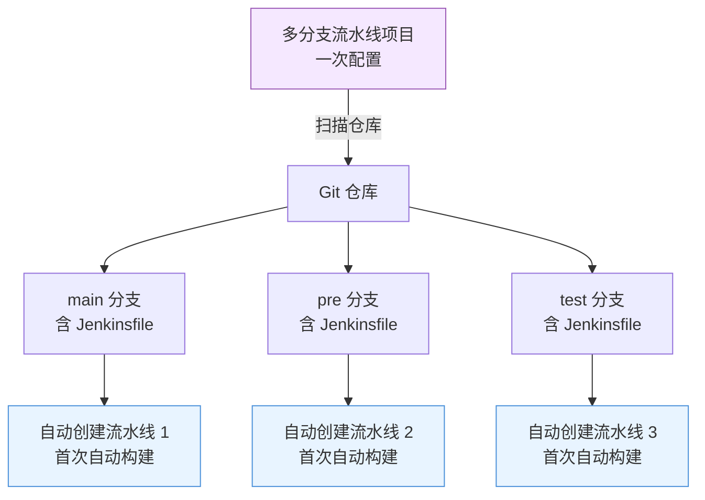

# 多分支流水线与本章小结：让 Jenkins 自动发现每个分支

## 纲要

- **多分支流水线解决"手工建一堆构建"的痛苦**：一个项目配一次，自动扫描仓库分支、自动创建对应流水线
- **两个硬前提**：被扫描的分支**必须真实存在**，且**每个分支里都必须有 `Jenkinsfile`**——缺一个都扫不出来
- **首次扫描会自动构建一次**：这是预期行为，不是异常
- **分支发现支持正则与通配符**：`main|pre` 用竖线分隔多个分支
- **脚本路径仍要指定**：多分支流水线同样要配 Jenkinsfile 在仓库里的存储路径
- **扫描策略三选一**：定时扫描（1 分钟 / 2 周 1 次）或手动扫描
- **它是 GitLab 状态回写的正解**：每个分支自动有构建，状态自然都能显示，不用手工建一堆
- **本章最重要的一条认知**：知识点可以暂时用不到，但**必须看得懂**——否则到新公司看别人配置会懵

## 一、多分支流水线：一个配置，N 个分支自动就绪

### 1.1 它解决什么问题

前面遇到一个具体痛点：GitLab 状态回写只在 `main` 分支生效，想让 `test` 分支也显示状态，就得**给每个分支建一个构建**、指定对应分支的 Jenkinsfile。

> 课件原话：但是这样就需要我们新建很多构建，**我们需要手工操作，很麻烦**。万一还有什么开发环境、预生产环境，那我们不是要新建很多个构建？

**多分支流水线（Multibranch Pipeline）就是终结这个痛苦的方案**：创建一个多分支流水线项目，**通过这个项目去扫描指定的仓库，扫描指定分支，自动创建流水线**。

比如扫描某仓库的 `main` 和 `pre` 分支，它会**自动创建两个流水线**——一个针对 `main`，一个针对 `pre`。

### 1.2 两个硬前提（缺一不可）

| 前提 | 说明 |
|---|---|
| **分支必须存在** | 你要扫的 `main`、`pre` 分支得在仓库里真实创建出来 |
| **每个分支都要有 `Jenkinsfile`** | 只有分支里存在 Jenkinsfile，它才会自动创建流水线 |

> 课件特别验证了这点：`main` 分支放一个输出 `main` 的 Jenkinsfile，`pre` 分支放一个输出 `pre` 的 Jenkinsfile，两个分支都必须有，否则扫不到。

### 1.3 首次扫描会自动构建一次

> 被扫描到的分支，**第一次创建时候，它会自动运行一次流水线，会自动帮你构建一次**。

这是**预期行为**——Jenkins 用这次构建验证分支配置是否可用。看到"刚建好就自己跑了"不用慌。

### 1.4 配置步骤

**① 新建项目，类型选「多分支流水线（Multibranch Pipeline）」**。

**② 分支源（Branch Sources）配置**：

| 字段 | 填法 |
|---|---|
| 仓库地址 | 要扫描的 Git 仓库 |
| **Credentials** | 该仓库的凭据（**扫描前必须先有凭据**） |
| **发现分支（Discover branches）** | 用**正则表达式**或**通配符**指定要扫哪些分支 |

**分支发现怎么写**：

```text
通配符 *            → 扫描所有分支
正则 main|pre       → 只扫 main 和 pre（竖线分隔，可继续加）
```

**③ 配 Jenkinsfile 的存储路径（Script Path）**：

默认是根路径。如果 Jenkinsfile 放在子目录，这里要指定（与普通流水线的 Script Path 规则相同）。

**④ 构建保留参数**：

```text
保留自身流水线签数保留期间的最大数量：100
```

即最多保留 100 次构建历史。

**⑤ 扫描策略（Scan Multibranch Pipeline Triggers）**：

| 选项 | 说明 |
|---|---|
| 定时扫描 | 配 1 分钟扫一次，或 2 周 1 次 |
| **手动扫描** | 需要时点"立即扫描" |

> 小团队/分支变化不频繁，**手动扫描就够了**，没必要每分钟扫。

### 1.5 效果验证

课件实测：

1. 手动扫描 → 日志显示 `main` 分支"真的是非常加大"（扫描成功）、`pre` 分支也成功；
2. **首次找到时先自行构建一次**；
3. 进去看构建输出——`main` 分支的流水线输出 `main` 分支名，`pre` 分支的输出 `pre` 分支名；
4. 多分支流水线配置完成。

**如果还有其他分支**：在"发现分支"里加上即可，其他分支里也加上 Jenkinsfile，就会自动扫出来。



## 二、本章小结：基础阶段必须带走的四条认知

课程到这里，第一大块基础内容讲完了。小结部分的信息量不大，但**四条认知很重要**，尤其是第二条。

### 2.1 必须掌握 Pipeline 流水线的使用

> Pipeline 流水线的内容包含了很多的知识点，但是我们都必须要会使用。

### 2.2 用不到 ≠ 可以不学（最重要）

> 也许我们很多的知识点用不到，**但是我们也必须要看得懂，知道如何配置，这个是我们必须要熟悉的**。你不能说有一些我没配置过、或者我没看过，然后去到别人公司，看到别人在使用，然后你自己看不懂，那肯定是不行的。

**这条对新手极有现实意义**：你现在的公司可能只用到了 `when` 没用 `input`、只用了 `parallel` 没用共享库。但：

- 换工作时看到别人的 Jenkinsfile 全是共享库调用，你看不懂 → 直接出局；
- 排查问题时看到 `options { parallelsAlwaysFailFast() }` 不认识 → 不知道去哪查；
- Review 别人 MR 里的流水线改动 → 无法判断对错。

> **正确姿势**：每个知识点至少手写一遍最小示例，理解它解决什么问题。不需要精通到能默写，但必须一眼认出"这是干什么的、参数大概什么意思"。

### 2.3 必须熟悉用户权限控制

> 能登录，并不是说你某个用户登录，我就可以随便操作、随便构建。我们的**权限审核是非常严格的**。包括说有些项目根本不是你这个开发负责人，那你可能**连看到这个项目的机会都没有**。

这呼应前面的 RBAC 章节：接入 LDAP 只解决认证，授权必须单独配。生产环境里"看不到项目"是**正常且正确**的状态，不是故障。

### 2.4 每学完一章做总结练习

> 我们建议学完一小节、一章之后，我们就针对这些知识点做一个总结练习。

**具体建议**：拿一个真实小项目，从零搭一条流水线，把本章知识点全部用一遍：

```text
建仓库放 Jenkinsfile → 配 SCM 拉取 → 配 LDAP + RBAC
→ 写多阶段流水线（agent/options/environment/凭据/post/when/parallel）
→ 配 Webhook 自动触发 → 配 GitLab 状态回写
→ 改用多分支流水线
```

**跑通这一套，比看十遍视频都管用。**

## 三、本章知识地图（自查用）

| 模块 | 必须掌握 | 必须看懂 |
|---|---|---|
| 部署 | Docker / Helm / YAML 三种方式 | PVC、RBAC、探针 |
| 认证授权 | LDAP 接入 | Role-Based Strategy 角色匹配规则 |
| 基础配置 | 视图、凭据、系统配置 | 项目分类规范的取舍 |
| 流水线语法 | `agent` / `stages` / `steps` / `environment` / `credentials` | `options` 七项行为、`post` 五条件块 |
| 进阶语法 | `when` / `input` / `parallel` | `cleanWs` / `checkout scm` / 内置变量 |
| 工程化 | Jenkinsfile 进 Git、Webhook、GitLab 状态回写 | CLI、多分支流水线 |

## 四、面试考点与追问

**Q1：多分支流水线解决什么问题？它的工作流程是什么？**
解决"每个分支手工建一个构建"的不可持续问题。流程：建多分支流水线项目 → 配分支源（仓库+凭据）→ 配分支发现（正则/通配符）→ 配 Jenkinsfile 路径与扫描策略 → 扫描仓库 → **对每个含 Jenkinsfile 的分支自动创建独立流水线**，首次自动构建一次。

**Q2：多分支流水线的两个硬前提是什么？**
① 被扫描的分支必须真实存在；② **每个分支里都必须有 Jenkinsfile**。缺任何一个，该分支都不会被创建流水线。

**Q3：多分支流水线首次扫描会发生什么？**
被扫到的分支会**自动运行一次流水线**。这是 Jenkins 的验证机制，属预期行为。

**Q4：分支发现有哪两种写法？**
正则表达式（如 `main|pre`，竖线分隔多个分支）与通配符（`*` 表示所有分支）。生产通常用正则精确控制，避免把临时分支也扫进来。

**Q5：多分支流水线与 GitLab 状态回写有什么关系？**
它是状态回写的**正解**。普通流水线只配一个分支的 Jenkinsfile，其他分支就没构建、没状态；多分支流水线给每个分支自动建构建，各分支状态自然都能回写到 GitLab，无需手工建一堆构建。

**Q6：本章小结强调"用不到的知识点也要学"，背后的理由是什么？**
因为技术选型因公司而异——你现在用不到 `input`，下一家可能全靠它做审批；你看不懂别人的 Jenkinsfile，就无法排查问题、无法 Review、无法接手维护。**底线要求是"看得懂、知道去哪查"**，而不是精通每一个细节。

## 📎 文本↔代码关联

本篇对应课件源码（`code/3-基础-Jenkins/`，已做去品牌化处理）：

| 代码文件 | 正文提及 | 内容 |
| --- | --- | --- |
| `code/3-基础-Jenkins/课件/教学课件.md` | 第 2.4 / 三 节 | `options` / `environment` / `credentials` / `post` 标准语法，多分支各分支 Jenkinsfile 的写法基础 |
| `code/3-基础-Jenkins/Jenkinsfile/Jenkinsfile-流水线基础（基础课程所有笔记都在此文件）` | 第 2.4 节 | 完整生产级 Jenkinsfile，可作为各分支放置的模板 |

**技术点总结**：多分支流水线用"一次配置"替代"N 次手工建构建"——配好分支源（仓库+凭据）与分支发现（正则/通配符）后，自动扫描仓库、对每个含 Jenkinsfile 的分支创建独立流水线，**首次自动构建一次**。两个硬前提：分支必须存在、每个分支必须有 Jenkinsfile。它是 GitLab 状态回写的正解。本章最重要认知：**用不到的知识点也必须看得懂**，底线是"认得出来、知道去哪查"；每学完一章拿真实项目做一次全流程总结练习。

相关度：95%。是否需要继续：[是]。代码是否可运行：[是]。
