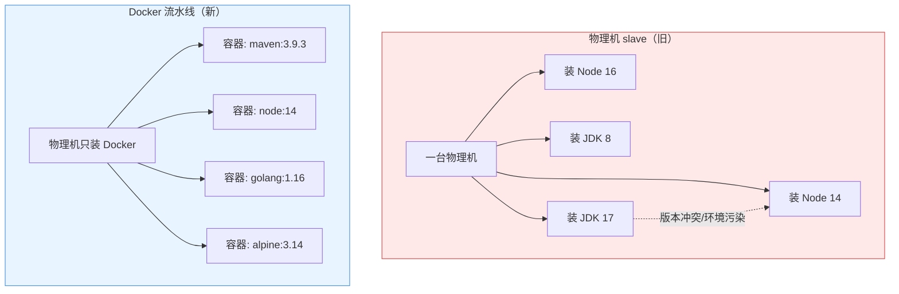

# Jenkins Docker 流水线：用容器环境替代物理机装环境

## 纲要

- **痛点**：静态 slave 在物理机上跑，不同项目要不同版本环境（Node 14/16、多版本 JDK），不停在物理机上装还会搞乱环境
- **解法**：`agent { docker { } }` 让每个 stage 在**独立容器**里跑，环境随镜像来，物理机只留 Docker
- **装 Docker Pipeline 插件**才可用，这是前置条件
- **全局与局部 docker agent 互斥**：配了全局就不能配局部，反之亦然——不是"局部优先"那套
- **强烈建议用局部镜像**：全局配一个镜像要包含所有环境，还得自己制作，极不方便
- **`args '-v $HOME/.m2:/root/.m2'` 是效率关键**：把宿主依赖目录挂进容器，依赖持久化，下次构建不用重新拉
- **label 加与不加是天壤之别**：不加 label → 容器在**部署 Jenkins 的那台服务器**上跑；Jenkins 用 K8s 部署时那台机没有 Docker → 必然失败
- **构建镜像用内置 `docker.build` + `.push()`**：比自己打镜像 + docker login + sh push 简单得多
- **容器之间默认不共享文件系统**：第一个容器建的 `a.txt`，第二个容器看不到（除非挂载）

## 一、为什么需要 Docker 流水线

### 1.1 物理机 slave 的困境

前面的静态 slave 是**直接在物理机上运行**的。这带来一个现实问题：**很多环境需要装在物理机上，非常不方便。**

课件的例子非常典型：

> 比如说我需要编译一个 Node 程序，然后可能需要使用到不同的版本，**可能要用 14 的版本，也可能不同的程序需要使用 16 版本**。那我们需要不停地在物理机上部署不同版本的 Node 环境。这样是非常麻烦的，**而且还可能会搞坏、搞乱物理机的环境**。

三个具体麻烦：

1. **版本冲突**：项目 A 要 Node 14、项目 B 要 Node 16，同一台机装两个版本互相干扰；
2. **环境污染**：装一堆工具后，今天能构建明天不能，根因难查；
3. **扩容成本**：每加一种环境就要动一遍物理机，还要做基线快照。

### 1.2 Docker 流水线的解法

**使用 Docker 流水线，利用 Docker 的环境来运行不同的构建任务。**

核心思想：**环境不再"装"在机器上，而是"随镜像来"**。每个 stage 声明用什么镜像，Jenkins 自动拉起容器执行，跑完即销毁。



## 二、前置：装 Docker Pipeline 插件

**要想使用 Docker 流水线，首先我们需要安装 `Docker Pipeline` 插件。**

> Jenkins 的老规律再次应验：**任何功能都要先装对应插件**。没装它，`agent { docker { } }` 这个语法直接不被识别。

## 三、agent 的三种配置与全局/局部互斥

### 3.1 docker agent 能配什么

在 stage 下面配置 `agent`，代表**局部代理**。它可以配这么几块：

| 配置 | 含义 |
|---|---|
| `node { label 'xxx' }` | 指定具体的**静态代理节点** |
| `label 'xxx'` | 同上，简写 |
| `docker { image 'xxx' }` | 指定**用 Docker 运行这个构建任务** |

```groovy
stage('Build') {
    agent {
        docker {
            label 'slave'
            image 'maven:3.9.3-eclipse-temurin-17'
            args '-v $HOME/.m2:/root/.m2'
        }
    }
    steps {
        sh 'mvn --version'
    }
}
```

### 3.2 全局与局部是互斥的（重点）

课件专门澄清了一个容易和前面混淆的点：

> 这个步骤我们可以把它放在 pipeline 上面，就代表全局。**如果全局配置了下边这个 stage 的 agent 就要删掉——配置了全局就不能配置局部。并不是说我可以配置全局也可以配置局部，然后局部优先生效。**

| 配置方式 | 结果 |
|---|---|
| **只在 `pipeline` 层配 `agent { docker { } }`** | 全局生效，**所有 stage 的局部 agent 必须删掉** |
| **只在各 stage 配 `agent { docker { } }`** | 各 stage 独立，**`pipeline` 层不能配 docker agent** |

> 这和前面讲的 `agent { node { label } }` 全局/局部关系不同——那种可以全局兜底、局部覆盖；**docker agent 的全局与局部是二选一**。

### 3.3 为什么不建议全局配镜像

课件给了明确结论：**不建议全局配一个镜像**。

原因很直接：

- **一个镜像要包含很多环境**——Maven、Node、Go、JDK 全塞进一个镜像，镜像体积爆炸；
- **还要自己制作镜像**——没人会帮你打好这种"全家桶"镜像；
- **维护成本高**——加一个环境版本就要重新构建基础镜像，所有流水线受影响。

> **建议都使用局部的镜像，每个步骤使用不同的环境。** 需要 Maven 就用 `maven:3.9.3`，需要 Node 就用 `node:14`，互不干扰，也不用手工做镜像。

## 四、挂载 args：效率的关键

```groovy
agent {
    docker {
        label 'slave'
        image 'maven:3.9.3-eclipse-temurin-17'
        args '-v $HOME/.m2:/root/.m2'
    }
}
```

`args` 就是把物理机上的目录挂载到容器里面。**为什么这是效率关键？**

> 课件原话：比如说我们使用 Node 构建的时候，会拉很多的依赖；或者 Java 构建也需要拉很多依赖包。**我们可以通过这个挂载，把它挂载到物理机里面，然后它就可以做持久化。下次我们再构建的时候，把物理机的这个依赖包的目录再挂载到容器里面，这样构建就会大大提升效率，就不需要再重新拉。**

**没有挂载**：每次构建新建容器 → 依赖缓存为空 → 全量重拉（Maven 项目几分钟就没了）。
**有挂载**：依赖缓存在宿主持久化 → 容器直接复用 → 增量构建。

**这是 Docker 流水线必配的一项。** 常见挂载：

| 语言 | 挂载 |
|---|---|
| Maven | `-v $HOME/.m2:/root/.m2` |
| Gradle | `-v $HOME/.gradle:/root/.gradle` |
| npm | `-v $HOME/.npm:/root/.npm` |
| Go | `-v $HOME/go/pkg/mod:/go/pkg/mod` |

## 五、label 加与不加：天壤之别

这是 Docker 流水线**最容易踩的坑**，课件专门强调：

> 这个 label 我们是可以指定它的代理节点。**如果你不指定 label 的话，它默认就会在部署了 Jenkins 的那台服务器上来运行你这个 Maven 镜像。但是我们的 Jenkins 是用 K8s 来部署的，所以 Jenkins 的服务器上并没有 Docker 环境，所以会运行失败。**

| 配置 | 容器跑在哪 |
|---|---|
| **加 `label 'slave'`** | 调度到**带该标签的 slave 代理节点**上运行 |
| **不加 label** | 在**部署 Jenkins 的那台服务器（本机）**上运行 |

**`agent { docker { } }` 只是指定"使用 Docker 环境运行"而已，不决定跑在哪台机器上**——跑在哪由 label 决定。

> **实践结论**：Jenkins 本身跑在 K8s 里时，那台服务器没有 Docker 环境，**Docker agent 必须加 label 指到有 Docker 的 slave**。这是"配了却跑不起来"的头号原因。

## 六、构建并推送镜像：两种方法

### 6.1 方法一：自己打镜像（麻烦，不推荐）

1. 自己打一个镜像，**里面必须要有 Docker 环境**；
2. 用 `docker login` 登录仓库；
3. `sh` 上去 push。

> 课件评价：**这样是比较麻烦的。**

### 6.2 方法二：内置 `docker.build` + `push`（推荐）

Docker Pipeline 插件提供了内置方法，**不需要镜像里有 Docker**：

```groovy
pipeline {
    agent {
        node { label 'slave' }
    }
    environment {
        images_head = "registry.cn-hangzhou.aliyuncs.com"
    }
    stages {
        stage('Build') {
            agent {
                docker {
                    label 'slave'
                    image 'maven:3.9.3-eclipse-temurin-17'
                    args '-v $HOME/.m2:/root/.m2'
                }
            }
            steps {
                sh 'mvn --version'
            }
        }
        stage('build-2') {
            steps {
                script {
                    docker.withRegistry("https://${images_head}", 'aliyun-images-registry') {
                        def customImage = docker.build("${images_head}/cicd-demo/app:${BUILD_TAG}-${GIT_COMMIT}")
                        customImage.push()
                    }
                }
            }
        }
    }
}
```

**三段拆解**：

| 代码 | 作用 |
|---|---|
| `docker.withRegistry("https://${images_head}", 'aliyun-images-registry')` | 指定仓库地址 + **凭据 ID**（第二参） |
| `docker.build("${images_head}/cicd-demo/app:${TAG}-${GIT_COMMIT}")` | 构建镜像，等价于终端执行 `docker build -t <repo>:<tag>` |
| `customImage.push()` | 推送镜像到仓库 |

**镜像名的三段结构**：

```text
registry.cn-hangzhou.aliyuncs.com / cicd-demo / app : tag
└──────────── images_head ─────┘  └─ 工作空间 ─┘ └仓库┘  └─tag┘
```

- **第一行**（`withRegistry` 第一个参数）= 仓库地址；
- **第二行**（`docker.build` 括号内）= **仓库的工作空间名 + 仓库名** + tag；
- tag 用 `${BUILD_TAG}-${GIT_COMMIT}` 拼接，**每次构建镜像 tag 唯一**，便于回溯。

### 6.3 凭据怎么来

**系统管理 → 凭据管理 → 添加用户名密码类型**：

- **用户名** = 镜像仓库的用户名；
- **密码** = 登录镜像仓库的密码；
- 创建后凭据管理会给出一个 **ID**，把这个 ID 复制到 `withRegistry` 的第二个参数。

### 6.4 指定 Dockerfile 路径（第二个参数）

默认 Dockerfile 在根目录，只传一个参数即可。如果放在不同路径，**给 `docker.build` 加第二个参数**：

```groovy
environment {
    DOCKERFILE = "dockerfiles/test/test"
}

// ...
def customImage = docker.build("${images_head}/cicd-demo/app:${BUILD_TAG}", "-f ${DOCKERFILE} ./")
customImage.push()
```

| 参数 | 含义 |
|---|---|
| `-f ${DOCKERFILE}` | 指定 **Dockerfile 文件名/路径** |
| `./` | 构建上下文路径 |

课件里的变量值 `dockerfiles/test/test` 就是"目录 + 文件名"的组合。

## 七、容器之间默认不共享文件系统

这是 Docker 流水线的**重要特性**，课件专门验证：

> 我第一个容器创建的文件，我在第二个容器里面能不能看得到呢？

**结论：看不到。** 每个 `docker` agent 是**独立容器**，文件系统相互隔离——第一个容器 `touch a.txt`，第二个容器 `ls` 不到。

**需要跨容器传文件怎么办？** 两条路：

1. **挂载同一个宿主持久化目录**（用 `args '-v'`）；
2. **用 K8s Pipeline 的 Workspace**（Tekton 那套的思路，Jenkins K8s agent 也支持）。

> 这和 Tekton 的"每个 step 一个容器、默认隔离"是同一套设计哲学。**不要假设"上一个 stage 的文件下一个 stage 还在"**——这是从 shell 脚本转流水线最常见的思维误区。

## 八、常见报错与排查

| 现象 | 根因 | 解法 |
|---|--- --- | --- |
| `agent { docker { } }` 不被识别 | 没装 Docker Pipeline 插件 | 装插件后 `/restart` |
| 容器起不来、报没有 Docker | **没加 label**，跑在 Jenkins 所在服务器 | 加 `label` 指到有 Docker 的 slave |
| 依赖每次全量重拉、构建慢 | 没配 `args '-v'` 挂载缓存 | 加 `-v $HOME/.m2:/root/.m2` 等 |
| 全局与局部都配了但报错 | docker agent 全局/局部**互斥** | 二选一，删掉另一处 |
| `docker.build` 报认证失败 | `withRegistry` 凭据 ID 错 | 核对凭据 ID 与仓库权限 |
| 推送成功但 tag 不对 | tag 拼接写错 | 检查 `${BUILD_TAG}-${GIT_COMMIT}` |
| Dockerfile 找不到 | 没传 `-f` 参数 | `docker.build(repo, "-f path/Dockerfile ./")` |
| 上一个 stage 的文件找不到 | **容器间文件系统隔离** | 用挂载共享，或改用 K8s agent |

## 九、面试考点与追问

**Q1：Docker 流水线解决什么问题？相比物理机 slave 的优势？**
解决物理机要装多版本环境、版本冲突、环境污染的问题。优势：环境随镜像来、用完即毁、按 stage 选不同镜像、无需手工维护物理机基线。

**Q2：docker agent 的全局与局部能同时配吗？**
**不能，是互斥的。** 配了全局 `agent { docker { } }`，各 stage 的局部 docker agent 必须删掉；反之只在 stage 配时，pipeline 层不能配 docker agent。这与 `agent { node { label } }` 的"全局兜底、局部覆盖"不同。

**Q3：为什么 Docker agent 必须加 label？**
因为 `agent { docker { } }` 只决定"用 Docker 环境"，不决定"跑在哪台机器"。不加 label 默认在部署 Jenkins 的服务器上跑；若 Jenkins 本身跑在 K8s 里，那台机没有 Docker 环境，必然失败。加 label 才能调度到有 Docker 的 slave。

**Q4：`args '-v $HOME/.m2:/root/.m2'` 的作用？**
把宿主机的 Maven 依赖目录挂进容器，使依赖缓存在宿主持久化。下次构建新容器直接复用，**避免每次全量重拉依赖**，是 Docker 流水线的必配效率项。

**Q5：`docker.build` + `push` 相比自己打镜像的方案优势？**
不需要镜像里带 Docker 环境、不需要 `docker login`、不需要手写 `sh 'docker push'`；插件内置方法直接完成构建与推送，凭据通过 `withRegistry` 统一管理。更简洁也更安全（密码走凭据而非明文）。

**Q6：Docker 流水线里多个 stage 的容器之间共享文件吗？**
**默认不共享。** 每个 docker agent 是独立容器，文件系统隔离。需要共享必须显式挂载同一个宿主持久化目录（`args '-v'`），或改用 K8s agent 的 Workspace 机制。这是从 shell 转流水线最常见的思维误区。

## 📎 文本↔代码关联

本篇对应课件源码（`code/4-进阶-Jenkins/`，已做去品牌化处理）：

| 代码文件 | 正文提及 | 内容 |
| --- | --- | --- |
| `code/4-进阶-Jenkins/Jenkinsfile/Jenkinsfile-Docker流水线-1` | 第 3.1 / 四 / 七 节 | 两个 stage 分别用 `maven:3.9.3` 与 `alpine:3.14`，含 `args '-v $HOME/.m2:/root/.m2'` 挂载；第三个 stage 验证容器间文件不共享 |
| `code/4-进阶-Jenkins/Jenkinsfile/Jenkinsfile-Docker流水线-2` | 第 6.2 / 6.4 节 | `environment { images_head }` + `docker.withRegistry` + `docker.build` + `customImage.push()` 完整构建推送范式 |
| `code/4-进阶-Jenkins/Jenkinsfile/Jenkinsfile-静态代理节点` | 第五节 | `agent { node { label 'slave' } }` 与 docker agent 的 label 对照 |

**技术点总结**：Docker 流水线用 `agent { docker { image, args } }` 让每个 stage 在独立容器里跑，解决物理机多版本环境冲突与污染问题。三个关键认知：**docker agent 全局与局部互斥**（不是局部优先）、**必须加 label** 否则跑在没 Docker 的 Jenkins 服务器上、**`args '-v'` 挂载是效率必配项**（依赖持久化）。构建推送用内置 `docker.withRegistry` + `docker.build` + `.push()`，比自己打镜像 + docker login 简洁安全。**容器之间默认不共享文件系统**，需显式挂载。

## 七、多阶段容器组合：一条流水线的完整形态

把前面的知识点串起来，看一条贴近真实的流水线长什么样：

```groovy
pipeline {
    agent { node { label 'docker-slave' } }        // 全局：指定有 Docker 的 slave
    environment {
        REGISTRY = "registry.cn-hangzhou.aliyuncs.com"
        IMAGE    = "${REGISTRY}/cicd-demo/app"
    }
    stages {
        stage('Compile') {                          // ① 编译：Maven 容器 + 依赖挂载
            agent {
                docker {
                    label 'docker-slave'
                    image 'maven:3.9.3-eclipse-temurin-17'
                    args '-v $HOME/.m2:/root/.m2'
                }
            }
            steps { sh 'mvn clean package -DskipTests' }
        }
        stage('Test') {                             // ② 测试：JDK 容器
            agent {
                docker {
                    label 'docker-slave'
                    image 'openjdk:17-jre'
                    args '-v $HOME/.m2:/root/.m2'
                }
            }
            steps { sh 'java -jar target/app.jar --test' }
        }
        stage('Lint') {                             // ③ 检查：轻量容器
            agent {
                docker { label 'docker-slave'; image 'alpine:3.14' }
            }
            steps { sh 'echo "lint placeholder"' }
        }
        stage('Image') {                            // ④ 构建推送镜像：在 slave 上执行
            steps {
                script {
                    docker.withRegistry("https://${REGISTRY}", 'aliyun-images-registry') {
                        def img = docker.build("${IMAGE}:${BUILD_TAG}-${GIT_COMMIT}")
                        img.push()
                    }
                }
            }
        }
    }
}
```

**四个设计要点**：

| 阶段 | 容器选择 | 关键配置 |
|---|---|---|
| Compile | `maven:3.9.3` | **必须挂 `.m2`**，否则每次全量拉依赖 |
| Test | `openjdk:17-jre` | 独立容器，与编译环境解耦 |
| Lint | `alpine:3.14` | 轻量镜像，秒级启动 |
| Image | 不用 docker agent | 在 slave 上直接跑 `docker.build` |

**注意第四阶段**：构建镜像那一步**不需要 docker agent**——它在 slave 上直接调用 slave 的 Docker daemon。只有"需要在特定工具链环境里执行命令"的 stage 才用 docker agent。

### 7.1 依赖挂载的进阶：区分只读与可写

上面的挂载是全量读写。生产可以更精细：

```groovy
args '-v $HOME/.m2:/root/.m2 -v $HOME/.m2/settings.xml:/root/.m2/settings.xml:ro'
```

把 `settings.xml`（含私服凭证）以**只读**挂载，避免构建过程意外改写。**私服凭证不要打进镜像**，用只读挂载注入更安全。

### 7.2 镜像拉取策略

```groovy
agent {
    docker {
        label 'docker-slave'
        image 'maven:3.9.3-eclipse-temurin-17'
        registryUrl 'https://registry.example.com'
        registryCredentialsId 'private-registry'
    }
}
```

私有仓库的镜像要用 `registryUrl` + `registryCredentialsId` 指定，否则拉取失败。

## 八、Docker 流水线 vs K8s 动态节点：怎么选

| 维度 | Docker 流水线 | K8s 动态节点 |
|---|---|---|
| 载体 | Docker 容器 | K8s Pod |
| 弹性 | 受单机资源限制 | **集群级弹性** |
| 环境隔离 | 容器级 | **Pod 级（更强）** |
| 多容器协作 | 单容器 per stage | **一个 Pod 多容器** |
| 依赖缓存 | 靠 `-v` 挂载 | 靠 Workspace / PVC |
| 学习成本 | 低 | 中（要懂 K8s YAML） |
| 适用 | 中小规模、已有 Docker 主机 | **大规模、已在 K8s** |

> **选型建议**：已有 K8s 集群且构建并发高 → 直接用 K8s 动态节点（下一篇）；只有几台 Docker 主机、并发不高 → Docker 流水线更轻。**两者可以在不同流水线里共存**，按需选择。

## 九、容器之间默认不共享文件系统

相关度：97%。是否需要继续：[是]。代码是否可运行：[是]。
