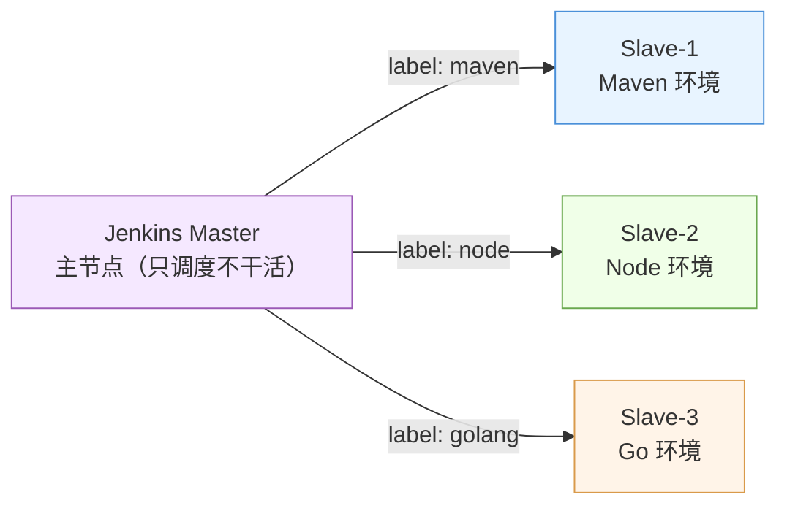

# 22. Jenkins Slave 节点静态配置：从节点接入、标签调用与端口对齐

## 纲要

- **Slave 是从节点**：执行主节点分配的构建任务，核心价值是**分担主节点压力、实现并行分布式构建**
- **调用靠 label**：给每个 slave 分配不同标签，流水线通过 `agent { node { label 'xxx' } }` 精确调度
- **标签是变量不是显示名**：节点显示名随意起，真正用于匹配的是 Label 字段
- **远程工作目录必须与服务器实际目录一致**，且服务器上要手动建好——这是最高频的启动失败原因
- **两种启动方式**：SSH 远程调用 与 Java Web 启动代理（下载 jar 到 slave 服务器运行），后者更常用
- **agent 端口必须三方一致**：Jenkins 容器端口 ↔ Service/NodePort 端口 ↔ Jenkins 页面"代理端口"，改一处不改另两处必失败
- **Java 版本是硬门槛**：课件实测 Java 11 可以、Java 8 跑不起来 agent.jar
- **slave 服务器三个自动目录**：`workspace`（构建工作区）、`cache`（依赖缓存）、`remoting`（连接生成文件）
- **扩容就是复制节点改 label**：其他配置保持不变，几分钟多一个执行器

## 一、先建立概念：静态节点 vs 动态节点

进阶课程第一块就是节点。先分清两个概念，不然后面全乱：

| 类型 | 特征 | 典型实现 |
|---|---|---|
| **静态节点** | **固定的**，构建任务被调度到固定的一台节点执行 | 物理机 slave、Docker 静态代理 |
| **动态节点** | **运行时才创建 Pod**，跑完 Pod 就消失 | K8s 动态 agent |

> 课件原话：静态节点就是它是固定的，我要调度到固定的一台节点去执行我的流水线。不管你是直接运行在物理机上跑，还是在这台机器上用 Docker 跑，**它都属于一个静态的节点**。而动态节点是**在运行的时候才会创建一个 Pod 来运行，运行完成之后这个 Pod 就不存在了**。

本篇讲静态节点（物理机 slave），Docker 流水线与 K8s 动态节点在后两篇。

## 二、Slave 节点是什么，为什么要用

**Jenkins Slave 节点，也就是 Jenkins 的从节点，用于执行主节点分配的构建任务。**

**优势**：帮助主节点分担构建压力。

> 当我们的构建任务非常多的时候，我们主节点它的负载是非常高的。这种情况下，我们就可以使用从节点来分担主节点的构建压力，从而实现**并行构建**——把一部分构建通过从节点来运行，实现**分布式构建**。



**额外收益**：**环境隔离**。不同 slave 装不同工具链（Maven 机、Node 机、Go 机），互不污染，也不用在主节点上堆一堆环境。

## 三、怎么调用 slave：label 机制

**我们给每个 slave 节点来分配不同的标签，通过 label 来定义标签。在 Jenkins 流水线上，我们会通过调用 label 标签名来对从节点进行构建任务的分配。**

```groovy
pipeline {
    agent {
        node {
            label 'slave'          // 调度到带 slave 标签的节点
        }
    }
    stages {
        stage('Hello') {
            steps {
                script {
                    sh 'hostname;pwd;free -h;touch a.txt'
                }
            }
        }
    }
}
```

> **再次强调那个坑**：**标签名是"变量"不是"名称"**。新建节点时填的节点名（如 `my-slave-1`）只是显示用，**真正用于流水线匹配的是 Label 字段**。把显示名当标签写进流水线，永远匹配不上。

## 四、配置一个 slave 节点：九个字段

### 4.1 前置准备

**准备一台 CentOS 服务器，在里面创建 home 目录。**

课件实操：把 `gitlab.example.com` 配成 slave，建 `/home/jenkins/agent` 作为它的 home 目录。

### 4.2 Jenkins 页面配置

**系统管理 → 节点管理 → 新建节点 → 固定节点（Permanent Agent）**：

| 字段 | 填法 | 说明 |
|---|---|---|
| **节点名称** | 随意（如 `my-slave-1`） | 仅显示用 |
| **并行构建数量**（# of executors） | 如 `10` | **最多允许这个 slave 同时运行多少个构建** |
| **远程工作目录**（Remote root directory） | 如 `/home/jenkins/agent` | **必须与服务器上实际目录一致** |
| **标签**（Labels） | 如 `slave` | **流水线匹配的依据** |
| **用法**（Usage） | **尽可能使用这个节点** | 让它参与调度 |
| **启动方式** | **Java Web 启动代理** | 二选一，见下 |
| **可用性**（Availability） | **尽量保持代理在线** | 也可配"需要时在线/空闲离线/定时" |

### 4.3 两种启动方式

| 方式 | 机制 |
|---|---|
| **通过 SSH 远程调用** | Jenkins 主动 SSH 到 slave 启动 agent |
| **通过 Java Web 启动代理** | Jenkins 生成一个 **jar 文件**，下载到 slave 服务器，运行 jar 来远程控制该节点 |

课件用第二种，更常见。配好后 Jenkins 会提供 jar 下载。

### 4.4 master 与 slave 的连接验证

> slave 节点与 master 节点运行连接的方式是通过 **secret key（seckey）**来进行连接验证的。

这是 Jenkins 的安全机制——slave 必须持有一个与 master 约定好的 secret 才能接入，防止未授权节点混入。

## 五、端口对齐：改一处必须改三处

**slave 节点的端口默认是 50000。** 但如果 Jenkins 是用 K8s/YAML 部署的，容器代理端口被改成了 **31000**，那么：

```text
① Jenkins Deployment 的 JNLP 容器端口        → 31000
② Service / NodePort 的 targetPort 与 port   → 31000
③ Jenkins 页面「全局安全配置 → 代理端口」      → 31000
```

**三处必须一致**，否则 slave 连不上。

> 课件原话：不管它的 NodePort 端口以及（Service）端口配置成哪一个，**我们在 Jenkins 页面上配置的端口必须要跟 Jenkins 容器端口保持一致**。

修改入口：**系统管理 → 全局安全配置 → 代理端口（TCP port for inbound agents）**。

## 六、启动 slave：两条命令

配置完成后 Jenkins 会给出两条指令：

```bash
# ① 把 agent.jar 拷到 slave 服务器
scp agent.jar root@gitlab.example.com:/home/jenkins/agent/

# ② 运行 jar，建立连接
java -jar agent.jar \
     -jnlpUrl http://jenkins.example.com/computer/my-slave-1/slave-agent.jnlp \
     -secret $SLAVE_SECRET \
     -workDir "/home/jenkins/agent"
```

| 参数 | 作用 |
|---|---|
| `-jar` | 指定 agent.jar |
| `-jnlpUrl` | 指定 master 服务器地址 |
| `-secret` | 与 master 建立连接 |
| `-workDir` | 工作目录路径 |

### 6.1 Java 版本是硬门槛

> 课件原话：我这边装的是 **Java 11**。之前我试过使用 **Java 8 是没有办法把这个 jar 文件运行起来的**。所以我们一定要注意我们的 Java 版本，看它跟这个 jar 兼不兼容。

**排查"agent 起不来"第一件事：`java -version`。** 新版 Jenkins 的 agent.jar 需要较高版本 JDK，Java 8 大概率不行。

### 6.2 成功的标志

命令行出现 **`connect`** 信息，就代表已经运行起来了。回 Jenkins 页面能看到节点在线。

## 七、slave 服务器上的三个自动目录

slave 首次运行后，工作目录下会自动生成三个目录：

| 目录 | 内容 |
|---|---|
| **`workspace`** | **构建工作区**。每一个构建项目都会有一个命名空间，存放在 `workspace` 下；构建时拉下来的代码都在这里 |
| **`cache`** | **依赖缓存**。构建时拉取的依赖文件放在这里 |
| **`remoting`** | master 与 slave 建立连接生成的文件 |

> **`workspace` 是排查构建产物的第一现场**——代码在哪、编译结果在哪，都在这下面按项目命名的子目录里。

## 八、扩容：复制节点改 label

要加一个 slave，不用从零配：

**节点管理 → 新建节点 → 复制现有节点**（如 `y-slave-1`）→ 改 label（如 `slave-2`）→ **其他保持不变** → 保存。

然后在目标服务器上跑那两条命令（jar + secret + workDir）即可。

**"断开"不等于"停止"**：它只切断 master 与 agent 的连接，服务器上的 java 进程仍在运行、仍占资源；节点列表显示叉号。要真正停止，需去服务器 kill 进程。

## 九、多 slave 拓扑：三种典型设计

单 slave 够用时无所谓，一旦构建并发上来，拓扑设计直接影响吞吐与稳定性。三种典型模式：

### 9.1 按工具链分（最常用）

```text
Master
 ├── label: maven    → Slave-1（装 Maven + JDK）
 ├── label: node     → Slave-2（装 Node 14/16）
 └── label: golang   → Slave-3（装 Go）
```

**优点**：环境纯净不互相干扰；某类构建卡住不影响其他。
**缺点**：资源利用率可能不均衡（Maven 忙死、Go 闲死）。

### 9.2 按环境分（强调隔离）

```text
Master
 ├── label: test   → Slave-test（连测试集群）
 └── label: prod   → Slave-prod（连生产集群，权限最严）
```

**核心价值是安全**：生产 slave 只给少数人用、单独授权，测试 slave 随便用。**配合 RBAC 做物理隔离**，比纯权限控制更硬。

### 9.3 同质集群分（追求吞吐）

```text
Master
 ├── label: build  → Slave-1/2/3/4（完全同配置，环境装在镜像里）
```

四个同 label 节点，Jenkins 自动负载均衡。适合构建任务同质化程度高、追求最大并发的场景。

> **选型判据**：工具链差异大选 9.1；有生产/测试安全边界选 9.2；任务同质、追求吞吐选 9.3。**实际项目常见组合：9.1 打底 + 9.2 划生产边界。**

### 9.4 executors 怎么定

"并行构建数量"不是越大越好：

```text
建议值 ≈ min(CPU 核数, 可用内存 / 单构建峰值内存)
```

- **设太大**：所有构建互相抢 CPU/IO，全部变慢，还可能 OOM；
- **设太小**：构建排队，吞吐上不去；
- **Maven/Node 类构建**通常 2~4 就够，**Go 这类轻构建**可以到 8~10。

> 课件里演示配的是 10，那是同质轻构建的场景。**别照抄，按自己的构建类型算。**

## 十、页面运维操作

| 操作 | 说明 |
|---|---|
| **断开连接** | 点右上角"断开"，页面显示叉号，但**服务器上的程序还在跑**（只是连接断开） |
| **上线节点** | 点"上线"重新建立连接，立即恢复 |
| **查看状态** | 节点列表里的叉号 = 已断开 |

> **"断开"不等于"停止"**：它只切断 master 与 agent 的连接，服务器上的 java 进程仍在。要真正停掉，需去服务器 kill 进程。这个区别在做节点维护时很重要——别以为页面点了断开就安全了。

## 十、常见报错与排查

| 现象 | 根因 | 解法 |
|---|--- --- | --- |
| agent 起不来、报 Java 错误 | **Java 版本不兼容** | 装 Java 11+，课件实测 Java 8 不行 |
| 节点一直显示离线 | 端口三方不一致 | 对齐 Deployment / Service / Jenkins 页面三处端口 |
| 提示找不到工作目录 | 服务器上没建目录或路径不一致 | 手动建目录，与"远程工作目录"完全一致 |
| 流水线调度不到 slave | label 写错（把显示名当标签） | 用 Label 字段的值 |
| secret 报错 | secret 复制不完整或节点重复 | 重新复制完整 secret |
| 断开了但服务器仍占资源 | 页面断开只是断连接 | 去服务器 kill java 进程 |
| 多个构建排队 | executors 太小 | 调大"并行构建数量" |
| 构建产物找不到 | 不知道 workspace 结构 | 去 slave 的 `workspace/<项目名>/` 看 |

## 十一、面试考点与追问

**Q1：Jenkins Slave 节点的作用？**
执行主节点分配的构建任务，分担主节点负载，实现并行与分布式构建；同时实现环境隔离（不同 slave 装不同工具链）。

**Q2：流水线如何把任务调度到指定 slave？**
通过 **label**。给 slave 配标签，流水线用 `agent { node { label 'xxx' } }` 或 `agent { label 'xxx' }` 匹配。**注意 label 是变量不是节点显示名**。

**Q3：配置 slave 时"远程工作目录"有什么要求？**
必须与 slave 服务器上实际存在的目录**完全一致**，且需提前手动创建。这是启动失败的常见原因。

**Q4：slave 的端口为什么要三方对齐？**
Jenkins 容器 JNLP 端口、Service/NodePort 端口、Jenkins 页面"全局安全配置 → 代理端口"三处必须一致，否则 slave 无法与 master 建立连接。改任何一处都要同步另两处。

**Q5：agent.jar 运行不起来，首先排查什么？**
**Java 版本**。课件实测 Java 11 可运行、Java 8 不行。其次查 secret 完整性、master 地址可达性、端口一致性。

**Q6："断开连接"和"停止节点"有什么区别？**
页面点"断开"只切断 master 与 agent 的连接，**服务器上的 java 进程仍在运行、仍占资源**；节点列表显示叉号。要真正停止需去服务器 kill 进程。这个区别在节点维护时极易忽略。

**Q7：slave 的 workspace、cache、remoting 三个目录分别放什么？**
`workspace` 是构建工作区（每个项目一个命名空间，代码与产物都在此）；`cache` 是构建拉取的依赖缓存；`remoting` 是 master-slave 连接生成的通信文件。排查构建产物去 `workspace/<项目名>/`。

## 📎 文本↔代码关联

本篇对应课件源码（`code/4-进阶-Jenkins/`，已做去品牌化处理）：

| 代码文件 | 正文提及 | 内容 |
| --- | --- | --- |
| `code/4-进阶-Jenkins/Jenkinsfile/Jenkinsfile-静态代理节点` | 第三节 | `agent { node { label 'slave' } }` 调度到静态 slave 的最小示例 |
| `code/4-进阶-Jenkins/课件/教学课件.md` | 第三节 | `agent` 五种写法（any/none/node/label/customWorkspace）与多镜像 stage 用法 |
| `code/3-基础-Jenkins/部署/kubernetes-jenkins/deployment.yaml` | 第五节 | JNLP 容器端口（31000）与 Service 端口对齐的参照 |

**技术点总结**：Slave 是执行主节点分配任务的从节点，价值在分担压力、并行分布式构建与环境隔离。调用靠 **label**（是变量不是显示名）。配置九字段里三个关键：并行构建数量决定吞吐、**远程工作目录必须与服务器实际目录一致**、label 是匹配依据。启动用 `java -jar agent.jar -jnlpUrl -secret -workDir`，**Java 版本是硬门槛**（课件实测 11 行、8 不行）。**端口必须三方对齐**（容器/Service/Jenkins 页面）。运维注意：**页面"断开"只断连接不杀进程**。

