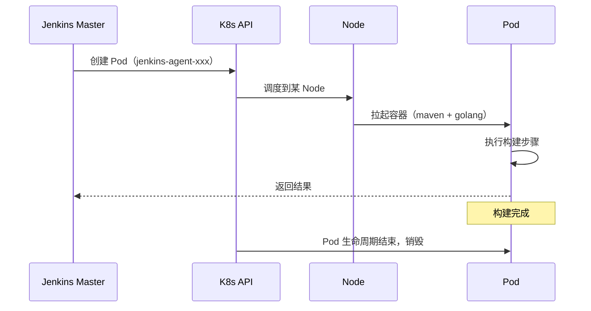

# 24. Jenkins K8s 动态节点：用完即毁的 Pod 构建代理

## 纲要

- **动态 vs 静态的本质差别**：静态节点固定存在；**动态节点在构建时才创建 Pod，跑完 Pod 生命周期结束即销毁**
- **装 Kubernetes 插件 + 配 Cloud**：填 K8s API server 地址（默认端口 6443）、上传 kubeconfig、命名空间（不填=default）
- **kubeconfig 要用「Secret file」类型凭据存**，不是用户名密码
- **Pod 配置强烈推荐写在 Jenkinsfile 的 `agent { kubernetes { yaml } }` 里**，而不是 Cloud 的 Pod 模板——后者管理麻烦、配置繁琐
- **`retries 2` 是 agent 级重试**：Pod 创建失败会自动重试两次
- **容器要靠 `command: cat` 或 `sleep 99d` 保活**，否则容器跑完命令就退出
- **`container('name') { }` 调用指定容器**，name 对应 YAML 里的 `containers[].name`
- **混合调度验证失败**：全局用 K8s agent 时，某 stage 想改配静态 slave **行不通**——用了动态节点就全走容器
- **Pod 名规则** `jenkins-agent-<label>-<build-id>`，点两次构建就有两个 Pod，可据此反查构建
- **默认资源 256Mi / 100m CPU**，资源紧张的集群要注意

## 一、动态节点的本质：临时 Pod

前面讲过静态节点（物理机 slave）与动态节点的区别，这里再钉死一次：

> **动态节点它是在运行的时候，才会创建一个 Pod 来运行。当运行完成之后，这个 Pod 就不存在了，所以叫动态节点。**

| 维度 | 静态节点 | 动态节点（K8s） |
|---|---|---|
| 存在时间 | 长期在线 | **构建时创建，跑完销毁** |
| 环境准备 | 提前装好 | 镜像自带，随拉随用 |
| 资源占用 | 常驻 | 按需，跑完释放 |
| 调度到哪 | 固定的机器 | **K8s 算法决定，可能任一 node** |
| 并发能力 | 受 executors 限制 | 受集群资源限制 |

**动态节点的核心优势是资源弹性**：没有构建时零占用，十个构建并行就起十个 Pod，集群自动调度。



## 二、配置 K8s 动态节点：两步

### 2.1 安装 Kubernetes 插件

**系统管理 → 插件管理 → 可选插件**，搜索 `Kubernetes`，安装。

### 2.2 配置 Cloud

**系统管理 → 系统配置 → Cloud → 添加 Kubernetes 配置**：

| 字段 | 填法 |
|---|---|
| **名称** | 随意（如 `kubernetes`） |
| **Kubernetes 地址** | **API server 地址**，如 `https://k8s.example.com:6443`（默认端口 **6443**） |
| **命名空间** | **可不填**，不填就在 `default` 命名空间跑 |
| **凭据（kubeconfig）** | 选一个 **Secret file** 类型的凭据 |

**kubeconfig 怎么存**：**系统管理 → 凭据管理 → 添加凭据 → 类型选 `Secret file`** → 上传本地的 kubeconfig 文件（通常在 `~/.kube/config`）→ 创建。

> **凭据类型别选错**：kubeconfig 是**文件**，必须用 `Secret file`，不是用户名密码。这是新手常选错的一处。

配完后点 **Test Connection**，显示连接成功（课件显示 "Kubernetes 1.28"）即可。下面的 Jenkins 连接超时、容器容量等**保持默认**就行。

## 三、Pod 配置：两种方式，只推荐第二种

### 3.1 方式一：Cloud 里的 Pod 模板（不推荐）

在 Cloud 配置里直接定义 **Pod 模板**：给模板起名称、命名空间、标签列表，再添加容器（指定镜像）。

**课件明确不推荐**：

> 比如说我们刚才说的 Maven 容器，然后指定它的镜像，然后再添加第二个容器。但是在这里定义完，然后再到我们的 Pipeline 去调用这个 Pod 来运行是**非常麻烦的**。我们首先需要在这个模板上先添加容器模板，然后在这里再调用这个容器模板，**这样是非常不方便的，而且这个配置也非常不方便。**

**问题**：镜像、工作目录、命令都定义在 Jenkins 页面里，**改一次要进页面、不可版本化、Jenkins 挂了就丢**。

### 3.2 方式二：写在 Jenkinsfile 里（强烈推荐）

**直接在 `agent { kubernetes { yaml '''...''' } }` 里写 Pod 定义**：

```groovy
pipeline {
  agent {
    kubernetes {
      // inheritFrom 'mypod'      // 如需继承 Cloud 里的模板可打开
      yaml '''
        apiVersion: v1
        kind: Pod
        spec:
          containers:
          - name: maven
            image: maven:alpine
            command:
            - cat
            tty: true
          - name: golang
            image: golang:1.16.5
            command:
            - sleep
            args:
            - 99d
        '''
      retries 2
    }
  }
  stages {
    stage('Run maven') {
      steps {
        container('maven') {
          sh 'touch a.txt'
        }
      }
    }
    stage('Run golang') {
      steps {
        container('golang') {
          sh 'ls;pwd'
        }
      }
    }
    stage('Run alpine') {
      agent {
        node {
          label 'slave'
        }
      }
      steps {
        sh 'hostname;pwd'
      }
    }
  }
}
```

> 课件原话：**建议我们各位同学都使用这种 Kubernetes YAML 的方式来配置这个 K8s 的动态代理。** 因为它跟 K8s 的 YAML 配置是一样的，直接在这里定义、直接调用就行，**不需要在页面上配模板**。

**好处很直接**：Pod 定义随 `Jenkinsfile` 进 Git，**可版本化、可 Review、Jenkins 可无状态重建**——和"Jenkinsfile 进 Git"是同一条逻辑。

### 3.3 三个必懂细节

**① `retries 2` = agent 级重试。** Pod 创建失败（镜像拉取超时、节点资源不足）会自动重试两次。这是**动态节点必配**的——Pod 创建是易失败环节，没有重试会导致偶发构建失败。

**② 容器必须保活。** `command: cat` + `tty: true`，或 `command: sleep` + `args: 99d`。**不保活的容器执行完命令就退出**，后续 step 无处可跑。这是 K8s agent 与 docker agent 的重要区别——Docker agent 由 Jenkins 托管容器生命周期，K8s agent 需要你自己让容器挂着。

**③ `container('name')` 的 name 必须与 YAML 里的 `containers[].name` 对应。** `container('maven')` 调的就是 YAML 里 `name: maven` 那个容器。写错名字会报容器不存在。

## 四、混合调度验证：一个重要的否定结论

课件做了一个很有价值的实验：**全局配了 K8s agent，某个 stage 改配静态 slave，能不能跑？**

```groovy
stage('Run alpine') {
    agent {
        node {
            label 'slave'      // 想切回静态节点
        }
    }
    steps {
        sh 'hostname;pwd'
    }
}
```

**验证结论：不行。**

> 课件原话：如果不行的话，那就是说我们这个步骤**只能全部都是调用这个 K8s 动态节点里面的容器来进行运行，而不可以调用 slave 静态节点来运行了。**

**规则**：**一条流水线一旦全局用了 K8s 动态 agent，所有 stage 都必须在容器里跑**，无法中途切回静态 slave。

> **实践含义**：选型时就要决定"这条流水线走 K8s 动态节点还是静态 slave"，不要指望混用。需要混用就得拆成两条流水线（比如编译走 K8s、部署走固定跳板机）。

## 五、Pod 的行为观察

构建触发后，在 K8s 里能看到：

| 观察项 | 表现 |
|---|---|
| **Pod 名** | `jenkins-agent-<label>-<build-id>`（课件实测 `slave-10-day-12`） |
| **Pod 数量** | **点两次构建就有两个 Pod**——每次构建独立 Pod |
| **自动注入的信息** | Jenkins 会把 YAML 里的容器、command、args 等**自动配置好并展示** |
| **默认资源** | **内存 256Mi、CPU 100m** |
| **容器 home 目录** | 如 `/home/jenkins/agent` |

**Pod 名的实用价值**：在 K8s 里 `kubectl get pod` 看到 `slave-10-day-12`，就能反推出这是第 12 次构建、标签 `slave-10-day` 的流水线——**排查"哪个构建占了资源"时很快**。

> **默认资源偏小**：256Mi/100m 对 Maven、Gradle 这类构建**经常不够**，OOMKilled 频发。生产应在 YAML 里显式加 `resources.requests/limits`。

**Pod 名的实用价值**：在 K8s 里 `kubectl get pod` 看到 `slave-10-day-12`，就能反推出这是第 12 次构建、标签 `slave-10-day` 的流水线——**排查"哪个构建占了资源"时很快**。

### 5.1 默认资源偏小，必须显式配置

默认 **256Mi 内存 / 100m CPU** 对多数真实构建**不够用**：

| 构建类型 | 建议 requests | 建议 limits |
|---|---|---|
| Lint / 格式检查 | 50m / 128Mi | 200m / 256Mi |
| Go 编译 | 200m / 256Mi | 500m / 512Mi |
| **Maven / Gradle** | 500m / 1Gi | 2 / 2Gi |
| 前端 Node 构建 | 200m / 512Mi | 1 / 1Gi |

在 Jenkinsfile 的 Pod YAML 里显式声明：

```yaml
spec:
  containers:
  - name: maven
    image: maven:3.9.3-eclipse-temurin-17
    command: ['cat']
    tty: true
    resources:
      requests:
        memory: "1Gi"
        cpu: "500m"
      limits:
        memory: "2Gi"
        cpu: "2000m"
```

> **不配的后果**：Maven 构建在 256Mi 下频繁 `OOMKilled`，表现为"构建莫名失败、日志截断"，且**报错信息指向 Java heap space 而非资源不足**，很容易误判为代码问题。

### 5.2 命名空间与 RBAC：别用 default

生产建议给 CI 单独建命名空间（如 `ci`）并配 ResourceQuota：

```yaml
apiVersion: v1
kind: ResourceQuota
metadata:
  name: ci-quota
  namespace: ci
spec:
  hard:
    requests.cpu: "8"
    requests.memory: 16Gi
    limits.cpu: "16"
    limits.memory: 32Gi
    pods: "20"
```

**为什么**：CI 构建 Pod 是**突发型负载**，不限流会把集群资源吃光，影响线上业务。设了 quota，最多并发 20 个构建 Pod，超出的排队等资源——这是**用排队换稳定**的正确取舍。

> 课件里命名空间不填走 default，那是演示。**生产必须独立命名空间 + quota**，否则一次大规模并行构建就可能把共享集群拖垮。

### 5.3 镜像预拉取，缩短启动

Pod 每次新建都要拉镜像，Maven 镜像几百 MB，光拉镜像就几十秒。两个优化：

1. **节点上预拉常用镜像**（DaemonSet 或在节点上 `docker pull`）；
2. **用集群内的镜像加速器**，减少外网拉取时间。

> 这对"每条流水线都新建 Pod"的动态节点收益特别明显——**构建总时长 = Pod 创建 + 镜像拉取 + 实际构建**，前两项能占到一半以上。

## 六、常见报错与排查

| 现象 | 根因 | 解法 |
|---|--- --- | --- |
| Cloud 配了但连不上 | API server 地址/端口错 | 核对 `https://<ip>:6443` |
| 凭据选不到 kubeconfig | 凭据类型选错 | 用 **Secret file** 类型，不是用户名密码 |
| 容器起来就退出 | 没配保活 command | 加 `command: cat` + `tty: true`，或 `sleep 99d` |
| 报容器不存在 | `container('name')` 与 YAML name 不一致 | 核对 `containers[].name` |
| Pod 创建偶发失败 | 镜像拉取超时/资源不足 | agent 加 `retries 2` |
| 构建中 OOMKilled | 默认 256Mi 不够 | YAML 里显式配 `resources` |
| 某 stage 想切静态 slave 失败 | **K8s agent 流水线不能混用静态节点** | 拆成两条流水线 |
| 命名空间里找不到 Pod | 配了非 default 命名空间 | 核对 Cloud 里的 namespace 配置 |

## 七、面试考点与追问

**Q1：K8s 动态节点与静态 slave 的本质区别？**
静态 slave 长期在线、环境提前装好、固定机器执行；动态节点**构建时才创建 Pod、跑完即销毁**，环境随镜像来，调度到哪个 node 由 K8s 决定，资源按需占用。动态节点优势在弹性与隔离，代价是每次构建有 Pod 创建开销。

**Q2：配置 K8s 动态节点需要哪两步？**
① 装 Kubernetes 插件；② 系统配置 → Cloud → 添加 Kubernetes 配置，填 API server 地址（默认 6443）、上传 **Secret file 类型的 kubeconfig 凭据**、命名空间（不填=default），Test Connection 通过。

**Q3：Pod 定义推荐放哪？为什么？**
**强烈推荐写在 Jenkinsfile 的 `agent { kubernetes { yaml '''...''' } }` 里**。因为可版本化、可 Review、Jenkins 可无状态重建；而 Cloud 里的 Pod 模板配置在页面上，改一次进一次页面、不可版本化、Jenkins 挂了就丢，且调用方式繁琐（要先建模板再在流水线里引用）。

**Q4：为什么 K8s agent 的容器必须配 `command: cat` 或 `sleep 99d`？**
因为 Jenkins 需要在**已运行的容器里分步执行多个 step**。容器若执行完命令就退出，后续 step 无处可跑。用 `cat` + `tty: true` 或 `sleep 99d` 让容器挂住保活。这与 Docker agent 不同——后者由 Jenkins 托管容器生命周期。

**Q5：`retries 2` 配在 agent 层的作用？**
Pod 创建失败时自动重试两次。动态节点的 Pod 创建是易失败环节（镜像拉取超时、节点资源不足、API server 限流），没有重试会导致偶发构建失败，**生产必配**。

**Q6：一条流水线全局用了 K8s agent，某 stage 能改配静态 slave 吗？**
**不能。** 课件实测验证过：用了 K8s 动态节点后，所有 stage 都只能在容器里运行，无法中途切回静态节点。需要混用应拆成两条流水线。

**Q7：K8s agent 的默认资源是多少？生产要注意什么？**
默认 **256Mi 内存 / 100m CPU**，对 Maven、Gradle 类构建经常不够，会 OOMKilled。生产应在 Pod YAML 里显式配 `resources.requests/limits`，按构建类型分级（轻量 lint 50m/128Mi，重构建 2/1Gi）。

## 📎 文本↔代码关联

本篇对应课件源码（`code/4-进阶-Jenkins/`，已做去品牌化处理）：

| 代码文件 | 正文提及 | 内容 |
| --- | --- | --- |
| `code/4-进阶-Jenkins/Jenkinsfile/Jenkinsfile-K8S流水线` | 第 3.2 / 3.3 / 四 节 | `agent { kubernetes { yaml '''Pod 定义''' retries 2 } }` 完整示例：maven + golang 双容器、保活 command、`container()` 调用、以及切静态 slave 的失败验证 |
| `code/3-基础-Jenkins/部署/kubernetes-jenkins/serviceAccount.yaml` | 第二节 | Jenkins 调用 K8s API 所需的 RBAC 授权（Cloud 连接的前置） |
| `code/3-基础-Jenkins/部署/kubernetes-jenkins/deployment.yaml` | 第二节 | Jenkins 自身跑在 K8s 的参照，理解"Jenkins 所在服务器没有 Docker" |

**技术点总结**：K8s 动态节点构建时才创建 Pod、跑完即销毁，优势在弹性与隔离。配置两步：装 Kubernetes 插件 + Cloud 填 API server（默认 6443）与 **Secret file 类型的 kubeconfig 凭据**。Pod 定义**强烈推荐写在 Jenkinsfile 的 `agent { kubernetes { yaml } }`**（可版本化）而非 Cloud 模板。三个必懂细节：**`retries 2` agent 级重试生产必配**、**容器必须 `command: cat`/`sleep 99d` 保活**（否则执行完就退出）、**`container('name')` 必须与 YAML `containers[].name` 对应**。一个重要否定结论：**全局用 K8s agent 后无法切回静态 slave，需混用就拆两条流水线**。默认资源仅 256Mi/100m，生产必须显式配 resources。

