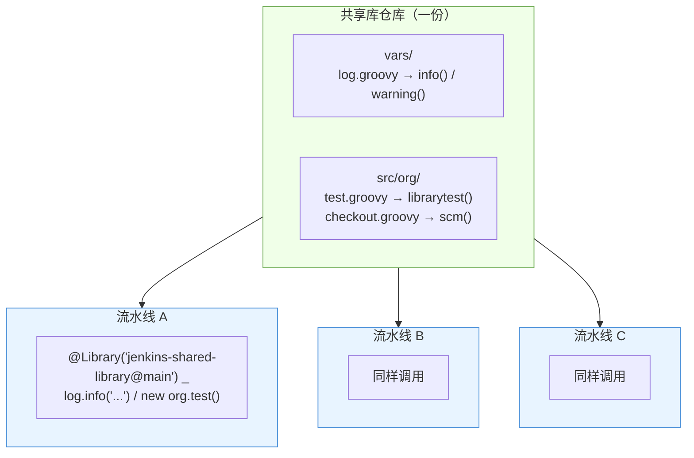

# Jenkins 共享库：把重复代码抽成可复用的 CI/CD 资产

## 纲要

- **痛点**：很多流水线步骤相同，重复写同样的代码和声明式片段，导致流水线非常臃肿
- **共享库提高代码通用性、降低冗余度**——把公共逻辑抽到独立 Git 仓库，多条流水线共同调用
- **两个目录分工明确**：`vars/` 放**全局函数直接调用**；`src/` 放**类要先实例化再调用**
- **`src/` 下的脚本开头必须 `package org`**，`org` 是包名前缀，可建多级目录
- **Jenkinsfile 第一行固定语法** `@Library('名称@分支') _`，分支可省略
- **两种调用方式差别很大**：`vars/` 直接 `log.info('x')`；`src/` 要先 `new org.test()` 再 `test.librarytest()`
- **加载失败的第一个排查点**：代码没提交——改了没 commit，Jenkins 拉的还是旧版
- **从 `def` 函数到共享库是自然演进**：前者解决单条流水线内重复，后者解决跨流水线重复

## 一、为什么需要共享库

### 1.1 臃肿是怎么来的

在 Pipeline 里，`stage` 下面的 `steps` 里可以配 `script { }` 写 Groovy。上一会我们学了 Groovy 基础。

但现实问题是：

> 在某些步骤，我们可能需要写一些 Groovy 语言，或者使用 Jenkins 流水线的一些声明式片段，我们可以把它粘贴到 `script` 里面。**但是有很多流水线同样的步骤，我们需要再写一次同样的代码或者声明式的一些片段写在 `script` 里面，这样就显得整个流水线非常臃肿。**

具体场景：

- 每条流水线都要写"构建镜像 + 推送"十几行；
- 每条流水线都要写发钉钉告警的一段 JSON；
- 每条流水线都要写"拉指定分支代码"的 `checkout` 配置。

**复制粘贴的代价**：改一处逻辑要改 N 个仓库，漏一个就是隐患。

### 1.2 共享库的解法

**使用共享库，来提高这些代码的通用性，以及降低它的冗余度。**

核心思路：**把公共代码抽到独立 Git 仓库，Jenkins 全局加载，多条流水线共同调用**。



## 二、配置共享库：两步

### 2.1 第一步：GitLab 创建共享库仓库

**在 GitLab 里面创建一个共享库，这个共享库主要就是用来存储我们需要重用的代码。**

仓库里建两个目录：

```text
jenkins-shared-library/
├── vars/                  ← 全局共享函数
│   └── log.groovy
└── src/                   ← Groovy 脚本与类
    └── org/
        ├── test.groovy
        ├── checkout.groovy
        └── color.groovy
```

### 2.2 第二步：Jenkins 配置连接

**系统管理 → 系统配置 → Pipeline → 全局共享库 → 新增**：

| 字段 | 填法 |
|---|---|
| **名称** | 共享库名称（流水线里 `@Library('这个名称@分支')` 要用） |
| **版本**（分支） | 如 `main` 或 `master`——共享库仓库的分支 |
| **允许覆盖默认版本** | ✅ 勾选 |
| **将 master 更改包含在作业最近的更改中** | ✅ 勾选 |
| **源代码管理（SCM）** | 选 Git，填共享库仓库地址 + 凭据 |

> 保存后**再打开一次系统配置页面**，确认没有报异常——有异常说明配置有问题，保存时不一定报。

## 三、两个目录：`vars/` 与 `src/` 的分工

这是共享库最核心的知识点，**两者调用方式完全不同**。

### 3.1 `vars/` —— 全局函数，直接调用

> `vars` 目录主要就是存储 Jenkins 的**全局共享的一些函数**。而这个目录里面的函数，**我们可以直接调用，直接调用就可以了**。

`vars/log.groovy`：

```groovy
def info(message) {
    echo "INFO: ${message}"
}

def warning(message, ab) {
    echo "WARNING: ${message} ${ab}"
}
```

**调用方式**——**文件名即对象名，直接点方法**：

```groovy
log.info('Starting')           // 文件名 log → 对象 log
log.warning('11', '22')        // 直接传参
```

**规则**：`vars/` 下的**文件名**（去掉 `.groovy`）就是调用时的对象名，文件里的每个 `def` 方法都是一个可调用函数。

### 3.2 `src/` —— 类，先实例化再调用

> `src` 目录通常是用来存放共享库中的 Groovy 脚本和类。这里 `org` 是一个**包名的前缀**。然后 `org` 下可以创建多层级的目录，你可以直接创建代码文件，也可以创建更多的目录结构。

`src/org/test.groovy`：

```groovy
package org                  // ← 必须声明包名

def librarytest() {
    sh "echo library test"
}
```

**注意开头必须 `package org`**——在 `src/org` 目录下创建脚本文件，**都需要在开头定义一个包**。这个包名就是目录名。

**调用方式**——**先 new 实例化，再调方法**：

```groovy
def test = new org.test()      // 实例化
test.librarytest()             // 调用方法
```

### 3.3 一个对比表（记住这张表就够了）

| 目录 | 内容 | 调用方式 | 典型用途 |
|---|---|---|---|
| **`vars/`** | 全局函数 | **直接** `log.info('x')` | 日志、通知、简单工具 |
| **`src/org/`** | 类 / 脚本 | **先 new 再调** `new org.test().method()` | 复杂逻辑、多方法封装 |

> 课件的原话对比：`vars` 下定义的方法"我们可以直接调用就可以，**不需要像在 `src/org` 目录下定义的脚本一样，首先要创建实例化对象，然后再调用方法**，不需要这么麻烦"。

## 四、在 Jenkinsfile 里引用共享库

### 4.1 第一行固定语法（必须写）

```groovy
#!groovy

@Library('jenkins-shared-library@main') _

pipeline {
    agent any
    ...
}
```

**三个要点**：

1. **`@Library('名称@分支')`** 是固定语法，**必须写在 pipeline 之前**；
2. **`@` 后面跟共享库名称**，`@main` 是分支——**分支可以省略不写**，也可以写；
3. **末尾的下划线 `_` 是固定占位符**，必须保留。

### 4.2 完整示例

```groovy
#!groovy

@Library('jenkins-shared-library@main') _

def test = new org.test()          // 实例化 src/org/test.groovy 里的类

pipeline {
    agent any
    stages {
        stage('Stage 1') {
            steps {
                script {
                    test.librarytest()           // 调用 src 下的方法
                    log.info('Starting')         // 直接调用 vars 下的函数
                    log.warning('11', '22')      // 传两个参数
                }
            }
        }
    }
}
```

课件实测输出：`library test` → `INFO: Starting` → `WARNING: 11 22`，三种调用全部成功。

### 4.3 `src` 下的实用示例

`src/org/checkout.groovy`——封装拉代码：

```groovy
package org

def scm(build_branch, url) {
    checkout scmGit(
        branches: [[name: "${build_branch}"]],
        extensions: [],
        userRemoteConfigs: [[credentialsId: 'gitlab', url: "${url}"]]
    )
}
```

调用：

```groovy
def co = new org.checkout()
co.scm('main', 'http://gitlab.example.com/golang/go.git')
```

**一行替代五六行 `checkout` 配置**，这就是共享库的价值。

`src/org/color.groovy`——彩色输出：

```groovy
package org

def PrintMessage(value, color) {
    colors = [
        'red' : "\033[40;31m >>>>>>>>>>> ${value} <<<<<<<<<<< \033[0m",
        'blue': "\033[47;34m >>>>>>>>>>> ${value} <<<<<<<<<<< \033[0m",
    ]
    ansiColor('xterm') {
        println(colors[color])
    }
}
```

用 ANSI 色让关键日志在控制台里**醒目可见**——排查长日志时极有用。

## 五、从 `def` 函数到共享库：演进路径

| 阶段 | 手段 | 适用范围 |
|---|---|---|
| 1 | 复制粘贴 | 1~2 条流水线 |
| 2 | **`def` 函数**（写在 Jenkinsfile 里） | 单条流水线内重复 |
| 3 | **共享库 `vars/`** | 跨流水线的简单函数 |
| 4 | **共享库 `src/`** | 跨流水线的复杂逻辑、多方法类 |

**判断标准很简单**：同一段逻辑出现第三次，就该抽共享库了。

## 六、常见报错与排查

| 现象 | 根因 | 解法 |
|---|--- --- | --- |
| **加载共享库失败 / 找不到** | **改了代码没提交** | 课件实测就是这个原因——commit 后重新构建即通过 |
| 系统配置保存后打开报异常 | 仓库地址或凭据错 | 核对 SCM 地址与凭据权限 |
| `@Library` 报找不到库 | 名称或分支写错 | 核对系统配置里的名称与版本 |
| 调用 `log.info` 报不存在 | `vars/log.groovy` 文件名不对 | 文件名必须与调用对象名一致 |
| `new org.test()` 报类不存在 | `src/org/test.groovy` 缺 `package org` | 文件开头补 `package org` |
| 实例化报错 | 目录层级与包名不匹配 | `src/<包名>/` 与 `package <包名>` 必须对应 |
| 改了库但流水线还用旧逻辑 | Jenkins 缓存 / 分支不对 | 确认 `@` 后分支与库实际分支一致 |

## 七、面试考点与追问

**Q1：共享库解决什么问题？**
多条流水线存在重复代码与声明式片段，复制粘贴导致流水线臃肿、改一处要改 N 处。共享库把公共逻辑抽到独立 Git 仓库，提高通用性、降低冗余度。

**Q2：`vars/` 与 `src/` 的区别？**
`vars/` 存全局函数，**调用时文件名即对象名，直接 `log.info('x')`**；`src/` 存类与脚本，**必须先 `new org.test()` 实例化再调方法**，且文件开头必须 `package org`。

**Q3：`src/org/test.groovy` 开头为什么必须 `package org`？**
因为 `org` 是包名前缀，对应目录结构。Jenkins 按包路径加载类，缺 `package` 声明会导致类找不到、实例化失败。

**Q4：`@Library('名称@分支') _` 的三个部分分别是什么？**
`@Library` 是固定注解；`'名称@分支'` 指定共享库与分支（分支可省略）；末尾 `_` 是固定占位符必须保留。这行必须写在 `pipeline { }` 之前。

**Q5：改了共享库代码但流水线还是旧逻辑，怎么排查？**
第一排查点是**代码没提交**——课件实测"加载共享库失败"就是因为改了没 commit。其次确认 `@` 后分支与库实际分支一致、Jenkins 是否有缓存。

**Q6：`def` 函数和共享库怎么选？**
`def` 函数写在 Jenkinsfile 里，解决**单条流水线内**的重复；共享库是独立仓库，解决**跨流水线**的重复。同一逻辑出现第三次就该抽共享库。

## 📎 文本↔代码关联

本篇对应课件源码（`code/4-进阶-Jenkins/`，已做去品牌化处理）：

| 代码文件 | 正文提及 | 内容 |
| --- | --- | --- |
| `code/4-进阶-Jenkins/shared-library/vars/log.groovy` | 第 3.1 节 | `vars/` 全局函数 `info(message)` 与 `warning(message, ab)` |
| `code/4-进阶-Jenkins/shared-library/src/org/test.groovy` | 第 3.2 节 | `src/org/` 下的类，`package org` + `librarytest()` |
| `code/4-进阶-Jenkins/shared-library/src/org/checkout.groovy` | 第 4.3 节 | 封装 `checkout scmGit` 的 `scm(build_branch, url)` |
| `code/4-进阶-Jenkins/shared-library/src/org/color.groovy` | 第 4.3 节 | `ansiColor` 彩色输出的 `PrintMessage(value, color)` |
| `code/4-进阶-Jenkins/Jenkinsfile/Jenkinsfile-共享库使用` | 第 4.1 / 4.2 节 | `@Library('jenkins-shared-library@main') _` + `new org.test()` + `log.info/warning` 完整调用 |

**技术点总结**：共享库把跨流水线的重复代码抽到独立 Git 仓库，核心是两个目录的分工——**`vars/` 放全局函数、文件名即对象名、直接调用**；**`src/` 放类、开头必须 `package org`、先 new 实例化再调方法**。Jenkinsfile 第一行固定写 `@Library('名称@分支') _`（分支可省略、下划线必须留）。**最高频坑是改了库代码没提交**，其次是指定分支与库实际分支不一致。演进路径：复制粘贴 → `def` 函数（单流水线内）→ 共享库 `vars/` → 共享库 `src/`。

相关度：96%。是否需要继续：[是]。代码是否可运行：[是]。
