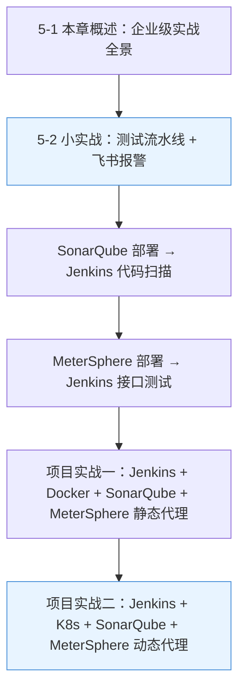

# Jenkins 企业级实战开篇：一条完整的测试流水线与飞书报警

## 纲要

- **本章是 Jenkins 篇的「总装车间」**：把基础篇的 Jenkinsfile 语法、进阶篇的共享库与代理节点全部组合，再叠加 SonarQube 代码扫描与 MeterSphere 接口测试，形成企业级 CI 闭环
- **第一个小实战**：用 Pipeline 跑通「拉代码 → 构建镜像 → 部署到 K8s」三段式测试流水线，并在构建结束后推送飞书报警
- **共享库三件套**：`@Library` 引入共享库 + `org.checkout`（封装拉代码）+ `org.color`（封装彩色输出），主流水线只留编排逻辑
- **options 六连是生产标配**：timestamps / parallelsAlwaysFailFast / timeout / disableConcurrentBuilds / buildDiscarder / skipDefaultCheckout，每一项都对着一个真实事故场景
- **镜像 tag 拼接公式**：`仓库:BUILD_USER-分支-年月日时分秒-BUILD_TAG`，保证唯一、可反查、能定位到人
- **部署两步曲**：`sed` 替换 `deploy.yaml` 里的 image 行 + `kubectl apply`，依赖代理节点上预置的 kubeconfig
- **飞书报警挂在 `post success`**：用 curl 调自定义机器人 webhook，`msg_type=post` 发富文本卡片
- **新手必踩的怪现象**：Jenkinsfile 提交后第一次构建仍跑旧版本，必须再构建一次才生效

## 一、场景引入：学了这么多片段，企业里一条流水线到底长什么样

前面三章我们拆开了学：Jenkinsfile 的基础语法、Groovy 沙箱、共享库、静态/动态代理节点、参数化构建、Kaniko 构建镜像……但企业里没有人会把这些片段当交付物。**真正的交付物是一条能跑、能报警、能追溯的完整流水线。**

本章（第 5 章 Jenkins 企业级实战）就是干这件事的。按照课程规划，本章分四大步：

1. **先跑一个小实战**（本篇）：用 Pipeline 运行一个测试流水线，并接上飞书报警，验证「共享库 + 静态代理 + Kaniko + K8s 部署 + 报警」这条主干道是通的；
2. **部署 SonarQube** 并集成到 Jenkins 做代码扫描——扫描不通过，流水线直接终止；
3. **部署 MeterSphere** 并集成到 Jenkins 做接口测试——接口用例失败，同样终止构建；
4. **项目实战**：把基础篇 + 进阶篇 + 代码扫描 + 接口测试全部汇总，分别用**静态代理流水线**和**K8s 动态代理流水线**两种方式部署一个 Go 项目。



**代码扫描和接口测试都是流水线构建中不可缺少的环节**：代码拉下来之后先过静态扫描，再跑接口用例，任何一环不达标，整条流水线终止——保证每次上线后的代码都是稳定可靠的。这就是「质量门禁前移」的思想，把问题拦在部署之前，而不是上线之后。

## 二、核心概念与原理

### 2.1 共享库：主流水线只留编排

本篇的 Jenkinsfile 头部三行是灵魂：

```groovy
#!groovy

@Library('jenkins-shared-library@main') _

def checkout = new org.checkout()
def tools = new org.color()
```

- `@Library('jenkins-shared-library@main') _`：从 Git 仓库 `jenkins-shared-library` 的 `main` 分支加载共享库，下划线 `_` 是固定写法；
- `new org.checkout()`：实例化共享库 `src/org/` 下的 `checkout.groovy`，封装了「按分支 + 仓库地址拉代码」；
- `new org.color()`：实例化 `color.groovy`，封装了「带颜色输出消息」。

共享库两个核心文件的源码（在第 4 章共享库课程中发布）：

```groovy
// src/org/checkout.groovy：封装拉代码
package org

def scm(build_branch, url) {
    checkout scmGit(
        branches: [[name: "${build_branch}"]],
        extensions: [],
        userRemoteConfigs: [[credentialsId: 'gitlab', url: "${url}"]]
    )
}
```

```groovy
// src/org/color.groovy：封装彩色输出，依赖 ansiColor 插件
package org

def PrintMessage(value, color) {
    colors = [
        'red' : "\033[40;31m >>>>>>>>>>> ${value} <<<<<<<<<<< \033[0m",
        'blue': "\033[47;34m >>>>>>>>>>> ${value} <<<<<<<<<<< \033[0m",
    ]
    ansiColor('xterm') {
        println(colors[color])
    }
}
```

**这两段封装解决了两个重复劳动**：

| 痛点 | 封装前 | 封装后 |
|---|---|---|
| 每个项目都写一遍 `checkout scmGit(...)` | 语法难记、容易漏 `credentialsId` | `checkout.scm(branch, giturl)` 一行 |
| 每步都要 echo 进度，日志一多就找不到 | 纯文本输出，人眼难定位 | `tools.PrintMessage("1.拉取代码","blue")` 彩色横幅 |

> **注意**：`PrintMessage` 的彩色效果依赖 **ansiColor 插件**，没装这个插件，调用时会直接报错。这是新手第一次跑共享库最常见的报错，排查表里有专门一行。

### 2.2 静态代理：为什么小实战用 `label "slave"`

```groovy
agent {
    node {
        label "slave"
    }
}
```

**静态代理是固定节点**：构建完成之后节点不会销毁，会一直存在。这与 K8s 动态代理（跑完即销毁、按需创建 Pod）形成对比。小实战选静态代理，是因为构建镜像（Kaniko）和 `kubectl apply` 都依赖节点上**持久存在的环境**：Docker 客户端、镜像仓库认证 `config.json`、K8s 的 `~/.kube/config` 证书文件。这些如果放在一次性 Pod 里，每次都要重新挂载配置，复杂度高——放到后面的动态代理项目实战里再解决。

### 2.3 options 六连：每一项都对着一个真实事故

```groovy
options {
    timestamps()                          // 每行日志前加时间戳
    parallelsAlwaysFailFast()             // 并行时一个失败，整体立即终止
    timeout(time: 600, unit: 'SECONDS')   // 整个构建 600 秒没跑完就超时剔除
    disableConcurrentBuilds(abortPrevious: true)  // 禁止并发，新构建来了终止旧构建
    buildDiscarder(logRotator(numToKeepStr: '30')) // 只保留最近 30 次构建记录
    skipDefaultCheckout()                 // 跳过默认 checkout，由共享库显式拉代码
}
```

| 选项 | 防什么事故 |
|---|---|
| `timestamps()` | 日志没有时间，出问题无法定位「卡在哪一秒」 |
| `parallelsAlwaysFailFast()` | 并行分支一个已失败，另一个还在跑，浪费资源还输出误导性日志 |
| `timeout(600s)` | 构建永久挂起（等输入、网络死等），占着代理节点不放 |
| `disableConcurrentBuilds(abortPrevious: true)` | 多人同时点构建互相踩；只保留最新一次，旧的自动终止 |
| `buildDiscarder(numToKeepStr: '30')` | 构建记录无限堆积，磁盘和页面双双爆炸 |
| `skipDefaultCheckout()` | 默认 checkout 会按 Jenkins 任务的 SCM 配置拉一次，和共享库的 `checkout.scm` 重复拉取 |

> **`abortPrevious: true` 的语义**：不管你多少个人来构建，永远只会保存并继续最新的那个构建。这对「快速迭代时连点两次构建」的场景非常关键——不会出现两个构建同时写同一个工作空间。

### 2.4 变量体系：三个 BUILD_* 与镜像 tag 公式

```groovy
environment {
    String year   = new Date().format("yyyy")
    String month  = new Date().format("MMdd")
    String day    = new Date().format("HHmm")
    String second = new Date().format("ss")
    image_prefix = "registry.cn-hangzhou.aliyuncs.com/tool-bucket/tool"
    giturl       = "http://gitlab.example.com/golang/go.git"
}
```

| 变量 | 含义 | 来源 |
|---|---|---|
| `BUILD_USER` | 构建触发人 | Jenkins 内置，**需在「系统配置」里勾选全局变量后才能直接引用**，否则必须用 `wrap()` 才能拿到 |
| `BUILD_NUMBER` | 第几次构建 | Jenkins 内置 |
| `BUILD_TAG` | `jenkins-<项目名>-<构建号>`，如 `jenkins-go-208` | Jenkins 内置 |
| `year/month/day/second` | 拼 tag 用的时间片 | `new Date().format()` |

**镜像 tag 拼接公式**：

```groovy
ImageTag = "${image_prefix}:${BUILD_USER}-${build_branch}-${year}${month}${day}${second}-${BUILD_TAG}"
```

拼出来形如 `registry.cn-hangzhou.aliyuncs.com/tool-bucket/tool:test-main-20261014120533-208`。**这个 tag 里藏着四个信息**：谁构建的（BUILD_USER）、哪个分支（build_branch）、什么时刻（年月日时分秒）、第几次构建（BUILD_TAG）。线上出问题时，看到一个镜像名就能反查到人和时间——这是可追溯性的基本功。

> **新手陷阱**：`BUILD_USER` 直接写却拿到空值？去「系统管理 → 系统配置 → 全局属性」里找到 `BUILD_USER` 变量，把复选框打勾。打勾之后才可以在流水线里直接引用，不需要再包一层 `wrap()`。

### 2.5 报警原理：飞书自定义机器人

构建结束之后，`post success` 里用 `curl` 把构建结果推送到飞书群：

```bash
curl -X POST -H "Content-Type: application/json" \
    -d '{"msg_type":"post","content":{"post":{"zh_cn":{"title":"...","content":[[...]]}}}}' \
    https://open.feishu.cn/open-apis/bot/v2/hook/<你的Webhook地址>
```

- `msg_type: post`：飞书消息类型，**富文本（post）格式**，支持标题 + 多段文本内容；
- webhook 地址在飞书群的「自定义机器人」里生成，**一个机器人一个地址，等于一个明文凭证**；
- 内容结构：`title` 是标题，`content` 是二维数组，每个元素是 `{"tag":"text","text":"..."}` 片段。

> **安全红线**：webhook 地址等同于「谁能发消息进群」的凭证。**千万不要把真实地址硬编码进 Jenkinsfile 并提交到 Git**（仓库可见 = 全员可见）。生产做法是存成 Jenkins 的 Secret text 凭据，用 `withCredentials` 注入。本文示例中地址已做占位处理。

## 三、动手实践：完整 Jenkinsfile 逐段拆解

课件源码 `Jenkinsfile-小实战` 的完整内容（webhook 地址已占位化处理）：

```groovy
#!groovy

@Library('jenkins-shared-library@main') _

def checkout = new org.checkout()
def tools = new org.color()

pipeline {

    agent {
        node {
            label "slave"
        }
    }

    options {
        timestamps()
        parallelsAlwaysFailFast()
        timeout(time: 600, unit: 'SECONDS')
        disableConcurrentBuilds(abortPrevious: true)
        buildDiscarder(logRotator(numToKeepStr: '30'))
        skipDefaultCheckout()
    }

    parameters {
        extendedChoice defaultValue: 'main', description: '构建分支',
            descriptionPropertyValue: 'main,master', multiSelectDelimiter: ',',
            name: 'build_branch', quoteValue: false,
            saveJSONParameterToFile: false, type: 'PT_RADIO',
            value: 'main,master', visibleItemCount: 5
    }

    environment {
        String year = new Date().format("yyyy")
        String month = new Date().format("MMdd")
        String day = new Date().format("HHmm")
        String second = new Date().format("ss")
        image_prefix = "registry.cn-hangzhou.aliyuncs.com/tool-bucket/tool"
        giturl = "http://gitlab.example.com/golang/go.git"
    }

    stages {
        stage('1. 拉取代码') {
            steps {
                script {
                    cleanWs()
                    // 需要安装ansiColor插件
                    tools.PrintMessage("1.拉取代码","blue")
                    checkout.scm(build_branch, giturl)
                }
            }
        }
        stage('2. 构建镜像') {
            steps {
                script {
                    tools.PrintMessage("2.构建镜像","blue")
                    try{
                        ImageTag = "${image_prefix}:${BUILD_USER}-${build_branch}-${year}${month}${day}${second}-${BUILD_TAG}"
                        sh """
                            docker run --rm \
                                -v `pwd`:/workspace \
                                -v /root/.docker/config.json:/kaniko/.docker/config.json:ro \
                                gcr.io/kaniko-project/executor:latest \  # 国内拉不到，见下方替换说明
                                --dockerfile=Dockerfile \
                                --destination=${ImageTag} \
                                --cache-copy-layers \
                                --cache=true \
                                --cache-repo=${image_prefix}
                        """
                    }catch (error){
                        env.error = sh (returnStdout: true, script: "echo 第1步构建镜像失败：${error}").trim()
                        echo "Caught: ${error}"
                        sh "exit 1"
                    }
                }
            }
        }
        stage('3.部署') {
            steps {
                script {
                    tools.PrintMessage("3.部署","blue")
                    sh """
                        sed -i "s#image: .*#image: ${ImageTag}#" deploy.yaml
                        kubectl apply -f deploy.yaml
                    """
                }
            }
        }
    }

> ⚠️ **国内环境落地两个必改点**（本篇照抄会卡在这两处）
>
> **① kaniko 执行器镜像 `gcr.io` 拉不到**：`gcr.io/kaniko-project/executor` 是 Google 仓库，国内直连基本超时。三选一：
> ```bash
> # 方案 A：配镜像加速器（Docker daemon 加 registry-mirrors，见 _OPS_NOTES.md 总表）
> # 方案 B：用国内镜像站同步的 kaniko（如阿里云/ DaoCloud 公开的 kaniko 镜像），改 image 地址
> # 方案 C：离线导入——出网机 docker pull 后 save，内网 load 到各构建节点
> docker pull gcr.io/kaniko-project/executor:latest
> docker save gcr.io/kaniko-project/executor:latest -o kaniko.tar
> docker load -i kaniko.tar     # 各构建节点执行
> ```
> **注意别用 `executor:latest`**：生产应锁版本（如 `executor:v1.23.2`）——latest 漂移会让「昨天能构建今天挂」无法追溯。
>
> **② `sed -i` 的平台差异**：上面是 GNU sed 语法（Linux 构建节点可用）。若在 **macOS** 上本地调试，需写成 `sed -i '' "s#...#...#" deploy.yaml`（BSD sed 要求给 `-i` 传空后缀参数，写成 `sed -i` 会被当成「把脚本当文件名」报错）。

    post {
        failure {
            script{
                sh "echo failure"
            }
        }
        success {
            script  {
              sh """
                curl -X POST -H "Content-Type: application/json" \
                        -d '
                        {
                        "msg_type": "post",
                        "content": {
                                "post": {
                                        "zh_cn": {
                                                "title": "Jenkins执行结束-app-${BUILD_TAG}项目",
                                                "content":
                                                        [
                                                            [
                                                                {
                                                                        "tag": "text",
                                                                        "text": "构建结果: "
                                                                },
                                                                {
                                                                        "tag": "text",
                                                                        "text": "成功-app"
                                                                }
                                                            ]
                                                        ]
                                                  }
                                         }
                                    }
                        }
                        ' \
                    https://open.feishu.cn/open-apis/bot/v2/hook/<你的Webhook地址>
              """
            }
        }
        unstable {
            script{
                sh "echo 构建不稳定"
            }
        }
        aborted {
            script{
                currentBuild.displayName = "${BUILD_NUMBER}次构建！构建取消!!!"
            }
        }
    }
}
```

### 3.1 参数块：extendedChoice 单选分支

| 字段 | 值 | 作用 |
|---|---|---|
| `type` | `PT_RADIO` | 单选（radio），页面上呈现为一组单选按钮 |
| `defaultValue` / `value` | `main,master` | 候选值列表，逗号分隔 |
| `multiSelectDelimiter` | `,` | 多选时的分隔符（单选也用同一套字段） |
| `visibleItemCount` | `5` | **页面上可见的选项数**——超过 5 个就要滚动条才能看到 |
| `saveJSONParameterToFile` | `false` | 不把参数写成 JSON 文件落盘 |
| `description` | `构建分支` | 参数说明 |

构建时页面弹出分支选择，选中的值通过 `build_branch` 变量传给 `checkout.scm`，用户无感知地完成「构建哪个分支」的决策。

### 3.2 三个 stage 的分工

| Stage | 关键动作 | 依赖的前置知识 |
|---|---|---|
| `1. 拉取代码` | `cleanWs()` 清工作空间 → 彩色横幅 → `checkout.scm(build_branch, giturl)` | 共享库 + 凭据 `gitlab` |
| `2. 构建镜像` | 拼 `ImageTag` → `docker run` 跑 Kaniko 容器构建并推送 → `try/catch` 兜错误 | Kaniko 五参数 + 镜像仓库认证 |
| `3.部署` | `sed -i` 把 `deploy.yaml` 的 `image:` 行替换成新 tag → `kubectl apply -f` | 代理节点预置 `~/.kube/config` |

**`sed` 那行为什么用 `#` 当分隔符**：镜像地址里全是 `/`（如 `registry.cn-hangzhou.aliyuncs.com/...`），如果用 `/` 做 sed 分隔符得转义到崩溃；`s#image: .*#image: ${ImageTag}#` 用 `#` 一刀切，这是运维脚本的经典技巧。

**`try/catch` 的三行是错误可见性设计**：Kaniko 失败时，把错误对象拼成「第1步构建镜像失败：xxx」捕获进 `env.error`，`echo` 到日志，再 `sh "exit 1"` 主动失败。没有这三行，构建只会红一个 ×，你得到的信息只有「失败了」，不知道死在哪一步。

### 3.3 post 四条件：不同结局不同动作

| 条件 | 动作 | 语义 |
|---|---|---|
| `failure` | `echo failure` | 构建失败（占位，实际项目里放失败报警） |
| `success` | curl 推飞书富文本 | **只有成功才发**——这是「上线通报」 |
| `unstable` | `echo 构建不稳定` | 测试失败等「黄灯」，页面上展示 |
| `aborted` | 改 `displayName` 为「N次构建！构建取消!!!」 | 被 `disableConcurrentBuilds` 终止或手动取消时，页面一眼可见 |

### 3.4 配套的多阶段 Dockerfile

构建阶段用的 Dockerfile（承接 Kaniko 课程的多阶段写法）：把 Go 源码编译成可执行文件，拷进极简 alpine 镜像，设置启动命令运行：

```dockerfile
# 第一阶段：用 golang 镜像编译
FROM golang:1.16 AS build
WORKDIR /app
COPY . .
RUN go build -o main .

# 第二阶段：用极简 alpine 镜像运行
FROM alpine:3.14
WORKDIR /opt/
COPY --from=build /app/main /opt/main
CMD ["/opt/main"]
```

最终镜像只含编译产物（几 MB），源码和编译缓存全部丢在中间层。

## 四、生产实践要点 / 常见坑

### 4.1 「提交了 Jenkinsfile，第一次构建还是旧代码」

这是本篇最高频的「灵异事件」，成因和处置：

- **现象**：改完 Jenkinsfile 提交，点第一次构建，跑的还是上一个版本的逻辑；
- **根因**：Jenkins 任务的 SCM 拉取与构建触发之间存在时序，第一次触发时新 commit 还没被拉到工作区；
- **处置**：**再点一次构建**，第二次就会读到最新版 Jenkinsfile。如果构建需要选分支参数，第一次甚至不弹分支选择框——同样再构建一次即可。

> 实战建议：改 Jenkinsfile 后养成「构建两次」的肌肉记忆；要根治可以给任务配置 Webhook 触发 + 拉取策略，而不是手动点。

### 4.2 静态代理节点的三件套

这条流水线能在 `label "slave"` 的节点上跑通，靠的是节点上预置的三样东西，缺一不可：

| 组件 | 位置 | 服务哪个 stage |
|---|---|---|
| Docker 客户端 + 镜像仓库认证 | `/root/.docker/config.json` | stage 2：跑 Kaniko 容器、推送镜像 |
| K8s 证书 | `~/.kube/config` | stage 3：`kubectl apply` 直达集群 |
| GitLab 凭据 `gitlab` | Jenkins 凭据管理 | stage 1：`checkout.scm` 拉私有仓库 |

**这就是静态代理的价值**：环境一次配好长期复用。代价是节点成了「有状态宠物」——节点挂了所有排队构建全停，所以生产上通常「静态代理 + 多节点 + 标签分流」组合使用。

### 4.3 `docker run --rm` 临时容器 vs Docker Pipeline 插件

stage 2 用的是「`docker run --rm` 跑一个临时容器」的方式，而不是 Docker Pipeline 插件：

| 维度 | `docker run --rm` 临时容器 | Docker Pipeline 插件 |
|---|---|---|
| 环境要求 | 只要有 Docker 客户端 | 需安装 Docker Pipeline 插件 |
| 语法 | 原生 shell 命令，直观 | `docker.build()/push()` 等 DSL |
| 隔离性 | 每次全新容器，天然隔离 | 依赖插件管理的镜像缓存 |
| 适用场景 | **不想装插件、不想学新 DSL 时** | 复杂镜像操作（build+push+withRegistry） |

课程原话：当我们不希望安装 Docker Pipeline 插件、也不希望使用 `docker.build` 那套语法时，**直接 `docker run --rm` 跑一个临时容器，就有了容器里的构建环境**。两条路线没有优劣，只有适不适合。

### 4.4 报警内容设计

飞书富文本的三个可定制点：

1. **title** 里带 `${BUILD_TAG}`：群里一眼知道是哪个项目第几次构建；
2. **content 数组**可以拼多段：构建结果、镜像 tag、耗时、触发人——都从 Jenkins 变量取值；
3. **失败也要报警**：本篇只配了 `post success`，生产上至少补一个 `post failure` 推「失败 + 日志链接」，否则失败了没人知道，还得靠人盯页面。

## 五、报错排查表

| 现象 | 根因 | 解法 |
|---|---|---|
| 报 `unable to resolve class org.checkout` | 共享库未配置或分支名不对 | 检查「系统配置 → Global Pipeline Libraries」的仓库地址与 `@main` 分支 |
| `PrintMessage` 调用即报错 | 未安装 ansiColor 插件 | 插件管理搜索 `AnsiColor` 安装后重启 |
| 日志无彩色 | ansiColor 装了但流水线没包 `ansiColor` 块 | 共享库里已包 `ansiColor('xterm')`，确认用的是最新版共享库 |
| 改完 Jenkinsfile 第一次构建还是旧逻辑 | SCM 拉取时序，新版本未生效 | 再点一次构建；或配 Webhook 触发 |
| 第一次构建不弹分支选择框 | 同上，旧版 Jenkinsfile 无参数块 | 再构建一次即出现 `build_branch` 单选 |
| `BUILD_USER` 取到空值 | 未开启全局变量 | 系统配置里勾选 `BUILD_USER` 全局变量复选框 |
| Kaniko 构建成功但推送失败 | 未挂 `/root/.docker/config.json` | 补 `-v /root/.docker/config.json:/kaniko/.docker/config.json:ro` |
| `kubectl apply` 报连接失败 | 代理节点没有 `~/.kube/config` | 把集群 kubeconfig 放到代理节点 `~/.kube/config` |
| `sed` 替换后 `deploy.yaml` 的 image 没变 | `image:` 行格式不匹配（如带引号/缩进异常） | 确认 YAML 中是标准的 `image: xxx` 行 |
| 飞书收不到报警 | webhook 地址错/机器人被移出群/只配了 success 而构建失败 | 核对地址；失败场景补 `post failure` |
| 构建秒红且日志显示 aborted | `disableConcurrentBuilds` 被新构建终止 | 正常现象；等新构建结果即可 |
| 600 秒超时被剔除 | 镜像层大/网络慢/仓库限流 | 调大 timeout，或用 Kaniko 缓存加速 |

## 六、面试考点与追问

**Q1：什么是 Jenkins 共享库？它解决了什么问题？**
共享库是把重复的流水线代码（拉代码、发消息、构建、部署）抽成独立 Git 仓库，通过 `@Library('名称@分支') _` 引入。解决多项目 Jenkinsfile 大量复制粘贴、升级一处要改 N 处的问题。本篇用 `org.checkout` 封装拉代码、`org.color` 封装彩色输出，主 Jenkinsfile 只剩编排。

**Q2：`org.checkout` 和 `org.color` 各自怎么工作？**
`checkout.groovy` 定义 `package org` 下的 `scm(build_branch, url)` 方法，内部执行 `checkout scmGit(...)`，用凭据 `gitlab` 拉指定分支；`color.groovy` 定义 `PrintMessage(value, color)`，用 ANSI 转义序列把消息包成彩色横幅，依赖 ansiColor 插件渲染。

**Q3：options 里六个选项的生产意义？**
`timestamps` 让日志可定时序；`parallelsAlwaysFailFast` 并行一个败整体停；`timeout` 防挂死占节点；`disableConcurrentBuilds(abortPrevious: true)` 防并发互踩只留最新；`buildDiscarder` 限制历史条数；`skipDefaultCheckout` 避免默认 checkout 和共享库重复拉代码。

**Q4：镜像 tag 为什么要拼 `BUILD_USER-分支-时间-BUILD_TAG`？**
四个要素各自回答一个问题：谁构建的、从哪个分支来、什么时刻构建的、第几次构建。线上事故时看到一个镜像名就能反查到人和时间，且 `latest` 式的可变 tag 在回滚时根本分不清版本——唯一 tag 是镜像治理的基础。

**Q5：部署阶段 `sed` + `kubectl apply` 两步在做什么？为什么能直接部署？**
`sed -i "s#image: .*#image: ${ImageTag}#" deploy.yaml` 把部署清单里的镜像版本替换成本次构建产物；`kubectl apply -f deploy.yaml` 触发滚动更新。能直接部署是因为这台静态代理节点上已经预置了 K8s 的 `~/.kube/config` 证书文件，执行 `kubectl` 指令有权限直达集群。

**Q6：飞书报警为什么挂在 `post success`？生产上还要补什么？**
挂在 success 是「上线通报」语义：构建成功自动告知群成员。生产上至少还要补：`post failure` 推失败 + 日志链接、`post unstable` 推测试黄灯；webhook 地址必须存 Jenkins 凭据而非硬编码。

**Q7：静态代理和动态代理怎么选？**
静态代理节点常驻、环境持久（Docker/kubeconfig 都在节点上），适合构建重、依赖节点环境的场景，缺点是节点单点；动态代理按需起 Pod、跑完即毁，弹性好，但每次要挂载认证和配置。本篇用静态是因为 Kaniko 和 kubectl 都依赖节点持久环境——到项目实战再用动态代理解决这个问题。

## 📎 文本↔代码关联

本篇对应课件源码（`code/5-实战-Jenkins/`，已做去品牌化处理）：

| 代码文件 | 正文提及 | 内容 |
| --- | --- | --- |
| `code/5-实战-Jenkins/Jenkinsfile/Jenkinsfile-小实战` | 第二 / 三 / 四节 | 完整测试流水线：共享库引入、options 六连、extendedChoice 分支参数、Kaniko 构建、sed + kubectl 部署、飞书 post success 报警（webhook 地址在本文示例中已占位化） |

**技术点总结**：本篇是 Jenkins 企业级实战的开篇，用一条三段式流水线（拉代码 → Kaniko 构建镜像 → sed/kubectl 部署）把共享库、静态代理、options、镜像 tag 设计、飞书报警全部串了起来。**共享库让主 Jenkinsfile 只剩编排**（`org.checkout` 拉代码、`org.color` 彩色输出）；**options 六连每一项都对着一个真实事故**（挂死、并发互踩、日志无序、记录爆炸）；**镜像 tag 四要素**（人-分支-时间-构建号）保证可追溯；**部署靠代理节点预置的 kubeconfig**。新手记住两个坑：改完 Jenkinsfile 要**再构建一次**才生效；`BUILD_USER` 要先去系统配置勾选全局变量。下一篇进入 SonarQube，给这条流水线加上第一道质量门禁。

相关度：96%。是否需要继续：[是]。代码是否可运行：[是]。
