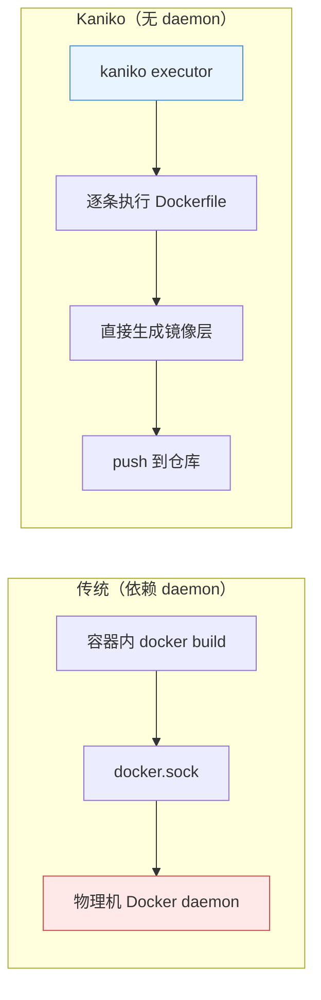

# 28. Kaniko 无守护进程构建镜像：K8s 环境下的必然选择

## 纲要

- **Kaniko 是一个用于构建镜像的工具**，核心特点是**不需要 Docker 守护进程**
- **为什么必须用它**：K8s 1.24 起弃用 Docker，node 上很可能不再部署 Docker，也就没法挂载 `docker.sock`——传统构建方式失效
- **原理**：在容器内**逐条执行 Dockerfile 里的命令**，不依赖 daemon，因此能在普通容器里构建镜像
- **五个关键参数**：`--cache-copy-layers`、`--cache`、`--cache-repo`、`--dockerfile`、`--destination`
- **缓存三层机制**：copy 层缓存 + 缓存层推送远程仓库，二次构建**几乎全命中缓存，速度提升数倍**
- **必须挂两个卷**：当前代码目录到 `/workspace`、`config.json` 到 `/kaniko/.docker/`（后者提供推送仓库的权限）
- **非交互模式用 `executor:latest`，交互调试用 `executor:debug`**——debug 版要输 `sh` 才进交互
- **tag 用 `new Date().format()` 拼年月日时分秒 + `BUILD_ID`**，唯一且可反查
- **进阶课程的三条主线在此收口**：动静态节点、Docker/Kaniko 构建、Groovy + 共享库

## 一、Kaniko 是什么，为什么必须学

**Kaniko 是一个用于构建镜像的工具。**

### 1.1 传统方式为什么失效

> 我们平时使用 Docker 来构建镜像，都需要有 Docker 守护进程。当我们在 K8s 里构建的时候，也需要挂载物理机上的 Docker 守护进程，才可以构建成功我们的镜像。

> **但是 K8s 1.24 版本开始他就不需要再使用 Docker 了。** 那我们的 K8s 的 node 节点上，很有可能就不再部署 Docker 了。所以我们也没有办法挂载 `docker.socket` 的文件到我们的容器里面。

**这是一个硬约束**：

| K8s 版本 | node 上是否有 Docker | 能否挂 `docker.sock` |
|---|---|---|
| < 1.24 | 通常有 | 能 |
| **≥ 1.24** | **很可能没有** | **不能** |

**这时候还需要在容器里面构建镜像，就需要使用 Kaniko。**

### 1.2 Kaniko 的原理

Kaniko **在容器内逐条执行 Dockerfile 里的命令**，把每一层的产物提交成一个镜像层，最终 push 到仓库。整个过程**不调用 Docker daemon**，所以普通容器里就能跑。



## 二、五个构建参数

课件把 Kaniko 的参数讲得很细，这五个是核心：

### 2.1 `--cache-copy-layers`（缓存复制层）

> 这个配置是指缓存复制层。当我们在 Dockerfile 里面加了 `COPY` 这一条指令，**第一次构建的时候，它就会缓存这个 COPY 这一层的指令。第二次再进行构建的时候，它就会直接使用上一次构建出来的缓存层，并不会再重复执行 COPY 追加指令。**

**生效的两个前提**：

1. **这次构建的 `COPY` 指令要跟上一次 Dockerfile 执行的 `COPY` 指令保持一致**；
2. **Kaniko 要加上 `--cache-copy-layers` 这个参数**。

> **实践含义**：Dockerfile 里**先 COPY 变化少的文件（如 `go.mod`）、后 COPY 变化多的文件（源码）**，才能让缓存真正命中。COPY 顺序写反，每次源码变都导致缓存失效。

### 2.2 `--cache`（开启缓存）

> 如果这个 `--cache` 你不给它开启的话，**尽管你加了这个 `--cache-copy-layers`，也没有办法进行使用。**

**默认 `--cache=true` 就是开启的**，但显式写出来更清楚。

### 2.3 `--cache-repo`（缓存仓库）

> 我们构建镜像的时候，每一层镜像它都会推送到我们的远程存储库里面。**当我们下一次再构建镜像的时候，如果是同样的镜像缓存层，远程存储库已经存在了，那它就不会再重复推送，这样就会加快我们的构建速度。**

这是**跨节点也能命中缓存**的关键——缓存放远程仓库，不依赖本地。

### 2.4 `--dockerfile`（Dockerfile 路径）

指定要构建的 Dockerfile 路径。

### 2.5 `--destination`（推送地址）

配置要推送的**镜像仓库地址**。

### 2.6 参数速查表

| 参数 | 作用 | 注意 |
|---|---|---|
| `--cache-copy-layers` | 缓存 COPY 层 | **COPY 指令要与上次一致**才命中 |
| `--cache` | 开启缓存 | 不开则上一个参数无效 |
| `--cache-repo` | 缓存推送到远程仓库 | 跨节点命中的关键 |
| `--dockerfile` | Dockerfile 路径 | |
| `--destination` | 镜像推送地址 | |

## 三、完整用法：docker run 方式

```bash
docker run --rm \
    -v `pwd`:/workspace \
    -v /root/.docker/config.json:/kaniko/.docker/config.json:ro \
    gcr.io/kaniko-project/executor:latest \   # ⚠️ 生产锁版本：kaniko 以 latest 滚动发布，固定 v1.x.y 保证可追溯
    --dockerfile=Dockerfile \
    --destination=registry.cn-hangzhou.aliyuncs.com/cicd-demo/app:main-20261014120533-57 \
    --cache-copy-layers \
    --cache=true \
    --cache-repo=registry.cn-hangzhou.aliyuncs.com/cicd-demo/app
```

**逐段拆解**：

| 部分 | 作用 |
|---|---|
| `docker run --rm` | 跑一个容器，**构建成功后容器自动删除** |
| `` -v `pwd`:/workspace `` | **挂载当前代码目录**到容器的 `/workspace` |
| `-v /root/.docker/config.json:/kaniko/.docker/config.json:ro` | **挂载 docker 认证配置**，让构建完有权限推送镜像到仓库 |
| `gcr.io/kaniko-project/executor:latest` | Kaniko 执行器镜像，`latest` 为滚动 tag；生产锁到 `v1.x.y` |
| `--dockerfile=Dockerfile` | Dockerfile 路径 |
| `--destination=...` | 推送地址 |
| `--cache-*` | 缓存三件套 |

> **两个挂载都不能少**：少了 `/workspace` 没代码可构建；少了 `config.json` 构建成功但**推不上去**（无仓库认证）。

## 四、交互模式：executor:debug

> 当前运行的 `latest` 版本，它只是支持在**非交互式**的模式下来构建镜像。如果想在交互式模式下构建，我们可以使用**调试镜像 `executor:debug`**。

```bash
docker run -it --entrypoint sh \
    gcr.io/kaniko-project/executor:debug
```

**注意**：debug 版执行器默认不带入口，**需要输入 `sh` 才拥有进入交互式模式执行的权限**。

**用途**：在 K8s 出问题的环境里排查构建失败原因——进去看文件、看日志、手动试命令。

## 五、流水线里的生产级写法

把 Kaniko 装进 Jenkins 流水线，配合前面的 Groovy 知识点：

```groovy
#!groovy

pipeline {
    agent { node { label "slave" } }        // 该 slave 上部署了 Docker

    environment {
        String year   = new Date().format("yyyy")
        String month  = new Date().format("MMdd")
        String day    = new Date().format("HHmm")
        String second = new Date().format("ss")
        image_prefix  = "registry.cn-hangzhou.aliyuncs.com/cicd-demo/app"
    }

    stages {
        stage('1. 构建镜像') {
            steps {
                script {
                    try {
                        env.docker_image = "${image_prefix}:main-${year}${month}${day}${second}-${BUILD_ID}"
                        retry(3) {
                            sh """
                                docker run --rm \
                                    -v `pwd`:/workspace \
                                    -v /root/.docker/config.json:/kaniko/.docker/config.json:ro \
                                    gcr.io/kaniko-project/executor:latest \   # 生产锁版本，别用 latest
                                    --dockerfile=Dockerfile \
                                    --destination=${docker_image} \
                                    --cache-copy-layers \
                                    --cache=true \
                                    --cache-repo=${image_prefix}
                            """
                        }
                    } catch (error) {
                        env.error = sh(returnStdout: true,
                            script: "echo 第1步构建镜像失败：${error}").trim()
                        echo "Caught: ${error}"
                        sh "exit 1"
                    }
                }
            }
        }
    }
}
```

**四个生产级设计点**：

| 设计 | 来源 | 价值 |
|---|---|---|
| `new Date().format()` 拼 tag | Groovy 时间 | tag 唯一且可反查构建时刻 |
| `retry(3)` | options/step 层重试 | 应对网络抖动导致的推送失败 |
| `try/catch` + 拼错误信息 | Groovy 异常 | 告警精确到"第1步构建镜像失败：xxx" |
| `sh(returnStdout: true).trim()` | Groovy | 把命令输出捕获进变量 |

> 课件实测：第二次构建时**全部命中缓存，构建时间非常快**——这就是 `--cache-copy-layers` + `--cache-repo` 的收益。

## 六、配套的多阶段 Dockerfile

课件里的 Dockerfile 用了**多阶段构建**（这也是 Kaniko 的最佳搭档）：

```dockerfile
# 第一阶段：用 golang 镜像编译
FROM golang:1.16 AS build
WORKDIR /app
COPY . .
RUN go build -o main .

# 第二阶段：用极简 alpine 镜像运行
FROM alpine:3.14
WORKDIR /opt/
COPY --from=build /app/main /opt/main
CMD ["/opt/main"]
```

**为什么这样写**：

- 编译阶段用 `golang:1.16`（体积大但工具全）；
- 运行阶段用 `alpine`（几 MB），**最终镜像只有编译产物**；
- 中间层（源码、编译缓存）全部丢弃。

> **配合 Kaniko 的缓存**：第一阶段源码没变就命中缓存，连编译都跳过。

## 七、常见报错与排查

| 现象 | 根因 | 解法 |
|---|--- --- | --- |
| 推送镜像失败、无权限 | 没挂 `config.json` | 补 `-v .../config.json:/kaniko/.docker/config.json:ro` |
| 找不到代码 | 没挂 `/workspace` | 补 `-v \`pwd\`:/workspace` |
| 缓存不生效 | `--cache` 没开，或 COPY 指令变了 | 开 `--cache=true`，保持 COPY 顺序稳定 |
| K8s 1.24+ 构建失败 | node 无 Docker、挂不了 sock | 改用 Kaniko |
| 交互进不去 | 用了 `latest` 而非 `debug` | 换 `executor:debug` 并输 `sh` |
| 镜像体积大 | Dockerfile 没用多阶段 | 编译与运行分离，运行阶段用 alpine |
| tag 冲突 | tag 拼接不含唯一值 | 用 `${年月日时分秒}-${BUILD_ID}` |
| 偶发推送失败 | 网络抖动 | 包 `retry(3)` |

## 八、面试考点与追问

**Q1：Kaniko 是什么？解决什么问题？**
无守护进程的镜像构建工具。解决 K8s 1.24 弃用 Docker 后，node 上没有 Docker daemon、无法挂载 `docker.sock`，导致容器内无法构建镜像的问题。

**Q2：Kaniko 与 docker build 的本质区别？**
`docker build` 依赖 Docker daemon（通过 `docker.sock` 通信）；Kaniko **在容器内逐条执行 Dockerfile 命令**，自己生成镜像层，完全不需要 daemon。因此它能在任何容器里跑，包括 K8s Pod。

**Q3：Kaniko 的缓存机制有哪几层？**
三层：`--cache` 开启缓存总开关；`--cache-copy-layers` 缓存 Dockerfile 里的 COPY 层（**前提是 COPY 指令与上次一致**）；`--cache-repo` 把缓存层推远程仓库，实现跨节点命中。**只加 `--cache-copy-layers` 不开 `--cache` 是无效的。**

**Q4：为什么 Dockerfile 要先 COPY `go.mod` 再 COPY 源码？**
为了命中 Kaniko 的 COPY 层缓存。依赖声明文件（`go.mod`/`package.json`）变化少，源码变化多——先 COPY 前者，源码变动时前面的层仍命中缓存，不用重新拉依赖。**顺序写反，缓存几乎永远失效。**

**Q5：`executor:latest` 与 `executor:debug` 的区别？**
`latest` 只支持非交互式构建；`debug` 是调试镜像，可进交互模式（需输 `sh`），用于在 K8s 出问题的环境里排查构建失败。

**Q6：生产环境用 Kaniko 构建，tag 怎么设计？**
用时间戳 + 构建号保证唯一且可追溯，如 `repo:main-${yyyy}${MMdd}${HHmm}${ss}-${BUILD_ID}`。好处是唯一不冲突、能反查构建时刻、与 Git commit 关联后可完整回溯。

## 📎 文本↔代码关联

本篇对应课件源码（`code/4-进阶-Jenkins/`，已做去品牌化处理）：

| 代码文件 | 正文提及 | 内容 |
| --- | --- | --- |
| `code/4-进阶-Jenkins/Jenkinsfile/Jenkinsfile-kaniko使用` | 第五节 | 完整生产级 Kaniko 流水线：`new Date().format()` 拼 tag、`retry(3)`、`try/catch` 拼错误信息、`sh(returnStdout: true).trim()` |
| `code/4-进阶-Jenkins/课件/教学课件.md` | 第二 / 六 节 | Kaniko 五个参数与多阶段 Dockerfile 的标准写法 |

**技术点总结**：Kaniko 是无守护进程的镜像构建工具，**K8s 1.24 弃用 Docker 后它是容器内构建镜像的必然选择**——原理是在容器内逐条执行 Dockerfile 命令，不依赖 daemon。五个核心参数：`--cache-copy-layers`（缓存 COPY 层，**前提是 COPY 指令与上次一致**）、`--cache`（总开关，不开则上一个无效）、`--cache-repo`（缓存推远程仓库实现跨节点命中）、`--dockerfile`、`--destination`。**两个挂载不能少**：`/workspace` 提供代码、`config.json` 提供推送权限。生产写法 = 时间戳 tag + `retry(3)` + `try/catch` 精确定位 + 多阶段 Dockerfile 缩小镜像。

