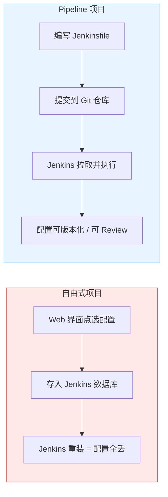
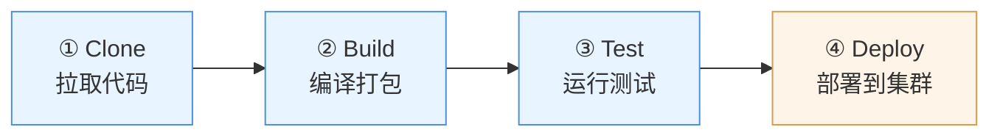
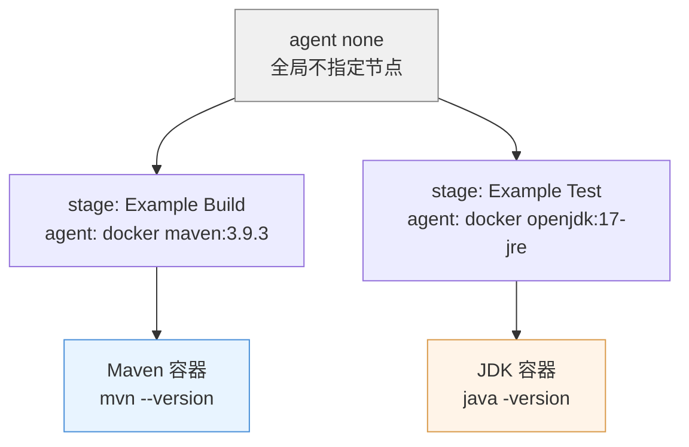

# Jenkins Pipeline 入门：声明式流水线基础语法与自由式项目的本质区别

## 纲要

- **为什么必须用 Pipeline 而不是自由式项目**：自由式项目的配置存在 Jenkins 数据库里， Jenkins 一挂全丢且无法版本化；Pipeline 用 Groovy DSL 写成的 `Jenkinsfile` 可以进 Git，配置即代码
- **声明式流水线的四层骨架**：`pipeline` → `agent` → `stages` → `stage` → `steps`，从外到内一层套一层，缺一个括号整条流水线直接报错
- **`agent any` 的真实含义**：不是"任意服务器"，而是"任意一个在线的可执行节点"，它是流水线能跑起来的前提
- **单阶段与多阶段的写法差异**：`stages` 里放多个 `stage`，每个 `stage` 必须有名字且内部必须先写 `steps`
- **三种流水线脚本来源**：页面内联、仓库中的 `Jenkinsfile`、SCM 拉取——生产环境只用后两种
- **面试高频追问**：声明式与脚本式流水线的区别、`agent none` 的用法、`steps` 里为什么不能直接写 shell

## 一、先看痛点：自由式项目到底差在哪

Jenkins 里有两种创建任务的方式，新手最容易在"自由风格软件项目"上踩坑。

**自由式项目（Freestyle Project）** 的所有配置——源码地址、构建触发器、构建步骤、构建后操作——全部通过 Web 界面点选，最终存进 **Jenkins 主控节点的数据库**。这带来三个结构性问题：

1. **配置不可版本化**：改了哪里、谁改的，无从追溯；
2. **Jenkins 挂了配置就没了**：重装 Jenkins 后要凭记忆把上百个 Job 重新点一遍；
3. **表达力有上限**：它只能做线性的一串步骤，无法定义"编译 → 测试 → 打包 → 部署"这样的多阶段结构，也无法写条件分支。

**Pipeline 项目**把上述配置全部搬进一个用 **Groovy DSL** 编写的 `Jenkinsfile`：

```groovy
pipeline {
    agent any
    stages {
        stage('Build') {
            steps {
                echo 'building...'
            }
        }
        stage('Test') {
            steps {
                echo 'testing...'
            }
        }
    }
}
```

这个文件可以提交到 Git 仓库，于是**流水线本身获得了代码的所有好处**：版本历史、Code Review、分支管理、回滚。



## 二、声明式流水线的四层骨架

声明式（Declarative）Pipeline 的语法是**严格分层**的，从外到内固定为：

```text
pipeline            ← 最外层，声明"这是一条流水线"
└── agent           ← 在哪个节点执行
    └── stages      ← 阶段集合（注意有 s）
        └── stage   ← 单个阶段（注意没有 s），必须有名字
            └── steps   ← 该阶段要执行的动作（注意有 s）
                └── 具体步骤（echo / sh / git ...）
```

对应到最小可运行的单阶段流水线：

```groovy
pipeline {
    agent any
    stages {
        stage('Stage 1') {
            steps {
                echo 'Hello world!'
            }
        }
    }
}
```

**逐行拆解：**

| 代码 | 作用 | 新手易错点 |
| --- | --- | --- |
| `pipeline {` | 声明这是一个声明式流水线 | 必须是整个文件的最外层块 |
| `agent any` | 指定执行节点 | `any` 表示任意在线节点，不是"任意服务器" |
| `stages {` | 阶段容器 | **有 s**，里面装多个 stage |
| `stage('Stage 1')` | 单个阶段 | **没有 s**，名字必须提供，会显示在流水线视图上 |
| `steps {` | 步骤容器 | **有 s**，里面才是真正干活的命令 |
| `echo 'Hello world!'` | 打印一行日志 | 字符串用单引号或双引号均可 |

> **铁律**：括号必须成对。少一个 `}`，整条流水线连语法检查都过不了，构建直接失败。这是新手最常见的报错来源。

## 三、多阶段流水线：把 CI 流程装进 stages

真实项目一定是多阶段的。写法就是把多个 `stage` 并列放进 `stages`：

```groovy
pipeline {
    agent any
    stages {
        stage('Stage 1') {
            steps {
                echo 'Hello world!'
            }
        }
        stage('Stage 2') {
            steps {
                echo 'This is Stage 2'
            }
        }
    }
}
```

一个更贴近真实 CI 的四阶段版本：

```groovy
pipeline {
    agent any
    stages {
        stage('Clone') {
            steps {
                git branch: 'main', url: 'http://gitlab.example.com/golang/go.git'
            }
        }
        stage('Build') {
            steps {
                sh 'go build -o app ./...'
            }
        }
        stage('Test') {
            steps {
                sh 'go test ./...'
            }
        }
        stage('Deploy') {
            steps {
                sh 'kubectl apply -f k8s/'
            }
        }
    }
}
```

在 Jenkins 的流水线视图里，这四个阶段会渲染成从左到右的进度条，哪个阶段挂了一眼就能看到：



**这就是 Pipeline 相对自由式项目的核心价值**：阶段边界清晰、失败定位精确、视图直观。自由式项目跑起来只有一坨控制台日志，没有阶段概念。

## 四、agent 到底有几种写法

`agent` 决定"这条流水线（或这个阶段）在哪个节点上跑"。课程里列出的常用写法：

```groovy
agent any                                   // 任意在线节点
agent none                                  // 不全局指定，由每个 stage 自己声明
agent { node { label 'labelName' } }        // 指定标签的节点
agent { label 'labelName' }                 // 简写形式
```

还可以在 `pipeline` 层用 `agent none`，然后让每个 stage 挂不同的 agent——这是**多环境构建**的经典用法：

```groovy
pipeline {
    agent none
    stages {
        stage('Example Build') {
            agent {
                docker {
                    label 'slave'
                    image 'maven:3.9.3-eclipse-temurin-17'
                    // 需要挂载目录时加参数
                    // args '-v /path/to/mount:/tmp'
                }
            }
            steps {
                echo 'Hello, Maven'
                sh 'mvn --version'
            }
        }
        stage('Example Test') {
            agent { docker 'openjdk:17-jre' }
            steps {
                echo 'Hello, JDK'
                sh 'java -version'
            }
        }
    }
}
```

**这段代码的精妙之处**：Build 阶段在 Maven 容器里跑，Test 阶段在 JDK 容器里跑，**每个 stage 用不同的工具链镜像，互不污染**，而且不需要在节点上预装 Maven 和 JDK。这是"容器即环境"思想的落地。



## 五、在 Jenkins 里创建第一条流水线

**Step 1**：Jenkins 首页 → 新建 Item → 输入任务名 → 选 **流水线（Pipeline）** → 确定。

**Step 2**：在配置页拉到最底部的 **Pipeline** 区域，会看到一个关键下拉框——**流水线脚本的来源**：

| 选项 | 含义 | 生产可用性 |
| --- | --- | --- |
| Pipeline script | 脚本直接写在 Jenkins 页面里 | ❌ 仅适合练手， Jenkins 挂了就没 |
| Pipeline script from SCM | 从 Git 仓库拉取 `Jenkinsfile` | ✅ **生产标准做法** |

**Step 3**：选 `Pipeline script`，把下面的内联脚本粘进去：

```groovy
pipeline {
    agent any
    stages {
        stage('git-clone') {
            steps {
                echo 'git clone'
            }
        }
        stage('build') {
            steps {
                echo 'build'
            }
        }
        stage('deploy') {
            steps {
                echo 'deploy'
            }
        }
        stage('test') {
            steps {
                echo 'test'
            }
        }
    }
}
```

**Step 4**：保存 → 立即构建。构建历史里会出现一条带**阶段进度条**的记录，四个阶段依次变绿。

> **对比实验**：同样的配置如果你用自由式项目做，只能加四个"执行 shell"步骤，构建视图里只有一坨日志，没有阶段进度，也无法在某个阶段失败时快速定位。建议新手两个都建一次，直观感受差异。

## 六、生产环境应该怎么写：脚本进 Git

练手用内联脚本没问题，但**生产环境必须把 `Jenkinsfile` 提交到仓库**。配置方式：

1. 仓库根目录放 `Jenkinsfile`，内容就是上面的流水线代码；
2. Jenkins 任务配置里选 **Pipeline script from SCM**；
3. SCM 选 Git，填仓库地址，选好凭据，分支指定 `*/main`；
4. 保存后构建，Jenkins 会自动拉取仓库里的 `Jenkinsfile` 并执行。

这样做的好处立竿见影：

- **改流水线就是发 MR**，有 Review、有记录；
- **不同分支可以用不同流水线**，天然支持多分支交付；
- **Jenkins 重建后零配置恢复**，所有定义都在 Git 里。

## 七、常见报错与排查

| 报错现象 | 根因 | 解法 |
| --- | --- | --- |
| `Expected a step` | 在 `steps` 外写了命令，或 `stage` 里漏了 `steps` | 确保命令一定在 `steps { }` 内 |
| `WorkflowScript: N: expecting '}'` | 括号不成对 | 用 IDE 的括号匹配逐个核对 |
| `No such DSL method 'sh'` | 在 `stage` 层直接用 `sh`，没包在 `steps` 里 | `sh` 是 step，必须放 `steps { }` |
| 流水线不执行，卡在排队 | `agent` 标签没有对应在线节点 | 改 `agent any` 或检查节点标签 |
| 阶段视图是空的 | 用了脚本式语法或阶段名重复 | 用声明式语法，保证 `stage` 名唯一 |

## 八、面试考点与追问

**Q1：声明式流水线和脚本式流水线的区别？**
声明式（`pipeline { }` 结构）语法固定、结构清晰、有可视化阶段视图，适合大多数场景；脚本式（`node { }` + 自由 Groovy）表达力更强、能写复杂逻辑，但可读性差、无阶段视图。**生产默认选声明式，声明式搞不定的局部再用脚本式块 `script { }` 补充。**

**Q2：`agent any` 和 `agent none` 的区别？**
`any` 让流水线在任意在线节点执行，适合整条流水线环境一致的场景；`none` 表示全局不指定，要求**每个 stage 自己声明 agent**，适合不同阶段需要不同工具链镜像的场景。

**Q3：为什么 `Jenkinsfile` 要进 Git？**
这是"配置即代码"的要求：版本化、可 Review、可回滚、Jenkins 可无状态重建。放在 Jenkins 数据库里的配置是运维黑盒。

**Q4：`stages` 和 `stage` 为什么要区分单复数？**
`stages` 是阶段**集合**（复数），`stage` 是单个**阶段**（单数）。声明式语法用单复数强制区分容器与元素，写反了直接语法错误。

## 📎 文本↔代码关联

本篇对应课件源码（`code/3-基础-Jenkins/`，已做去品牌化处理）：

| 代码文件 | 正文提及 | 内容 |
| --- | --- | --- |
| `code/3-基础-Jenkins/课件/教学课件.md` | 多处 | 单/多阶段流水线、构建代理、`agent none` 多镜像阶段的完整语法 |
| `code/3-基础-Jenkins/Jenkinsfile/Jenkinsfile-流水线基础（基础课程所有笔记都在此文件）` | 多处 | 含 `triggers` / `options` / `parameters` / `environment` 的完整生产级流水线模板 |

**技术点总结**：声明式流水线用 `pipeline → agent → stages → stage → steps` 五层骨架把 CI 流程结构化，核心收益是**配置即代码**——`Jenkinsfile` 进 Git 后获得版本化、可 Review、Jenkins 可重建三大能力；`agent none` + 各 stage 独立 `docker` agent 是"容器即环境"的标准落地姿势。

相关度：96%。是否需要继续：[是]。代码是否可运行：[是]。
