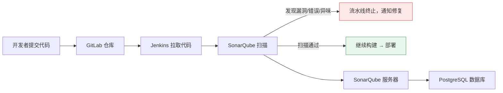
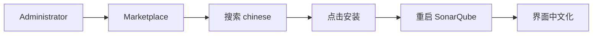
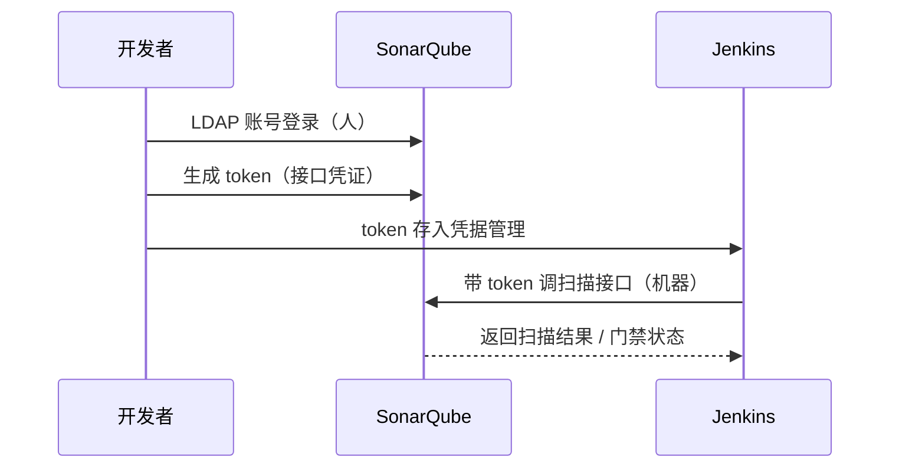

# 30. SonarQube 部署、插件安装与 LDAP 接入：给流水线装上第一道质量门禁

## 纲要

- **SonarQube 是开源的持续代码质量检查平台**：漏洞、错误、异味、语法问题一站式扫描，与 Jenkins 集成后「扫描不过，流水线即终止」
- **部署主线**：`vm.max_map_count` 内核参数 + docker-compose 一键起 SonarQube + PostgreSQL 双容器
- **默认三卷不够用**：data / extensions / logs 之外，**生产必须补 conf 卷**——LDAP 配置要改 `sonar.properties`，不挂出来就得进容器改，容器一重建全丢
- **汉化两步**：Administrator → Marketplace 搜 `chinese` 装中文插件 → 重启，界面中文化
- **LDAP 接入是六行固定配置**：`sonar.security.realm=LDAP` 打头，url / bindDn / bindPassword / user.baseDn / user.request / 属性映射，重启生效
- **登录验证看两点**：admin 是本地管理员，LDAP 账号（如 test）登录成功且归属 users 组，即证明过滤条件 `ou=user` 生效
- **为 Jenkins 集成埋伏笔**：SonarQube 与 Jenkins 之间的连接靠**令牌（token）**，LDAP 账号本身不参与接口调用

## 一、场景引入：代码审查不能只靠人眼

先回答一个根本问题：**流水线里为什么要放一台 SonarQube？**

人肉 code review 有三个绕不开的短板：审不完（每天几十个 MR）、审不细（安全漏洞、空指针、重复代码靠肉眼极易漏）、标准不统一（每个人尺度不一样）。SonarQube 就是一个**不知疲倦、标准统一、24 小时在线的审查员**：

> SonarQube 是一个可以持续检查代码质量的开源平台。通过对代码的扫描分析，我们可以及时发现代码中的漏洞、错误以及代码质量问题、语法错误问题等等。

它在流水线里的位置决定了它的价值——**把质量检查左移到构建阶段**：



**关键语义**：一旦扫描发现问题，整个流水线就会终止构建；开发者修复代码后重新构建，再次扫描。如此反复，**保证每一次上线后的代码都是稳定可靠的**。这就是「质量门禁」——问题在部署前被拦截，而不是上线后由用户替你发现。

## 二、核心概念与原理

### 2.1 三个组件的关系

| 组件 | 角色 | 部署形态 |
|---|---|---|
| SonarQube Server | Web 界面 + 扫描分析引擎 + 质量门禁判定 | `sonarqube:community` 容器 |
| PostgreSQL | 存放项目、指标、历史快照 | `postgres:12` 容器 |
| Scanner 客户端 | 实际执行扫描的命令行（镜像 `sonarsource/sonar-scanner-cli`） | Jenkins 流水线里以容器方式运行 |

Server 依赖 DB：**DB 先启动，SonarQube 才能启动**，所以 compose 里用 `depends_on` 声明依赖顺序。

### 2.2 部署前置：为什么必须先改 `vm.max_map_count`

SonarQube 内置 Elasticsearch，ES 默认使用 `mmapfs` 目录存储索引，需要较大的 `vm.max_map_count`（内存映射区域数）。系统默认值（通常 65530 或更小）不够，**不修改直接启动，ES 会报 `max virtual memory areas ... too low` 然后反复重启**。生产标准值：**262144**。

```bash
# 临时生效
sysctl -w vm.max_map_count=262144

# 永久生效（重启后仍有效）
echo "vm.max_map_count=262144" >> /etc/sysctl.conf
```

### 2.3 卷规划：默认三卷与必须补的第四卷

compose 默认挂三个卷，对应 SonarQube 的三类数据：

| 卷 | 容器内路径 | 装什么 | 丢了会怎样 |
|---|---|---|---|
| `sonarqube_data` | `/opt/sonarqube/data` | 索引与业务数据 | 扫描历史全丢 |
| `sonarqube_extensions` | `/opt/sonarqube/extensions` | **已安装插件（含中文包）** | 插件全部失踪，汉化白装 |
| `sonarqube_logs` | `/opt/sonarqube/logs` | 运行日志 | 无法排查启动失败 |
| `sonarqube_conf`（补） | `/opt/sonarqube/conf` | **`sonar.properties` 等配置** | **LDAP 配置被容器重建清掉** |

**默认 compose 没挂 conf 卷**，但本篇要改 LDAP 配置——不把 conf 挂到物理机，就得每次 `docker exec` 进容器改文件，容器一重建配置即丢。**生产部署第一件事就是补上 conf 卷**，这是本篇最重要的生产实践点。

### 2.4 LDAP 集成的原理

SonarQube 把身份认证委托给 LDAP：用户在 SonarQube 登录页输入的账号密码，SonarQube 用「管理员绑定账号（bindDn）」连到 LDAP 服务器，按「用户请求过滤器」找到对应条目，再验证密码。整个流程对用户无感——**一套 LDAP 账号通行所有系统**，这正是前面 Jenkins 接入 OpenLDAP 的同一套思路。

## 三、动手实践：docker-compose 部署

### 3.1 课件原始 compose（双容器 + 三卷）

```yaml
version: "3"

services:
  sonarqube:
    image: sonarqube:community
    depends_on:
      - db
    environment:
      SONAR_JDBC_URL: jdbc:postgresql://db:5432/sonar
      SONAR_JDBC_USERNAME: sonar
      SONAR_JDBC_PASSWORD: sonar
    volumes:
      - sonarqube_data:/opt/sonarqube/data
      - sonarqube_extensions:/opt/sonarqube/extensions
      - sonarqube_logs:/opt/sonarqube/logs
    ports:
      - "9000:9000"
  db:
    image: postgres:12
    environment:
      POSTGRES_USER: sonar
      POSTGRES_PASSWORD: sonar
    volumes:
      - postgresql:/var/lib/postgresql
      - postgresql_data:/var/lib/postgresql/data

volumes:
  sonarqube_data:
  sonarqube_extensions:
  sonarqube_logs:
  postgresql:
  postgresql_data:
```

**逐字段拆解**：

| 字段 | 值 | 作用 |
|---|---|---|
| `image: sonarqube:community` | 官方社区版 | 免费版，功能覆盖代码扫描全流程 |
| `depends_on: [db]` | 启动顺序 | 先起 db 再起 sonarqube（**只控顺序，不控就绪**） |
| `SONAR_JDBC_URL` | `jdbc:postgresql://db:5432/sonar` | JDBC 连接串，主机名用 compose 服务名 `db` |
| `SONAR_JDBC_USERNAME/PASSWORD` | `sonar/sonar` | 与 db 的 `POSTGRES_USER/PASSWORD` **必须一致** |
| `ports: "9000:9000"` | 宿主机 9000 → 容器 9000 | SonarQube Web 入口 |
| `db` 的 `postgresql_data` 卷 | `/var/lib/postgresql/data` | **真正的数据落盘点**，备份就备它 |

> **`depends_on` 的坑**：它只保证「db 容器先启动」，不保证「db 服务已就绪」。PostgreSQL 初始化要几秒，SonarQube 抢跑会连不上库然后退出。稳妥做法见 3.2 的健康检查写法。

### 3.2 生产加固版 compose

```yaml
version: "3"

services:
  sonarqube:
    image: sonarqube:community
    depends_on:
      db:
        condition: service_healthy
    environment:
      SONAR_JDBC_URL: jdbc:postgresql://db:5432/sonar
      SONAR_JDBC_USERNAME: sonar
      SONAR_JDBC_PASSWORD: sonar
    volumes:
      - sonarqube_data:/opt/sonarqube/data
      - sonarqube_extensions:/opt/sonarqube/extensions
      - sonarqube_logs:/opt/sonarqube/logs
      - sonarqube_conf:/opt/sonarqube/conf
    ports:
      - "9000:9000"
    ulimits:
      nofile:
        soft: 65536
        hard: 65536
  db:
    image: postgres:12
    environment:
      POSTGRES_USER: sonar
      POSTGRES_PASSWORD: sonar
    volumes:
      - postgresql_data:/var/lib/postgresql/data
    healthcheck:
      test: ["CMD-SHELL", "pg_isready -U sonar"]
      interval: 10s
      timeout: 5s
      retries: 10

volumes:
  sonarqube_data:
  sonarqube_extensions:
  sonarqube_logs:
  sonarqube_conf:
  postgresql_data:
```

三处加固对应三个生产教训：

| 加固 | 解决的教训 |
|---|---|
| `condition: service_healthy` + `pg_isready` | db 未就绪时 sonarqube 抢跑失败 |
| `sonarqube_conf` 卷 | LDAP 配置持久化，容器重建不丢 |
| `ulimits nofile 65536` | 高并发扫描时文件句柄耗尽 |

### 3.3 启动与首次登录

```bash
# 1. 改内核参数
sysctl -w vm.max_map_count=262144

# 2. 启动
docker compose up -d

# 3. 查看状态（sonarqube 是 Java 应用，首次启动较慢）
docker compose ps

# 4. 访问 http://<服务器IP>:9000
#    默认用户名/密码都是 admin，首次登录强制修改密码
```

> SonarQube 是 Java 应用，**启动和重启都比普通容器慢**，等一两分钟是正常的，不要急着判定失败。

### 3.4 安装中文插件

安装路径：**Administrator（头像）→ Marketplace → 搜索 `chinese` → 点击安装 → 重启**。



两个注意点：

1. **安装插件需要能访问 SonarQube 插件更新中心**，网络受限的内网环境要提前准备离线插件包（`.jar`）走离线安装；
2. **装完必须重启才生效**，重启又是漫长的 Java 启动，耐心等待。

### 3.5 K8s 环境下的持久化：sonar-pvc.yaml

如果 SonarQube 要上 K8s（项目实战里的形态），scanner 缓存需要 **RWX（多读多写）** 能力的存储，课件用 NFS 提供的 PVC：

```yaml
apiVersion: v1
kind: PersistentVolumeClaim
metadata:
  name: sonar-cache-pvc
spec:
  accessModes:
    - ReadWriteMany
  resources:
    requests:
      storage: 1Gi
  storageClassName: nfs-client
```

| 字段 | 值 | 为什么 |
|---|---|---|
| `accessModes: [ReadWriteMany]` | 多节点同时读写 | 多个 scanner Pod 要共享同一份缓存目录，RWO 会互相排斥 |
| `storage: 1Gi` | 1GiB | scanner 缓存量级不大，1Gi 起步足够 |
| `storageClassName: nfs-client` | NFS 供应器 | NFS 天然支持 RWX，是这类场景的常见选择 |

## 四、LDAP 接入实战

### 4.1 找到配置文件

配置文件在宿主机的位置取决于 Docker 的数据目录（Debian/Ubuntu 系默认 `/var/lib/docker`，CentOS 系可能是 `/var/lib/docker` 或其他自定义路径——**以你自己环境的挂载路径为准**）：

```bash
# docker 默认装在 /var/lib/docker 的环境，路径形如：
/var/lib/docker/volumes/$COMPOSE_PROJECT_sonarqube_conf/_data/sonar.properties
```

**目录名叫什么，取决于你 compose 里卷怎么命名的**——这就是 3.2 一定要补 conf 卷的原因：路径确定、配置持久。

### 4.2 六行固定配置

在 `sonar.properties` 末尾加入（以下为 LDAP 集成的标准模板，值按各自环境替换）：

```properties
# LDAP configuration
# General Configuration
sonar.security.realm=LDAP
ldap.url=ldap://<LDAP服务器IP>:389
ldap.bindDn=cn=admin,dc=example,dc=com
ldap.bindPassword=<LDAP管理员密码>

# User Configuration
ldap.user.baseDn=ou=user,dc=example,dc=com
ldap.user.request=(&(objectClass=inetOrgPerson)(uid={login}))
ldap.user.realNameAttribute=cn
ldap.user.emailAttribute=mail
```

| 配置项 | 作用 | 填错的现象 |
|---|---|---|
| `sonar.security.realm=LDAP` | 声明用 LDAP 认证 | 仍是本地账号体系，LDAP 账号登不进 |
| `ldap.url` | LDAP 服务器地址 + 端口（默认 389） | 测试连接直接失败 |
| `ldap.bindDn` | **管理员绑定账号**——SonarQube 用它连 LDAP 查用户 | 认证阶段报 bind 失败 |
| `ldap.bindPassword` | 绑定账号密码 | 同上 |
| `ldap.user.baseDn` | **用户搜索基准 DN**，`ou=user` 限定只搜这个 OU 下的用户 | 搜出一堆无关条目，登录混乱 |
| `ldap.user.request` | 用户过滤器，`{login}` 是登录名占位符 | 找不到用户 |
| `ldap.user.realNameAttribute=cn` | 真实名取自 `cn` 属性 | 页面显示名异常 |
| `ldap.user.emailAttribute=mail` | 邮箱取自 `mail` 属性 | 通知邮件发不出去 |

### 4.3 重启并验证

```bash
# 在 compose 文件所在目录执行
docker compose restart
```

重启后**先看日志确认过滤条件生效**——日志里能看到基于 `ou=user` 过滤的记录，说明 LDAP 连通、过滤器工作正常：

```bash
docker compose logs -f sonarqube | grep -i ldap
```

然后登录验证：

| 验证项 | 预期结果 |
|---|---|
| 用 LDAP 账号（课件用 test）登录 | **登录成功**，证明 url/bindDn/过滤器全部正确 |
| 查看该账号详情 | 邮箱为 LDAP 里的 mail 属性、归属 users 组 |
| 用 admin 登录 | admin 是本地管理员，拥有全部配置权限 |

**权限差异要记牢**：admin 属于管理员组，能配质量门禁、装插件、管用户；LDAP 普通账号默认只有「执行代码扫描分析」的权限。这个差异在下面配令牌、配 Jenkins 时会直接用到。

### 4.4 与 Jenkins 的衔接点

LDAP 解决的是「人怎么登录 SonarQube」。而 **Jenkins 与 SonarQube 之间的连接不走 LDAP 账号，走令牌（token）**——在 SonarQube 里生成一个 token，配置到 Jenkins 凭据里，Jenkins 才有权限调用 SonarQube 的扫描接口。这套流程是下面的主题，这里先建立心智模型：



## 五、生产实践要点 / 常见坑

| 实践点 | 说明 |
|---|---|
| **conf 卷必须挂** | 见 3.2，否则 LDAP 配置随容器重建丢失，是最高频的「配了又没了」 |
| **内核参数持久化** | 只 `sysctl -w` 不写 `/etc/sysctl.conf`，重启服务器后 ES 起不来 |
| **备份 = 备 postgresql_data 卷** | 项目历史、指标全在库里；extensions 卷建议一起备（插件也是资产） |
| **插件市场网络** | 装中文包、后续装语言插件都需要外网；内网环境提前备离线包 |
| **版本匹配** | 社区版镜像与 PostgreSQL 12 是课件验证过的组合，升级 DB 大版本前先备份 |
| **Java 启动慢** | 首次启动 / 重启各等 1~2 分钟，配合 `docker compose logs` 看进度，别误判失败 |
| **安全基线** | 9000 端口不要直接暴露公网；管理员密码首登即改；生产放内网 + 反向代理 |

## 六、报错排查表

| 现象 | 根因 | 解法 |
|---|---|---|
| sonarqube 容器反复重启，日志报 `max virtual memory areas too low` | `vm.max_map_count` 太小 | `sysctl -w vm.max_map_count=262144` 并写入 `/etc/sysctl.conf` |
| 启动报连不上数据库 | db 未就绪，`depends_on` 不控就绪 | 加 `healthcheck` + `condition: service_healthy`，或先单独起 db |
| 页面能开但扫描报 `jdbc` 错误 | `SONAR_JDBC_*` 与 `POSTGRES_*` 不一致 | 两边用户名密码改成同一套 |
| 9000 端口打不开 | 端口映射没生效 / 防火墙 | 查 `docker compose ps` 与安全组 |
| Marketplace 搜索不到 / 安装失败 | 访问不了插件更新中心 | 换网络或下载离线 `.jar` 走离线安装 |
| 中文包装了不生效 | 安装后未重启 | Administrator → 重启 |
| LDAP 账号登录失败 | `sonar.properties` 某行配置错 | 逐行核对 url/bindDn/baseDn；`docker compose logs` 看 bind 与过滤日志 |
| 找不到 `sonar.properties` | conf 卷没挂或卷名对不上 | `docker volume ls` 确认卷名，路径按实际挂载目录找 |
| LDAP 能登录但显示名/邮箱为空 | `realNameAttribute`/`emailAttribute` 映射错 | 改成 LDAP 里实际的属性名（cn/mail） |
| 容器重建后 LDAP 配置没了 | conf 未持久化 | 补 `sonarqube_conf` 卷（生产加固版） |

## 六、面试考点与追问

**Q1：SonarQube 是什么？它和 Jenkins 集成后解决什么问题？**
开源的持续代码质量检查平台，能发现漏洞、错误、异味、语法问题。与 Jenkins 集成后，代码拉下来先扫描，**不达标流水线直接终止**，把质量门禁左移到构建阶段，保证每次上线的代码稳定可靠。

**Q2：SonarQube 部署为什么要改 `vm.max_map_count`？**
它内置 Elasticsearch，ES 用 `mmapfs` 存索引，需要较大的内存映射区域数。系统默认值不够会导致 ES 启动失败，标准做法是设成 262144 并写入 `sysctl.conf` 持久化。

**Q3：compose 里 sonarqube 和 db 是什么关系？**
SonarQube 的元数据（项目、指标、历史）全存 PostgreSQL。compose 里 `depends_on` 声明启动顺序，JDBC 连接串用服务名 `db:5432`，两边用户名密码必须一致。**注意 `depends_on` 不保证服务就绪**，生产要加健康检查。

**Q4：默认 compose 三个卷各装什么？生产为什么必须补 conf 卷？**
data 装业务数据、extensions 装插件、logs 装日志。**conf 装 `sonar.properties`**——LDAP 配置就在这里，不挂出来就得进容器改，容器重建即丢。生产第一件事就是补 conf 卷。

**Q5：SonarQube 接入 LDAP 的核心配置有哪几行？**
`sonar.security.realm=LDAP` 打头；`ldap.url` 服务器地址；`ldap.bindDn` + `ldap.bindPassword` 管理员绑定账号；`ldap.user.baseDn` 限定 `ou=user` 搜索范围；`ldap.user.request` 用户过滤器；`realNameAttribute=cn` / `emailAttribute=mail` 属性映射。改完重启生效。

**Q6：怎么验证 LDAP 接入成功？**
两个层次：`docker compose logs` 里看到基于 `ou=user` 过滤的记录；用 LDAP 账号能登录成功，且账号详情里邮箱、组归属与 LDAP 一致。admin（本地管理员）与 LDAP 账号的权限差异也是验证点。

**Q7：Jenkins 和 SonarQube 之间的连接靠什么？**
靠**令牌 token**，不是 LDAP 账号。在 SonarQube「我的账号 → 安全」生成 token，存到 Jenkins 凭据管理，Jenkins 带 token 调扫描接口。LDAP 只负责「人怎么登录」。

## 📎 文本↔代码关联

本篇对应课件源码（`code/5-实战-Jenkins/`，已做去品牌化处理）：

| 代码文件 | 正文提及 | 内容 |
| --- | --- | --- |
| `code/5-实战-Jenkins/SonarQube部署/docker-compose.yaml` | 第 3.1 / 3.2 节 | 原始双容器 compose：`sonarqube:community` + `postgres:12`，JDBC 环境变量、data/extensions/logs 三卷、9000 端口 |
| `code/5-实战-Jenkins/pvc/sonar-pvc.yaml` | 第 3.5 节 | K8s 形态下的 scanner 缓存 PVC：`ReadWriteMany` + `nfs-client`，1Gi |
| `code/5-实战-Jenkins/课件/教学课件.md` | 第 4.2 节 | LDAP 接入 `sonar.properties` 标准配置模板（realm / url / bindDn / baseDn / user.request / 属性映射） |

**技术点总结**：SonarQube 是流水线的第一道质量门禁——扫描发现漏洞、错误、异味即终止构建，保证上线代码稳定可靠。部署主线是「`vm.max_map_count=262144` + docker-compose 双容器」：`sonarqube:community` 通过 JDBC 连 `postgres:12`，`depends_on` 只控启动顺序，生产要加健康检查。**默认三卷之上必须补 conf 卷**，LDAP 配置才有地方持久化。LDAP 接入就是 `sonar.properties` 里八行固定配置（realm/url/bindDn/password/baseDn/request/两个属性映射），重启后从「日志基于 `ou=user` 过滤」和「LDAP 账号登录成功」两个点验证。人用 LDAP 登录，机器用 token 通信——后者是下面 Jenkins 扫描集成的钥匙。

