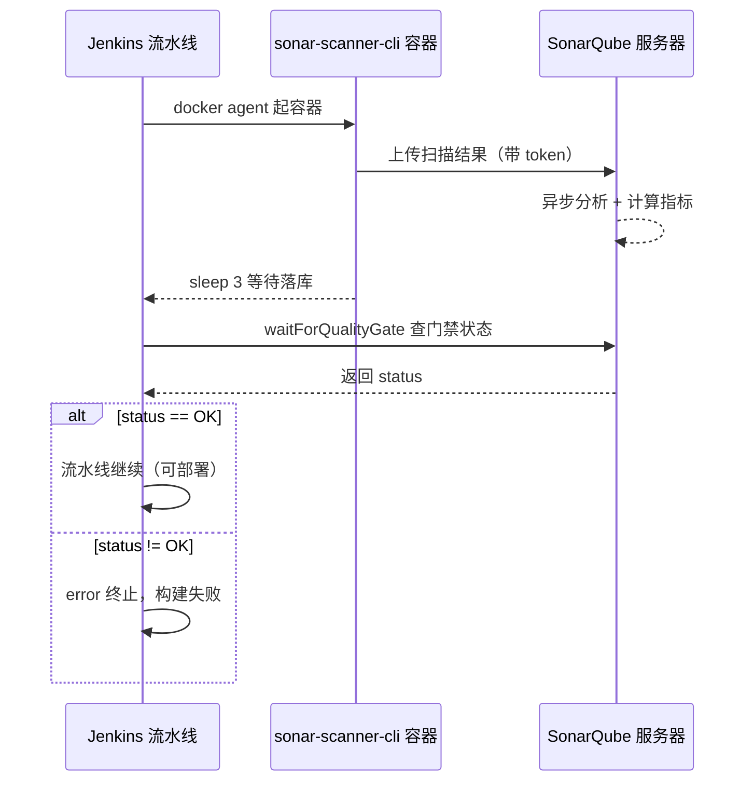

# 31. SonarQube 质量门禁、权限令牌与 Jenkins 扫描 Go 代码：让扫描结果真正拦住流水线

## 纲要

- **上篇解决了「能扫」，本篇解决「扫了算数」**：给 SonarQube 配好新代码周期、质量门禁、权限和令牌，再用 Jenkins 流水线把扫描接进构建
- **新代码周期**：配置 → 新代码 → 天数（课件设 7 天），过去 7 天修改的代码才算新代码，**指标只卡新代码，历史债务不背锅**
- **质量门禁 = 触发阈值**：覆盖率、重复行、异味、热点审查等条件越过阈值，本轮扫描判失败，**流水线在这一步直接终止**
- **默认门禁 + 自定义门禁**：没指定门禁的项目走默认（新代码覆盖率 ≥ 80%、重复行 ≤ 3.0%）；项目可指定用自定义门禁
- **权限三层结构**：全局权限（administrators 组 = 系统管理员，users 组 = 执行扫描）+ 用户级直授 + 组继承，撤销管理员后配置项立即消失
- **项目不手工创建**：Jenkins 构建时带 `projectKey` 扫描，项目在 SonarQube 侧**自动创建**
- **token 是机器凭证**：我的账号 → 安全 → 生成（全局分析、永不过期），**生成后只显示一次，马上复制**，存进 Jenkins 的 Secret text 凭据
- **流水线三段式**：`sonar-scanner-cli` 容器扫描 → `sleep 3` 等结果落库 → `waitForQualityGate` 判定，状态非 OK 直接 `error` 终止

## 一、场景引入：体检报告和合格线

前面我们把 SonarQube 部署起来、接好了 LDAP，这时候它只是一台「能出体检报告的机器」——扫出一堆指标，红红绿绿很好看，但**没有任何东西会因为这些指标停下来**。

企业要的不是报告，是**合格线**：

> 我们可以配置质量门禁，这个质量门禁可以理解为触发的阈值，就是当你的代码达到了我这个指定的阈值之后，整个流水线就会终止，你的代码审核就不通过。比如说它的安全等级没有达到我的要求，或者说我的覆盖率没有达到我指定的阈值，这一轮的扫描就当做是你失败。

**类比**：体检中心给你出一份报告（扫描指标），但只有「哪项超标就不发合格证」（质量门禁）才能挡住不合格的人上岗。SonarQube 的门禁配好后，一旦扫描结果不达标，Jenkins 流水线在这一步终止——**测试的扫描才算完全通过，后边的部署步骤根本不会执行**。

## 二、核心概念与原理

### 2.1 新代码周期：为什么只卡新代码

配置路径：**配置 → 新代码 → 天数**（课件设 7 天）。

> 在天数里面，我们配置 7 天。天数就是指过去多少天修改的代码都会被当做是新代码。在下一次扫描之后就会生效。

**为什么要有这个概念**：一个跑了五年的老项目，历史债务（重复代码、覆盖率低）成千上万，如果门禁卡「全部代码」，项目第一天就是红的，永远翻不了身——门禁就成了摆设。**只卡新代码**意味着：老人老办法、新人新办法，新提交的代码必须干净，技术债务靠滚动清理。这是质量门禁能落地的关键设计。

### 2.2 质量门禁的结构

| 概念 | 说明 |
|---|---|
| **内置默认门禁** | SonarQube 自带，条件为「新代码覆盖率 ≥ 80%」「重复行 ≤ 3.0%」等；**项目未指定门禁时自动走默认** |
| **自定义门禁** | 自己建，可添加任意条件：可靠性评级、安全评级、覆盖率、重复行、异味数、热点审查率…… |
| **条件方向** | 每个条件可选「评级劣于 X 才失败」「覆盖率低于 X 才失败」等，宽松/严格自己定（如可靠性评级选 B 比选 A 宽松） |
| **门禁管理员** | 拥有配置门禁权限的账号；质量配置和质量门禁管理员可以为项目配门禁 |
| **项目指定门禁** | 项目级勾选「使用哪个门禁」；不指定就用默认 |

课件实测的自定义门禁条件（分两套指标）：

| 指标范围 | 条件 | 失败判定 |
|---|---|---|
| **全部代码** | 异味（代码味道）数量 | > 0 即不通过 |
| **新代码** | 问题数 | > 0 即不通过 |
| **新代码** | 热点审查率 | < 100% 即不通过 |
| **新代码** | 覆盖率 | < 80% 即不通过 |
| **新代码** | 重复行占比 | > 3.0% 即不通过 |
| **新代码** | 异味数量 | > 0 即不通过 |

> **注意这个设计的尺度**：全部代码只卡「异味 > 0」一项（老项目债务放行），新代码卡五维（新提交必须干净）。**门禁不是越严越好，是越能落地越好。**

### 2.3 权限模型：三层

课件里完整的权限结构：

| 层级 | 内容 | 权限 |
|---|---|---|
| **群组** | `administrators` 组 | 系统管理员全部权限 |
| **群组** | `users` 组 | **执行代码扫描分析**的权限 |
| **用户** | admin（本地） | 属 administrators 组，继承全部权限 |
| **用户** | test（LDAP 账号） | 默认无单独授权，但已加入 `users` 组，**继承组权限** |
| **用户级直授** | 可单独给某账号勾管理员权限 | 课件实测：给 test 勾上管理员 → 登录后门禁配置全都有；撤销 → 配置项全部消失 |

**两个要点**：

1. **组继承是主路径**：账号权限从「加入的组」来，批量授权靠改组，不靠逐人点；
2. **用户级授权是特例通道**：给个人单独提权，适合「某个开发要临时管门禁」的场景，用完即撤。

### 2.4 项目从哪来：Jenkins 扫描自动创建

> 项目这边，项目可以通过多种方式进行导入……但是我们是不会直接从这边导入项目的。我们会通过在 Jenkins 构建的时候，集成 SonarQube 来对代码进行扫描，从而在这边自动创建项目。

**这条规则很重要**：SonarQube 里的项目不是运维手工建的，是流水线第一次带 `projectKey` 扫描时自动创建的。项目名、版本号都由流水线的 `-Dsonar.projectKey=xxx` 参数决定——**流水线即配置**。

### 2.5 令牌：机器与机器之间的凭证

> 配置令牌主要的目的，就是为了让 Jenkins 可以连接 SonarQube 来扫描我们的代码。我们想要在 Jenkins 上集成 SonarQube 进行扫描的话，首先我们就必须要先有执行 SonarQube 操作的权限，获得这个权限，就必须要先在 SonarQube 里面创建一个令牌。

生成路径：**右上角头像 → 我的账号 → 安全 → 生成令牌**：

| 选项 | 课件选择 | 说明 |
|---|---|---|
| 类型 | **全局分析**（Global Analysis） | 有权限执行扫描分析 |
| 过期时间 | **永不过期** | 演示环境做法；生产建议设过期 + 定期轮换 |
| 可见性 | **只显示一次** | 生成后马上复制，关掉页面就再也拿不到 |

复制下来的 token 粘到 Jenkins：**系统管理 → 凭据管理 → 全局 → 添加凭据**，类型选 **Secret text（保密文本）**，把 token 串粘贴进去，ID 填 `sonarqube`，描述写中文，创建。

> **安全习惯**：token 等同密码。不要贴进 Jenkinsfile 提交到 Git（会被 `git log` 永久记录）；不要打进构建日志（报警时可能外泄）；泄露了立刻在 SonarQube 侧撤销重新生成。

## 三、动手实践：Jenkins 侧三件套 + 扫描流水线

### 3.1 Jenkins 侧的三处配置（缺一不可）

| # | 配置 | 路径 | 要点 |
|---|---|---|---|
| 1 | **插件** | 插件管理 → 搜 `SonarQube Scanner` | 提供 `withSonarQubeEnv` / `waitForQualityGate` 等步骤 |
| 2 | **凭据** | 凭据管理 → 全局 → 添加 Secret text | 内容 = SonarQube 生成的 token，ID 建议 `sonarqube` |
| 3 | **服务器** | 系统配置 → SonarQube servers | 填 name / Server URL / token；**勾选「环境变量注入」复选框**，否则流水线里引用不到 |

> **第三项的复选框是高频漏点**：不勾「允许在流水线中注入为环境变量」，`withSonarQubeEnv('sonarqube')` 会报找不到 server。另外**系统配置里的 name 必须和流水线里的字符串一致**——两边都叫 `sonarqube`，这是绑定关系，不是随便起的昵称。

### 3.2 完整扫描流水线（课件 Jenkinsfile-sonar扫描测试）

```groovy
#!groovy

@Library('jenkins-shared-library@main') _

def tools = new org.color()
def checkout = new org.checkout()

pipeline {

    agent {
        label 'slave'
    }

    options {
      timestamps()
      parallelsAlwaysFailFast()
      timeout(time: 600, unit: 'SECONDS')
      disableConcurrentBuilds(abortPrevious: true)
      buildDiscarder(logRotator(numToKeepStr: '30'))
      skipDefaultCheckout()
    }

    environment {
        String year = new Date().format("yyyy")
        String month = new Date().format("MMdd")
        String day = new Date().format("HHmm")
        String second = new Date().format("ss")
        images_head = "registry.cn-hangzhou.aliyuncs.com"
        giturl = "http://gitlab.example.com/golang/go.git"
    }

    parameters {
        choice choices: ['main', 'pre', 'test'], name: 'branch_name'
    }

    stages {
        stage('克隆代码') {
            agent {
                docker {
                    label 'slave'
                    image 'registry.cn-hangzhou.aliyuncs.com/tool-bucket/tool:git'
                }
            }
            steps {
                script {
                    cleanWs()
                    tools.PrintMessage("1.克隆代码","blue")
                    checkout.scm(branch_name, giturl)
                }
            }
        }
        stage('sonar扫描') {
            agent {
                docker {
                    label 'slave'
                    image 'sonarsource/sonar-scanner-cli'
                }
            }
            steps {
                script {
                    tools.PrintMessage("1.sonar扫描","blue")
                    withSonarQubeEnv('sonarqube') {
                        sh """
                        sonar-scanner \
                        -Dsonar.projectKey=test-go \
                        -Dsonar.projectName=test-go \
                        -Dsonar.projectVersion=test-go-${BUILD_NUMBER} \
                        -Dsonar.ws.timeout=30 \
                        -Dsonar.sources=. \
                        -Dsonar.sourceEncoding=UTF-8
                        sleep 3
                    """
                    }
                }
            }
        }
        stage("Quality Gate"){
            steps {
                script {
                    tools.PrintMessage("2.Quality Gate","blue")
                    timeout(time: 10, unit: 'SECONDS') {
                        def qg = waitForQualityGate('sonarqube')
                        if (qg.status != 'OK') {
                            error "未通过Sonarqube的代码质量阈检查，请及时修改！failure: ${qg.status}"
                        }
                    }
                }
            }
        }
    }
}
```

### 3.3 扫描参数逐字段拆解

| 参数 | 课件值 | 作用 |
|---|---|---|
| `-Dsonar.projectKey` | `test-go` | **项目唯一标识**，SonarQube 里同一个 key 就是同一个项目；重复扫描同一 key 即更新同一项目 |
| `-Dsonar.projectName` | `test-go` | 页面显示名 |
| `-Dsonar.projectVersion` | `test-go-${BUILD_NUMBER}` | **动态版本号**：每次构建用 BUILD_NUMBER 替换，每次扫描的版本都不一样，报告可按版本对比 |
| `-Dsonar.ws.timeout` | `30` | 调用 SonarQube 页面接口的超时（秒） |
| `-Dsonar.sources` | `.` | 扫描路径 = 当前目录 |
| `-Dsonar.sourceEncoding` | `UTF-8` | 源码编码，中文注释不乱码的关键 |

**为什么用 `sonarsource/sonar-scanner-cli` 镜像**：SonarQube 官方提供的客户端镜像，**不需要在代理节点装 scanner**，`docker agent` 起容器即用——环境零侵入，版本还锁定。

### 3.4 门禁判定的三段式



`waitForQualityGate('sonarqube')` 返回的 `qg.status` 三种典型值：

| status | 含义 | 流水线动作 |
|---|---|---|
| `OK` | 门禁通过 | 继续后续 stage |
| `ERROR` / `WARN` | 门禁条件失败 | `error "未通过Sonarqube的代码质量阈检查"`，**构建终止** |
| 一直拿不到 | 分析未完成 | 加大 `sleep` 与 `timeout`（见 4.2） |

## 四、生产实践要点 / 常见坑

### 4.1 门禁条件怎么设计：两套指标的尺度

课件的自定义门禁（第 2.2 节的表）示范了一个可落地的组合：**全部代码只卡异味 > 0**（存量放行、增量收紧），**新代码卡五维**（问题、热点审查、覆盖率、重复行、异味）。设计原则：

- **新代码严格**：新提交必须干净，这是团队纪律；
- **存量宽松**：老债务靠滚动重构，不搞「一天全部还完」的运动式治理；
- **条件宁少勿多**：每个条件都会拦一次构建，条件太多团队会想尽办法绕门禁（比如 `sonar.exclusions` 越加越多）。

### 4.2 两个时间参数的调优

| 参数 | 课件值 | 生产建议 |
|---|---|---|
| `sleep 3`（扫描后等待） | 3 秒 | 小项目够用；大项目/服务端负载高时加到 5~10 秒 |
| `timeout(10s)`（门禁查询超时） | 10 秒 | **偏短**，生产建议 60 秒以上；分析未完成时 10 秒等不到就误报失败 |

> 课件的顺序是先 `sleep 3` 再查门禁，是因为**扫描结果是异步分析的**——scanner 上传完不等于分析完。等待 + 轮询（`waitForQualityGate` 内部就是轮询）双保险，才能既不太慢、也不错杀。

### 4.3 失败案例复盘：一个花括号引发的门禁失败

课件做了完整的「破坏 → 拦截 → 修复」实验：

1. **破坏**：在 `main.go` 第 9 行删掉一个花括号 `}`，提交；
2. **拦截**：重新构建，扫描后门禁状态为 **ERROR 不是 OK**，流水线终止；
3. **定位**：SonarQube 页面显示「全部代码 → 异味」条件失败，点进去看到**文件解析错误**——那一行语法有问题导致解析失败；
4. **修复**：把花括号加回去，重新提交、重新构建，门禁通过，新代码与全部代码指标全部正常。

**这个实验把门禁的价值演示得淋漓尽致**：一个语法错误如果在运行时才暴露，可能是线上事故；在扫描阶段暴露，只是一次构建失败。

### 4.4 评级与门禁的关系：A 也会被拦，非 A 也可能放行

课件构建成功后页面显示：新代码的可靠性、可维护性、安全性、安全审查评级**全是 A**；全部代码的安全审查评级是 1（有热点），但门禁在全部代码侧**只卡异味**，所以照样通过。

**结论**：门禁看的是「条件是否被触发」，不是「分数高不高」。评级只是参考信息，放行与否由条件决定——设计门禁条件时想清楚「到底哪几个指标不过就不能上线」，比追求全 A 更务实。

### 4.5 项目与密钥治理

| 实践 | 做法 |
|---|---|
| projectKey 规范 | `项目名-语言` 或 `团队-服务名`，全局唯一；多分支扫描用 `key-分支名` 区分，避免报告互相覆盖 |
| token 存放 | Jenkins Secret text 凭据，不落 Jenkinsfile、不打日志 |
| token 轮换 | 生产设过期时间（如 90 天），到期前重新生成、更新凭据 |
| 门禁变更留痕 | 门禁条件修改走评审，防止有人偷偷把覆盖率从 80% 改成 20% |

## 五、报错排查表

| 现象 | 根因 | 解法 |
|---|---|---|
| `withSonarQubeEnv` 报找不到名为 `sonarqube` 的 server | 系统配置没配 server，或 name 不一致 | 系统配置 → SonarQube servers 补配；**两边 name 严格一致** |
| 配了 server 还是引用不到 | 「环境变量注入」复选框没勾 | 系统配置里勾选该复选框 |
| 扫描报 401 / 认证失败 | token 错、没填进 server 配置或凭据 | 重新生成 token，更新 server 配置里的 token 字段 |
| sonar-scanner 命令不存在 | docker agent 没起容器 / 镜像没拉下来 | 确认 `image 'sonarsource/sonar-scanner-cli'` 与网络 |
| 门禁查询一直 WAITING 最终超时 | 结果未分析完；`sleep 3` + `timeout 10s` 太短 | 加大 sleep 与 timeout（生产 ≥ 60s） |
| `qg.status != 'OK'` 构建终止 | 门禁条件失败 | 去 SonarQube 项目页看哪个条件红了，按第 4.3 节路径定位 |
| SonarQube 里找不到项目 | 首次扫描才创建；或 projectKey 拼写不一致 | 跑一次带正确 key 的扫描 |
| 每次报告版本号都一样 | `projectVersion` 写死 | 用 `test-go-${BUILD_NUMBER}` 动态拼接 |
| 扫描报语法/解析错误 | 源码本身语法错误 | 修复代码——这正是门禁要拦的问题 |
| 给 test 勾了管理员但登录后没有配置项 | 改权限后未重新登录 | 退出重新登录，权限随会话刷新 |

## 六、面试考点与追问

**Q1：什么是质量门禁？它和代码扫描是什么关系？**
扫描产出指标（覆盖率、异味、漏洞等），门禁是这些指标的**触发阈值**。指标越过阈值，本轮扫描判失败、流水线终止。没有门禁的扫描只是报告，拦不住任何东西。

**Q2：为什么要配「新代码周期」？配 7 天是什么意思？**
只卡新代码、放行存量债务，门禁才能落地。7 天指过去 7 天修改过的代码都算新代码，指标（覆盖率、重复行、异味等）只对新代码部分生效——防止老项目因历史债务永远翻不了身。

**Q3：Jenkins 集成 SonarQube 要配哪三样？**
① SonarQube Scanner 插件；② Secret text 凭据存 token（ID 如 `sonarqube`）；③ 系统配置 → SonarQube servers 填 name/URL/token **并勾选环境变量注入**。三者缺一，`withSonarQubeEnv` 就会报找不到 server。

**Q4：`withSonarQubeEnv('sonarqube')` 和 `waitForQualityGate('sonarqube')` 里的字符串是什么？**
是系统配置里 SonarQube server 的 **name**。它是流水线与服务端配置的绑定键，两边必须严格一致——写错名字等于没配。

**Q5：`sonar-scanner` 常用参数有哪些？**
`projectKey`（项目唯一标识，重复扫描同一 key 即更新同项目）、`projectName`、`projectVersion`（建议用 `${BUILD_NUMBER}` 动态化，报告可对比）、`ws.timeout`（接口超时）、`sources`（扫描路径）、`sourceEncoding`（编码）。

**Q6：扫描后为什么要 `sleep 3`？门禁查询超时怎么设？**
扫描结果是**异步分析**的，scanner 上传完不等于分析完。`sleep 3` 给服务端留分析时间；`waitForQualityGate` 内部轮询，外面包的 `timeout` 要给够——课件 10 秒偏短，生产建议 60 秒以上，否则分析没完成就误报失败。

**Q7：扫描不通过时，流水线是怎么终止的？**
`waitForQualityGate` 拿到 `qg.status`，不等于 `OK` 时执行 `error "未通过Sonarqube的代码质量阈检查，请及时修改！failure: ${qg.status}"`——`error` 步骤直接让 stage 失败、流水线终止，后续部署 stage 不会执行。

**Q8：SonarQube 里的项目是怎么来的？**
不是页面手工建的。Jenkins 构建时带 `-Dsonar.projectKey=xxx` 扫描，**首次扫描自动在 SonarQube 创建项目**——项目定义跟着流水线走，这是「流水线即配置」的体现。

## 📎 文本↔代码关联

本篇对应课件源码（`code/5-实战-Jenkins/`，已做去品牌化处理）：

| 代码文件 | 正文提及 | 内容 |
| --- | --- | --- |
| `code/5-实战-Jenkins/Jenkinsfile/Jenkinsfile-sonar扫描测试` | 第 3.2 / 3.4 节 | 完整扫描流水线：`sonarsource/sonar-scanner-cli` 容器扫描、`withSonarQubeEnv('sonarqube')`、六个 `-Dsonar.*` 参数、`sleep 3`、`waitForQualityGate` + 非 OK 即 `error` 终止 |
| `code/5-实战-Jenkins/课件/教学课件.md` | 第 2.3 / 4.1 节 | 门禁条件设计、权限与组继承、凭据与 server 配置要点的速查材料 |

**技术点总结**：本篇把 SonarQube 从「能出报告的体检机」变成「会拦人的门禁」。四块配置按顺序落地：**新代码周期**（只卡新代码，存量放行，门禁才可落地）→ **质量门禁**（阈值条件，全部代码卡异味、新代码卡五维的务实组合）→ **权限与 token**（组继承为主路径，token 走 Secret text 凭据，只显示一次马上复制）→ **Jenkins 三件套**（Scanner 插件 + token 凭据 + server 配置并勾选环境变量注入）。流水线三段式：`sonar-scanner-cli` 容器扫描（六个 `-D` 参数，`projectVersion` 用 `BUILD_NUMBER` 动态化）→ `sleep 3` 等异步分析 → `waitForQualityGate` 判定，非 OK 即 `error` 终止。**一个花括号的实验**证明：语法错误在扫描阶段拦截，成本只是一次构建失败；漏到线上就是事故。

