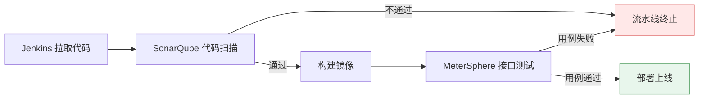
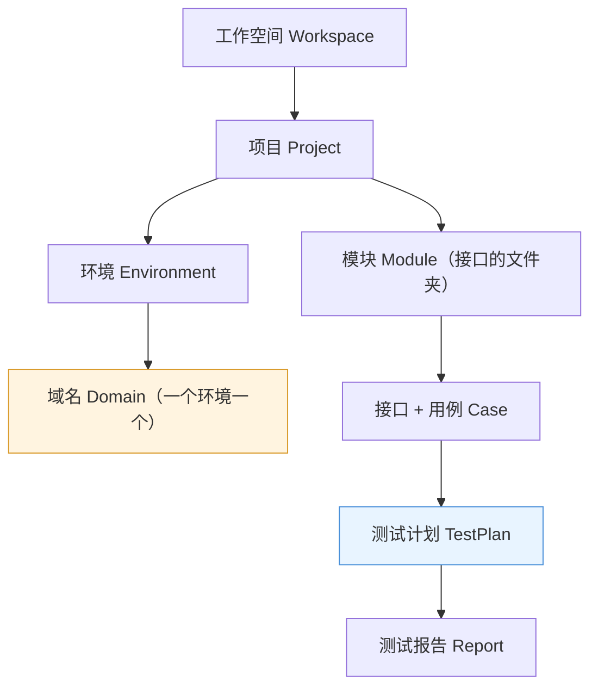

# 32. MeterSphere 接口测试：部署、用例定义与 Jenkins 集成：给流水线装上第二道质量门禁

## 纲要

- **MeterSphere 是开源的一站式持续测试平台**：测试管理、接口测试、UI 测试、性能测试四合一，本篇重点是**接口测试**与 Jenkins 的集成
- **分工先厘清**：运维负责部署、接 LDAP、配集成；**用例由测试人员定义**，运维调用测试配好的测试计划执行
- **部署门槛**：CentOS 7、CPU ≥ 4 核、内存 ≥ 8G、磁盘 ≥ 50G；一键脚本安装，也支持 K8s（Helm）与离线（改 values 关模块）
- **两套账号体系**：普通账号 + LDAP 账号登录（LDAP 账号登录后界面变深色），LDAP 在「系统参数设置」里配，配完先测试连接再测试登录
- **AK/SK 是 Jenkins 的钥匙**：个人账号 → API Keys 生成，片段生成器里靠它验证账户
- **四级资源模型**：工作空间 → 项目 → 环境 → 接口/用例；**一个环境只能绑一个域名**，要测多个域名就建多个环境
- **测试计划是用例的篮子**：一个计划关联多个用例，Jenkins 调的是「测试计划」而不是单个接口
- **Jenkins 集成三步**：下载 `.hpi` 插件上传部署 → 片段生成器生成 DSL → 粘贴进 Jenkinsfile 的 step
- **报警双通道**：项目设置 → 消息设置 → Jenkins 任务通知，成功/失败都推企业微信、飞书或钉钉机器人

## 一、场景引入：代码扫完了，接口谁来看守

前面的 SonarQube 解决了「代码写得对不对」——静态视角的质量。但服务部署起来之后**真的能用吗**？登录接口返回什么？下单接口状态码对不对？这些动态行为，静态扫描管不了，需要**接口测试**。

> MeterSphere 是一个开源的持续测试平台，它包含了测试管理、接口测试、UI 测试、性能测试等功能。通过这个平台，我们可以把它集成到 Jenkins 里面，通过在流水线构建的过程当中，对我们的代码进行持续的接口测试。

它在流水线里的位置，紧跟在代码扫描之后：



**先立一个分工的规矩**，这在整个落地过程中最重要：

> 这个工具主要的使用人是测试人员，并不是运维人员。我们主要的工作就是把它部署上去，然后把它接入 LDAP 账号，让测试人员进行登录配置，然后调用测试人员配置好的测试用例，在 Jenkins 里面进行持续集成测试。

运维管「平台可用 + 集成打通」，测试管「用例定义 + 断言设计」。两边边界清晰，才不会出现运维写了一堆接口、测试写了半辈子 YAML 的错位局面。

## 二、核心概念与原理

### 2.1 功能矩阵：本篇只用接口测试

| 模块 | 是否本篇重点 | 说明 |
|---|---|---|
| 接口测试 | **是** | 开源版完整支持，Jenkins 通过 API 调用测试计划 |
| 测试管理 | 是 | 用例、计划、报告的组织容器 |
| 性能测试 | 否 | 可自行配置使用 |
| UI 测试 | 否 | **企业版功能，需要付费** |

### 2.2 硬件要求

| 资源 | 社区版最低 | 企业版最低 | 说明 |
|---|---|---|---|
| 操作系统 | CentOS 7 | CentOS 7 | 课件基于 CentOS 7 验证 |
| CPU | ≥ 4 核 | ≥ 8 核 | |
| 内存 | ≥ 8G | ≥ 16G | Java 系平台，内存是硬门槛 |
| 磁盘 | ≥ 50G | ≥ 50G | 依赖容器多、镜像大 |
| 授权 | 免费 | 收费 | |

### 2.3 安装方式矩阵

| 方式 | 命令/操作 | 适用场景 |
|---|---|---|
| **一键脚本（Linux）** | 执行官方安装脚本（基于 Docker） | 单机快速部署，课件选择 |
| Windows 一键 | 官方提供的一键部署包 | 开发/测试笔记本 |
| **K8s / Helm** | 建命名空间 → `helm repo add` 官方仓库 → `helm repo update` → install | 生产集群部署 |
| **离线安装** | 下载 values 文件修改后安装 | 内网无外网环境 |

**离线安装改 values 的三个维度**（这是内网部署的核心技能）：

1. **安装版本号**：锁定到内网镜像仓库里实际存在的 tag；
2. **镜像拉取策略**：`imagePullPolicy` 改成 `IfNotPresent`/`Never`，避免反复拉外网；
3. **模块开关**：不需要的模块（如某些通知组件）改成 `false`，减少资源占用；
4. **外部依赖**：数据库、存储、缓存、消息队列、分布式协调中心，既可以装内置的，也可以全部指向外部已建好的实例（填主机名、端口、用户密码即可）。

### 2.4 四级资源模型

整个平台的资源层级，是理解所有操作的前提：



**三条铁律**：

1. **一个工作空间可以包含多个项目**——按团队/业务线分；
2. **一个项目下可以有多个环境，一个环境绑定一个域名**——这个域名就是接口测试的目标地址；想绑多个域名？**建多个环境**，一个环境只准一个；
3. **一个测试计划可以关联多个接口用例**——Jenkins 执行构建时调用的就是「测试计划」，计划里所有接口会全部被执行一次。

### 2.5 升级流程

平台自身升级三步：**停止服务 → 执行升级指令 → 启动并检查容器状态**。因为依赖容器多，升级本质是拉一批新镜像重启，耗时比普通服务长。

## 三、动手实践：部署 MeterSphere

### 3.1 一键安装（Docker 方式）

```bash
# 1. 准备一台 CentOS 7（4C8G/50G 起步）
# 2. 执行官方一键安装脚本（脚本内基于 Docker 拉取全部依赖镜像）
bash install.sh

# 3. 安装完成后查看容器状态
docker ps

# 4. 访问 http://<服务器IP>:8081
```

依赖镜像较多（数据库、缓存、消息队列、协调中心、各类服务组件），**首次安装拉镜像时间较长**，属于正常现象。

### 3.2 升级流程

```bash
# 1. 停止服务
bash stop.sh   # 或 stop 容器

# 2. 执行升级指令（拉取最新版本镜像）
bash upgrade.sh

# 3. 启动并检查状态
bash start.sh && docker ps
```

### 3.3 登录的两种方式

| 方式 | 界面特征 |
|---|---|
| 普通账号登录 | 默认普通账户入口 |
| **LDAP 账号登录** | 入口选中后**界面颜色变深**；登录的是 LDAP 里的账号 |

这个「颜色变深」的差异是新手确认「我到底走没走 LDAP」最快的判据。

### 3.4 K8s 部署（Helm）

```bash
# 1. 创建命名空间
kubectl create ns metersphere

# 2. 添加官方 Helm 仓库
helm repo add metersphere https://metersphere.github.io/helm-charts/
helm repo update

# 3. 安装（内网环境先下载 values 修改镜像地址与模块开关）
helm install metersphere metersphere/metersphere -n metersphere -f values.yaml
```

## 四、LDAP、AK/SK 与资源创建：把平台交给测试

### 4.1 LDAP 配置（系统参数设置）

路径：**系统设置 → 系统参数设置 → LDAP 设置 → 编辑**：

| 配置项 | 说明 |
|---|---|
| LDAP 地址 | 服务器 IP + 端口（默认 389） |
| 管理员账号 + 域名 | 绑定账号，如 `cn=admin,dc=example,dc=com` |
| 密码 | 绑定账号密码 |
| 用户域名（baseDn） | 用户搜索基准，如 `ou=user,dc=example,dc=com` |
| 用户过滤器 | `uid={0}`——按登录名匹配 |
| 属性映射 | 用户名属性 `uid`、姓名属性 `cn`、邮箱属性 `mail` |

配完后**两个按钮按顺序点**：先「测试连接」（网络 + 绑定账号对不对），再「测试登录」（输入 LDAP 用户名密码，登录成功才算全通）。最后别忘了勾上「启用 LDAP 验证」复选框并保存。

> 这套配置与 Jenkins、SonarQube 接入 LDAP 是同一套 LDAP 服务器——**三个系统一套账号**，这正是统一认证的价值。

### 4.2 AK/SK：Jenkins 的钥匙

路径：**右上角个人信息 → API Keys → 新建**。

AK/SK 是 Jenkins 调 MeterSphere OpenAPI 的凭证，与「人登录用的 LDAP 账号」完全是两套：**人用账号，机器用 AK/SK**。生成后妥善保存，Jenkins 片段生成器里要用它「验证账户」。

### 4.3 工作空间 → 项目 → 环境

1. **创建工作空间**：一个工作空间可含多个项目；**创建后要刷新页面**，右上角才会出现新工作空间的选择项（新手高频卡点：创建完找不到）；
2. **创建项目**：选中工作空间后创建「接口测试」项目，「集成第三方平台」选 LDAP，其余默认；
3. **创建环境**：项目 → 创建环境 → HTTP 配置 → 选协议（HTTP/HTTPS）→ 填域名 → 添加 → 命名（如「测试环境」）→ 确定。

> **一个环境只能绑一个域名**：已存在域名时再输入新域名不会被接受。要测多个域名（如官网 + 管理后台），老老实实建多个环境。

### 4.4 定义接口与用例

以「成功接口」为例，完整路径：


| 步骤 | 操作 | 要点 |
|---|---|---|
| 加子模块 | 接口定义 → 添加子模块 | **模块就是文件夹**，不同模块放不同业务的接口 |
| 快捷调试 | 接口列表 → 加号 → 快捷调试 | 先手动跑通，再固化成用例 |
| 断言规则 | 断言规则 → 添加 → 类型选**正则** | 响应状态码匹配 `^200$`——**只有 200 才算成功** |
| 选环境 | 右上角环境选择 | 用例跑的时候用哪个环境的域名 |
| 另存为用例 | 另存为新用例 → 命名 → 保存 | 接口定义 + 用例 两步都落库 |

**「失败接口」的设计更有教学价值**：目标是造一个「返回非 200」的用例。难点在于——目标站点对不存在的路径也返回 200，根本造不出失败。解法是**换一个域名**：把环境的域名换掉（换成访问不存在路径会返回 404 的站点），再建一个打不存在路径（如 `//1`）的接口，断言仍旧是 `^200$`——于是 404 触发断言异常，**失败用例诞生**。

> **这个设计暴露了接口测试的本质**：用例的「通过/失败」完全由断言定义，与接口本身对错无关。测试的价值不在于「全绿」，在于**红的那几个是不是你预期的红**。

### 4.5 测试计划与报告

路径：**测试跟踪 → 测试计划 → 创建**（名称如「接口测试」，测试阶段选「冒烟测试」）→ **关联测试用例**（把成功接口、失败接口都选上）→ 选运行环境 → 执行。

首页看板与报告：

| 信息 | 位置 |
|---|---|
| 过去七天测试计划失败用例、运行中的定时任务 | 首页 |
| 单个用例的测试报告 | 接口测试 → 查看报告 |
| **触发方式**：手动触发 / 定时任务 / **API 调用** / 批量执行 | 报告详情 |

**四种触发方式里，「API 调用」就是 Jenkins 集成用的**——Jenkins 不点页面，它调 API 让平台执行测试计划。这就是下面所有配置的存在意义。

### 4.6 用户组与权限

在用户/用户组配置里可分配：**超级管理员**（整个系统最大权限）→ **系统管理员**（仅次于超级管理员）→ **工作空间管理员**（单个工作空间范围）。一个账号可配多个组权限。

## 五、Jenkins 集成实战

### 5.1 第一步：安装插件（.hpi 离线部署）

MeterSphere 的 Jenkins 插件**不在官方插件市场**，要走离线部署：

```bash
# 1. 从 MeterSphere 官方 GitHub Releases 下载最新稳定版 .hpi 文件
#    例如：metersphere-jenkins-plugin-x.x.x.hpi

# 2. Jenkins → 插件管理 → 高级设置 → 部署插件
#    选择文件（刚下载的 .hpi）→ 部署 → 等待安装完成
```

### 5.2 第二步：片段生成器生成 DSL

**流水线语法 → 片段生成器 → 选择 `metersphere`**，填以下字段：

| 字段 | 值来源 |
|---|---|
| msEndpoint | MeterSphere 地址，如 `http://metersphere.example.com:8081/` |
| msAccessKey / msSecretKey | 4.2 节生成的 AK/SK |
| workspaceId | 片段生成器下拉选择（工作空间） |
| projectId | 下拉选择（项目） |
| method | `testPlan`（执行测试计划） |
| testPlanId | 下拉选择（测试计划） |
| mode | `serial`（串行执行） |
| openMode | 报告打开方式 |

**「验证账户」按钮变绿**，说明 AK/SK 与地址都对。然后点「生成流水线脚本」。

### 5.3 第三步：DSL 粘进 Jenkinsfile

把生成的 DSL 作为一个 step 放进流水线（以下值已做占位化处理，实际值以你控制台为准）：

```groovy
#!groovy

pipeline {

    agent {
        label 'slave'
    }

    options {
      timestamps()
      parallelsAlwaysFailFast()
      timeout(time: 600, unit: 'SECONDS')
      disableConcurrentBuilds(abortPrevious: true)
      buildDiscarder(logRotator(numToKeepStr: '30'))
      skipDefaultCheckout()
    }

    stages {
        stage('MeterSphere测试') {
            steps {
                    meterSphere method: 'testPlan',
                    mode: 'serial',
                    msAccessKey: '<你的AccessKey>',
                    msEndpoint: 'http://<MeterSphere地址>:8081/',
                    msSecretKey: '<你的SecretKey>',
                    openMode: 'auth',
                    projectId: '<项目ID>',
                    projectName: '',
                    projectType: 'projectId',
                    resourcePoolId: '<资源池ID>',
                    testCaseId: '', testCaseName: '',
                    testPlanId: '<测试计划ID>',
                    testPlanName: '',
                    workspaceId: '<工作空间ID>'
                }
            }
        }
    }
```

**字段逐项解释**：
| 字段 | 作用 | 留空的行为 |
|---|---|---|
| `method: 'testPlan'` | 执行方式 = 跑测试计划 | 另有跑单个用例的方式 |
| `mode: 'serial'` | 串行执行 | 大数据量用例集可评估并行 |
| `msAccessKey`/`msSecretKey` | **接口凭证** | 验证账户必失败 |
| `msEndpoint` | 平台地址（带端口与尾斜杠） | 连不上平台 |
| `projectType: 'projectId'` + `projectId` | 用 ID 定位项目 | 定位失败 |
| `testPlanId` | **要执行的测试计划** | 不知道跑什么 |
| `resourcePoolId` | 执行用例的资源池 | 用默认池 |
| `workspaceId` | 工作空间 | 定位失败 |
| `openMode: 'auth'` | 报告打开方式（认证访问） | |

### 5.4 执行结果解读

课件执行结果：**两个用例，一个通过、一个失败**——失败的是故意打不存在路径的「错误接口」（404 触发 `^200$` 断言异常）。

> **再次强调**：这个「失败」是用例设计的预期行为，用来验证「断言真的能拦住问题」。真实项目里失败用例应该是真问题。Jenkins 侧可以看到每个用例的通过/失败明细，并跳转到 MeterSphere 查看完整测试报告。

### 5.5 报警配置：Jenkins 任务通知

路径：**项目设置 → 更多选项 → 消息设置 → Jenkins 任务通知 → 创建新通知**：

| 配置项 | 选项 |
|---|---|
| 事件 | **成功 / 失败**（可多选——本篇需求是「不管对错都通知」） |
| 接收方式 | 邮件 / 钉钉 / **企业微信** / **飞书** |
| Webhook | 把对应机器人的 webhook 地址粘贴进来 |

配置两个通知（一个成功、一个失败）都推到企业微信机器人，构建完成后**无论对错都会报警**——接口测试这种「时好时坏」的环节，失败即时达比事后翻报告重要得多。

> 与前面飞书报警同样的安全原则：**webhook 地址是凭证，别硬编码进 Jenkinsfile**；Jenkins 调 MeterSphere 的 AK/SK 同理，建议存 Secret text 凭据后用 `withCredentials` 注入。

### 5.6 合体：一条流水线同时跑扫描和接口测试

真实企业 CI 不会为接口测试单开一条流水线——它应该挂在代码扫描之后、部署之前，形成「静态质量 + 动态行为」双重门禁。把前面的 sonar 扫描 stage 与本篇的 metersppere stage 串起来：

```groovy
stages {
    stage('克隆代码') { /* 同 5.3 节 */ }
    stage('sonar扫描') { /* 同上一篇：scanner-cli 容器 + withSonarQubeEnv */ }
    stage('Quality Gate') { /* 同上一篇：waitForQualityGate，非 OK 即 error */ }
    stage('metershpere接口测试') {
        steps {
            meterSphere method: 'testPlan',
                mode: 'serial',
                msAccessKey: '<你的AccessKey>',
                msEndpoint: 'http://<MeterSphere地址>:8081/',
                msSecretKey: '<你的SecretKey>',
                openMode: 'auth',
                projectId: '<项目ID>',
                projectType: 'projectId',
                testPlanId: '<测试计划ID>',
                workspaceId: '<工作空间ID>'
        }
    }
}
```

**合体的三个设计点**：

| 设计点 | 做法 | 理由 |
|---|---|---|
| 顺序 | 扫描 → 门禁 → 接口测试 | 静态问题先拦，省一次接口测试执行成本 |
| 失败即停 | 两个 stage 任一失败，后续部署 stage 不执行 | 双重门禁的意义就是「谁不过谁拦」 |
| 报警分流 | 扫描失败推开发群、接口失败推测试群 | 不同问题找不同人，报警才有人看 |

## 六、生产实践要点 / 常见坑

| 实践点 | 说明 |
|---|---|
| **资源规划** | 50G 磁盘是底线；依赖容器十几个，安装/升级都要预留时间窗口 |
| **内网部署** | 用离线方式：提前把镜像同步到内网仓库，values 里改镜像地址、拉取策略、模块开关 |
| **依赖可外置** | 数据库/缓存/MQ/协调中心都可以用外部实例，平台只装服务本身，便于统一运维 |
| **用例归属** | 接口与用例由测试定义，运维不要越界写业务接口——平台集成的稳定性才是运维的 KPI |
| **环境与域名** | 一个环境一个域名；多域名 = 多环境；环境命名带用途（测试/预发） |
| **断言设计** | 状态码用 `^200$` 精确匹配；业务字段再加 JSON path 断言；**没有断言的用例等于没测** |
| **测试计划粒度** | 按场景分组（冒烟/回归），Jenkins 里不同流水线调不同计划——别把所有用例塞一个计划 |
| **AK/SK 安全** | 存 Jenkins 凭据、不进 Git、不进日志；轮换时同步更新片段生成器配置 |
| **报警降噪** | 通知事件按需选：迭代期全选（对错都报），稳定期只选失败 |
| **运行模式** | `serial` 串行；用例量大且相互无依赖时评估并行，缩短流水线耗时 |
| **升级纪律** | 先停服务再升级，升级完 `docker ps` 全绿才算完成 |
| **报告留存** | 接口测试报告按构建号归档（跳转链接带 `BUILD_NUMBER`），复盘时能回溯任一历史版本 |
| **定时任务 vs 流水线** | 平台自带定时任务适合夜间回归；Jenkins 流水线触发适合「每次提交都测」——两者互补，别只用其一 |
| **多环境串测** | 同一套用例在「测试 / 预发」两个环境各执行一次，只需在 Jenkins 侧传不同 `projectId`/环境参数，用例本身零改动 |

## 七、报错排查表

| 现象 | 根因 | 解法 |
|---|---|---|
| 部署插件时报兼容性错误 | `.hpi` 版本与 Jenkins 版本不匹配 | 换稳定版 `.hpi`，或升级 Jenkins |
| 片段生成器里没有 `metersphere` 步骤 | 插件没装好 / 装完没重启 | 插件管理确认已安装，重启 Jenkins |
| 「验证账户」失败 | AK/SK 错，或 msEndpoint 不通（端口/防火墙） | 核对 API Keys；`curl` 测通 `http://<ip>:8081` |
| 执行后全部用例失败 | 环境域名不通 / 没选对环境 | 检查环境域名、协议、网络 |
| 失败用例不符合预期 | 断言规则设计问题（如域名换错导致 404） | 回顾 4.4 节「失败接口」的设计逻辑 |
| 用例执行成功但报告打不开 | `openMode` 选了 auth 但未登录 | 用 `auth` 方式时先登录平台账号 |
| LDAP 账号登录后界面不变深 | 没勾「启用 LDAP 验证」 | 系统参数设置里勾选并保存 |
| 新工作空间/项目不显示 | 创建后未刷新页面 | 刷新后从右上角切换工作空间 |
| 收不到报警 | webhook 没粘贴 / 事件没选 / 没打勾 | 消息设置里逐项检查；先手动触发一次通知 |
| Jenkins 调 API 超时 | 平台负载高或用例集太大 | 增大流水线 timeout；拆分测试计划；评估并行执行 |
| 升级后容器起不来 | 镜像 tag 与版本不匹配 | 回滚到上一版本镜像，核对 values 版本号 |

## 八、面试考点与追问

**Q1：MeterSphere 是什么？和 Jenkins 集成做什么？**
开源的一站式持续测试平台（测试管理、接口、UI、性能）。与 Jenkins 集成后，流水线在构建阶段自动执行接口测试计划——用例失败即终止构建，把「服务能不能用」的验证前移到上线前。

**Q2：落地接口测试平台，运维和测试的分工是什么？**
运维负责：部署平台（脚本/Helm/离线）、接 LDAP、配 AK/SK 与 Jenkins 集成、配报警。测试负责：定义接口、设计断言、组织测试计划。**运维调用测试配好的测试计划执行**，边界清晰。

**Q3：MeterSphere 的部署方式有哪些？离线安装改什么？**
一键脚本（Docker）、Windows 一键、K8s（Helm：建 ns → add repo → update → install）、离线安装。离线改 values 四类：安装版本号、镜像拉取策略、模块开关（不需要的改 `false`）、外部数据库/缓存/MQ/协调中心连接信息。

**Q4：工作空间-项目-环境-接口四级模型是怎样的？一个环境为什么只能绑一个域名？**
工作空间含多个项目；项目含多个环境；环境绑域名作为测试目标；项目下模块（文件夹）组织接口与用例；用例挂进测试计划。一个环境只绑一个域名是为了**测试目标明确、报告归属清晰**——要测多个域名就建多个环境。

**Q5：测试计划是什么？Jenkins 调用的是计划还是单个接口？**
测试计划是用例的篮子，一个计划关联多个用例，执行计划即批量执行其中所有接口。**Jenkins 调的是测试计划**（`method: 'testPlan'` + `testPlanId`），不是单个接口——这样一条流水线就能完成整套回归。

**Q6：Jenkins 集成 MeterSphere 的三步？**
① 从官方 GitHub 下载 `.hpi`，插件管理 → 高级 → 部署插件上传（插件市场没有）；② 片段生成器选 `metersphere`，填地址 + AK/SK + 工作空间/项目/测试计划，「验证账户」通过后生成 DSL；③ DSL 作为 step 粘进 Jenkinsfile。AK/SK 来自「个人信息 → API Keys」。

**Q7：报警怎么配？**
项目设置 → 更多选项 → 消息设置 → Jenkins 任务通知 → 创建新通知：选事件（成功/失败，可多选）→ 选接收方式（邮件/钉钉/企业微信/飞书）→ 粘贴机器人 webhook。建两个通知分别对成功/失败，即可「不管对错都报警」。

**Q8：AK/SK 和 LDAP 账号的区别？AK/SK 怎么保安全？**
LDAP 账号是「人」登录平台的凭证；AK/SK 是「机器」（Jenkins）调 OpenAPI 的凭证。AK/SK 安全三原则：存 Jenkins Secret text 凭据不硬编码、不进构建日志、定期轮换。

## 📎 文本↔代码关联

本篇对应课件源码（`code/5-实战-Jenkins/`，已做去品牌化处理；AK/SK、各类 ID 在本文示例中均已占位化，实际值以各自 MeterSphere 控制台为准）：

| 代码文件 | 正文提及 | 内容 |
| --- | --- | --- |
| `code/5-实战-Jenkins/Jenkinsfile/Jenkinsfile-MehtereSphere接口测试` | 第 5.3 / 5.4 节 | `meterSphere` step 完整字段：`method: 'testPlan'`、`mode: 'serial'`、`msAccessKey/msSecretKey`、`msEndpoint`、`projectId`、`testPlanId`、`resourcePoolId`、`workspaceId`、`openMode` |
| `code/5-实战-Jenkins/Jenkinsfile/Jenkinsfile-sonar扫描测试` | 第 一 节 | 同一套 agent/options 骨架的扫描流水线，与接口测试 stage 组合即可形成「扫描 + 测试」完整 CI |

**技术点总结**：MeterSphere 是流水线的第二道质量门禁，管「服务跑得对不对」。**分工是落地第一原则**：运维部署、接 LDAP、配 AK/SK 与 Jenkins 集成；测试定接口、写断言、组测试计划。部署门槛 CentOS 7 / 4C8G / 50G，四种安装方式里离线安装靠改 values（版本号、拉取策略、模块开关、外部依赖）。资源模型四级：工作空间 → 项目 → 环境 → 模块/接口/用例，**一个环境只能绑一个域名**，测试计划是用例的篮子。Jenkins 集成三步：`.hpi` 离线部署插件 → 片段生成器验证 AK/SK 生成 DSL → 粘进 Jenkinsfile step。报警走「Jenkins 任务通知」，成功/失败都可推企业微信、飞书、钉钉。最后记住那个失败用例的设计——**红不红由断言说了算，测试的价值在于红得是不是预期**。

