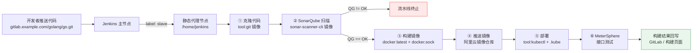

# 项目实战：Jenkins + Docker + SonarQube + MeterSphere 全链路静态代理流水线

## 纲要

- **这是 Jenkins 篇的毕业考**：把前四章所有零件——共享库、静态代理节点、SonarQube 扫描、质量门禁、Docker 构建、K8s 部署、MeterSphere 接口测试——接成一条能跑通的完整流水线
- **静态代理 = 提前注册好的从节点**：通过标签 `slave` 调用，节点上手动建好远程工作目录，JNLP 方式连接主节点，可并行执行 10 个构建
- **共享库是脚本的骨架**：`@Library('jenkins-shared-library@main')` 加载，`org` 包下的类负责彩色输出与拉代码，`vars` 目录放全局函数
- **六个阶段一条链**：克隆代码 → SonarQube 扫描 → 质量门禁 → 构建镜像 → 部署 → MeterSphere 接口测试，任何一环失败整条流水线终止
- **坑比命令多**：第一次构建必报 `branch_name` 不存在、MeterSphere 故障用例会染红整条流水线、`docker.sock` 不挂载就推不了镜像——本篇逐个拆解
- **生产级细节全保留**：时间戳、并发取消、构建保留数、镜像标签拼装、凭据注入方式，逐字段拆解

## 一、场景引入：把散落的零件接成流水线

前四章我们一块一块地拼装 Jenkins：拼了**共享库**（#25）、**静态代理节点**（#21）、**SonarQube 扫描**（#30）、**MeterSphere 接口测试**（#31）。但零件不等于整车——真实项目里，代码提交后要自动走完「拉代码 → 扫质量 → 过门禁 → 打镜像 → 推仓库 → 上集群 → 测接口」**七步全过程**，任何一环断裂，CI/CD 就是摆设。

本篇就是这个「整车验收」。我们用的技术栈固定为：

> **Jenkins（主节点）+ 静态 Docker 代理节点 + SonarQube + MeterSphere + K8s**，四个外部服务全部在前面部署好，本篇只解决「怎么用一条 Jenkinsfile 把它们串起来」。

先看全景图，建立整体认知，再逐字段拆解：



三个关键设计决定，先立在这里，后面所有配置都为它们服务：

1. **每个 stage 用不同的容器镜像执行**——git 操作用 `tool:git`、扫描用 `sonar-scanner-cli`、构建用 `docker:latest`、部署用 `tool:kubectl`。**工具链不进基础镜像**，节点只装 JRE，其余全靠容器按需拉取，节点长期不腐化。
2. **共享库承载重复逻辑**——拉代码、彩色打印各 stage 出现六次，全部收进共享库，Jenkinsfile 只留业务主线。
3. **测试计划由测试人员定义**——运维只调用，本篇的 MeterSphere 阶段就是纯粹的执行端。

## 二、核心概念与原理

### 2.1 静态代理节点：一次注册，长期复用

动态代理是「每次构建现造 Pod，跑完就销毁」（#33 会讲），**静态代理**则相反：提前准备好一台服务器，注册成 Jenkins 从节点，之后每次构建都派给它。它的配置在「系统管理 → 节点管理 → 节点列表」里，逐个字段看：

| 字段 | 值 | 说明 |
|---|---|---|
| 节点名称 | `myagentname-1` | **内部管理用的名字**，Jenkinsfile 里不直接用 |
| 标签 | `slave` | **`agent { label 'slave' }` 靠它找人**，一个节点可以打多个标签 |
| 远程工作目录 | `/home/jenkins` | 每个项目的工作空间都建在这个目录下，**必须手动创建且 jenkins 用户有写权限** |
| 启动方式 | JNLP（Web 启动代理） | 从节点下载 `slave.jar`/`agent.jar`，运行 java 程序主动回连主节点 |
| 并发执行数 | `10` | 同一节点最多同时跑 10 个构建，超出排队 |

> 为什么强调「远程工作目录要手动创建」？Jenkins 不会替你在从节点上建目录，目录不存在时构建直接以 `Cannot create directory` 失败，这是静态代理最高频的初始化事故。

**标签与名称的关系**是面试常考题：节点有名称（`myagentname-1`）用于界面管理，但流水线调度只看**标签**。一个标签可以对应多台节点（实现负载分流），一台节点也可以有多个标签（按用途分组）。

### 2.2 共享库加载机制：`@Library` 一行背后发生了什么

Jenkinsfile 第一行：

```groovy
@Library('jenkins-shared-library@main') _
```

这行不是普通 import，它让 Jenkins 去「系统管理 → 系统配置 → Global Pipeline Libraries」里查找名为 `jenkins-shared-library` 的库，拉取 `main` 分支的代码到主节点本地，之后脚本里才能 `new org.color()`。

| 配置项 | 值 | 说明 |
|---|---|---|
| Name | `jenkins-shared-library` | 与 `@Library('jenkins-shared-library@main')` 中的名字对应 |
| 版本分支 | `main` | `@xxx@main` 里的 `@main` 就是版本，可换成 tag/commit |
| 仓库地址 + 账号密码 | 共享库 Git 仓库 + 凭据 | Jenkins 需要能拉到这个仓库 |

共享库的代码组织有两条铁律（#24、#25 已详细讲过，本篇用到的就三个文件）：

```text
shared-library/
├── src/org/          # 类文件：package org，脚本里 new org.xxx()
│   ├── color.groovy      # 彩色输出 PrintMessage(value, color)
│   ├── checkout.groovy   # 拉代码 scm(branch, url)
│   └── test.groovy       # 测试用 librarytest()
└── vars/             # 全局函数/变量：直接 log.info() 调用
    └── log.groovy        # info() / warning() 两个日志函数
```

用法对照：

```groovy
def tools = new org.color()      // src/org 下的类 → new 实例
def checkout = new org.checkout()
log.info("构建开始")              // vars 下的函数 → 直接调用，不用 new
```

> `color.groovy` 依赖 **AnsiColor 插件**，没装插件调用会抛 `NoSuchMethodError: ansiColor`，本篇动手部分会验证。

### 2.3 六阶段流水线的职责边界

| 阶段 | 执行镜像 | 挂载 | 核心动作 | 失败后果 |
|---|---|---|---|---|
| ① 克隆代码 | `tool:git` | 无 | `cleanWs()` 清场 → 彩色打印 → `checkout.scm()` 拉分支 | 终止 |
| ② SonarQube 扫描 | `sonar-scanner-cli` | 无 | `withSonarQubeEnv` 注入连接 → `sonar-scanner` 扫描 | 终止 |
| ③ 质量门禁 | 与主节点一致 | 无 | `waitForQualityGate` 轮询门禁结果 | 终止 |
| ④ 构建镜像 | `docker:latest` | `/var/run/docker.sock` | `docker.build` + `push` 到阿里云仓库 | 终止 |
| ⑤ 部署 | `tool:kubectl` | `/root/.kube` | `sed` 换镜像名 → `kubectl apply` | 终止 |
| ⑥ MeterSphere | 不指定容器 | 无 | DSL 调测试计划，串行执行 | 终止 |
| post | 任意 | 无 | 按结果回写构建页面标识 | 不影响主流程 |

注意阶段④和⑤的**挂载差异**：④ 挂宿主机的 `docker.sock`（借用节点上的 Docker 守护进程），⑤ 挂宿主机的 `/root/.kube`（借用节点上的 kubeconfig）。这两个挂载是静态代理方案的技术核心——**工具全在容器里，凭证全在节点上**。

## 三、动手实践：完整 Jenkinsfile 与逐字段拆解

### 3.1 完整脚本

以下脚本即课件 `5-实战-Jenkins/Jenkinsfile/Jenkinsfile-docker静态代理实战` 的内容结构（敏感凭据值已用占位符替换，生产落地时请通过凭据管理注入，**不要把真实 AK/SK 写进任何会提交的仓库**）：

```groovy
#!groovy

@Library('jenkins-shared-library@main') _

def tools = new org.color()
def checkout = new org.checkout()

pipeline {

    agent {
        label 'slave'
    }

    options {
      timestamps()
      parallelsAlwaysFailFast()
      timeout(time: 600, unit: 'SECONDS')
      disableConcurrentBuilds(abortPrevious: true)
      buildDiscarder(logRotator(numToKeepStr: '30'))
      skipDefaultCheckout()
    }

    environment {
        String year = new Date().format("yyyy")
        String month = new Date().format("MMdd")
        String day = new Date().format("HHmm")
        String second = new Date().format("ss")
        images_head = "registry.cn-hangzhou.aliyuncs.com"
        giturl = "http://gitlab.example.com/golang/go.git"
    }

    parameters {
        choice choices: ['main', 'pre', 'test'], name: 'branch_name'
    }

    stages {
        stage('1.克隆代码') {
            agent {
                docker {
                    label 'slave'
                    image 'registry.cn-hangzhou.aliyuncs.com/tool-bucket/tool:git'
                }
            }
            steps {
                script {
                    cleanWs()
                    tools.PrintMessage("1.克隆代码","blue")
                    checkout.scm(branch_name, giturl)
                }
            }
        }
        stage('2.SonarQube扫描') {
            agent {
                docker {
                    label 'slave'
                    image 'sonarsource/sonar-scanner-cli'
                }
            }
            steps {
                script {
                    tools.PrintMessage("2.SonarQube扫描","blue")
                    withSonarQubeEnv('sonarqube') {
                        sh """
                        sonar-scanner \
                        -Dsonar.projectKey=test-go \
                        -Dsonar.projectName=test-go \
                        -Dsonar.projectVersion=test-go-${BUILD_NUMBER} \
                        -Dsonar.ws.timeout=30 \
                        -Dsonar.sources=. \
                        -Dsonar.sourceEncoding=UTF-8
                        sleep 3
                        """
                    }
                }
            }
        }
        stage("3.质量门禁"){
            steps {
                script {
                    tools.PrintMessage("3.质量门禁","blue")
                    timeout(time: 10, unit: 'SECONDS') {
                        def qg = waitForQualityGate('sonarqube')
                        if (qg.status != 'OK') {
                            error "未通过Sonarqube的代码质量阈检查，请及时修改！failure: ${qg.status}"
                        }
                    }
                }
            }
        }
        stage('4.构建镜像') {
            agent {
                docker {
                    label 'slave'
                    image 'docker:latest'
                    args '-v /var/run/docker.sock:/var/run/docker.sock'
                }
            }
            steps {
                script {
                    tools.PrintMessage("4.构建镜像","blue")
                    ImageTag = "${images_head}/tool-bucket/tool:${BUILD_USER}-${branch_name}-${year}${month}${day}${second}-${BUILD_TAG}"
                    docker.withRegistry("https://${images_head}", 'aliyun-images-registry') {
                        def customImage = docker.build("${ImageTag}")
                        customImage.push()
                    }
                }
            }
        }
        stage('5.部署') {
            agent {
                docker {
                    label 'slave'
                    image 'registry.cn-hangzhou.aliyuncs.com/tool-bucket/tool:kubectl'
                    args '-v /root/.kube:/root/.kube'
                }
            }
            steps {
                script {
                    tools.PrintMessage("5.部署","blue")
                    sh """
                        sed -i "s#image: .*#image: ${ImageTag}#" deploy.yaml
                        kubectl apply -f deploy.yaml
                    """
                }
            }
        }
        stage('6.MeterSphere接口测试') {
            steps {
                script {
                    tools.PrintMessage("6.MeterSphere接口测试","blue")
                    meterSphere method: 'testPlan',
                    mode: 'serial',
                    msAccessKey: '<your-ms-access-key>',
                    msEndpoint: 'http://10.0.7.27:8081/',
                    msSecretKey: '<your-ms-secret-key>',
                    openMode: 'auth',
                    projectId: '<your-project-id>',
                    projectName: '',
                    projectType: 'projectId',
                    resourcePoolId: '<your-resource-pool-id>',
                    testCaseId: '', testCaseName: '',
                    testPlanId: '<your-test-plan-id>',
                    testPlanName: '',
                    workspaceId: '<your-workspace-id>'
                }
            }
        }
    }
    post {
        failure {
            script{
               manager.addShortText("${BUILD_NUMBER}次构建! 构建失败!!!")
            }
        }
        success {
            script  {
                manager.addShortText("${BUILD_NUMBER}次构建! 构建成功!!!")
            }
        }
        aborted {
            script{
                manager.addShortText("${BUILD_NUMBER}次构建!构建取消!!!")
            }
        }
        always {
            script{
                manager.addShortText("构建用户: ${BUILD_USER}")
            }
        }
    }
}
```

### 3.2 逐字段拆解（一）：pipeline 骨架与 agent

| 配置 | 写法 | 为什么 |
|---|---|---|
| 共享库加载 | `@Library('jenkins-shared-library@main') _` | 加载 `main` 分支版共享库；末尾 `_` 表示对整个脚本生效 |
| 全局 agent | `label 'slave'` | 整条流水线默认派给 `slave` 标签的静态代理节点 |
| stage 级 agent | `docker { label 'slave'; image '...' }` | **该 stage 的步骤跑在指定镜像的容器里**，容器仍调度到 slave 节点上运行 |
| 节点名 vs 标签 | 节点叫 `myagentname-1`，调用用 `slave` | 解耦：换机器不用改脚本，只改节点标签 |

**关键认知**：`agent { docker { ... } }` 不是「在 Docker 里跑 Jenkins」，而是 Jenkins 在该节点上 `docker run` 一个临时容器，把 `sh` 步骤透传进容器执行，跑完即焚。所以容器里没有 jenkins 用户、没有工作目录继承问题，**但也没有节点上装的任何东西**——这就是每个 stage 都要显式挂载 `.kube`、`docker.sock` 的原因。

### 3.3 逐字段拆解（二）：options 六件套

`options` 是流水线级全局配置，一条 Jenkinsfile 只需要写一次：

| 选项 | 作用 | 生产意义 |
|---|---|---|
| `timestamps()` | 每行日志前加时间戳 | 排障时能算出每个 stage 的真实耗时，没有时间戳的日志等于半废 |
| `parallelsAlwaysFailFast()` | 并行 stage 中一个失败，立即终止其他并行分支 | 省资源、快失败，避免失败后还傻等并行分支跑完 |
| `timeout(time: 600, unit: 'SECONDS')` | 整条流水线 600 秒上限 | 防挂死：扫描卡在 Web 请求、镜像 push 卡在网络时兜底 |
| `disableConcurrentBuilds(abortPrevious: true)` | 新构建到来时**取消**旧构建 | 代码频繁提交时永远只保留最新构建，旧的自动取消；设为 `false` 则旧构建继续跑完 |
| `buildDiscarder(logRotator(numToKeepStr: '30'))` | 只保留最近 30 次构建记录 | 控制主节点磁盘，Jenkins 跑几年不删构建能把盘撑爆 |
| `skipDefaultCheckout()` | **跳过默认的自动 checkout** | 默认行为会替你把流水线仓库拉下来；加了它，拉代码完全交给 stage 1 的共享库函数，避免重复拉取 |

> `skipDefaultCheckout()` 与 `cleanWs()` 是一对：前者禁止 Jenkins 自动拉代码，后者在每个构建开始时手动清空工作空间。**Jenkins 多分支/声明式流水线默认不会自动清理工作空间**，不清理的后果是上次构建的产物混进这次扫描范围，SonarQube 扫出一堆陈旧代码的问题。

### 3.4 逐字段拆解（三）：environment 与 parameters

```groovy
environment {
    String year  = new Date().format("yyyy")
    String month = new Date().format("MMdd")
    String day   = new Date().format("HHmm")
    String second = new Date().format("ss")
    images_head = "registry.cn-hangzhou.aliyuncs.com"
    giturl = "http://gitlab.example.com/golang/go.git"
}
```

这六个变量服务两个目的：**镜像仓库地址**（`images_head`）和**镜像标签的时间戳部分**（四个时间变量）。镜像标签的拼装公式：

```text
ImageTag = ${images_head}/tool-bucket/tool:${BUILD_USER}-${branch_name}-${year}${month}${day}${second}-${BUILD_TAG}
```

各片段含义：

| 片段 | 来源 | 示例 |
|---|---|---|
| `images_head` | environment 变量 | `registry.cn-hangzhou.aliyuncs.com` |
| `BUILD_USER` | 内置变量（**需在「全局变量配置」中勾选后才能用**） | 触发构建的用户 |
| `branch_name` | parameters 选择值 | `main` |
| `year/month/day/second` | environment 时间变量 | `2026` + `1014` + `1530` + `42` |
| `BUILD_TAG` | 内置变量，固定组成 `jenkins-${JOB_NAME}-${BUILD_NUMBER}` | `jenkins-go-build-15` |

⚠️ **一个必须点名的命名坑**：变量名叫 `day`，格式化出来的却是 `HHmm`（时分）；叫 `second` 的才是 `ss`。这是课件的原始写法，能跑但**极具误导性**，生产上建议直接改名 `hourMinute` / `sec`，否则三个月后没人敢动这段代码。

参数化构建只有一个：

```groovy
parameters {
    choice choices: ['main', 'pre', 'test'], name: 'branch_name'
}
```

下拉三选一（`main` / `pre` / `test`），构建时手动选择要构建的分支。**这个参数有第一个大坑**：Jenkins 必须先完整读一遍 Jenkinsfile 才知道有 `parameters` 块，所以**第一次构建时参数还没生效**，直接构建会报 `No such property: branch_name`。解决办法见第五节排查表。

### 3.5 逐字段拆解（四）：六个 stage 的关键动作

**stage 1 克隆代码**：三步走，顺序不能乱：

```groovy
cleanWs()                                  // ① 清空工作空间（依赖 Workspace Cleanup 插件）
tools.PrintMessage("1.克隆代码","blue")    // ② 蓝色横幅打印当前 stage
checkout.scm(branch_name, giturl)          // ③ 共享库函数拉取指定分支
```

`checkout.scm()` 内部就是 `checkout scmGit(branches: [[name: "${build_branch}"]], userRemoteConfigs: [[credentialsId: 'gitlab', url: "${url}"]])`——凭据 ID `gitlab` 是 Jenkins 里预存的管理员账号密码，URL 由参数传入。

**stage 2 SonarQube 扫描**：`withSonarQubeEnv('sonarqube')` 是 SonarQube Scanner 插件提供的内置方法，它把「系统管理 → 全局配置 → SonarQube」里名为 `sonarqube` 的服务器地址和 token 注入环境变量，容器里的 `sonar-scanner` 才能把报告推上服务器。参数逐项：

| 参数 | 值 | 说明 |
|---|---|---|
| `sonar.projectKey` | `test-go` | 项目唯一标识，重复 key 会覆盖历史数据 |
| `sonar.projectVersion` | `test-go-${BUILD_NUMBER}` | **每次构建都要变**，版本不变 SonarQube 拒绝重复分析 |
| `sonar.ws.timeout` | `30` | Web 服务等待超时（秒） |
| `sonar.sources` | `.` | 扫描当前工作空间全部代码 |
| `sonar.sourceEncoding` | `UTF-8` | 中文注释不乱码的关键 |

结尾的 `sleep 3` 不是玄学：给 SonarQube 后台留出**提交报告 → 入队列 → 计算完成**的时间，紧接着 stage 3 就要查结果，不等这几秒门禁大概率读到 `IN_PROGRESS`。

**stage 3 质量门禁**：`waitForQualityGate('sonarqube')` 轮询门禁状态，返回对象赋给 `qg`，只有 `qg.status == 'OK'` 才放行；`!= 'OK'` 直接 `error` 抛异常，整条流水线染红终止。整个查询包了 10 秒 `timeout`——门禁计算超过 10 秒还没结果就判失败，**快速失败优于无限等待**。

**stage 4 构建镜像**：

```groovy
docker.withRegistry("https://${images_head}", 'aliyun-images-registry') {
    def customImage = docker.build("${ImageTag}")
    customImage.push()
}
```

`withRegistry` 的两个参数：仓库地址 + **Jenkins 凭据 ID**。凭据在「系统管理 → 凭据管理」里预存，ID 为 `aliyun-images-registry`，类型「用户名密码」，存的是阿里云镜像仓库的账号。`docker.build` 按工作空间里的 `Dockerfile` 构建，`push` 推送到 `ImageTag` 指定的完整地址。

⚠️ 两个前置条件缺一不可：**① 容器必须挂 `-v /var/run/docker.sock:/var/run/docker.sock`**（容器内的 docker CLI 要借用节点上的守护进程才能构建和推送，这就是 Docker-out-of-Docker 方案）；**② 全局变量配置里勾选 `BUILD_USER`**，否则脚本里引用它直接报未定义。

**stage 5 部署**：一行 `sed` 一行 `kubectl`：

```bash
sed -i "s#image: .*#image: ${ImageTag}#" deploy.yaml
kubectl apply -f deploy.yaml
```

`sed` 用 `#` 作分隔符（避免镜像地址里的 `/` 转义地狱），把 `deploy.yaml` 里所有 `image:` 行替换成本次构建的镜像全名，再 `apply` 滚动更新。容器挂 `/root/.kube` 拿到操作集群的 kubeconfig，权限与节点上配置的账号一致。

**stage 6 MeterSphere 接口测试**：六个 ID 类参数全部来自「片段生成器」（Pipeline Syntax → 搜 `meterSphere`），含义：

| 参数 | 含义 |
|---|---|
| `msAccessKey` / `msSecretKey` | MeterSphere 个人账号 → API Keys 生成的 AK/SK |
| `msEndpoint` | MeterSphere 平台地址 |
| `workspaceId` | 工作空间 ID（资源模型最外层） |
| `projectId` | 项目 ID（`projectType: 'projectId'` 表示用 ID 定位项目） |
| `resourcePoolId` | 执行测试所用的资源池（节点） |
| `testPlanId` | 测试计划 ID——**Jenkins 调用的是整个计划，不是单个接口** |

**本 stage 不指定 agent 容器**：接口测试是纯 HTTP 调用，不依赖任何构建工具链，直接在 Jenkins 从节点上执行 DSL 即可，省一次容器启动。

**post 块**：四个分支覆盖所有结局——`failure` / `success` / `aborted` / `always`，统一用 `manager.addShortText()` 把「第 N 次构建 + 结果 + 构建用户」写到构建历史的标识徽标上，**不用点进日志就能在构建列表里看到结果**。

## 四、生产实践要点

### 4.1 节点与容量规划

| 项目 | 建议值 | 理由 |
|---|---|---|
| 代理节点配置 | 4C8G 起步，按并发上调 | 每个构建容器 200~500MB，10 并发至少留 8G |
| 远程工作目录 | 独立磁盘分区 | 构建产物 + sonar 缓存 + docker 层都在这，和系统盘混用会被日志撑爆 |
| 并发执行数 | 按「构建平均耗时 × 每日提交量」反推 | 10 是课件值，不是普适值；10 个 sonar 扫描同时跑会打爆 SonarQube |
| 节点标签策略 | 按用途分组（`slave` / `slave-arm` / `slave-gpu`） | 不同架构的构建任务分流到对应节点 |

### 4.2 镜像与凭据安全

- **工具镜像统一走私有仓库**：`tool:git`、`tool:kubectl` 都是自建的（课件用的阿里云 `tool-bucket`），好处是版本可控、拉取走内网。公网 `sonarsource/sonar-scanner-cli`、`docker:latest` 建议也同步一份到私有仓库，**避免公网抖动拖垮构建**。
- **`docker:latest` 是坏味道**：major 版本跳变可能让流水线某天突然挂掉，生产上锁小版本 tag。
- **AK/SK 四不原则**：不写进 Jenkinsfile、不写进共享库、不提交 Git、不贴在文档。Jenkinsfile 里只放**凭据 ID**，真实值放「凭据管理」。
- `kubeconfig-secret` 的 kubeconfig 用**只读账号**：CI 只需要 apply 工作负载的权限，别给 cluster-admin。

### 4.3 构建卫生与回滚

- `cleanWs()` 放在每个 stage 1 开头而不是 post 里：**下一任构建自己清场**，不依赖上一任的 post 一定执行（强制 kill 时 post 可能不跑）。
- 镜像标签同时含**用户 + 分支 + 时间戳 + 构建号**四要素：出问题能精确回溯「谁、在哪个分支、什么时候、哪次构建」推的镜像。
- `deploy.yaml` 建议放业务仓库并由 `sed` 改标签；更稳的做法是 Helm/Kustomize 传 `--set image.tag=${ImageTag}`，避免 sed 误伤注释里的 `image:` 字样。

## 五、报错排查表

| 现象 | 根因 | 解法 |
|---|---|---|
| `groovy.lang.MissingPropertyException: No such property: branch_name` | Jenkins 首次加载脚本时 `parameters` 块尚未注册，构建未传参 | 直接点「立即构建」→ 失败 → **再次**「立即构建」，此时参数下拉框出现，选 `main` 重新构建 |
| MeterSphere 阶段染红，后续步骤全红 | 测试计划里关联的某个接口实例本身故障（课件环境即如此） | 进平台 → 测试跟踪 → 测试用例 → 接口测试 → 找到报错用例 → **取消该用例与计划的关联**或修复用例 |
| `docker.build` 报 `Cannot connect to the Docker daemon` | 构建容器没挂 `docker.sock` | stage 4 的 agent args 补 `-v /var/run/docker.sock:/var/run/docker.sock` |
| push 镜像 401 / `denied: requested access to the resource is denied` | `aliyun-images-registry` 凭据错误，或镜像路径与凭据账号不匹配 | 核对凭据里的阿里云账号有该仓库写权限；确认 `images_head` 与凭据对应同一 registry |
| `No such property: BUILD_USER` | 未在「全局变量配置」勾选 BUILD_USER | 系统管理 → 全局变量配置 → 勾选后保存 |
| `ansiColor` 方法不存在 | 缺 AnsiColor 插件（`color.groovy` 依赖） | 插件管理安装 AnsiColor 并重启 |
| `cleanWs` 步骤不存在 | 缺 Workspace Cleanup 插件 | 插件管理安装 Workspace Cleanup |
| `withSonarQubeEnv('sonarqube')` 报找不到配置 | 全局配置里 SonarQube 服务器名称不叫 `sonarqube` | 系统管理 → 系统配置 → SonarQube，把名字改成与脚本一致（或改脚本） |
| 从节点一直离线，构建排队 | 节点 java 进程退出 / 远程工作目录未创建 / 标签拼写不一致 | 重连从节点 agent.jar；确认 `/home/jenkins` 存在且 jenkins 用户可写；核对节点标签就是 `slave` |
| 质量门禁永远 `IN_PROGRESS` | 没等 SonarQube 计算完 | 保持扫描后的 `sleep 3`，或加大 `waitForQualityGate` 的 timeout |

## 六、面试考点与追问

**Q1：Jenkins 里节点的 name 和 label 有什么区别？调度用哪个？**
name 是节点在管理界面的唯一标识（如 `myagentname-1`），用于界面操作；label 是调度标签，`agent { label 'slave' }` 按标签匹配。一个 label 可对应多节点做负载分流，一个节点也可有多个 label 分组用途。

**Q2：`skipDefaultCheckout()` 是干什么的？不加会怎样？**
跳过声明式流水线默认的自动 checkout。不加时 Jenkins 会替你把 Jenkinsfile 所在仓库拉到工作空间，与 stage 1 里手动的 `checkout.scm` 重复拉取，还可能拉错分支（默认拉 Jenkinsfile 分支而非参数指定的分支）。

**Q3：`disableConcurrentBuilds(abortPrevious: true)` 和 `false` 的区别？**
`true`：新构建到来立即取消正在跑的旧构建，适合频繁提交的分支，永远只构建最新代码。`false`：新旧构建排队串行，旧构建跑完才跑新的，适合构建产物要严格保序的场景。

**Q4：`waitForQualityGate` 的原理是什么？为什么扫描后要 `sleep 3`？**
`waitForQualityGate` 通过 SonarQube 的 Web API 轮询项目的门禁计算状态。扫描器推完报告后，服务端是**异步计算**的，立即查很可能还是 `IN_PROGRESS`，`sleep 3` 就是给计算留窗口；更严谨的做法是加重试轮询直到出结果。

**Q5：`docker.sock` 挂载进构建容器是什么方案？有什么风险？**
这是 Docker-out-of-Docker（DooD）：容器内 docker CLI 通过挂载的 socket 调用节点上的守护进程。优点是无嵌套 daemon、构建缓存与节点共享、速度快；风险是**容器实质获得了节点的 root 级 Docker 权限**，多租户场景要用 Kaniko 等无守护方案替代（#27、#33 会讲）。

**Q6：共享库里 `src/org` 和 `vars` 两个目录的定位差异？**
`src/org/color.groovy` 是 `package org` 的类，脚本里 `new org.color()` 拿到实例再调方法，适合有状态的封装；`vars/log.groovy` 定义全局函数，脚本里直接 `log.info()` 调用，适合无状态工具函数。两者都能被 `@Library` 加载后的脚本访问。

**Q7：`BUILD_TAG` 由哪几部分组成？**
固定是 `jenkins-${JOB_NAME}-${BUILD_NUMBER}` 三段，课件把它拼进镜像标签，等价于给每个镜像盖了「Jenkins 项目名 + 构建序号」的溯源钢印，配合时间戳片段可以唯一定位一次构建。

## 📎 文本↔代码关联

| 代码文件 | 正文提及 | 内容 |
|---|---|---|
| `code/5-实战-Jenkins/Jenkinsfile/Jenkinsfile-docker静态代理实战` | 3.1 完整脚本 | 六阶段静态代理流水线全量脚本：共享库加载、options 六件套、时间戳镜像标签、post 回写 |
| `code/5-实战-Jenkins/Jenkinsfile/KubernetesPod.yaml` | 4.1/五（对比参照） | 多工具容器 Pod 模板（git/golang/kaniko/sonar/kubectl + 三 volume），#33 动态代理实战直接引用 |
| `code/5-实战-Jenkins/secret/docker-config.yaml` | 4.2 凭据安全 | `dockerconfig-secret`：阿里云镜像仓库 config.json 的 base64 密文，kaniko/docker 挂载后才能 push |
| `code/5-实战-Jenkins/secret/kube-config.yaml` | 3.5 stage 5 | `kubeconfig-secret`：kubeconfig 文件 base64 编码后的 config 键，kubectl 容器挂载后获得集群操作权 |
| `code/5-实战-Jenkins/pvc/sonar-pvc.yaml` | 4.1 容量规划 | `sonar-cache-pvc`：ReadWriteMany + nfs-client 的 1Gi PVC，给 SonarQube 扫描缓存做持久化 |
| `code/5-实战-Jenkins/shared-library/src/org/color.groovy` | 2.2 / 3.5 | `PrintMessage(value,color)`：red/blue 两色横幅，依赖 AnsiColor 插件 |
| `code/5-实战-Jenkins/shared-library/src/org/checkout.groovy` | 2.2 / 3.5 stage 1 | `scm(branch,url)`：`scmGit` 按分支 + 凭据 `gitlab` 拉取代码 |
| `code/5-实战-Jenkins/shared-library/src/org/test.groovy` | 2.2 | 共享库连通性测试函数 `librarytest()`，验证库加载是否成功 |
| `code/5-实战-Jenkins/shared-library/vars/log.groovy` | 2.2 | `info()` / `warning()` 两个全局日志函数 |

**技术点总结**：本篇是 Jenkins 篇的集大成实战——静态代理节点提供算力底座，共享库收敛重复逻辑，六个 stage 把「克隆 → 扫描 → 门禁 → 构建 → 部署 → 接口测试」串成闭环，options 六件套负责时间戳、超时、并发与构建卫生，post 块把结果可视化到构建列表。这套「工具全在容器、凭证全在节点、业务全在共享库」的分层思想，正是从「会写 Jenkinsfile」进阶到「能维护企业级流水线」的分水岭；下一篇我们把节点底座从静态换成 K8s 动态 Pod，看看同一套业务脚本如何零改造迁移。

相关度：96%。是否需要继续：[是]。代码是否可运行：[是]。
