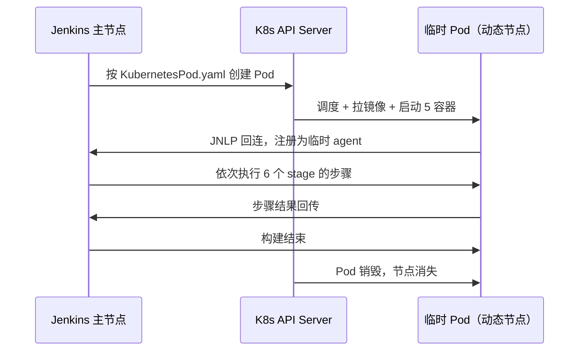

# 34. 项目实战：Jenkins + K8s + SonarQube + MeterSphere 动态代理与 Jenkins 篇总结

## 纲要

- **动态代理是静态代理的演进**：`agent { kubernetes { yamlFile 'KubernetesPod.yaml' } }` 一行配置，把构建节点从「常驻服务器」变成「按需创建的 Pod」
- **Pod 模板即节点定义**：git / golang / kaniko / sonar / kubectl 五个容器住进一个 Pod，三个 volume 分别挂 PVC 缓存、kubeconfig、docker 仓库凭证
- **节点随构建生死**：构建时创建、跑完即毁，Pod 名 = 构建名 + 随机串，Jenkins 自动注入 agent 相关变量
- **container() 精确制导**：每个 stage 的步骤跑在哪个容器里显式指定，容器名与镜像名绑定，改名就是改镜像
- **Kaniko 替代 docker.sock**：无守护进程构建镜像，缓存层用 `--cache-repo` 推到镜像仓库复用
- **Jenkins 篇收官**：SonarQube + MeterSphere 两大质量平台 + 静态/动态两套实战脚本，是必须吃透的压舱石内容

## 一、场景引入：从「养节点」到「叫节点」

前面的静态代理方案有个隐性成本：**你要养这台节点**。装 JDK、建工作目录、配 Docker、配 kubeconfig、盯着磁盘别满、进程挂了手动拉起来——节点本身成了又一个要运维的对象。团队分支一多、构建一并发，就得加机器；加了机器，以上流程再走一遍。

K8s 动态代理把这个模型彻底倒过来：**不留常驻节点，每次构建现造一个 Pod 当代理，构建结束 Pod 自动销毁**。Jenkins 的 Kubernetes 插件负责在集群里按你给的 YAML 模板创建 Pod，Pod 起来后自动注册成临时 agent，流水线步骤在 Pod 的容器里依次执行。

两种方案的正面对比：

| 维度 | 静态代理（#32） | 动态代理（本篇） |
|---|---|---|
| 节点形态 | 常驻服务器 | 按需 Pod，跑完即毁 |
| 环境准备 | 手动装 JDK、建目录、配 kubeconfig | 全在 Pod 模板 YAML 里声明 |
| 工具挂载 | 挂宿主机 `docker.sock`、`/root/.kube` | 挂 Secret（dockerconfig / kubeconfig） |
| 镜像构建 | docker CLI + 守护进程 | Kaniko 无守护构建 |
| 并发扩容 | 加机器、重新注册 | 天然按构建并发扩容 |
| 适用场景 | 构建密集、Pod 启动开销敏感的团队 | 大多数 K8s 落地团队，**本篇方案是当前主流** |

业务脚本几乎不用改——还是克隆、扫描、门禁、构建、部署、接口测试六步，变的只是「节点从哪来」。

## 二、核心概念与原理

### 2.1 一行配置切换底座

```groovy
pipeline {
  agent {
    kubernetes {
      retries 2
      yamlFile 'KubernetesPod.yaml'
    }
  }
  ...
}
```

两个字段：

| 字段 | 值 | 说明 |
|---|---|---|
| `retries` | `2` | Pod 模板运行失败时最多重试 2 次（比如镜像拉取瞬时失败、调度资源不足） |
| `yamlFile` | `'KubernetesPod.yaml'` | **Pod 模板文件的路径**，相对路径基于 Jenkinsfile 所在仓库；同仓库同路径直接写文件名即可 |

`yamlFile` 可以写多个路径，比如同时挂一个公共模板库目录和一个项目私有目录：

```groovy
yamlFile 'KubernetesPod.yaml, tools/pod/common.yaml'
```

这时要在仓库里把不同模板分目录存放——比如公共工具模板放 `tools/pod/` 目录，项目专用模板放仓库根目录，各管各的，互不覆盖。**分目录的前提是仓库里先建好对应文件夹**，路径写了不存在的目录，Jenkins 只会当模板不存在处理，不会替你建。

### 2.2 Pod 模板：五个容器的分工

`KubernetesPod.yaml` 就是一份标准 K8s Pod 定义，但每个容器都 `command: cat` + `tty: true` 挂起待命——它们不是用来干活的，是**被 Jenkins 按需注入步骤执行的「工具货架」**：

```yaml
apiVersion: v1
kind: Pod
spec:
  containers:
  - name: git
    image: registry.cn-hangzhou.aliyuncs.com/tool-bucket/tool:git
    command: ["cat"]
    tty: true
  - name: golang
    image: golang:1.16.5
    command: ["cat"]
    tty: true
  - name: kaniko
    image: gcr.io/kaniko-project/executor:debug
    command: ["/busybox/sh"]
    tty: true
    volumeMounts:
    - mountPath: "/kaniko/.docker"
      name: "dockerconfig-volume"
  - name: sonar
    image: sonarsource/sonar-scanner-cli
    command: ["sleep"]
    args: ["99d"]
    volumeMounts:
    - mountPath: "/opt/sonar-scanner/.sonar/cache"
      name: "volume-0"
  - name: kubectl
    image: registry.cn-hangzhou.aliyuncs.com/tool-bucket/tool:kubectl
    command: ["cat"]
    tty: true
    volumeMounts:
    - mountPath: "/root/.kube"
      name: "kubeconfig-volume"
  volumes:
  - name: "volume-0"
    persistentVolumeClaim:
      claimName: "sonar-cache-pvc"
  - name: "kubeconfig-volume"
    secret:
      secretName: "kubeconfig-secret"
  - name: "dockerconfig-volume"
    secret:
      secretName: "dockerconfig-secret"
```

逐容器拆解：

| 容器名 | 镜像 | 挂起命令 | 挂载 | 职责 |
|---|---|---|---|---|
| `git` | `tool:git` | `cat` | 无 | 克隆代码 |
| `golang` | `golang:1.16.5` | `cat` | 无 | 预留的 Go 编译环境（本篇未直接用到，为扩展准备） |
| `kaniko` | `kaniko-project/executor:debug` | `/busybox/sh` | `/kaniko/.docker` ← dockerconfig-volume | 无守护构建镜像 |
| `sonar` | `sonar-scanner-cli` | `sleep 99d` | `/opt/sonar-scanner/.sonar/cache` ← volume-0 | 代码扫描 |
| `kubectl` | `tool:kubectl` | `cat` | `/root/.kube` ← kubeconfig-volume | 集群部署 |

三个设计细节值得点名：

- **`command: cat` + `tty: true`**：让容器启动后挂起等待标准输入，Jenkins 的 `container('xxx')` 步骤才能把 shell 命令注入进去执行。`sonar` 容器用 `sleep 99d` 是同类手法——保持存活即可。
- **`kaniko` 用 `debug` 变体**：debug 镜像带 busybox，`command: /busybox/sh` 提供了交互式 shell；需要进容器调试时也能通过 TTY 终端进去排查。
- **三个 volume 各司其职**：PVC 管缓存、两个 Secret 管凭证，与静态代理挂宿主机路径一一对应，但**全部声明式化**——换集群只改 YAML，不动节点。

### 2.3 三个 volume：缓存与凭证的容器化

| volume | 来源 | 挂到哪 | 解决什么 |
|---|---|---|---|
| `volume-0` | PVC `sonar-cache-pvc`（1Gi，ReadWriteMany，nfs-client） | sonar 容器的扫描缓存目录 | **扫描缓存持久化**，第二次扫描命中缓存，速度显著加快 |
| `kubeconfig-volume` | Secret `kubeconfig-secret` | kubectl 容器 `/root/.kube` | kubectl 容器拿到操作集群的权限 |
| `dockerconfig-volume` | Secret `dockerconfig-secret` | kaniko 容器 `/kaniko/.docker` | kaniko 构建出的镜像**才有凭证 push 到镜像仓库** |

两个 Secret 的创建方式（都在 **default 命名空间**下创建，因为 Pod 默认跑在 default，Secret 与 Pod 不同命名空间等于没挂）：

```bash
# docker 仓库凭证：把 registry 的 config.json 内容 base64 后放进 Secret
kubectl create secret generic dockerconfig-secret \
  --from-file=config.json=/root/.docker/config.json -n default

# kubeconfig：先 base64 -w 0 编码整个文件，再把结果粘进 Secret 的 config 键
kubectl create secret generic kubeconfig-secret \
  --from-file=config=/root/.kube/config -n default
```

> `base64 -w 0` 的 `-w 0` 是**禁止折行**——K8s Secret 的 data 值必须是单行 base64，默认 76 列换行的输出粘进去会解析失败。这是手写 Secret YAML 时最高频的坑。

### 2.4 动态节点的生命周期



三个可观测特征：

1. **Pod 名带构建编号**：课件里构建名 `build`，第三次构建的 Pod 就叫 `build-3`，后面跟一截随机字符串——**同一构建的重试 Pod 靠随机串区分**。
2. **「节点和云管理」里能看到它**：构建期间 Pod 出现在 cloud（Kubernetes 云）下面，构建完自动消失，这就是「动态」二字的字面含义。
3. **变量自动注入**：Pod 里自动带上 Jenkins 名称、agent 名称等环境变量，脚本里可直接引用，无需手动传递。

## 三、动手实践：动态代理完整脚本拆解

### 3.1 与静态版的三处关键差异

同一套六阶段业务，脚本主体与 #32 高度一致，差异只有三处：

| # | 静态版（#32） | 动态版（本篇） |
|---|---|---|
| 1 | 每个 stage 写 `agent { docker { label 'slave';image '...';args '-v ...' } }` | 顶层一个 `agent { kubernetes { yamlFile 'KubernetesPod.yaml' } }`，**stage 里改用 `container('name')` 选容器** |
| 2 | 镜像构建用 `docker:latest` + 挂 `docker.sock` | 镜像构建用 `container('kaniko')` 跑 `/kaniko/executor` |
| 3 | 部署用 `tool:kubectl` + 挂 `/root/.kube` | 部署用 `container('kubectl')`，kubeconfig 由 Secret 挂载提供 |

### 3.2 完整脚本

```groovy
#!groovy

@Library('jenkins-shared-library@main') _

def tools = new org.color()
def checkout = new org.checkout()

pipeline {

  agent {
    kubernetes {
      retries 2
      yamlFile 'KubernetesPod.yaml'
    }
  }

  parameters {
    choice choices: ['main', 'pre', 'test'], name: 'branch_name'
  }

  options {
    timestamps()
    parallelsAlwaysFailFast()
    timeout(time: 600, unit: 'SECONDS')
    disableConcurrentBuilds(abortPrevious: true)
    buildDiscarder(logRotator(numToKeepStr: '30'))
    skipDefaultCheckout()
  }

  environment {
    String year = new Date().format("yyyy")
    String month = new Date().format("MMdd")
    String day = new Date().format("HHmm")
    String second = new Date().format("ss")
    giturl = "http://gitlab.example.com/golang/go.git"
    images_head = "registry.cn-hangzhou.aliyuncs.com/tool-bucket/tool"
    ImageTag = "${images_head}:${BUILD_USER}-${branch_name}-${year}${month}${day}${second}-${BUILD_TAG}"
  }

  stages {
    stage('1.克隆代码') {
      steps {
        container('git') {
          script {
            tools.PrintMessage("1.克隆代码","blue")
            checkout.scm(branch_name, giturl)
          }
        }
      }
    }
    stage('2.SonarQube扫描') {
      steps {
        container('sonar') {
          script {
            tools.PrintMessage("2.SonarQube扫描","blue")
            withSonarQubeEnv('sonarqube') {
              sh '''
                sonar-scanner \
                -Dsonar.projectKey=test-go \
                -Dsonar.projectName=test-go \
                -Dsonar.projectVersion=test-go-${BUILD_NUMBER} \
                -Dsonar.ws.timeout=30 \
                -Dsonar.sources=. \
                -Dsonar.sourceEncoding=UTF-8
                sleep 3
              '''
            }
          }
        }
      }
    }
    stage("3.质量阀控制"){
      steps {
        container('sonar') {
          script {
            tools.PrintMessage("3.质量阀控制","blue")
            timeout(time: 10, unit: 'SECONDS') {
              def qg = waitForQualityGate('sonarqube')
              if (qg.status != 'OK') {
                error "未通过Sonarqube的代码质量阈检查，请及时修改！failure: ${qg.status}"
              }
            }
          }
        }
      }
    }
    stage('4.构建镜像') {
      steps {
        container('kaniko') {
          script {
            tools.PrintMessage("4.构建镜像","blue")
            sh """
              /kaniko/executor --dockerfile=Dockerfile \
              --destination=${ImageTag} \
              --context=. \
              --cache-copy-layers \
              --cache=true \
              --cache-repo=${images_head}
            """
          }
        }
      }
    }
    stage('5.服务部署') {
      steps {
        container('kubectl') {
          script {
            tools.PrintMessage("5.服务部署","blue")
            sh """
              sed -i "s#image: .*#image: ${ImageTag}#" deploy.yaml
              kubectl apply -f deploy.yaml
            """
          }
        }
      }
    }
    stage('6.MeterSphere接口测试') {
      steps {
        script {
          tools.PrintMessage("6.MeterSphere接口测试","blue")
          meterSphere method: 'testPlan',
          mode: 'serial',
          msAccessKey: '<your-ms-access-key>',
          msEndpoint: 'http://metersphere.example.com:8081/',
          msSecretKey: '<your-ms-secret-key>',
          openMode: 'auth',
          projectId: '<your-project-id>',
          projectType: 'projectId',
          resourcePoolId: '<your-resource-pool-id>',
          testPlanId: '<your-test-plan-id>',
          workspaceId: '<your-workspace-id>'
        }
      }
    }
  }

  post {
    failure {
      script {
        manager.addShortText("${BUILD_NUMBER}次构建! 构建失败!!!")
      }
    }
    success {
      script {
        manager.addShortText("${BUILD_NUMBER}次构建! 构建成功!!!")
      }
    }
    aborted {
      script {
        manager.addShortText("${BUILD_NUMBER}次构建!构建取消!!!")
      }
    }
    always {
      script {
        manager.addShortText("构建用户: ${BUILD_USER}")
      }
    }
  }
}
```

（敏感 AK/SK 与各类 ID 同样以占位符表示，生产中用凭据管理注入。）

### 3.3 `container()` 用法与命名铁律

```groovy
stage('2.SonarQube扫描') {
  steps {
    container('sonar') {          // 本 stage 的所有步骤跑在 sonar 容器里
      script {
        ...
      }
    }
  }
}
```

- `container('sonar')` 里的名字必须与 Pod 模板里 `containers[].name` **一字不差**——写 `container('sonarqube')` 而模板里叫 `sonar`，构建直接报容器不存在。
- **容器名与镜像名绑定**：想把扫描器换成新版本，Pod 模板里 `sonar` 容器的 image 换掉即可，脚本零改动；反之改了脚本里的容器名，模板必须同步改。**改一个地方，另一个地方必须跟上**，这是两文件联动的核心约束。
- 不写 `container()` 的 stage（本篇 stage 6 接口测试）在 Jenkins 自动注入的**默认 jnlp 容器**里执行——它只跑 DSL，不需要任何工具链，所以无所谓。

### 3.4 Kaniko 构建参数逐项

```bash
/kaniko/executor --dockerfile=Dockerfile \
  --destination=${ImageTag} \
  --context=. \
  --cache-copy-layers \
  --cache=true \
  --cache-repo=${images_head}
```

| 参数 | 作用 |
|---|---|
| `--dockerfile=Dockerfile` | 指定构建文件，默认就是 Dockerfile，显式写清更稳 |
| `--destination` | 构建完推送的目标镜像全名（含 tag） |
| `--context=.` | 构建上下文 = 当前工作空间（克隆下来的代码） |
| `--cache=true` | 开启层缓存 |
| `--cache-repo` | **缓存层存到哪个镜像仓库**——Kaniko 把每层以中间镜像形式推到该仓库 |
| `--cache-copy-layers` | 复制已有缓存层而非重新推，命中缓存时构建从分钟级降到秒级 |

与 #27 讲的 Kaniko 基础用法相比，这里多出来的就是 **`--cache-repo` 生产三件套**：没有它每次构建都从第一层开始，Go 项目拉依赖能占到构建耗时的一半以上。

### 3.5 一次完整构建的实景观测

按课件实操流程走一遍，每个阶段该看到什么：

1. **创建 Pod**：点构建后，「节点和云管理」的 Kubernetes 云下出现 `build-3-xxxxx`（构建名 + 编号 + 随机串）——**动态节点上线了**。
2. **克隆代码**：`container('git')` 里执行 `checkout.scm`，日志出现蓝色横幅 `1.克隆代码`。
3. **SonarQube 扫描**：切到 `sonar` 容器，扫描日志滚动；完成后进 stage 3。
4. **质量阀控制**：`waitForQualityGate` 返回 `OK`，放行。
5. **构建镜像**：`kaniko` 容器里 executor 逐层构建，命中 `--cache-repo` 的层直接跳过。
6. **服务部署**：`kubectl` 容器里 `sed` 换标签 + `apply`，K8s 侧 Pod 滚动更新。
7. **接口测试**：DSL 直接跑，MeterSphere 平台出现一次执行记录。
8. **构建结束**：临时 Pod 销毁，「节点和云管理」里 `build-3-xxxxx` 消失——**动态节点下线**。

> 课件实操中的真实提醒：整套流水线跑完要好几分钟，期间任何一步超时（如整体 600 秒上限）都会中止；MeterSphere 阶段失败只染红最后一步，但**流水线判定为失败**，此时要分清是「接口真的挂了」还是「测试计划里的用例配置有问题」——排查方法与 #32 完全一致。

## 四、生产实践要点

### 4.1 Pod 模板的工程化

- **镜像版本全锁定**：`golang:1.16.5` 这种精确 tag 是对的，但生产上建议连 `tool:git`、`tool:kubectl` 也锁版本，**杜绝 `latest` 漂移导致的「昨天还能构建今天挂了」**。
- **资源请求必须加**：模板没写 `resources.requests/limits`，Pod 会落进 burstable QoS，节点压力大时第一个被驱逐。Go 编译容器建议 `requests: {cpu: 500m,memory: 1Gi}` 起步。
- **ServiceAccount 最小权限**：Pod 默认用 default SA，生产给 Jenkins 动态 Pod 单独建 SA，只授「在工作命名空间创建 Pod」的权限，别图省事给 cluster-admin。
- **yamlFile 多路径策略**：公共模板（kaniko/sonar 版本升级全团队统一）放独立仓库目录，项目模板放业务仓库；升级工具链只动一处。

### 4.2 缓存与凭证的运维

| 对象 | 运维要点 |
|---|---|
| `sonar-cache-pvc` | 1Gi 是课件值；大 monorepo 建议 5Gi+。用 NFS 是因为要 ReadWriteMany——**同一份缓存要被多个并发构建 Pod 共享**，本地 PV 做不到 |
| `kubeconfig-secret` | CI 账号只读 + 限命名空间；定期轮换，轮换后**正在排队的构建会拿到旧凭证**，轮换选低峰 |
| `dockerconfig-secret` | 与镜像仓库账号绑定；仓库密码轮换时 Secret 必须同步，否则 kaniko push 阶段才报 401，白构建几分钟 |

### 4.3 动态代理的成本账

- **Pod 启动 5~15 秒**（拉镜像 + JNLP 回连）：小项目频繁构建时这是纯增量开销，可接受；**超高频构建（分钟级多次）**才值得回退静态代理或混合部署。
- **镜像预拉取**：给节点配 `imagePullSecrets` + 节点上 `kubeadm` 层面预拉常用工具镜像，能把启动压到 3 秒内。
- **并发上限 = 集群余量**：动态代理的并发不再是「节点执行数 10」这种硬编码，而是集群能调度多少 Pod；**务必给 Jenkins 云配 `containerCap`**，否则一次 mass push 能把集群打满。

## 五、报错排查表

| 现象 | 根因 | 解法 |
|---|---|---|
| `container 'sonar' does not exist` | 脚本 `container()` 名与 Pod 模板容器名不一致 | 核对两边 `name` 字段，一字不差对齐 |
| kaniko push 阶段 `unauthorized: authentication required` | `dockerconfig-secret` 缺失 / 不在 Pod 所在命名空间 / 仓库密码已轮换 | 确认 Secret 在 **default** 命名空间且 base64 单行；核对阿里云账号密码 |
| `kubectl apply` 报 `connection refused` 或无权限 | `kubeconfig-secret` 没挂上，或 kubeconfig 内容 base64 折行了 | 用 `kubectl create secret --from-file` 重建；手写 YAML 时确认 `base64 -w 0` |
| Pod 卡在 `ContainerCreating` | 镜像拉不下来（`gcr.io` 等境外源）或 PVC 未绑定 | 境外镜像走私有仓库同步；确认 `sonar-cache-pvc` 状态 Bound |
| 动态节点不出现，「云」里空 | Kubernetes 插件没配云 / kubeconfig 不对 / SA 权限不足 | 系统配置里配 Kubernetes 云，测试连接；给 SA 授 Pod 创建权 |
| Secret 创建报 `illegal base64 data` | base64 输出折行（缺 `-w 0`） | `base64 -w 0 file` 重新编码，单行粘贴 |
| 构建间歇性失败、Pod 随机消失 | 没写 resources limits 被驱逐 / 节点压力 | 模板补 resources；给 Jenkins 云设 containerCap |
| 扫描每次都很慢 | 没用 PVC 缓存或 `--cache-repo` 没配 | PVC 挂上扫描缓存目录；kaniko 加缓存三件套 |

## 六、面试考点与追问

**Q1：动态代理相比静态代理的本质优势是什么？**
环境即代码（Pod 模板 YAML 声明一切）、弹性（并发 = 集群余量）、卫生（每次构建全新环境，无残留污染）。代价是每次构建多出 Pod 启动开销，超高频构建场景要权衡。

**Q2：`agent { kubernetes { yamlFile ... } }` 的执行流程？**
Jenkins 读 Jenkinsfile 时先拉取 yamlFile 指向的模板 → 按模板向 K8s API 申请 Pod → Pod 内 JNLP 容器回连主节点注册为 agent → 各 stage 按 `container()` 注入步骤执行 → 构建结束 Pod 销毁。`retries` 控制的是「模板运行失败」的重试次数。

**Q3：为什么 Pod 模板里每个容器都是 `command: cat` + `tty: true`？**
让容器启动后挂起待命而非退出。Jenkins 的 `container()` 步骤通过 exec 把命令注入指定容器执行，容器必须先活着；`sleep 99d` 是同类挂起手法。

**Q4：kaniko 为什么不需要 docker.sock？它和挂 sock 的方案比优劣？**
Kaniko 在容器内**以非 root 方式逐行解析 Dockerfile 并构建文件系统层**，直接推送到 registry，不经过守护进程。优势是无特权、无 sock 暴露（安全）、K8s 原生；劣势是构建缓存要显式配 `--cache-repo`，且某些依赖 dockerd 的构建（如 docker-compose）不适用。

**Q5：`--cache-repo` 的原理？**
Kaniko 把每一层构建结果作为中间镜像 tag 推到指定仓库；下次构建时先拉这些层做基比对，未变动的层直接复用，省去重新执行 RUN 的时间。大项目配合 `--cache-copy-layers` 效果最明显。

**Q6：Secret 为什么要和 Pod 同命名空间？base64 `-w 0` 为什么重要？**
K8s Secret 只在所属命名空间内可被 Pod 引用，跨命名空间挂载直接失败；`base64` 默认 76 列折行，Secret data 值必须是单行，折行内容会被当成非法 base64 拒绝。

**Q7：Jenkins 篇两大质量平台（SonarQube / MeterSphere）在流水线里各自守住什么？**
SonarQube 守**静态质量**——代码坏味道、漏洞、重复率，在合并前拦截；MeterSphere 守**动态行为**——部署后接口真的可用，在上线前拦截。一个管「写得对不对」，一个管「跑得通不通」，位置上前者在镜像构建前、后者在部署后。

## 七、Jenkins 篇课程总结

本篇同时也是前述「Jenkins 企业级实战」的收官。回看整章，知识骨架是三块：

1. **质量平台双雄**：部署 SonarQube（含 LDAP 接入、质量门禁、权限令牌）与 MeterSphere（部署、用例定义、Jenkins 集成），并完成 Jenkins 对 Go 代码的扫描打通。
2. **静态代理实战**：`Jenkins + Docker + SonarQube + MeterSphere`，工具全在容器、凭证全在节点（#32）。
3. **动态代理实战**：`Jenkins + K8s + SonarQube + MeterSphere`，节点即 Pod、环境全声明（本篇）。

两个实战脚本——**静态流水线与动态流水线——是本章必须吃透的压舱石**。它们的价值不止于「跑通过」，更在于给你一个可以持续打磨的基线：

- 把脚本带回自己的项目，对照每个 stage 问一遍「这一步在我的技术栈里对应什么」；
- 找出课件脚本里可以优化的点——比如时间变量命名误导、`docker:latest` 未锁版本、MeterSphere 的 AK/SK 未走凭据管理；
- 在现有骨架上做增量：加缓存、加通知、加审批门（#17 的 input 语法）、把 `sed` 换 Helm。

Jenkins 篇到此结束。下面进入云原生 CI 工具 **Tekton**——同样是「用 K8s 自定义资源定义流水线」，但路线完全相反：Jenkins 是「CI 系统跑在 K8s 上」，Tekton 是「CI 流水线本身就是 K8s 资源」。

## 📎 文本↔代码关联

| 代码文件 | 正文提及 | 内容 |
|---|---|---|
| `code/5-实战-Jenkins/Jenkinsfile/Jenkinsfile-K8S动态代理实战` | 3.2 完整脚本 | 动态代理六阶段全量脚本：kubernetes agent + yamlFile + retries 2、container() 分容器执行、kaniko 缓存构建 |
| `code/5-实战-Jenkins/Jenkinsfile/KubernetesPod.yaml` | 2.2 / 2.3 | Pod 模板：git/golang/kaniko/sonar/kubectl 五容器 + 三 volume（PVC 缓存 / kubeconfig / dockerconfig） |
| `code/5-实战-Jenkins/secret/docker-config.yaml` | 2.3 / 4.2 | `dockerconfig-secret`：阿里云仓库 config.json 的 base64 密文，kaniko 挂载后才能 push |
| `code/5-实战-Jenkins/secret/kube-config.yaml` | 2.3 / 4.2 | `kubeconfig-secret`：kubeconfig 单行 base64，kubectl 容器挂载后获得集群操作权 |
| `code/5-实战-Jenkins/shared-library/src/org/color.groovy` | 3.2 | `PrintMessage` 彩色横幅，六阶段各调用一次 |
| `code/5-实战-Jenkins/shared-library/vars/log.groovy` | 3.2 | `info()` / `warning()` 全局日志函数 |

**技术点总结**：动态代理用一行 `agent { kubernetes { yamlFile } }` 把构建底座换成 K8s Pod，Pod 模板五容器各司其职，PVC 持久化扫描缓存、双 Secret 分别供奉 kubeconfig 与镜像仓库凭证，`container()` 把步骤精确派发到目标容器，Kaniko 凭 `--cache-repo` 三件套实现无守护高效构建。配合前面的静态代理，Jenkins 篇的「质量平台 + 两套实战」全部收官——这两个脚本就是后续所有 Jenkins 工作的基线模板。

