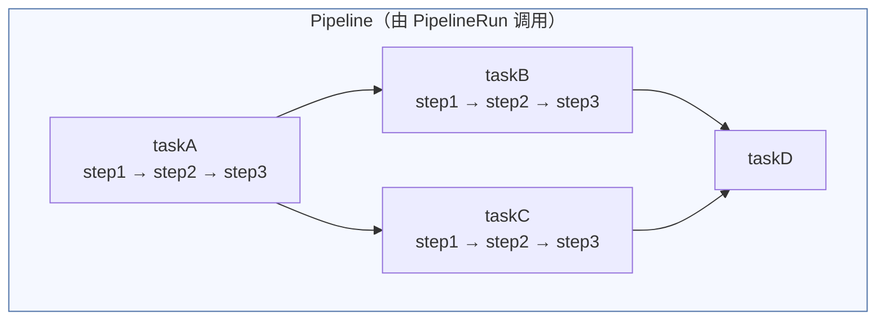
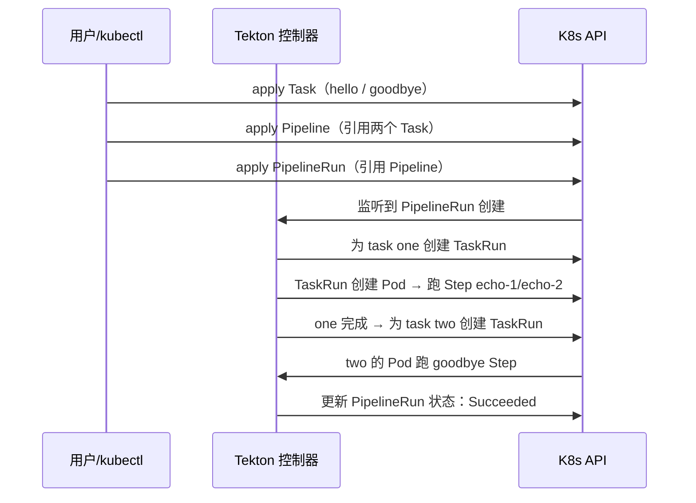
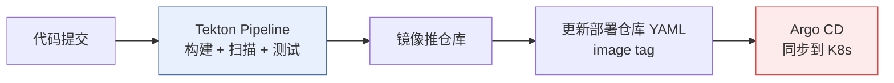

# 35. Tekton 快速入门：核心概念与基础夯实

## 纲要

- **Tekton 是 K8s 原生的 CI/CD 框架**：流水线的每个组件——Task、Pipeline、TaskRun、PipelineRun——都是 K8s 自定义资源（CRD），用 YAML 声明，`kubectl` 管理
- **学习前置只有一条：先会 K8s**。Tekton 不是独立系统，它是 K8s 的扩展，不懂 Pod、CRD、命名空间，后面每一节都会卡壳
- **四级资源模型是骨架**：Task（一个 Pod）→ Step（一个容器）→ TaskRun（运行 Task）；Pipeline（多个 Task 组合）→ PipelineRun（运行 Pipeline，自动创建 TaskRun）
- **执行语义两条铁律**：Task 内 Step 严格串行、前一个失败后全部终止；Pipeline 内 Task 默认串行，显式配置 `runAfter` 才并行，并行分支全部完成才继续
- **与 Jenkins 的本质差异**：Jenkins 是「装进 K8s 的 CI 系统」，Tekton 是「CI 流水线本身就是 K8s 资源」——没有中心服务器，只有资源和控制器
- **生态定位**：Tekton 管 CI（构建、测试），与后面的 Argo CD 管 CD（部署）组成云原生 CI/CD 双壁

## 一、场景引入：当流水线变成 K8s 的一种资源

 Jenkins 的世界里，流水线是「一个系统里的配置」——要装主节点、装插件、配凭据、养从节点。到了 K8s 环境，这套「重型外设」越来越别扭：构建节点要么常驻浪费、要么动态 Pod 依赖 Jenkins 插件拼装，流水线定义本身也逃不出 Groovy DSL 的语法糖。

Tekton 换了个彻底思路：

> **流水线的每个组件，都是 K8s 的一种自定义资源（CRD）。** Task 是资源，Pipeline 是资源，连「运行一次流水线」都是资源（PipelineRun）。没有需要安装的 CI 服务器，只有 `kubectl apply` 上去的一堆 YAML，和背后默默干活的一套控制器。

这意味着：

- **声明式一切**：会写 K8s YAML 就会写 Tekton，没有第二套语法；
- **`kubectl get taskrun` 就能看构建历史**，构建记录和 Pod、Service 一样是集群的一等公民；
- **弹性即集群弹性**：每个 Task 跑成一个 Pod，K8s 的调度、资源限制、命名空间隔离全部天然继承。

本章（前述）就是把这个模型从零讲透：概念与架构 → 部署 → Task 运行 → Pipeline 组合 → 参数与工作空间 → 数据持久化 → 触发器 → 项目实战。本篇打地基：**把四级资源模型和执行语义吃透**。

## 二、核心概念与原理

### 2.1 Tekton 是什么：三个定位

| 定位 | 解释 |
|---|---|
| 开源框架 | CNCF 社区项目，供应商中立，不是某家云平台的私有组件 |
| K8s 的扩展 | 通过 CRD 扩展 K8s API，`kubectl apply` 即安装流水线，不引入集群外的系统 |
| CI/CD 专用 | 只解决「构建、测试、交付流水线」，**不试图做项目管理、制品库、告警中心**——干一件事，干好 |

为什么值得学（按课程给出的动机排序）：

1. **与 K8s 紧密集成**：任务即 Pod，调度、隔离、弹性白拿；
2. **声明式配置**：一份 YAML 走天下，简洁、美观、易维护——对比 Jenkins 要装多个插件、在多个界面点多个配置，Tekton 的「一个 YAML 一个资源」心智负担低得多；
3. **可扩展性与灵活性**：Step 就是容器，任何能容器化的工具都能进流水线；
4. **社区活跃、企业采用多**：云原生 CI 的事实标准之一；
5. **与 Argo CD 天然互补**：**Tekton 负责 CI（把代码变成镜像），Argo CD 负责 CD（把镜像部署进集群）**，两者共享 K8s 声明式模型，组成后两章的主线。

### 2.2 资源模型：Task / Step / TaskRun

先建立最小组装单位：

```text
Task ──定义──> 一个 Pod
Pod 内含 1~N 个 Step
一个 Step = 一个容器
```

- **Task**：一个任务，运行起来就是一个 Pod。比如「克隆代码」是一个 Task。
- **Step**：Task 内的步骤，**一个 Step 对应一个容器**。一个 Task 可以有多个 Step——比如「克隆代码」Task 里：Step 1 用 `git` 镜像执行克隆；Step 2 用 `alpine` 镜像执行 `ls -la` 验证代码是否真的拉下来了。
- **TaskRun**：Task 的「运行实例」。定义了 Task 不会自己跑，**必须有一个 TaskRun 引用它**，就像「类」与「实例」。

看一份真实的 Task 定义（课件 `6-Tekton/task/hello-task.yaml`）：

```yaml
apiVersion: tekton.dev/v1beta1
kind: Task
metadata:
  name: hello
spec:
  steps:
    - name: echo-1
      image: alpine
      script: |
        #!/bin/sh
        echo "Hello alpine"
    - name: echo-2
      image: alpine
      script: |
        #!/bin/sh
        echo "Hello alpine:3.16"
```

逐字段：

| 字段 | 值 | 说明 |
|---|---|---|
| `apiVersion` | `tekton.dev/v1beta1` | Tekton 资源的组/版本，v1beta1 是当前课件所用版本 |
| `kind` | `Task` | 资源类型，还有 `Pipeline` / `TaskRun` / `PipelineRun` 等 |
| `metadata.name` | `hello` | Task 名，TaskRun 靠这个名字引用 |
| `spec.steps` | 两个 step | **Step 的核心是 `image` + `script`**：用哪个镜像、跑什么脚本 |

注意这里没有 `command`/`args`——Tekton 的 Step 用 `script` 字段直接写 shell 脚本，Tekton 控制器负责把它包成带 shebang 的入口脚本塞进容器执行。`image` 没写 `imagePullPolicy` 时默认 `IfNotPresent`（课件 `goodby-task.yaml` 里显式写了这个值，效果相同）。

对应的 TaskRun（课件 `6-Tekton/taskrun/hello-taskrun.yaml`）：

```yaml
apiVersion: tekton.dev/v1beta1
kind: TaskRun
metadata:
  name: hello-task-run-2
spec:
  taskRef:
    name: hello
```

三行核心：`taskRef.name: hello` ——「运行名为 hello 的 Task」。`apply` 这份 YAML，Tekton 控制器就会创建一个 Pod，Pod 里按顺序跑 echo-1、echo-2 两个 Step。

### 2.3 资源模型：Pipeline / PipelineRun

Task 之上是 Pipeline：

```text
Pipeline ──定义──> 多个 Task 的组合（引用已有 Task）
PipelineRun ──运行──> Pipeline，并自动为每个 Task 创建 TaskRun
```

课件 `6-Tekton/pipeline/pipeline1-hello-goodby.yaml`：

```yaml
apiVersion: tekton.dev/v1beta1
kind: Pipeline
metadata:
  name: pipeline-hello-goodbye
spec:
  tasks:
    - name: one
      taskRef:
        name: hello
    - name: two
      taskRef:
        name: goodbye
```

Pipeline 的 `spec.tasks` 是个列表，每个元素两件事：**这个 Task 在流水线里的名字**（`one`/`two`，可自定义）和**引用哪个 Task**（`taskRef.name`）。引用意味着复用——`hello` 和 `goodbye` 是独立 apply 的 Task 资源，Pipeline 只是按顺序编排它们。

**PipelineRun 的自动化红利**是关键设计：

> 单独跑 Task，要先创建 TaskRun；但 Task 放进 Pipeline 后，**只需要创建 PipelineRun，Tekton 会自动为 Pipeline 里的每个 Task 创建 TaskRun**，不需要再手动声明。

这就是「PipelineRun 运行 Pipeline，Pipeline 自动派生 TaskRun，TaskRun 运行 Task」的三级传递。

### 2.4 三种运行方式：CLI / 声明式 / Dashboard

Tekton 的「运行」入口有三个，适用不同场景：

| 方式 | 操作 | 适用场景 |
|---|---|---|
| **tkn 命令行** | `tkn taskrun start hello` 等 | 终端快速测试，**一般用于开发调试** |
| **声明式 YAML** | `kubectl apply -f taskrun.yaml` | GitOps、CI 触发、生产标准姿势 |
| **Dashboard UI** | 网页点选运行 | 演示、非技术人员手动触发 |

三者最终都是「创建一个 Run 资源」，殊途同归。本章先用手动 apply + `kubectl logs` 观察，部署（#35）完成后就有 Dashboard 可点了。

### 2.5 执行语义：两条铁律

**铁律一：Task 内 Step 严格串行。**

Pod 内容器从第一个开始依次执行：Step 1 完成才启动 Step 2。**任何一个 Step 失败，整个 Task 失败，流水线从该处终止**，后面的 Step 不再执行。

**铁律二：Pipeline 内 Task 默认串行，显式声明才并行。**

未加任何依赖声明时，Task 按列表顺序一个个跑。课件的完整架构展示了一个更真实的形态：



执行规则：

- **taskA 先跑**：内部三个 Step 串行，任一失败全流水线终止；
- **taskB 与 taskC 并行**：两者互不依赖、同时执行，**各自内部仍按 Step 串行**；B 或 C 任一 Step 报错，整个流水线照样终止；
- **taskD 等 B、C 都完成**才启动。

用一句话记忆：**Step 之间永远串行，Task 之间默认串行、可配并行，失败一律全局终止**。（并行的显式配置是 `runAfter` 的反面——不依赖即并行，后续 #38 会专门讲执行方式控制。）

### 2.6 运行流程全景：从 YAML 到 Pod



单个 Task 的独立路径则是：`apply Task` → `apply TaskRun` → 控制器建 Pod → 跑 Step → TaskRun 状态更新。**两条路径共享同一套「Run 驱动 Pod」的控制器逻辑**，只是 Pipeline 路径多了一层自动派生。

## 三、动手实践：跑通第一个 Task 与 Pipeline

环境前提：一个可用的 K8s 集群 + `kubectl`（Tekton 本体的部署是 #35 的内容，这里假定已装好）。所有 YAML 都在课件 `code/6-Tekton/` 下。

### 3.1 第一步：apply 两个 Task

```bash
kubectl apply -f task/hello-task.yaml
kubectl apply -f task/goodby-task.yaml

# 确认落地
kubectl get task
# NAME      AGE
# hello     10s
# goodbye   10s
```

### 3.2 第二步：单独运行 hello（TaskRun 路径）

```bash
kubectl apply -f taskrun/hello-taskrun.yaml

# 看 TaskRun 状态
kubectl get taskrun
# NAME               SUCCEEDED   REASON
# hello-task-run-2   True        Succeeded

# 看 Pod 和日志
kubectl get pods
# hello-task-run-2-pod-xxxxx   1/2   Running   ...

kubectl logs -f hello-task-run-2-pod-xxxxx -c step-echo-1
# Hello alpine
kubectl logs hello-task-run-2-pod-xxxxx -c step-echo-2
# Hello alpine:3.16
```

三个观测点：

1. **Pod 名 = TaskRun 名 + `-pod-` + 随机串**，与 TaskRun 生命周期绑定；
2. **容器名 = `step-` + Step 名**（`step-echo-1`、`step-echo-2`），`kubectl logs -c` 按 Step 名取日志；
3. **`SUCCEEDED: True`** 是 TaskRun 的终态，False 时 `kubectl describe taskrun` 看 Events。

### 3.3 第三步：组合成 Pipeline 并运行

```bash
kubectl apply -f pipeline/pipeline1-hello-goodby.yaml

# 手动创建 PipelineRun（课件后续会给出专门的 pipelinerun YAML，这里用 tkn 快捷方式演示）
tkn pipeline start pipeline-hello-goodbye --showlog
```

观察自动派生：

```bash
kubectl get taskrun
# 能看到两个 TaskRun：pipeline-hello-goodbye-xxx-one、...-two
# 前者 Succeeded 后后者才出现——串行语义的直接证据
```

### 3.4 命名空间：最容易被忽视的约束

Tekton 所有资源都活在命名空间里，且**引用关系不能跨命名空间**：

> Task 部署在 `tekton-app` 命名空间，引用它的 TaskRun 也必须定义在 `tekton-app`；Pipeline 引用 Task 同理；PipelineRun 引用 Pipeline 同理。

```bash
# 错误示范：Task 在 tekton-app，TaskRun 在 default
kubectl apply -f taskrun.yaml   # 报错：task.tekton.dev "hello" not found
```

部署整套资源时保持「同命名空间 apply」即可，多环境（dev/test/prod）用不同命名空间隔离，这也是 Tekton 多环境管理的基本手法。

## 四、生产实践要点

### 4.1 Tekton 与 Jenkins 的选型对照

| 维度 | Jenkins | Tekton |
|---|---|---|
| 部署形态 | 中心服务器 + 从节点 | 无服务器，纯 K8s 资源 |
| 流水线定义 | Groovy Jenkinsfile | YAML（Task/Pipeline） |
| 环境隔离 | 插件 + 节点管理 | 每 Task 一个 Pod，天然隔离 |
| 权限管控 | RBAC 插件矩阵 | **基本没有**（课件原话：官网没做资源管控） |
| 触发方式 | Webhook/轮询 | Trigger 资源（#42 讲） |
| 适用 | 非 K8s 环境、遗留虚拟机部署 | K8s 原生团队、云原生流水线 |

课件点出的 Tekton 短板要正视：**资源管控弱**——Tekton 能帮你自动构建，但「谁能构建什么、构建到哪个环境」这套审批与权限，Tekton 自己不做。落地方案是：**Tekton 只负责构建，部署交给 Argo CD 这类带审核能力的 CD 工具**（部署工具里可以加人工审批、环境门禁），职责边界切干净。

### 4.2 目录与版本管理

- **YAML 全部入 Git**：Tekton 资源就是代码，Task/Pipeline/PipelineRun 分目录存放，改动走 MR review；
- **apiVersion 锁定**：`tekton.dev/v1beta1` 是课件基线，升级集群时关注 Tekton 版本的 CRD 变更（v1 已逐步 GA），批量升级前先在一个命名空间灰度；
- **镜像 tag 精确化**：Step 里 `image: alpine` 这种写法课件用来演示没问题，生产一律锁版本或 digest，否则「同样的 YAML，不同的行为」。

### 4.3 与 Argo CD 的分工预告

本章最后几节会讲到「应用部署」，但完整姿势在前面：



Tekton 产出镜像、Argo CD 消费镜像，中间用 Git 仓库做「声明式交接」——这就是后两章的完整故事线。

## 五、报错排查表

| 现象 | 根因 | 解法 |
|---|---|---|
| `apply` 报 `unable to recognize "...": no matches for kind "Task"` | Tekton 未安装 / 装在别的命名空间 | 先完成 Tekton Pipeline 部署（#35），确认 CRD 存在：`kubectl get crd | grep tekton` |
| TaskRun 报 `task.tekton.dev "hello" not found` | 跨命名空间引用，或 Task 没 apply | Task 与 TaskRun 放同一命名空间；先 `kubectl get task` 确认存在 |
| Pod 卡在 `ImagePullBackOff` | 镜像拉不下来（境外源 / tag 不存在） | 换可达镜像或同步到私有仓库；精确 tag |
| Step 报 `permission denied` | script 无执行位 / 镜像无 shell | Tekton 会自动处理 shebang；确认镜像里有 `/bin/sh`，alpine 默认有 |
| TaskRun `SUCCEEDED: False` 但 Pod 已结束 | 脚本退出码非 0 | `kubectl logs <pod> -c step-xxx` 看具体 Step 输出；`describe taskrun` 看 Events |
| PipelineRun 不创建 TaskRun | Pipeline 里 `taskRef` 指向不存在的 Task / 命名空间不一致 | 核对 Pipeline 的 taskRef.name 与 Task 名、命名空间 |
| `tkn` 命令不存在 | CLI 未安装 | 按 #35 安装 tkn 到 /usr/local/bin |
| 并行 Task 没有并行 | 没有显式去掉依赖/配 `runAfter` | Tekton 中 Task 默认按列表顺序串行，并行需显式声明（#38） |

## 六、面试考点与追问

**Q1：Tekton 的 Task、Step、TaskRun 分别对应 K8s 的什么？**
Task 定义一次运行 = 一个 Pod；Step = Pod 内的一个容器（Tekton 会把 script 包成入口命令）；TaskRun = Task 的运行实例资源，由控制器驱动创建 Pod。

**Q2：PipelineRun 和 TaskRun 的关系？**
PipelineRun 运行 Pipeline，Tekton 控制器自动为 Pipeline 中的每个 Task 创建 TaskRun；Task 单独运行时才需要手写 TaskRun。所以「跑 Pipeline 只需要 apply 一个 PipelineRun」是 Tekton 的自动化红利。

**Q3：Tekton 有几种运行流水线的方式？**
三种：`tkn` 命令行（快捷，多用于测试）、声明式 apply PipelineRun（生产/GitOps 标准姿势）、Dashboard UI 点击运行（演示用）。

**Q4：Task 内的 Step 是什么执行关系？失败会怎样？**
严格串行：Step 1 完成才启动 Step 2；任一 Step 失败，该 Task 失败，整个流水线从该步骤终止，后续不再执行。

**Q5：Pipeline 内的 Task 如何实现并行？默认是什么行为？**
默认按列表顺序串行执行；要并行需显式声明依赖关系（去掉前置依赖或用 `runAfter` 编排），两个互不依赖的 Task 会被同时调度。并行分支全部完成后，后续 Task 才继续。

**Q6：为什么学 Tekton 前必须先会 K8s？**
Tekton 没有自己的运行时——Task 跑成 Pod、Run 资源靠控制器循环 reconcile、资源按命名空间隔离，全部复用 K8s 原语。不懂 Pod/CRD/命名空间，连「为什么 TaskRun 找不到 Task」这类基础问题都定位不了。

**Q7：Tekton 和 Jenkins 的核心差异？Tekton 适合什么场景？**
Jenkins 是「跑在某处的 CI 系统」（可装进 K8s），Tekton 是「CI 流水线即 K8s 资源」。Tekton 适合 K8s 原生团队：无服务器要养、环境即代码、弹性靠集群；权限管控弱是短板，需搭配 Argo CD 等 CD 工具补上部署审批。

**Q8：Tekton 与 Argo CD 在云原生 CI/CD 里的分工？**
Tekton 负责 CI：拉代码、扫描、测试、构建镜像、推仓库；Argo CD 负责 CD：监听 Git 仓库的部署 YAML、同步到集群、可回滚可审计。两者以「镜像 + Git 声明」为交接面。

## 📎 文本↔代码关联

| 代码文件 | 正文提及 | 内容 |
|---|---|---|
| `code/6-Tekton/task/hello-task.yaml` | 2.2 / 3.1 | `hello` Task：两个 alpine Step（echo-1 / echo-2），演示「一个 Task 多个 Step」 |
| `code/6-Tekton/task/goodby-task.yaml` | 2.2 / 3.1 | `goodbye` Task：ubuntu 镜像单 Step，显式 `imagePullPolicy: IfNotPresent` |
| `code/6-Tekton/taskrun/hello-taskrun.yaml` | 2.2 / 3.2 | `hello-task-run-2`：最小 TaskRun，`taskRef.name: hello` 引用运行 |
| `code/6-Tekton/pipeline/pipeline1-hello-goodby.yaml` | 2.3 / 3.3 | `pipeline-hello-goodbye`：两个 Task 顺序组合，Pipeline 最简形态 |

**技术点总结**：Tekton 把「流水线」拆成 K8s 资源——Task 定义 Pod 模板、Step 是容器、TaskRun/PipelineRun 是运行实例，Pipeline 编排多个 Task 且运行 PipelineRun 时自动派生 TaskRun。执行语义就两条：Step 严格串行、失败全局终止；Task 默认串行、显式声明才并行。记住「资源全部按命名空间隔离、引用不可跨命名空间」，这套模型就从入门到立住了。

