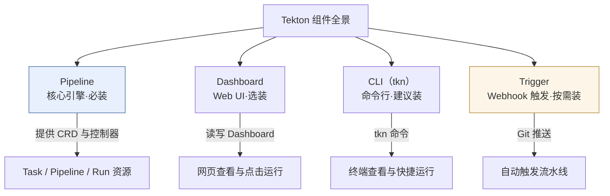

# 36. Tekton 部署到 K8s 集群：四大组件一次装齐

## 纲要

- **部署不是一条命令，是四大组件**：Pipeline（流水线引擎，必装）、Dashboard（Web 界面，选装）、CLI（`tkn` 命令行，强烈建议装）、Trigger（触发器，用到 Webhook 时再装）
- **官方安装姿势统一为 `kubectl apply` 官方 release YAML**，Pipeline 与 Dashboard 都落在 `tekton-pipeline` 命名空间
- **Dashboard 的读写权限是个分水岭**：加 `--read-right`（read-write 参数）才能在网页上点击运行流水线，默认只读装法只能看不能点
- **CLI 装到 `/usr/local/bin`**：`tkn` 是开发期神器，查看运行状态、快捷启动 TaskRun/PipelineRun 都靠它，但**生产触发不要依赖它**
- **网络是最大的坑**：组件镜像来自境外 Google 容器源，国内集群要么自备加速、要么离线打包，装到一半 `ImagePullBackOff` 是常态
- **Dashboard 默认 NodePort 32012**：可自行改 Ingress 或 LB 暴露；界面里能看 Pipeline/PipelineRun/Task/TaskRun，触发器相关资源单独装后才出现
- **权限短板要认清**：Tekton 只做构建不做资源管控，部署与审批交给专门的 CD 工具（Argo CD），这是架构分工不是缺陷

## 一、场景引入：概念都懂了，先把系统装上

前面把 Tekton 的四级资源模型（Task / Pipeline / TaskRun / PipelineRun）讲透了，但那些 YAML `apply` 上去之前，集群里得先有「认识 Tekton 资源的控制器」。本篇就是干这件事——**把 Tekton 全家桶装上集群**。

先建立组件地图，避免装错装漏：



四个组件各自的定位：

| 组件 | 作用 | 装不装 |
|---|---|---|
| **Pipeline** | 提供全部 CRD + 控制器，`kubectl apply` 的 Task/Pipeline 能跑起来全靠它 | **必装，没它一切免谈** |
| **Dashboard** | Web 界面，可视化查看 Pipeline/Task 运行、点按钮触发构建 | 选装，团队非 K8s 人员要用就装 |
| **CLI** | `tkn` 命令：查看运行情况、快捷启动 TaskRun/PipelineRun | 建议装，开发测试期效率翻倍 |
| **Trigger** | 监听 Git 仓库 Webhook，推送代码自动运行流水线（对标 Jenkins 的 Webhook 自动触发） | 用到自动触发再装（#42 详解） |

> 注意 Dashboard 里那些「事件监听、触发器、触发器绑定」菜单，**只有在单独装了 Trigger 组件后才会出现**——没装之前界面里看不到是正常的，不是装坏了。

## 二、动手实践：四步装完全家桶

环境前提：一个能 `kubectl` 连上的 K8s 集群。以下命令均来自 Tekton 官方安装文档。

> ⚠️ **国内环境可达性（本篇三个下载源全部在境外，照抄必卡）**
>
> | 官方源 | 国内症状 | 替代方案 |
> | --- | --- | --- |
> | `storage.googleapis.com/tekton-releases/...` | 连接超时 | ① 先 `wget` 到能出网的跳板机再 `kubectl apply -f release.yaml`；② 换国内镜像站同步的 release YAML（如各云厂商开源镜像站收录的 tekton pipeline 版本） |
> | `github.com/tektoncd/cli/releases/download/...` | 下载极慢/中断 | 用 `gh-proxy.com` 前缀，或走包管理器（Debian 系部分发行版源里有 `tkn`） |
> | `ghcr.io` / `gcr.io` 系列镜像 | 拉取失败 | 配 **镜像加速器**（见文末 `_OPS_NOTES.md` 的镜像加速总表），或提前 `docker pull` + `docker save/load` 导入离线镜像 |
>
> **离线环境标准打法**：能出网的机器上把 release YAML 与镜像一次性拖回，YAML 本地 apply、镜像 `docker load` 进各节点（或推到内网 Harbor，再把 YAML 里的 `image:` 批量 `sed` 成内网地址）。

### 2.1 第一步：安装 Pipeline（核心引擎）

```bash
# 官方 release YAML 一键安装
kubectl apply -f https://storage.googleapis.com/tekton-releases/pipeline/previous/v0.50.0/release.yaml

# 验证：所有 Pod 就绪
kubectl get pods -n tekton-pipeline
# NAME                                           READY   STATUS    RESTARTS   AGE
# tekton-pipelines-controller-xxxxx              1/1     Running   0          30s
# tekton-pipelines-webhook-xxxxx                 1/1     Running   0          30s
```

装在 **`tekton-pipeline`** 命名空间。控制器起来后，集群里就多了一批 `tekton.dev` 组的 CRD：

```bash
kubectl get crd | grep tekton
# pipelines.tekton.dev
# pipelineruns.tekton.dev
# tasks.tekton.dev
# taskruns.tekton.dev
# ...
```

`kubectl apply -f task.yaml` 不再报 `no matches for kind`，就成了。

### 2.2 第二步：安装 Dashboard（Web 界面）

```bash
# read-write 参数 = 页面可读写（能点击运行流水线）
kubectl apply -f https://storage.googleapis.com/tekton-releases/dashboard/previous/v0.34.0/tekton-dashboard-release.yaml --read-right

kubectl get pods -n tekton-pipeline | grep dashboard
# tekton-dashboard-app-xxxxx    1/1   Running   0   20s
```

⚠️ **`--read-right` 这个参数是权限分水岭**：

- 不加：Dashboard 是**只读**模式，能看流水线运行状态，但**不能在页面上点击触发构建**；
- 加：读写模式，页面上的「创建 TaskRun/PipelineRun」按钮才可用。

课件特意强调这一点，是因为默认安装方式只给只读权限，而团队演示、手动触发场景必须要能点。同样装在 `tekton-pipeline` 命名空间。

Dashboard 的 Service 默认类型与端口：

```bash
kubectl get svc -n tekton-pipeline tekton-dashboard
# NAME                TYPE       PORT(S)         AGE
# tekton-dashboard    NodePort   32012:30000/TCP  1m
```

- **NodePort 32012**，集群内任意节点 IP + 32012 即可访问（课件环境节点 IP 为 10.0.7.x）；
- 生产暴露方式自行选择：NodePort（简单）、Ingress（统一入口、可配域名和证书）、LoadBalancer（云厂商）。

### 2.3 第三步：安装 CLI（tkn）

CLI 不跑在集群里，装在**操作者的终端/跳板机**上：

```bash
# 1. 下载（按系统架构选，x86_64 用这个）
curl -LO https://github.com/tektoncd/cli/releases/download/v0.32.0/tkn_0.32.0_Linux_x86_64.tar.gz

# 2. 解压
tar xvzf tkn_0.32.0_Linux_x86_64.tar.gz

# 3. 移到 PATH 目录
mv tkn /usr/local/bin/

# 4. 验证
tkn version
# Client version: 0.32.0
```

`tkn` 的典型用途：

```bash
# 查看流水线 / 任务运行列表（-n 指定命名空间）
tkn pipelinerun list -n tekton-pipeline
tkn taskrun list -n tekton-pipeline

# 跟踪某次运行的实时日志
tkn pipelinerun logs -f pipeline-hello-goodbye-xxx -n tekton-pipeline

# 快捷启动一个 Task（等价于手写 TaskRun，测试期神器）
tkn task start hello --showlog -n tekton-pipeline
```

> 课件的定位说得很直白：`tkn` 命令运行 TaskRun/PipelineRun **是一种比较快捷的运行方式，一般用于测试才会使用**。生产环境的触发要么走声明式 apply、要么走 Trigger 自动触发，不依赖任何人的终端。

### 2.4 第四步：Trigger 留到触发器章节

Trigger 的安装放在前面触发器小节（#42）配合 Webhook 一起讲，本篇不装。但你要知道两件事：

1. **Dashboard 的触发器菜单要等它装好才会出现**；
2. 触发器的语义对标 Jenkins 的 Webhook：**推送代码到 Git 仓库 → 自动运行流水线**，这是 CI「持续」二字的落地机制。

## 三、Dashboard 界面导览

浏览器打开 `http://<节点IP>:32012`，界面结构：

| 区域 | 内容 |
|---|---|
| 命名空间选择器（右上角） | 集群有权限的全部命名空间——**Tekton 资源按命名空间隔离，切换命名空间看不同环境的资源** |
| PipelineRuns | 流水线运行历史，每次运行一个卡片，点进去看每个 TaskRun 的 Step 日志 |
| Pipelines | 已安装的流水线定义 |
| TaskRuns / Tasks | 任务运行记录与任务定义 |
| 事件监听 / 触发器 / 触发器绑定 | **仅安装 Trigger 组件后出现**，管理 Webhook 接入 |
| 自定义事件 | Trigger 相关的高级话题 |

实操演示里，老师把历史运行的 PipelineRun 全删掉——Dashboard 有删除权限，界面清清爽爽从头开始。**这里也能直观感受到 Tekton 的命名空间约束**：Tekton 界面里看到的所有资源都带命名空间属性，Task 装在哪个命名空间，TaskRun 就得在哪个命名空间运行，Dashboard 右上角切换的就是这个上下文。

## 四、生产实践要点

### 4.1 网络与镜像：国内集群的第一道坎

课件直言不讳：**部署 Pipeline 和 Dashboard 需要能拉取境外镜像（Google 容器源）**。国内集群装到一半卡住，99% 是镜像拉取问题。三种解法按推荐度排序：

| 方案 | 做法 | 适用 |
|---|---|---|
| **镜像同步** | 在能出网的环境 `docker pull` 全部组件镜像 → 推到私有 Harbor → 集群改镜像地址 | 生产标准做法 |
| 加速器 | 集群配置镜像加速（各云厂商都有） | 快速验证，稳定性看运气 |
| 离线包 | 提前导出镜像 tar，节点 `docker load` | 完全内网集群 |

判断是否装成功的唯一标准：`kubectl get pods -n tekton-pipeline` **全部 `1/1 Running`**，而不是 `apply` 命令没报错——`apply` 成功只代表资源创建成功，镜像拉不下来 Pod 照样起不来。

### 4.2 暴露方式选型

| 方式 | 配置成本 | 适用场景 |
|---|---|---|
| NodePort 32012 | 零配置，默认就有 | 内网自用、开发集群 |
| Ingress | 一条 Ingress 规则，可配域名 + TLS | 生产推荐，统一入口 |
| LoadBalancer | 云厂商一条 LB | 无 Ingress 控制器的云环境 |

Dashboard 本身认证很弱（依赖集群反向代理的能力），**暴露到公网前务必在前面加一层 SSO/ basic auth**，否则等于把集群流水线操作台敞开。

### 4.3 版本与升级

- **版本配套**：CLI、Pipeline、Dashboard、Trigger 四组件版本要相互兼容，升级前查 Tekton 官方 release 兼容矩阵，别 CLI 升了引擎没升；
- **升级策略**：Tekton 是 `kubectl apply` 新版 release YAML 滚动升级，CRD 变更可能影响存量资源，**升级前在测试命名空间灰度验证**；
- **API 版本演进**：`v1beta1` 是课件基线，Tekton 社区在推进 `v1`，新集群装新版直接用新 API，老资源迁移走官方迁移工具。

### 4.4 架构分工：Tekton 不管的事

课件的架构判断值得原样传达给团队：

> Tekton 可以帮我们做自动构建，但**没有办法做资源控制、资源管控**。部署不用 Tekton 做——用专门的部署工具（Argo CD），在部署工具里还可以做审核功能。

落到实践就是三条边界：

1. **构建归 Tekton**：编译、扫描、测试、打镜像、推仓库，到此为止；
2. **部署归 Argo CD**：镜像 tag 写进 Git，Argo CD 同步进集群，带审批、带回滚、带审计；
3. **触发归 Trigger**：Git 推送驱动流水线，触发规则本身也是 YAML，同样入 Git。

这条边界不是 Tekton 的缺陷，而是**职责切分**——CI 引擎和 CD 引擎各自把自己那件事做到可审计、可回滚，比一个大而全的黑盒更适合生产。

## 五、报错排查表

| 现象 | 根因 | 解法 |
|---|---|---|
| `kubectl apply` 报 `no matches for kind "Task"` | Pipeline 组件没装 / 装在别的命名空间 | 先装 Pipeline release，`kubectl get crd | grep tekton` 确认 CRD 就位 |
| `tekton-pipelines-controller` 一直 `ContainerCreating` / `ImagePullBackOff` | 拉不到境外镜像 | 同步镜像到私有仓库后改 release YAML 镜像地址；或配加速器 |
| Dashboard Pod 起来了但打不开页面 | NodePort 没放行 / IP 选错 | 用 `http://<节点IP>:32012`；确认云厂商安全组、防火墙放行 32012 |
| Dashboard 能看不能点 | 装的是默认只读模式 | 重装/升级时加 `--read-right` 参数 |
| `tkn: command not found` | 没移到 PATH 目录 / 架构包下错 | 确认二进制在 `/usr/local/bin`，按集群架构选 amd64/arm64 包 |
| `tkn pipelinerun list` 空但明明 apply 过 | 命名空间不对 | `tkn pipelinerun list -n tekton-app`，与资源所在命名空间对齐 |
| Dashboard 里没有触发器菜单 | Trigger 组件未安装 | 正常现象，装 Trigger 后才出现（#42） |
| apply release YAML 后老资源异常 | 版本升级 CRD 变更 | 回滚到上一版本 release，灰度升级；升级前备份 CR YAML |

## 六、面试考点与追问

**Q1：Tekton 部署包含哪些组件？各自职责？**
Pipeline（核心引擎，CRD + 控制器，必装）、Dashboard（Web UI 查看与触发，选装）、CLI（`tkn` 命令行，建议装，开发测试期用）、Trigger（Git Webhook 自动触发，按需装）。

**Q2：Dashboard 的只读与读写模式差异？怎么控制？**
只读模式只能查看运行状态；读写模式（安装时加 `--read-right` 参数）才能在页面点击创建/运行流水线。默认装法是只读。

**Q3：`tkn` 命令适合生产触发吗？为什么？**
不适合。`tkn` 的定位是开发测试期的快捷方式；生产触发走声明式 `kubectl apply` PipelineRun（GitOps）或 Trigger Webhook 自动触发，不依赖人工终端，才可追溯、可复现。

**Q4：为什么国内集群装 Tekton 容易卡住？怎么解？**
组件镜像托管在境外 Google 容器源，国内直拉困难。解法：能出网的环境拉全部镜像推私有 Harbor 后改镜像地址（生产标准）；或用镜像加速器；完全内网则离线 load。

**Q5：Tekton 的权限管控短板是什么？架构上怎么补？**
Tekton 只有基本的命名空间隔离，没有「谁能构建、能部署到什么环境」的审批与权限体系。补法：Tekton 只负责构建，部署交给 Argo CD——镜像 tag 写 Git，Argo CD 同步集群，部署动作天然带 Git 审计，审批门禁放在 CD 工具里做。

**Q6：Tekton 资源的命名空间约束具体指什么？**
Task、Pipeline、TaskRun、PipelineRun 全部活在命名空间里，且**引用不能跨命名空间**：TaskRun 必须与它引用的 Task 同命名空间，PipelineRun 与它引用的 Pipeline 同命名空间。Dashboard 右上角的命名空间选择器切换的就是这个上下文。

**Q7：Pipeline 与 Dashboard 装完落在哪个命名空间？Dashboard 默认怎么访问？**
都在 `tekton-pipeline` 命名空间。Dashboard Service 默认 NodePort 32012，`http://<节点IP>:32012` 访问，生产建议改 Ingress 并前置认证。

## 📎 文本↔代码关联

本篇为**部署操作篇**，课件未提供配套代码文件（安装全部基于官方 release YAML 与命令行，如实标注、不虚构路径）。本篇落地的资源将在后续章节直接使用：

- `code/6-Tekton/task/`、`code/6-Tekton/pipeline/`、`code/6-Tekton/pipelinerun/` —— #36 起每篇的 Task / Pipeline / Run 资源，装好本套组件后即可 `kubectl apply`
- `code/6-Tekton/trigger/` —— #42 触发器章节用，需配合 Trigger 组件安装

**技术点总结**：Tekton 部署 = 四大组件分步装：Pipeline 必装（CRD + 控制器，落 `tekton-pipeline` 命名空间）、Dashboard 选装（记得 `--read-right` 才有页面运行权限，默认 NodePort 32012）、CLI 建议装（`tkn` 是测试期神器、生产触发别依赖它）、Trigger 按需（推送代码自动触发，留到触发器章节）。国内集群的第一道坎是镜像网络，判断成功的唯一标准是 Pod 全 Running；而 Tekton「只构建、不管部署审批」的边界，用 Argo CD 补上，就是完整的云原生 CI/CD 架构。

