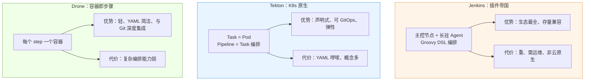
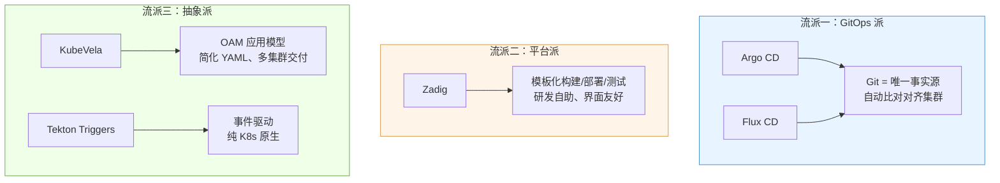
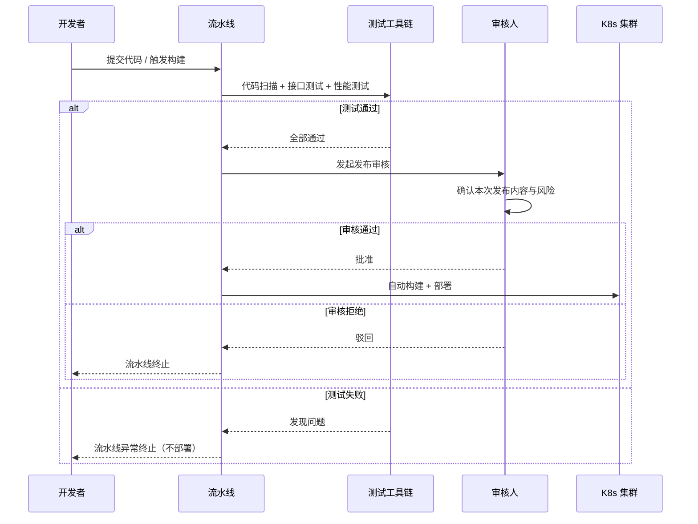

# 3. 云原生 CI/CD 工具全景与选型方法论：6 个 CI + 5 个 CD 工具怎么挑

## 纲要

- **CI 工具六个**：Jenkins / GitLab CI / GitHub Actions / Drone / Tekton / Argo Workflow，设计哲学从"插件帝国"到"K8s 原生 CRD"完全不同，不是谁替代谁的关系
- **CD 工具五个**：Argo CD / Flux CD / Zadig / KubeVela / Tekton Triggers，分三大流派——GitOps 派、平台派、抽象派
- **三个关键区分点**：是否云原生生态、是否有统一构建视图、是否内置插件生态——这三点决定了工具的学习成本与适用场景
- **Zadig 的版本陷阱**：社区版 1.18 功能完整，2.0 把模板功能砍给企业版了，选型时必须锁版本
- **选型三步法**：先定需求 → 再定方案（必须含测试与审核两类需求）→ 持续验证优化，这不是一次性动作而是循环
- **面试高频**：被问"你们公司用什么 CI/CD"时，能讲清选型逻辑比报出工具名字更能体现深度

## 一、先建立坐标系：工具为什么会这么多

CI/CD 工具层出不穷，根源在于**不同团队对不同约束的优先级不同**：

- 有的团队**存量项目多**，需要极强的插件兼容性 → Jenkins
- 有的团队**全面 Git 化**，希望配置即代码且权限复用 → GitLab CI / GitHub Actions
- 有的团队**全面容器化**，希望流水线本身也是 K8s 资源 → Tekton
- 有的团队**要统一发布平台**，希望研发自助、界面友好 → Zadig
- 有的团队**追求声明式交付**，Git 即唯一事实源 → Argo CD / Flux

**所以选型的第一性原理是：没有最好的工具，只有最适配当前约束的工具。** 这也是课程反复强调"先确定需求"的原因。

## 二、CI 工具全景：六个工具，三种哲学

### 2.1 逐个数一遍

| 工具 | 生态定位 | 配置方式 | 权限模型 | 统一构建视图 | 插件生态 |
| --- | --- | --- | --- | --- | --- |
| **Jenkins** | 老牌通用，非云原生生态 | Groovy DSL（`Jenkinsfile`） | 自建用户体系 | 有 | **极强**（数千插件） |
| **GitLab CI** | GitLab 内置 | 仓库放 `.gitlab-ci.yml` | **继承 GitLab 权限** | 无（只能进仓库看） | 弱，需自建镜像 |
| **GitHub Actions** | GitHub 内置 | 仓库放 workflow YAML | 继承 GitHub 权限 | **有**（多项目一屏） | **强**（Marketplace） |
| **Drone** | 云原生轻量 | 仓库放 `.drone.yml` | 继承 Git 平台 | 有 | 中等（内置常用插件） |
| **Tekton** | **K8s 原生 CRD** | Task / Pipeline YAML | K8s RBAC | 有（Dashboard） | 以 Catalog 形式复用 |
| **Argo Workflow** | 云原生 | Workflow CRD | K8s RBAC | 有 | 较弱 |

### 2.2 三个必须讲清的区分点

**区分点一：是不是云原生生态。**

Jenkins 是非常老的工具，基本上每一家公司都在用，部署传统项目比较合适。但它**不是云原生生态的**——云原生项目也能部署，只是没那么合适，因为它的架构模型（主控节点 + 长驻 agent）与 K8s 的调度模型是两套东西。

Tekton 正好相反：它**本身就是 K8s 的一个扩展（CRD）**，通过配置 Task 来工作。一个 Task 就是一个 Pod，Pod 里可以跑多个容器；多个 Task 串起来形成一条流水线。这是彻底的云原生思路——**流水线即 K8s 资源**。

**区分点二：有没有统一的构建页面。**

GitLab CI 和 GitHub Actions 都是"放一个 YAML 文件就能构建"的轻量级方案，但体验有别：

- **GitLab CI**：没有统一构建页面，你必须进到具体仓库里，才能看到那个仓库、那个项目的构建情况；
- **GitHub Actions**：有一个统一的构建页面，在页面上可以看到很多个不同项目在构建。

团队规模小、项目少时这个差异无所谓；**项目一多，没有统一视图会显著增加排查成本**。

**区分点三：插件生态的厚薄。**

GitHub Actions 集成了大量插件，比如 Maven 构建插件、Tekton 插件、K8s 部署插件——**不需要再自己打镜像去部署**，内置插件就能实现很多功能。

而 GitLab CI 没有这套东西，**需要自己去构建镜像**。这意味着在 GitLab CI 里做"部署到 K8s"这类事情，你得自己准备带 `kubectl` 的镜像，自己维护。

**Drone 走的是中间路线**：内置了常用插件（克隆、sonar 扫描、kaniko 构建镜像、deploy 部署、ssh/scp、钉钉报警等），不需要自己造轮子，也不像 Actions 那样重。

### 2.3 本课程的取舍

课程重点讲 **Jenkins、Tekton、Drone** 三个，另外两个（GitLab CI / GitHub Actions / Argo Workflow）简单了解即可。

这个取舍很有讲究——**三个工具恰好覆盖了三种设计哲学**：

**对比着学，收益最大**：同一个"构建 Go 项目并部署到 K8s"的需求，用三种工具各写一遍，就能真正理解它们的边界。

## 三、CD 工具全景：五个工具，三大流派

### 3.1 逐个数一遍

| 工具 | 流派 | 触发方式 | 特点 | 市场情况 |
| --- | --- | --- | --- | --- |
| **Argo CD** | GitOps 派 | Git 变更自动同步 | 基于 GitOps 交付，架构清晰可视 | 企业用得多，**课程重点** |
| **Flux CD** | GitOps 派 | Git 变更自动同步 | 与 Argo CD 同流派，更轻 | 用的人稍少 |
| **Zadig** | 平台派 | 页面 / YAML 触发 | 集成大量模板，界面现代 | 国内公司开发，**课程重点** |
| **KubeVela** | 抽象派 | GitOps / Webhook | 在 K8s YAML 之上再抽象一层 | 用得较多，**课程重点** |
| **Tekton Triggers** | 云原生派 | 事件触发 | Tekton 旗下，为云原生交付而生 | 用的人稍少 |

### 3.2 三个重点工具的差异

**Argo CD —— GitOps 的事实标准。** 基于 GitOps 交付，可以看到整个架构，市场上企业用得比较多。它的核心模型是：**Git 仓库声明期望状态，Argo CD 持续比对集群实际状态，自动对齐**。人要做的只是提 MR。

**Zadig —— 面向工程的交付平台。** 国内公司开发，比较智能，**集成了很多模板**：构建模板、部署模板、测试模板。

它的价值在于：**部署过程中不需要再写大量 YAML、不需要配置大量构建流程，只需要指定一个 YAML 文件、指定一个流程模板，就可以进行部署**。而且页面非常现代化，看起来简洁舒服，部署效率高。

> **Zadig 的版本陷阱（选型必看）**：它有企业版和社区版，**企业版收费、功能多；社区版功能少**。
> - 社区版 **1.18** 功能还比较完整；
> - 到 **2.0** 版本，社区版的模板功能就被砍掉了，需要企业版才能用。
>
> **所以课程讲 1.18 版本。** 如果你在生产选型时忽略这一点，照着 2.0 的文档配 1.18，或反之，都会踩坑。

**KubeVela —— 在 K8s 之上再抽象一层。** 用得比较多，支持 **GitOps 和 webhook 触发**等方式部署。

它的核心思想是 **OAM（Open Application Model）**：把 K8s 的 YAML 配置**更加抽象、简化**，并且**支持多集群交付**。对研发来说，不用写一大堆 K8s YAML，写一个 Application 就够了。

## 四、选型方法论：三步，而且第三步是循环

课程给了一套很务实的方法论，核心一句话：**先确定需求，只有了解了需求之后，才能够根据需求选择不同的工具。**

### 第一步：确定需求

**并不是说一个工具可以把你所有的需求都解决了，不同的需求，需要使用不同的工具来实现。**

常见的需求维度：

| 需求维度 | 典型问题 | 影响选型 |
| --- | --- | --- |
| 团队技能栈 | 会 Groovy 还是只会 YAML？ | Jenkins vs Tekton/Drone |
| 存量项目 | 有没有大量遗留 Job？ | Jenkins 兼容性优势 |
| 集群规模 | 单集群还是多集群？ | KubeVela 多集群能力 |
| 交付模式 | 研发自助还是平台统一？ | Zadig vs Argo CD |
| 权限模型 | 是否复用 Git 平台权限？ | GitLab CI / Actions |
| 成本约束 | 能否接受商业版？ | Zadig 社区版限制 |

### 第二步：制定方案

制定方案时，一般会加入两个需求——这是工作当中最常见的：

**① 测试需求。** 一般会让你加入**代码扫描、性能测试、接口测试**等等。也就是前面说的"可靠性部署"：测试工具发现问题，流水线异常终止，问题代码不进服务器。

**② 审核需求。** 在部署的过程当中，**让负责人去做一个审核，只有审核人通过之后，整个流水线才会自动构建部署**。

审核需求的业务价值常被低估：它不只是"卡一下"，而是**让负责人确认这个版本所要发布的内容**——发了哪些功能、有没有风险变更、是否需要通知相关方。这是线上事故预防的重要一环，也是合规要求。

### 第三步：实施验证、优化及改进（这是循环，不是终点）

这一步最容易被当成"一次性动作"，但课程特别强调：**这是一个持续的过程，并不是说上线之后就改到最好。**

具体分两段：

**① 本地反复验证。** 部署配置好流水线之后，**需要在本地反复测试验证，验证通过没问题之后，再放到线上跑**。

**② 线上持续改进。** 在线上跑的过程当中，可能又会出现各种各样的问题，或者不符合我们的需求。这个期间就需要**再将流水线进行优化和改进**。

典型的持续改进触发点：

- **上线后引入新需求**——比如新加了安全扫描要求、新加了审批节点；
- **多次构建后才发现的坏味道**——比如偶发的超时、缓存失效导致的重复构建、日志噪音过大；
- **不符合预期的效率问题**——比如某一步没必要串行、某个镜像层可以复用。

> **记住这个闭环**：需求 → 方案 → 实施 → 验证 → 优化 → 新需求 → 新方案……CI/CD 流水线是"养"出来的，不是"一次搭好就完"的。

## 五、生产落地清单

把前面的方法论落成可执行的检查项：

| 阶段 | 检查项 |
| --- | --- |
| 选型前 | 需求清单是否覆盖：技能栈 / 存量 / 集群规模 / 交付模式 / 权限 / 成本 |
| 方案设计 | 是否包含测试门禁（扫描/接口/性能）与审核门禁 |
| 方案设计 | 工具版本是否锁定（尤其 Zadig 1.18 vs 2.0） |
| 实施期 | 是否在本地反复验证通过后才上线上 |
| 上线后 | 是否建立了反馈与优化机制（坏味道收集、效率复盘） |
| 全周期 | 配置是否全部进 Git，可 Review、可回溯 |

## 六、面试考点与追问

**Q1：CI 工具和 CD 工具有什么本质区别？**
CI 的输入是源代码、输出是容器镜像，核心动作是编译、测试、扫描、构建、推仓库；CD 的输入是容器镜像、输出是运行中的服务，核心动作是环境差异管理、发布策略、流量切换、回滚。两者以镜像仓库为接缝。

**Q2：Jenkins 和 Tekton 的核心差异是什么？**
Jenkins 是长驻服务 + 插件生态，用 Groovy DSL 编排，非云原生生态，优势在存量兼容与插件齐全；Tekton 是 K8s CRD，Task 即 Pod、Pipeline 即 Task 编排，声明式、可 GitOps、弹性伸缩，优势在云原生一致性。选型看团队是否全面容器化、是否有大量遗留 Job。

**Q3：GitLab CI 和 GitHub Actions 的主要差异？**
两者都是"仓库放 YAML 即可构建"的轻量方案。差异在：GitLab CI 无统一构建页面（需进仓库查看），插件生态弱、常需自建镜像；GitHub Actions 有统一构建页面（多项目一屏可见），Marketplace 插件丰富，多数场景无需自建镜像。

**Q4：什么是 GitOps？Argo CD 如何体现它？**
GitOps 是以 Git 为唯一事实源的交付模式：期望状态写在 Git，工具持续比对集群实际状态并自动对齐，人的变更通过 MR 进入，可 Review、可回溯、可回滚。Argo CD 通过 Application CRD 声明"哪个 Git 仓库的哪个路径部署到哪个集群"，Controller 循环执行同步。

**Q5：一条生产级流水线必须包含哪两类门禁？为什么？**
**测试门禁**（代码扫描/接口测试/性能测试）——确保有缺陷的代码不进入部署环节，把问题拦截在提交后几分钟内；**审核门禁**——让负责人确认本次发布内容与风险，通过后才自动构建部署，防止未授权或未评估的变更上线。两者分别对应"质量"与"管控"。

**Q6：为什么说 CI/CD 方案是持续优化而不是一次搭好？**
因为需求会演进（新增强扫、新审批节点）、环境会暴露问题（偶发超时、缓存失效）、效率有提升空间（并行化、层复用）。课程强调本地反复验证后再上线，上线后仍需根据实际跑的情况持续优化改进，这是一个闭环而非终点。

## 📎 代码关联

本篇为工具选型与方法论，无配套代码。各工具的具体配置代码在后续：

- Jenkins 的 `Jenkinsfile` 与部署清单：`code/3-基础-Jenkins/`、`code/4-进阶-Jenkins/`、`code/5-实战-Jenkins/`
- Tekton 的 Task/Pipeline/Trigger CRD：`code/6-Tekton/`
- Drone 的 `.drone.yml`：`code/7-Drone/`
- KubeVela 的 Application 与 CUE：`code/8-Kubevela/`
- Zadig 的安装脚本与模板：`code/9-Zadig/`
- Argo CD 的 Application / ApplicationSet / syncOptions / 蓝绿灰度：`code/10-Argocd/`

**技术点总结**：CI 工具分三种哲学——Jenkins 的插件帝国、Tekton 的 K8s 原生 CRD、Drone 的容器即步骤；CD 工具分三大流派——Argo CD/Flux 的 GitOps 派、Zadig 的平台派、KubeVela 的抽象派。选型三步法：先定需求（没有一个工具解决所有需求）→ 再定方案（必须含测试门禁与审核门禁）→ 实施验证并持续优化（这是循环不是终点）。特别注意 Zadig 社区版 1.18 功能完整而 2.0 砍掉了模板功能，选型必须锁版本。

