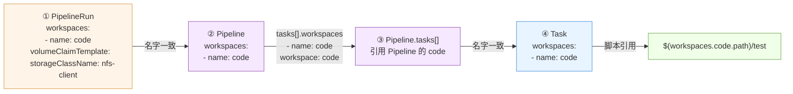
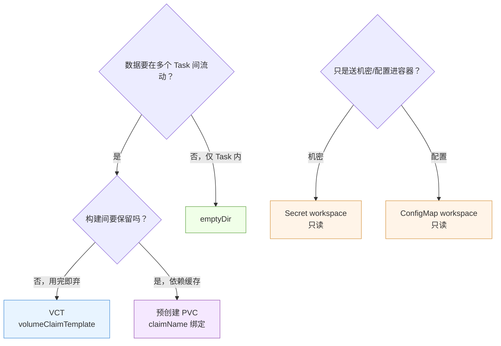

# 40. Tekton Workspace 实战：VCT 动态共享存储、Secret 挂载与镜像推送全流程

## 纲要

- **Workspace 是 Tekton 的「数据传送带」**：Task 之间文件系统默认隔离，workspace 是把克隆的代码、构建产物递给下一个 Task 的唯一正式通道
- **四种存储件覆盖全部场景**：VCT（同一流水线跨 Task 共享，一次性）、Secret（只读，挂载凭据）、emptyDir（Task 内跨 step，**不跨 Task**）、ConfigMap（只读配置）
- **VCT 是本节重点**：PipelineRun 里用 `volumeClaimTemplate` 按需动态申请 PVC，随流水线创建、随流水线销毁，天然做到「一次构建一块独立空间」
- **VCT 有一条四级声明链**：PipelineRun 定义 → Pipeline 声明 → `tasks[].workspaces` 引用 → Task 声明 → 脚本里 `$(workspaces.<名字>.path)`，每一级名字必须一致
- **VCT 不能在 Dashboard 上创建**：控制台建 PipelineRun 选 VCT 会报「无可用卷绑定」，只能走终端/声明式——这正是自动触发必须配 Trigger 的原因之一
- **Secret workspace 是推送镜像的标准姿势**：docker `config.json` 存进 Secret，挂到 kaniko 的 `/kaniko/.docker`，`DOCKER_CONFIG` 一指，build & push 一条龙
- **CI 与 CD 分工**：CI 流水线只负责产出镜像；部署和人工审核放 CD 工具，测试/开发环境可全自动，生产环境加审核 + 超时

## 一、场景引入：Task 之间隔着「一堵墙」

前几篇留下了一个悬而未决的问题：git-clone Task 把代码克隆到了自己容器的 `/workspace`，下一个 Task 的 `list-files` 容器却**什么也看不到**。

原因很简单：Tekton 的每个 Task 实例化为一个独立 Pod，**Pod 之间文件系统天然隔离**——这是 K8s 的容器模型决定的，不是 Tekton 的疏漏。于是问题变成：构建流水线里，「拉下来的代码」必须从 clone Task 流到 build Task，「编译产物」必须从 build Task 流到打包 Task，这个「流」靠什么？

答案就是 **Workspace**。可以把它理解为车间之间的**传送带 + 临时货仓**：不声明 workspace，每个 Task 都是一个封闭黑盒；声明了 workspace，Tekton 会在运行前把卷（volume）挂到相关 Task 的容器里，数据沿着传送带流动。更进一步，workspace 不只传数据，还能**挂载机密**（镜像仓库密码）、**挂载配置**（配置文件），是 Tekton 里存储相关能力的总闸门。

## 二、核心概念与原理

### 2.1 四种存储件：一张选型表

Workspace 是「接口」，背后挂什么卷是「实现」。Tekton 支持四种常用后端：

| 存储件 | 共享范围 | 读写性 | 典型用途 | 生命周期 |
| --- | --- | --- | --- | --- |
| **VCT**（volumeClaimTemplate） | **同一流水线的不同 Task** | 读写 | 克隆代码、构建产物传递 | 流水线结束自动回收，一次性 |
| **Secret** | 挂到哪个 Task 就哪个能用 | **只读** | 镜像仓库 `config.json`、`kubeconfig`、SSH key | 跟随 Secret 资源 |
| **emptyDir**（空目录） | **同一个 Task 内的不同容器/step** | 读写 | Task 内中间产物 | 随 Pod 消亡，**不跨 Task** |
| **ConfigMap** | 挂到哪个 Task 就哪个能用 | **只读** | 构建脚本、`npmrc`、应用配置 | 跟随 ConfigMap 资源 |

三个最容易记混的点：

1. **VCT 只在一个流水线内共享**。不同 PipelineRun 各有各的 VCT 卷，互相看不到对方数据——这是特性不是缺陷，构建隔离就要这么设计；
2. **emptyDir 不跨 Task**。课件专门做了对照实验（见 3.2 节）：用 `emptyDir` 绑定的 workspace，第二个 Task 里 `ls` 直接报「没有这样的文件或目录」，因为每个 TaskRun 各分到一个全新空目录；
3. **Secret / ConfigMap 都是只读**。它们的用途是「把机密和配置送进容器」，不是「让 Task 之间传数据」。

一个 PipelineRun 里三种绑定可以同时存在，形态如下（综合示意，用于理解绑定语法）：

```yaml
# PipelineRun.spec.workspaces 的三种绑定形态（示意）
spec:
  workspaces:
    # ① VCT：动态申请 PVC，跨 Task 共享
    - name: code
      volumeClaimTemplate:
        spec:
          storageClassName: nfs-client
          accessModes:
            - ReadWriteOnce
          resources:
            requests:
              storage: 12M
    # ② Secret：只读挂载已有 Secret
    - name: registry-secret
      secret:
        secretName: aliyun-image-registry-secert
    # ③ 空目录：一对花括号即可
    - name: scratch
      emptyDir: {}
```

### 2.2 VCT 的工作方式：先有 SC，才有动态卷

VCT 的全名是 **VolumeClaimTemplate**——「卷申请模板」。它的工作原理分两步：

1. **前置条件**：集群里必须存在带**动态供给能力**的 `StorageClass`（如 `nfs-client`、各类 CSI driver）。Tekton 自己不造存储，它只是按模板替你向 K8s 申请；
2. **运行时行为**：PipelineRun 一创建，Tekton 就照模板生成一个 PVC 并绑定，挂到所有声明了该 workspace 的 Task 容器里；**PipelineRun 结束，卷自动回收**。

所以 VCT = 「一次构建一块独立空间，用完即焚」。对比另一种做法——**预先手工创建 PVC 再绑定**：那个卷跨流水线持久存在，适合放依赖包缓存（前端 `node_modules`、Go module cache），但需要人工清理、多流水线共用还有并发写冲突。两者的分工：

| | VCT | 预创建 PVC |
| --- | --- | --- |
| 隔离性 | **每次构建独立**，互不污染 | 多构建共享，可能互相覆盖 |
| 生命周期 | 随 PipelineRun 自动回收 | 长期存在，需人工管理 |
| 适用数据 | 源码、构建产物 | 依赖缓存、共享中间库 |
| 运维成本 | 零（有 SC 即可） | 要规划容量、清理策略 |

### 2.3 四级声明链：workspace 版「击鼓传花」

Workspace 和参数一样，是一条**逐级声明、逐级引用**的链，一共四级：



注意第 ③ 级有两个名字：`name` 是 **Task 内部**对 workspace 的称呼，`workspace` 是** Pipeline 里**的名字。两者可以不同（Task 里叫 `src`，Pipeline 里叫 `code`，用 `workspace: code` 映射即可），但**教程和课件统一用同名**，减少心智负担——本文沿用具名做法。

### 2.4 workspace 变量：path / bound / claim

Tekton 为每个 workspace 提供了三个运行时变量：

| 变量 | 含义 | 用途 |
| --- | --- | --- |
| `$(workspaces.<name>.path)` | 该 workspace 在容器里的**挂载路径** | 脚本里读写数据的根路径，**最常用** |
| `$(workspaces.<name>.bound)` | 该 workspace 是否被成功绑定（true/false） | 配合 `optional: true` 做「有缓存用缓存」的优雅降级 |
| `$(workspaces.<name>.claim)` | 底层 PVC 的名字（仅 PVC/VCT 类型有值） | 调试时定位卷 |

**永远用 `$(workspaces.<name>.path)`，不要硬编码 `/workspace`**——挂载路径由 Tekton 管理，硬编码在不同版本、不同配置下都可能对不上。这是前面 literal `/workspace` 踩坑的根治办法。

## 三、动手实践

### 3.1 VCT 主实战：clone → ls-files 跨 Task 共享代码

这是本节的旗舰案例，四个文件构成完整闭环。先看 **Task**（vct-git-clone-task.yaml）：

```yaml
apiVersion: tekton.dev/v1beta1
kind: Task
metadata:
  name: vct-git-clone-task
spec:
  params:
    - name: giturl
      type: string
    - name: branch
      type: string
  workspaces:
    - name: code
  steps:
    - name: git-clone
      image: bitnami/git:latest      # ⚠️ 生产锁版本：改为具体 tag（形如 <版本号>-debian-12-r<修订>），latest 会随上游发布静默变更
      imagePullPolicy: IfNotPresent
      env:
        - name: git_username
          valueFrom:
            secretKeyRef:
              name: gitlab-secert
              key: username
        - name: git_password
          valueFrom:
            secretKeyRef:
              name: gitlab-secert
              key: password
      script: |
        echo ${git_username} ${git_password}
        git clone -b $(params.branch) -v http://${git_username}:${git_password}@$(params.giturl) $(workspaces.code.path)/test
        ls -la
        pwd
        echo $(workspaces.code.path)
        cd $(workspaces.code.path)/test
        ls -la
        pwd
    - name: list-file
      image: ubuntu
      imagePullPolicy: IfNotPresent
      command:
        - /bin/sh
      args: ['-c', 'ls -la $(workspaces.code.path)/test']
```

**与前面 literal 版的三个关键差异：**

| 差异点 | literal 版（git-clone-task.yaml） | VCT 版（vct-git-clone-task.yaml） |
| --- | --- | --- |
| workspace 声明 | 无 | `spec.workspaces: [{name: code}]` |
| 克隆目标路径 | `/workspace`（容器私有） | `$(workspaces.code.path)/test`（共享卷） |
| 跨 Task 可见性 | 第二个 Task 看不到 | `ls-files` Task 能直接 `ls` 到代码 |

注意克隆到 `$(workspaces.code.path)/test` 而不是直接到 workspace 根——`test` 子目录是克隆动作自建的，`git clone` 要求目标目录为空或不存在。第二个 step `list-file` 用 `$(workspaces.code.path)/test` 验证代码确实在共享卷上。

再看 **Pipeline**（pipeline10-vct.yaml）——参数与 workspace 在此汇合：

```yaml
apiVersion: tekton.dev/v1beta1
kind: Pipeline
metadata:
  name: pipeline-vct
spec:
  params:
    - name: giturl
      type: string
    - name: branch
      type: string
  workspaces:
    - name: code
  tasks:
    - name: clone
      taskRef:
        name: vct-git-clone-task
      params:
        - name: giturl
          value: "$(params.giturl)"
        - name: branch
          value: "$(params.branch)"
      workspaces:
        - name: code
          workspace: code
    - name: ls-files
      taskRef:
        name: ls-files
      runAfter:
        - clone
      workspaces:
        - name: code
          workspace: code
```

**逐字段拆解：**

| 字段 | 值 | 含义 |
| --- | --- | --- |
| `spec.workspaces` | `[{name: code}]` | Pipeline 声明自己需要一个叫 `code` 的 workspace |
| `tasks[].workspaces[].name` | `code` | Task 内部使用的 workspace 名 |
| `tasks[].workspaces[].workspace` | `code` | 映射到 Pipeline 声明的 workspace（同名省略歧义） |
| `runAfter` | `[clone]` | 串行：等 clone 成功再 ls-files，保证能看到代码 |

最后是 **PipelineRun**（pipelinerun5-vct.yaml）——VCT 的真正落点：

```yaml
apiVersion: tekton.dev/v1
kind: PipelineRun
metadata:
  name: pipelinerun-vct-2
spec:
  pipelineRef:
    name: pipeline-vct
  params:
    - name: giturl
      value: gitlab.example.com/golang/go.git
    - name: branch
      value: main
  workspaces:
    - name: code
      volumeClaimTemplate:
        spec:
          storageClassName: nfs-client
          accessModes:
            - ReadWriteOnce
          resources:
            requests:
              storage: 12M
```

`storageClassName: nfs-client` 是**动态供给的 StorageClass**，`12M` 是每次构建申请的容量。运行起来后：

```bash
kubectl apply -f task/vct-git-clone-task.yaml
kubectl apply -f task/ls-code.yaml          # 定义 ls-files Task
kubectl apply -f pipeline/pipeline10-vct.yaml
kubectl apply -f pipelinerun/pipelinerun5-vct.yaml
```

Dashboard 上能看到：clone 步骤先打印 workspace 路径，再 `cd` 进去 `ls -la` 看到仓库文件；**ls-files 步骤同样能 `ls` 到代码**——跨 Task 共享成立。这正回答了 2.1 节留下的问题：**代码沿着 workspace 传送带流到了下一个 Task**。

### 3.2 对照实验：emptyDir 绑定为什么跨不了 Task

课件用 `tkn` 做了一个极具教学价值的对照——同一个 pipeline-vct，workspace 改用空目录绑定：

```bash
tkn pipeline start pipeline-vct \
  -p giturl=gitlab.example.com/golang/go.git \
  -p branch=main \
  -w name=code,emptyDir=""
```

每个参数都要单独一个 `-p`，workspace 用 `-w name=code,emptyDir=""` 绑定空目录。结果：clone 成功，但 **ls-files 步骤报「没有这样的文件或目录」**。

**根因**：emptyDir 是 **Pod 级**卷，每个 TaskRun 是独立 Pod，各分到一个全新空目录——clone Task 克隆进去的代码在它自己的 Pod 里，ls-files Task 的 Pod 里只有空白。这从实验角度证明了 2.1 节的结论：**emptyDir 只在同一个 Task 的多个 step 之间共享（它们同 Pod），跨 Task 必须用 VCT 或 PVC**。

顺带记住 `tkn pipeline start` 的 workspace 绑定全家桶：

```bash
# 空目录
-w name=code,emptyDir=""
# 已有 PVC（可带 subPath）
-w name=code,claimName=my-pvc,subPath=subdir
# 已有 ConfigMap / Secret
-w name=cfg,config=my-configmap
-w name=sec,secret=my-secret
# VCT 模板文件
-w name=code,volumeClaimTemplateFile=vct.yaml
```

### 3.3 Secret workspace 实战：kaniko 构建并推送镜像

CI 的终点是产出镜像。kaniko 是「无守护进程」的镜像构建工具（不需要 Docker daemon，在容器里直接构建，K8s 环境的首选），它通过读取 docker 的 `config.json` 获得镜像仓库凭据。把 `config.json` 存进 Secret、以 workspace 形式挂载，就是标准做法。

**第一步：制作镜像仓库 Secret**（aliyun-image-registry-secret.yaml）：

```yaml
apiVersion: v1
data:
  config.json: <base64 编码的 docker config.json>
kind: Secret
metadata:
  name: aliyun-image-registry-secret
type: Opaque
```

`config.json` 的内容是 docker 标准格式（base64 前）：

```json
{
  "auths": {
    "registry.cn-hangzhou.aliyuncs.com": {
      "auth": "<base64(username:password)>"
    }
  }
}
```

制作命令：

```bash
# 生成 auth 字段（用户名:密码 的 base64）
echo -n 'your-user:your-password' | base64

# 把整份 config.json 编码后填入 Secret
cat config.json | base64 -w 0
```

也可以用 `kubectl create secret docker-registry` 一条命令生成同款 Secret，再按需改造。

**第二步：Pipeline 声明两个 workspace**（pipeline11-secret.yaml）：

```yaml
apiVersion: tekton.dev/v1beta1
kind: Pipeline
metadata:
  name: pipeline-secret
spec:
  params:
    - name: giturl
      type: string
    - name: branch
      type: string
  workspaces:
    - name: code
    - name: aliyun-image-registry-secert
  tasks:
    - name: clone
      taskRef:
        name: vct-git-clone-task
      params:
        - name: giturl
          value: "$(params.giturl)"
        - name: branch
          value: "$(params.branch)"
      workspaces:
        - name: code
          workspace: code
    - name: image-build-and-push
      taskRef:
        name: image-build-and-push
      workspaces:
        - name: aliyun-image-registry-secert
          workspace: aliyun-image-registry-secert
        - name: code
          workspace: code
      runAfter:
        - clone
```

**第三步：build-and-push Task**（kaniko，定义于 build-dockerfile-bush.yaml）：

```yaml
apiVersion: tekton.dev/v1beta1
kind: Task
metadata:
  name: image-build-and-push
spec:
  workspaces:
    - name: code
    - name: aliyun-image-registry-secert
      mountPath: /kaniko/.docker
  steps:
    - name: image-build-and-push
      image: gcr.io/kaniko-project/executor:latest   # ⚠️ 生产锁版本：kaniko 官方以 latest 滚动发布，固定到 v1.x.y 保证可追溯
      imagePullPolicy: IfNotPresent
      securityContext:
        # kaniko 官方镜像要求 root 读写 /kaniko 工作区；集群若启用 Pod Security
        # restricted 禁止 root，需换非 root 构建方案（BuildKit rootless）或为该 SA 申请豁免
        runAsUser: 0
      env:
        - name: DOCKER_CONFIG
          value: /kaniko/.docker
      command:
        - /kaniko/executor
      args:
        - --dockerfile=Dockerfile
        - --context=$(workspaces.code.path)/test
        - --destination=registry.cn-hangzhou.aliyuncs.com/cicd-demo/app:test
        - --cache=true
        - --cache-repo=registry.cn-shenzhen.aliyuncs.com/cicd-demo/app
        - --cache-copy-layers
```

**三个精髓设计：**

1. **`mountPath: /kaniko/.docker`**：workspace 声明可以指定挂载点。把 Secret workspace 直接挂到 kaniko 默认读配置的路径，无需拷贝；
2. **`DOCKER_CONFIG=/kaniko/.docker`**：环境变量告诉 kaniko「凭据在这个目录」，它读取其中的 `config.json` 完成仓库认证；
3. **`--context=$(workspaces.code.path)/test`**：构建上下文直接指向 clone Task 克隆下来的代码——workspace 传送带在此完成交接，`runAfter` 保证顺序。

**第四步：PipelineRun 同时绑定两种存储件**（pipelinerun6-secret.yaml）：

```yaml
apiVersion: tekton.dev/v1
kind: PipelineRun
metadata:
  name: pipelinerun-secret-19
spec:
  pipelineRef:
    name: pipeline-secret
  params:
    - name: giturl
      value: gitlab.example.com/golang/go.git
    - name: branch
      value: main
  workspaces:
    - name: code
      volumeClaimTemplate:
        spec:
          storageClassName: nfs-client
          accessModes:
            - ReadWriteOnce
          resources:
            requests:
              storage: 12M
    - name: aliyun-image-registry-secert
      secret:
        secretName: aliyun-image-registry-secert
```

一个 workspace 用 **VCT**（代码，读写共享），一个用 **Secret**（凭据，只读）——两种后端在一条流水线里协同，这就是 2.1 节选型表的活样本。

**apply 顺序不能乱**：

```bash
# ① 先 Task（secret 引用和镜像构建的依赖）
kubectl apply -f secret/aliyun-image-registry-secret.yaml
kubectl apply -f secret/git-secret.yaml
kubectl apply -f task/vct-git-clone-task.yaml
kubectl apply -f task/build-dockerfile-bush.yaml     # image-build-and-push
kubectl apply -f task/ls-code.yaml                   # 如流水线含 ls-files
# ② 再 Pipeline
kubectl apply -f pipeline/pipeline11-secret.yaml
# ③ 最后 PipelineRun
kubectl apply -f pipelinerun/pipelinerun6-secret.yaml
```

跑完后控制台观察两步：先 `clone`，再 `image-build-and-push`；镜像仓库控制台刷新，能看到 `cicd-demo/app:test` 新版本上线——**从代码到镜像的闭环打通**。

## 四、生产实践要点

### 4.1 存储件选型决策树



一句话版本：**跨 Task 传数据用 VCT，跨构建留缓存用 PVC，Task 内中转用 emptyDir，送机密配置用 Secret/ConfigMap**。

### 4.2 VCT 落地的三个前置检查

上生产前逐条确认：

1. **StorageClass 存在且是动态供给型**：`kubectl get sc`，确认 `PROVISIONER` 不是 `kubernetes.io/no-provisioner`（静态 SC 无法自动建卷，VCT 会一直 Pending）；
2. **容量规划**：`storage: 12M` 只是课件演示值。真实 Go/前端项目按「源码 + 依赖 + 产物」估算，建议 `2Gi` 起步并留监控；
3. **访问模式**：单流水线内 Task 顺序执行，`ReadWriteOnce` 足够；切勿让两个 PipelineRun 共享同一个 VCT（VCT 本来就是一次性的，没有共享语义）。

### 4.3 「控制台不能建 VCT」的工程含义

课件实测：Dashboard 上选 VCT 类型创建 PipelineRun，直接报**无可用卷绑定**错误——Dashboard 的创建表单对 VCT 支持不完整。这个限制的工程含义很大：

- **手工触发**：用 `tkn pipeline start`（`-w name=code,volumeClaimTemplateFile=vct.yaml`）或 `kubectl apply` 声明式；
- **自动触发**：必须走 **Tekton Trigger**（EventListener + TriggerBinding + TriggerTemplate，后续展开），由系统生成 PipelineRun；
- **只想手工点的团队**：要么忍受不了 VCT 而退用预创建 PVC，要么把触发统一收到 CI 系统/Trigger——**生产流水线的入口必须是可编程的**，Dashboard 点按钮只适合演示。

### 4.4 镜像 tag 规范：拒绝 latest 和写死

课件里的 `--destination=.../app:test` 是写死的演示值。生产 tag 必须携带溯源信息：

| 方案 | 示例 | 说明 |
| --- | --- | --- |
| commit 短 hash | `app:${GIT_COMMIT:0:7}` | 最严谨，镜像↔代码一一对应 |
| 分支 + 构建号 | `app:main-128` | 人工可读，适合内部环境 |
| 语义版本 | `app:v1.4.2` | 发布流水线用，配合 Git tag |
| 日期 + hash | `app:20261014-a1b2c3d` | 兼顾可读与唯一 |

`--destination` 支持变量替换，把 tag 做成参数（前面的参数化）或由触发器从 Webhook 事件提取，**任何写死的 tag 都是回滚时的噩梦**。

### 4.5 CI/CD 分工：构建与部署解耦

课件在本节末尾专门强调了运维哲学，值得每个架构师记住：

- **CI（Tekton）只负责构建镜像**：拉代码 → 编译 → 扫描 → 打包推送，终点是镜像仓库；
- **CD 工具负责部署**：KubeVela、Argo CD 这类工具消费镜像，执行发布；
- **审核放 CD 侧**：测试/开发环境可以「提交代码 → 自动构建 → 自动部署」全自动；**生产环境必须加人工审核**，且审核可以配超时——超时未批，流水线自动终止，防止「挂个审批等三天」；
- **多工具组合而非单一工具硬扛**：用触发链把「代码提交 → Tekton 构建 → CD 部署」串起来，各司其职。

这条原则直接决定了 Tekton 流水线的边界：**不要试图在 CI 流水线里直接 `kubectl apply` 部署生产**——构建和部署的生命周期、权限模型、审计要求都不同。

### 4.6 安全加固清单

| 项 | 措施 |
| --- | --- |
| Secret 内容 | base64 是编码不是加密；开 etcd 加密、RBAC 最小权限，或上 Vault/CSI |
| 镜像仓库凭据 | 用只读 Secret workspace 挂载，绝不以 `-p` 参数或明文 env 传递 |
| kaniko 权限 | `runAsUser: 0` 是 kaniko 官方镜像要求；集群启用 Pod Security restricted 禁止 root 时，改用非 root 构建方案（BuildKit rootless）或为该 ServiceAccount 申请豁免 |
| workspace 隔离 | VCT 天然隔离；用 PVC 缓存时按项目分卷，避免跨项目写冲突 |
| 构建缓存 | `--cache-repo` 指向独立缓存仓库，别污染正式仓库 tag 列表 |

## 五、报错排查表

| 现象 | 根因 | 解法 |
| --- | --- | --- |
| VCT 的 Pod 一直 `Pending`，事件显示 no persistent volumes available | StorageClass 不存在或不是动态供给型 | `kubectl get sc` 换动态 SC（如 nfs-client） |
| Dashboard 创建 VCT 型 PipelineRun 报「无可用卷绑定」 | Dashboard 对 VCT 绑定支持不完整 | 改用 `tkn pipeline start -w ...volumeClaimTemplateFile=` 或声明式 apply |
| 第二个 Task 报「没有这样的文件或目录」 | workspace 用 emptyDir 绑定，跨 Task 不共享 | 换 VCT/PVC 绑定；确认 `tasks[].workspaces` 已映射 |
| `$(workspaces.code.path)` 原样出现在日志 | Task 未声明同名 workspace，或名字拼错 | 核对四级链每一级名字；用 `.path` 变量不要硬编码路径 |
| clone 成功但 build 找不到代码 | 克隆到了 workspace 根，build 找的是子目录（或反之） | 统一约定子目录（如 `/test`），clone 与 context 用同一路径 |
| kaniko 报 `authentication required` / push 403 | `config.json` 未挂载到 kaniko 读取路径，或凭据错 | 检查 `mountPath: /kaniko/.docker` 与 `DOCKER_CONFIG` 是否配对 |
| Secret 挂载了但内容为空 | Secret 的 key 与挂载 item 不匹配 | `kubectl get secret <name> -o yaml` 核对 data 下的 key 名 |
| 镜像推送成功但 tag 不对 | `--destination` 写死或变量未替换 | tag 参数化，用 commit hash/构建号 |
| PipelineRun 结束但 PVC 没回收 | 用了预创建 PVC（本来就持久）或 VCT 回收延迟 | VCT 随流水线自动回收；预创建 PVC 需人工/脚本清理 |
| apply 后 PipelineRun 报 task not found | Task 没先 apply，或名字不一致 | 按 3.3 节顺序：Task → Pipeline → PipelineRun |

## 六、面试考点与追问

**Q1：Tekton 的 workspace 解决什么问题？不声明会怎样？**
解决 Task/Pod 间文件系统隔离导致的数据不通问题。不声明 workspace，每个 Task 都是数据孤岛——克隆的代码、构建产物都出不了自己的 Pod，只能靠「把所有事情塞进一个 Task」规避，那是反模式。

**Q2：VCT、emptyDir、Secret、ConfigMap 四种 workspace 的区别？**
VCT：动态申请 PVC，同一流水线内跨 Task 读写共享，随流水线回收；emptyDir：Pod 级临时目录，仅同一 Task 的 step 间共享，不跨 Task；Secret/ConfigMap：只读，把机密/配置挂进容器。选型口诀：跨 Task 传数据用 VCT，Task 内中转用 emptyDir，送机密配置用 Secret/ConfigMap。

**Q3：VCT 的完整声明链是怎样的？哪一级最容易出错？**
PipelineRun `workspaces`（定义 VCT 模板）→ Pipeline `spec.workspaces`（声明）→ `tasks[].workspaces`（引用映射）→ Task `spec.workspaces`（声明）→ 脚本 `$(workspaces.<name>.path)`。最容易错的是**第 ③ 级的映射字段**（`name` vs `workspace` 两个名字）和**名字拼写不一致**——表现就是变量不替换或目录不存在。

**Q4：为什么 kaniko 要把 Secret 挂到 `/kaniko/.docker`？**
kaniko 遵循 docker 的凭据发现机制：默认从 `$DOCKER_CONFIG`（默认 `~/.docker`）读 `config.json`。课件把 Secret workspace 的 `mountPath` 设为 `/kaniko/.docker`，再用 `DOCKER_CONFIG=/kaniko/.docker` 显式指定，kaniko 启动即读到仓库凭据。这是「把凭据送到工具默认读取位置」的经典手法，免拷贝、免改写。

**Q5：VCT 和预创建 PVC 怎么选？**
VCT 适合「一次构建一份独立空间」：源码、构建产物，用完即焚，隔离性好、零运维。预创建 PVC 适合「跨构建保留」：依赖缓存（node_modules、go mod cache），但要管容量、清理策略和并发写。生产上常见组合：**code 用 VCT，cache 用 PVC**。

**Q6：为什么说生产流水线的入口必须是可编程的，而不是 Dashboard 点按钮？**
三个理由：① VCT 在 Dashboard 上建不了，可编程是功能刚需；② 点按钮无法留痕（谁跑的、传了什么参数说不清）；③ 自动触发（Webhook/定时）本质就是程序化入口。Dashboard 适合演示和验证，不适合生产。

**Q7：Tekton 流水线里直接 kubectl apply 部署生产环境，有什么问题？**
违背 CI/CD 分离：构建产物（镜像）和部署动作的生命周期、权限、审计要求不同；CI 系统持有生产 kubectl 权限 = 巨大的爆炸半径；没有审核关卡。正确做法是 CI 产镜像、CD 工具（Argo CD/KubeVela/Zadig）消费镜像并执行带审核的发布——这也正是本课程后半程的主题。

## 📎 文本↔代码关联

本篇对应课件源码（`code/6-Tekton/`，已做去品牌化处理）：

| 代码文件 | 正文提及 | 内容 |
| --- | --- | --- |
| `code/6-Tekton/pipeline/pipeline10-vct.yaml` | 第 2.3、3.1 节 | params + workspaces 双声明，clone/ls-files 两 Task 共享 code workspace |
| `code/6-Tekton/task/vct-git-clone-task.yaml` | 第 3.1 节 | 克隆到 `$(workspaces.code.path)/test` 的 VCT 版 git-clone Task |
| `code/6-Tekton/pipelinerun/pipelinerun5-vct.yaml` | 第 3.1 节 | `volumeClaimTemplate`（nfs-client SC / ReadWriteOnce / 12M）绑定示例 |
| `code/6-Tekton/pipeline/pipeline11-secret.yaml` | 第 3.3 节 | code（VCT）+ aliyun-image-registry-secert（Secret）双 workspace Pipeline |
| `code/6-Tekton/pipelinerun/pipelinerun6-secret.yaml` | 第 3.3 节 | VCT + Secret 混合绑定的 PipelineRun |
| `code/6-Tekton/task/build-dockerfile-bush.yaml` | 第 3.3 节 | kaniko `image-build-and-push` Task：`mountPath` + `DOCKER_CONFIG` + 缓存参数 |
| `code/6-Tekton/task/ls-code.yaml` | 第 3.1 节 | `ls-files` Task：跨 Task 验证 workspace 共享（`cd $(workspaces.code.path)/test`） |
| `code/6-Tekton/secret/git-secret.yaml` | 第 3.1 节 | git 仓库凭据 Secret（username/password） |
| `code/6-Tekton/secret/aliyun-image-registry-secret.yaml` | 第 3.3 节 | 镜像仓库 `config.json` Secret，供 kaniko 挂载认证 |

**技术点总结**：Workspace 是 Tekton 打通 Task 数据孤岛的传送带，四种存储件各司其职——**跨 Task 传数据用 VCT（随流水线创建回收、天然隔离）、Task 内中转用 emptyDir、送机密配置用只读的 Secret/ConfigMap**；VCT 落地要过「四级声明链 + 动态 StorageClass」两关，脚本里一律用 `$(workspaces.<名字>.path)` 而非硬编码路径；镜像推送场景的标准姿势是「docker config.json 存 Secret → mountPath 挂到 kaniko 读取位 → DOCKER_CONFIG 指路」；最后记住架构铁律——**CI 只构建镜像，部署与审核交给 CD 工具**，生产入口必须是可编程的（tkn/声明式/Trigger），Dashboard 点按钮只配演示。

