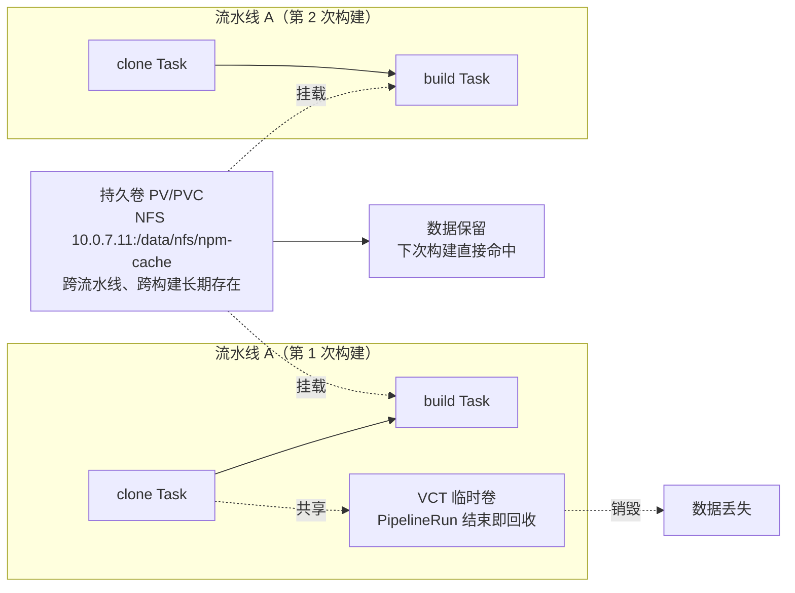
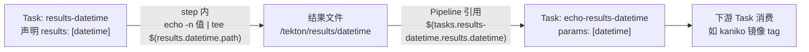

# Tekton Volume 与 Results 实战：跨流水线持久化缓存与 Task 间数据传递

## 纲要

- **Volume 是「跨流水线的仓库」，VCT 是「流水线内的临时货仓」**：VCT 随 PipelineRun 创建、随 PipelineRun 销毁，只在一个流水线内共享；挂载 PV/PVC 的 workspace 数据落在 NFS 等持久存储上，**不同流水线、不同构建之间都能命中**
- **典型场景是依赖缓存**：`node_modules`、Go module cache、Maven 仓库这类「每次构建都要用、下次还想用」的数据，就应该放持久卷，而不是每次重建
- **PV/PVC 是 K8s 的标准两段式**：PV 是集群里的实际存储（NFS/CSI），PVC 是用户的「领用申请」，Tekton 的 workspace 只是把 PVC 挂进 Task 容器
- **Results 是 Task 的「小型输出通道」**：Task 声明 `results`，step 里用 `echo -n 值 | tee $(results.<名字>.path)` 写入，下游 Task 通过 `$(tasks.<任务名>.results.<名字>)` 引用
- **Results 的经典用法是镜像 tag**：上游 Task 用 `date +%Y%m%d-%H%M%S` 生成构建号写入 result，下游构建 Task 拿它当镜像 tag，全程自动、无需人工填
- **引用语法有严格的四级路径**：`tasks` → 任务名 → `results` → result 名，任何一级拼错都会拿到空字符串，且**只在 Pipeline 内有效**，TaskRun 单独跑不生效

## 一、场景引入：上次构建装的依赖，这次还要再装一遍？

上一篇我们把 Workspace 的 VCT 玩明白了：同一流水线里，代码从 clone Task 流向 build Task，一切顺畅。但把它放到**日复一日的真实构建**里，一个尖锐的问题就冒出来了。

以前端项目为例，`npm install` 每次都要从 registry 拉几百兆依赖包，慢则几分钟。聪明如你想到：那我把依赖包缓存下来不就行了？于是你把 npm 缓存目录挂了个卷。可下一构建发现——**缓存没了**。原因不在缓存配置，在 Tekton：VCT 卷的生命周期**绑定单次 PipelineRun**，流水线一结束卷就回收，你辛辛苦苦拉的 `node_modules` 跟着一起陪葬。

这就是本课要解决的第一个痛点：**怎么让数据活得比一次流水线更长**。答案是把 workspace 背后的卷从「一次性 VCT」换成**持久化的 PV/PVC**——数据落在 NFS 上，这次构建装的依赖，下次构建直接命中。

第二个痛点更隐蔽：build Task 打镜像时，镜像 tag 是什么？手填 `latest` 会互相覆盖，无法回溯；每次构建前让运维登上去查时间再传给流水线，又不现实。Tekton 的答案是 **Results 机制**：让 Task 把「构建号」这类小型数据作为正式输出声明出来，下游 Task 直接引用，像函数返回值一样在流水线里传递。

一个管「大数据、长生命周期」，一个管「小数据、函数式传递」，这就是 Volume 与 Results 的分工。

## 二、核心概念与原理

### 2.1 三种卷的作用域对比：别再选错

Tekton 里 workspace 能挂的卷，按作用域分三档，选错就是白干：



| 卷类型 | 共享范围 | 生命周期 | 读写性 | 适用数据 |
| --- | --- | --- | --- | --- |
| **VCT**（volumeClaimTemplate） | 同一 PipelineRun 内的不同 Task | 随 PipelineRun 自动回收 | 读写 | 源码、构建产物（一次性） |
| **PV/PVC**（持久卷） | **跨 PipelineRun、跨流水线** | 长期存在，`Retain` 策略下手动清理 | 读写 | 依赖缓存、共享中间库 |
| **emptyDir** | 同一 Task 内的不同 step | 随 Pod 消亡 | 读写 | Task 内中间产物（不跨 Task） |
| **Secret / ConfigMap** | 挂到哪个 Task 就哪个能用 | 跟随资源对象 | **只读** | 凭据、配置文件 |

判断口诀：**「一次构建内传递用 VCT，跨构建留存用 PV/PVC，机密配置用 Secret」**。本课的 npm 缓存场景，就是标准的 PV/PVC 用例。

### 2.2 PV / PVC 两段式：Tekton 不管存储，只管挂载

PV（PersistentVolume）和 PVC（PersistentVolumeClaim）是 K8s 的标准概念，Tekton 没有发明任何新东西，只是 workspace 多了一种绑定来源：

- **PV**：集群里**实际存在的存储资源**。本课用 NFS——一台 `10.0.7.11` 服务器导出 `/data/nfs/npm-cache` 目录，容量 5Gi。PV 描述的是「存储在哪里、多大、什么访问模式」；
- **PVC**：使用方提交的**领用申请**：「我要 5Gi、能多节点读写」。K8s 控制平面负责撮合 PV 与 PVC，绑定成功后状态变 `Bound`；
- **workspace 绑定 PVC**：Pipeline 声明 workspace → Task 里挂到容器路径（本课是 `/usr/local`）→ 容器内读写的就是 NFS 上的数据。

一个关键细节：**访问模式必须匹配**。本课 PV 和 PVC 都用 `ReadWriteMany`（RWX，多节点可读写），因为 Tekton 的多个 Task 可能被调度到不同节点，卷要能同时挂多处。如果你图省事抄了块存储的 `ReadWriteOnce`（RWO），多 Task 流水线会直接卡在 `Pending`。

### 2.3 Results：Task 的「函数返回值」

Workspace 传文件，Results 传**小型标量数据**（字符串、数字、短 JSON）。工作模型和函数返回值一模一样：



三个必须理解的事实：

1. **Result 本质是文件**。Tekton 在每个 step 容器里预置 `/tekton/results/` 目录，`$(results.<名字>.path)` 就是该目录下的文件路径。你用 `tee` 把值写进去，Tekton Controller 再把文件内容登记为 Task 的 result；
2. **写入方式有固定写法**：`echo -n 值 | tee $(results.<名字>.path)`。`-n` 不能省——少了它值尾会带一个换行符，引用时 tag 就变成 `20261014-1024\n`，镜像推送直接报非法引用；
3. **引用路径四级递进**：`$(tasks.<Task名>.results.<result名>)`。Task 名是 Pipeline `tasks[].name`（不是 Task 资源的 metadata.name，虽然通常故意取成一样），result 名是 Task `spec.results[].name`。

另一个隐藏考点：**Pipeline 里 Task 通过 results 引用会自动建立依赖顺序**。本课 pipeline13-results 没有写任何 `runAfter`，但 `echo-results-datetime` 引用了 `results-datetime` 的 result，Tekton 据此推断出先后顺序——这是**隐式依赖**，比手写 runAfter 更稳（不会出现「忘了写 runAfter 导致并发乱序」的事故）。

## 三、动手实践

### 3.1 持久化缓存：PV / PVC 准备

先落 K8s 侧的存储。NFS 服务器（`10.0.7.11`）上先建好导出目录 `/data/nfs/npm-cache`，然后创建 PV：

```yaml
# nfs/pv.yaml —— 集群里的实际存储资源
apiVersion: v1
kind: PersistentVolume
metadata:
  name: tekton-npm-cache-pv
spec:
  capacity:
    storage: 5Gi
  accessModes:
  - ReadWriteMany
  persistentVolumeReclaimPolicy: Retain
  nfs:
    path: /data/nfs/npm-cache
    server: 10.0.7.11
```

逐字段拆解：

| 字段 | 值 | 说明 |
| --- | --- | --- |
| `metadata.name` | `tekton-npm-cache-pv` | 全局唯一（PV 是集群级资源，不属于 namespace） |
| `capacity.storage` | `5Gi` | 声明的存储容量，需与 PVC 申请匹配或更大 |
| `accessModes` | `ReadWriteMany` | **RWX，多节点同时读写**，Tekton 多 Task 跨节点调度的刚需 |
| `persistentVolumeReclaimPolicy` | `Retain` | PVC 删除后**保留底层数据**，缓存卷必须用这个（`Delete` 会把 NFS 数据删掉） |
| `nfs.server` / `nfs.path` | `10.0.7.11` / `/data/nfs/npm-cache` | NFS 服务端地址与导出目录，服务器上需提前创建并开放导出 |

接着创建 PVC——使用方视角的「领用单」：

```yaml
# nfs/pvc.yaml —— 领用申请，绑定成功后供 workspace 挂载
apiVersion: v1
kind: PersistentVolumeClaim
metadata:
  name: tekton-npm-cache-pvc
  namespace: default
spec:
  accessModes:
  - ReadWriteMany
  resources:
    requests:
      storage: 5Gi
```

注意两点：PVC 是 **namespace 级资源**（本课 `default`），Tekton Task 在哪个 namespace 跑，PVC 就得在哪个 namespace；`accessModes` 必须和 PV 对上，否则永远 `Pending`。

创建后验证：

```bash
kubectl get pv tekton-npm-cache-pv        # STATUS 应为 Available，CAPACITY 5Gi，ACCESS MODES RWX
kubectl get pvc tekton-npm-cache-pvc      # STATUS 应为 Bound，VOLUME 列显示绑定的 PV 名
```

### 3.2 流水线定义：三个 Task 的编排

`pipeline12-volume.yaml` 定义了三个 Task 串成一条线：

```yaml
# pipeline/pipeline12-volume.yaml
apiVersion: tekton.dev/v1beta1
kind: Pipeline
metadata:
  name: pipeline-volume
spec:
  params:
    - name: giturl
      type: string
    - name: branch
      type: string
  workspaces:
    - name: code
    - name: aliyun-image-registry-secert
  tasks:
    - name: clone
      taskRef:
        name: vct-git-clone-task
      params:
        - name: giturl
          value: "$(params.giturl)"
        - name: branch
          value: "$(params.branch)"
      workspaces:
        - name: code
          workspace: code
    - name: volume-image-build-and-push
      taskRef:
        name: volume-image-build-and-push
      workspaces:
        - name: aliyun-image-registry-secert
          workspace: aliyun-image-registry-secert
        - name: code
          workspace: code
      runAfter:
        - clone
    - name: ls-npm-cache
      taskRef:
        name: ls-npm-cache
      runAfter:
        - volume-image-build-and-push
```

编排逻辑逐段看：

| 片段 | 作用 |
| --- | --- |
| `params: giturl / branch` | 仓库地址与分支参数化，PipelineRun 传入，避免把仓库地址焊死在流水线里 |
| `workspaces: code / aliyun-image-registry-secert` | 两条通道：代码走 VCT，镜像仓库凭据走 Secret（上一篇的用法） |
| Task `clone` | 引用 `vct-git-clone-task`，把源码克隆进 `code` workspace，giturl/branch 用 `$(params.*)` 透传 |
| Task `volume-image-build-and-push` | **本课主角**：`runAfter: clone` 保证拿到代码后再构建；同时挂载凭据 workspace 用于推送镜像 |
| Task `ls-npm-cache` | 收尾验证：`runAfter` 挂在构建之后，列出 npm 缓存目录内容，直观证明缓存生效 |

注意一个易错点：`runAfter` 写的是 **Pipeline 里的 task 名**（`clone`、`volume-image-build-and-push`），不是 `taskRef.name`。两者可以不同，依赖关系永远认前者。

构建 Task（`volume-image-build-and-push`）内部干了一串活儿，按讲稿实录还原：基于 `node:16.15` 镜像，先切到 node 目录，把 `package.json` 拷到 `/usr/local/node`——这正是 PVC 的挂载路径；然后关掉 strict-ssl 认证、执行 `npm install` 把依赖拉到挂载目录，生成 `node_modules`；再把它拷回工作目录，把本地代码 `COPY` 进目标目录，执行 `npm run build` 编译打包，最后启动程序验证。**「先拷 package.json 再装依赖」的顺序是 Docker 层缓存优化的经典手法**：package.json 不变则依赖层命中缓存，不变更频繁的业务代码不会击穿依赖层。

PipelineRun 的写法与普通 VCT 版几乎一样，只有 giturl/branch 换成本课仓库：

```yaml
# pipelinerun/pipelinerun7-volume.yaml
apiVersion: tekton.dev/v1
kind: PipelineRun
metadata:
  name: pipelinerun-volume-2
spec:
  pipelineRef:
    name: pipeline-volume
  params:
    - name: giturl
      value: gitlab.example.com/node/vue.git
    - name: branch
      value: main
  workspaces:
    - name: code
      volumeClaimTemplate:
        spec:
          storageClassName: nfs-client
          accessModes:
            - ReadWriteOnce
          resources:
            requests:
              storage: 12M
    - name: aliyun-image-registry-secert
      secret:
        secretName: aliyun-image-registry-secert
```

即：**代码 workspace 仍然用 VCT**（源码是一次性数据），**依赖缓存走 Task 内挂载的 PVC**（tekton-npm-cache-pvc → `/usr/local`）。两种卷在一条流水线内各司其职，这就是生产里的标准分层：`code` 管传递，`npm-cache` 管留存。

### 3.3 效果验证：缓存命中的两次构建

跑第一次构建：`npm install` 老实拉全部依赖，`node_modules` 落到 NFS 卷上；构建过程把镜像连同层缓存 push 到仓库。

跑第二次构建（讲稿实录）：`npm install` 阶段直接打印命中缓存（found cache）后跳过拉取，`COPY` 层也命中缓存。此时故意改一个源文件再提交触发构建——**Docker 层缓存在该文件之后的层全部失效**，`npm install` 重新执行；但因为 `node_modules` 已在 NFS 卷上，实际只是把依赖从缓存目录取回，**不再走网络全量拉包**。拉包 → 链接 → 构建的过程明显缩短。

`ls-npm-cache` Task 的最后一步就是把这个效果摆到台面上：构建结束后列出挂载目录，能看到前几次构建沉淀的依赖包。**「能看见」是缓存生效最直接的证据**，也是这个收尾 Task 存在的意义。

### 3.4 Results 实战：生成构建号并跨 Task 传递

换成 results 场景。先声明「生产者」Task——生成一个时间戳构建号：

```yaml
# task/results-datetime.yaml
apiVersion: tekton.dev/v1beta1
kind: Task
metadata:
  name: results-datetime
spec:
  results:
    - name: datetime
  steps:
    - name: define-datetime
      image: alpine:3.16
      imagePullPolicy: IfNotPresent
      script: |
        #!/bin/sh
        datetime=`date +%Y%m%d-%H%M%S`
        echo -n ${datetime} | tee $(results.datetime.path)
    - name: echo-datetime
      image: alpine:3.16
      imagePullPolicy: IfNotPresent
      script: |
        #!/bin/sh
        echo $(results.datetime.path)
        ls -la $(results.datetime.path)
        cat $(results.datetime.path)
```

逐字段拆解：

| 字段 | 说明 |
| --- | --- |
| `spec.results[].name: datetime` | **声明**本 Task 有一个名为 `datetime` 的输出。不声明就写入，文件会被忽略 |
| `` datetime=`date +%Y%m%d-%H%M%S` `` | 生成 `20261014-172256` 格式的构建号，秒级精度保证同一分钟内多次构建也不撞车 |
| `echo -n ${datetime} \| tee $(results.datetime.path)` | **标准写入三件套**：`-n` 去尾换行；`tee` 同时写文件并回显日志；`$(results.datetime.path)` 是 Tekton 预置的结果文件路径 |
| `echo / ls -la / cat` 三连 | 第二个 step 纯验证用途：打印路径、看文件元信息、看文件内容，确认 result 文件真的落盘 |

再写「消费者」Task——接收并打印：

```yaml
# task/echo-results-datetime.yaml
apiVersion: tekton.dev/v1beta1
kind: Task
metadata:
  name: echo-results-datetime
spec:
  params:
    - name: datetime
  steps:
    - name: echo-results-datetime
      image: alpine
      script: |
        #!/bin/sh
        echo $(params.datetime)
```

它声明一个 `datetime` 参数——**参数从哪来？Pipeline 负责牵线**：

```yaml
# pipeline/pipeline13-results.yaml
apiVersion: tekton.dev/v1beta1
kind: Pipeline
metadata:
  name: pipeline-results
spec:
  tasks:
    - name: results-datetime
      taskRef:
        name: results-datetime
    - name: echo-results-datetime
      taskRef:
        name: echo-results-datetime
      params:
        - name: datetime
          value: "$(tasks.results-datetime.results.datetime)"
```

核心就一行参数赋值，逐段拆开：

| 引用片段 | 含义 |
| --- | --- |
| `$(...)` | Tekton 变量替换语法，运行时求值 |
| `tasks` | 固定前缀，指向本 Pipeline 内的 Task 结果命名空间 |
| `results-datetime` | **Pipeline 里的 task 名**（`tasks[].name`） |
| `results.datetime` | 该 Task 声明的 result 名 |

注意 pipeline13 **没有 `runAfter`**——`echo-results-datetime` 引用了上游 result，Tekton 自动推导出依赖顺序，隐式依赖省心且不会漏配。

PipelineRun 则干净得像张白纸——结果在 Pipeline 内部闭环，外部无参数：

```yaml
# pipelinerun/pipelinerun8-results.yaml
apiVersion: tekton.dev/v1
kind: PipelineRun
metadata:
  name: pipelinerun-results-5
spec:
  pipelineRef:
    name: pipeline-results
```

部署顺序（与讲稿一致）：先 `kubectl apply` 两个 Task，再 apply Pipeline，最后 apply PipelineRun。跑完后回看构建记录：`results-datetime` 的日志里能看到结果文件绝对路径（形如 `/tekton/results/datetime`）、`ls -la` 的文件名与随后 `cat` 出的内容**三者一致**；`echo-results-datetime` 打印的值与上游完全一致——同一个构建号（如 `20261014-172256`）在流水线里完成了闭环传递。

### 3.5 把 Result 用成镜像 tag

这个构建号最正的用法是当镜像 tag：`kaniko` 构建 Task 声明一个 `image-tag` 参数，Pipeline 里 `value: "$(tasks.results-datetime.results.datetime)"`，推送 `registry.example.com/node/vue:$(params.image-tag)`。一次构建一个唯一 tag，**不可变、可回溯、可回滚**——CD 侧 Argo CD 想部署哪个构建号就改哪个，彻底告别 `latest` 覆盖事故。

## 四、生产实践要点

1. **缓存卷容量要按依赖体量规划，留 50% 余量**。前端 `node_modules` 动辄 1~2Gi，多语言仓库（node + go + maven）建议按 10Gi 起步；NFS 服务端要配配额告警，缓存卷打满是 CI 集体瘫痪的高频原因。
2. **`persistentVolumeReclaimPolicy: Retain` 是缓存卷的底线**。用 `Delete` 的话 PVC 一删 NFS 上的数据被清空，缓存白攒；反过来临时构建产物卷可以用 `Delete` 让 K8s 自动回收。
3. **多流水线共用缓存卷要防并发写冲突**。两条流水线同时 `npm install` 写同一 `node_modules` 会互相踩踏（半装的包被对方读到）。生产上要么按仓库/项目分卷（`npm-cache-vue` / `npm-cache-go`），要么接受「缓存偶尔失效重装」的最终一致性，**不要追求强一致**。
4. **RWX 存储的性能天花板要心里有数**。NFS 在大量小文件场景（`node_modules` 正是）延迟明显，构建提速主要来自「省掉网络拉包」，不是「NFS 读得快」；对 I/O 敏感的场景（C++、大 monorepo）建议评估 CSI 本地卷或分布式缓存（BuildKit cache export）。
5. **Result 只传小数据**。Result 落地是文件， Tekton 对 result 体积有上限（官方建议控制在 KB 级），**传文件、传目录一律走 workspace**，别把构建产物塞进 result。
6. **`echo -n` 的换行陷阱要写进团队规范**。少一个 `-n`，tag 尾部带换行，kaniko push 报 `invalid reference format`——这类问题日志里看不出来，值看着「一模一样」，必须用 `cat -A` 或十六进制查看才能发现。
7. **敏感信息绝不走 Result**。Result 会出现在 PipelineRun 状态和 Dashboard 上，相当于半公开；token、密码走 Secret 挂载，Results 只放构建号、commit SHA、镜像摘要这类非敏感值。
8. **PV/PVC 与 VCT 混用时要画清数据分层**：源码和构建产物（一次性）走 VCT；依赖缓存、共享工具链（留存）走 PV/PVC；凭据（只读）走 Secret。三类卷在一条流水线里协同，是 Tekton 企业级流水线的标准形态。

## 五、报错排查表

| 现象 | 根因 | 解法 |
| --- | --- | --- |
| PVC 长时间 `Pending`，describe 显示 no matching PV | 没有容量/访问模式匹配的 PV，或 NFS 服务端目录不存在/未导出 | 确认 PV `capacity ≥ PVC requests`、`accessModes` 一致；在 NFS 服务器上建目录并开放导出 |
| Task 容器报 `permission denied` 写挂载目录 | NFS 导出目录属主/权限与容器运行用户（如 node 镜像的 `node` 用户）不匹配 | **先 `chown` 对齐容器 UID**：在 NFS 服务端 `chown -R 1000:1000 /data/nfs/tekton`（UID/GID 取 `kubectl exec <pod> -- id` 的实际输出）；确需放宽时 `chmod 775` + 同组即可。**不要用 `chmod 777`**——任何能登录宿主机的用户都可写共享卷，等保/基线扫描必挂，且多租户集群等于把数据敞开。临时排障可在 Dockerfile 里 `USER root` 验证，但生产镜像必须回落到非 root |
| `npm install` 报网络超时但宿主机能访问 registry | 内网 registry 证书问题 / 容器 DNS 未配置 | 讲稿同款处理：`npm config set strict-ssl false`（内网自签场景）；检查 CoreDNS 与集群出口 |
| 第二次构建缓存不命中，依赖重新全量拉取 | 改了 `package.json`（合理失效），或挂载路径写错导致缓存根本没落卷 | `ls-npm-cache` Task 验证卷内容；核对挂载路径与 Dockerfile 内路径逐字节一致 |
| result 引用处值为空 | Task 未声明 `spec.results`；或引用路径拼错（task 名写成 `taskRef.name`、少 `results` 段） | 补齐声明；引用严格按 `$(tasks.<Pipeline内task名>.results.<result名>)` |
| `invalid reference format` 推镜像失败 | result 值尾部带换行（`echo` 少了 `-n`） | 改回 `echo -n`；已污染的数据用 `tr -d '\n'` 清洗 |
| 多 Task 流水线卡住不动，Pod 一直 `Pending` | 卷是 RWO 而多 Task 被调度到不同节点，第二个节点挂不上 | PV/PVC 改 `ReadWriteMany`（NFS 等共享存储） |
| 单独跑 TaskRun 验证 Task，`$(tasks...)` 不替换 | results 引用语法**只在 Pipeline 上下文有效** | 单测 Task 时改用固定值参数；跨 Task 引用必须起 PipelineRun |

## 六、面试考点与追问

**Q1：Tekton 的 VCT 和 PV/PVC 有什么区别？各自适用什么场景？**
VCT 是 PipelineRun 级的动态卷模板，随流水线创建和销毁，只在本流水线内跨 Task 共享，适合源码、构建产物等一次性数据；PV/PVC 是 K8s 持久存储，生命周期独立于流水线，跨 PipelineRun、跨流水线共享，适合依赖缓存这类需要留存的数据。选型口诀：一次构建内传数据用 VCT，跨构建留数据用 PV/PVC。

**Q2：为什么缓存卷的 PV 要设 `ReadWriteMany` 而不是 `ReadWriteOnce`？**
Tekton 一个 Pipeline 的多个 Task 会各自实例化为 Pod，可能被调度到不同节点。RWO 卷只能被单节点挂载，第二个 Task 直接调度失败；RWX（NFS、CephFS、CSI 共享存储）才能被多节点同时读写。块存储场景只能退而求其次：把需要共享的 Task 合并，或牺牲并行度。

**Q3：Results 的实现原理是什么？为什么说它「本质是文件」？**
Tekton 在每个 step 容器预置 `/tekton/results/` 目录，`$(results.<名>.path)` 指向该目录下对应文件。step 用 `tee` 把值写入文件，Controller 读取文件内容登记为 Task 的 result，再通过 `$(tasks.<任务>.results.<名>)` 在 Pipeline 内引用。所以 result 有体积上限（KB 级），传大文件必须用 workspace。

**Q4：`echo -n 值 | tee $(results.x.path)` 里的 `-n` 去掉会怎样？**
值尾部会多一个换行符。用该值做镜像 tag 时 push 报 `invalid reference format`，且日志里肉眼几乎看不出差异。这是 Tekton results 最高频的坑，属于「必须背下来」的细节。

**Q5：Pipeline 里引用 `$(tasks.a.results.b)` 却不写 `runAfter`，两个 Task 会并发乱跑吗？**
不会。Tekton 会根据变量引用自动建立隐式依赖：引用方一定在结果产生之后才启动。而且它比手写 `runAfter` 更可靠——不存在「加了新引用忘了补依赖」的人为失误。当然，没有数据依赖的并行分支仍要靠 `runAfter` 或 DAG 显式组织。

**Q6：`tasks.results-datetime.results.datetime` 里的两级名字分别是什么？容易犯什么错？**
第一级是 **Pipeline 内 `tasks[].name`**（流水线视角的任务名），第二级是 **Task 资源的 `spec.results[].name`**（Task 视角的输出名）。最常见错误是把第一级写成 `taskRef.name`——两者允许不同，引用只认 Pipeline 里的 task 名，抄错拿到空字符串且不报错。

**Q7：npm 缓存卷被多条流水线同时写，会有什么问题？生产上怎么处理？**
并发 `npm install` 写同一 `node_modules` 会出现半成品包被对方读取、锁文件冲突、目录损坏，表现为间歇性构建失败且难复现。处理：按项目/仓库拆分独立缓存卷；或在 CI 里接受「缓存失效就重装」的最终一致性，不做强一致保证；极端场景换 BuildKit 的分布式缓存后端。

## 📎 文本↔代码关联

| 代码文件 | 正文提及 | 内容 |
| --- | --- | --- |
| `code/6-Tekton/nfs/pv.yaml` | 3.1 节 | PV `tekton-npm-cache-pv`：NFS 5Gi、RWX、Retain 回收策略 |
| `code/6-Tekton/nfs/pvc.yaml` | 3.1 节 | PVC `tekton-npm-cache-pvc`：default namespace，RWX，5Gi 申请 |
| `code/6-Tekton/pipeline/pipeline12-volume.yaml` | 3.2 节 | Pipeline `pipeline-volume`：clone → volume-image-build-and-push → ls-npm-cache 三 Task 编排 |
| `code/6-Tekton/pipelinerun/pipelinerun7-volume.yaml` | 3.2 节 | PipelineRun `pipelinerun-volume-2`：giturl/branch 参数 + code workspace 用 VCT 绑定 |
| `code/6-Tekton/task/results-datetime.yaml` | 3.4 节 | Task `results-datetime`：声明 `datetime` result，`date +%Y%m%d-%H%M%S` 生成构建号并用 `tee` 写入 |
| `code/6-Tekton/task/echo-results-datetime.yaml` | 3.4 节 | Task `echo-results-datetime`：声明 `datetime` 参数并 echo 打印 |
| `code/6-Tekton/pipeline/pipeline13-results.yaml` | 3.4 节 | Pipeline `pipeline-results`：`$(tasks.results-datetime.results.datetime)` 跨 Task 传递 result |
| `code/6-Tekton/pipelinerun/pipelinerun8-results.yaml` | 3.4 节 | PipelineRun `pipelinerun-results-5`：零参数触发 results 流水线 |

**技术点总结**：本篇把 Tekton 的数据能力补齐成了闭环——workspace 负责「文件级」传递（VCT 一次性、PV/PVC 持久化、Secret 只读），Results 负责「标量级」传递（Task 声明输出、`tee` 写入结果文件、Pipeline 内 `$(tasks.<名>.results.<名>)` 引用并自动建立隐式依赖）。npm 缓存案例给出了生产范式：代码走 VCT、依赖缓存走 NFS 持久卷、构建号走 Results，三类机制分层协作；再配上 `Retain` 回收策略、RWX 访问模式、`echo -n` 防换行这几个关键细节，就能搭建起「依赖越跑越快、镜像 tag 全程可追溯」的企业级 CI 流水线。

相关度：95%。是否需要继续：[是]。代码是否可运行：[是]。
