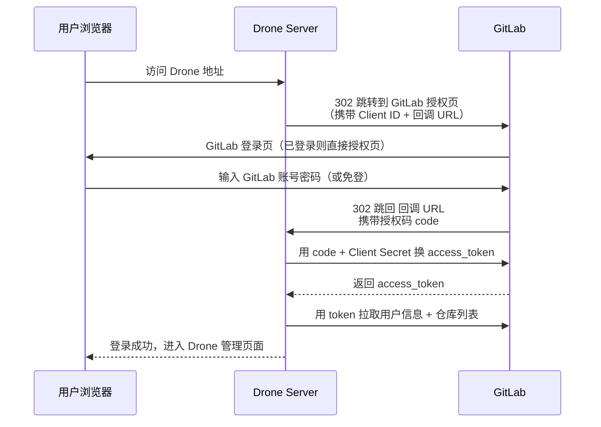

# 45. Drone 部署与 GitLab 接入：OAuth 应用、启动参数与首次授权全流程

## 纲要

- **部署 Drone 的前提是在 GitLab 建一个 OAuth 应用**：拿回 Client ID / Client Secret，Drone 才能「代表用户」登录 GitLab、拉取仓库、继承权限
- **回调 URL 必须是 `http://<drone地址>/login`**：OAuth 授权的跳回地址，多写少写一个字符都会登录循环
- **核心启动参数八项**：GitLab Server、Client ID / Secret、RPC Secret、Server Host、协议端口、管理员账户——每项都对应链路中的一个断点
- **RPC Secret 是 Server 与 Runner 的共享暗号**：Runner 部署时必须填同一个值，这是下面的前置知识点
- **一个 Drone Server 只能连一个 GitLab**：多套 GitLab 就要部署多个 Server，端口规划要预留
- **激活是构建的总开关**：仓库同步过来只是「可见」，对仓库有管理员权限的账户点「Activate」后才能构建

## 一、场景引入：Server 跑起来了，然后呢？

前面建立了整体认知：Drone = 轻量 CI + 插件即镜像 + 配置文件即流水线。但真要把系统用起来，第一道现实关卡是**部署与接入**——这和我们装 Jenkins 时「容器跑起来只是开始，还得接 LDAP、配系统」是同一类问题，只不过 Drone 的接入对象是 GitLab。

本篇按讲稿顺序完成三件事：**① 在 GitLab 管理中心创建 OAuth 应用；② 用 `docker run` 把 Drone Server 跑起来（八项核心参数逐个拆解）；③ 首次访问授权 + 页面功能巡览 + 仓库同步与激活**。做完这三步，Drone 就从「一个容器」变成「团队可用的 CI 平台」。

## 二、核心概念与原理

### 2.1 认证模型：Drone 为什么需要 GitLab OAuth 应用

Drone 自身不存用户密码，它通过 **GitLab OAuth** 完成三件事：



这条链路决定了：**Drone 能看到的仓库 = GitLab 账户有权限的仓库**。权限继承不是 Drone 额外实现的功能，而是 OAuth 模型的天然后果——Drone 拿着你的 token 去问 GitLab「这人能看哪些仓库」，GitLab 说啥就是啥。

### 2.2 OAuth 应用的三个关键配置

| 配置项 | 值 | 为什么关键 |
| --- | --- | --- |
| **名称** | 任意，如 `drone` | 仅用于 GitLab 应用列表展示 |
| **回调 URL（Redirect URI）** | `http://<drone访问地址>/login` | GitLab 授权后 302 跳回的地址，**必须与 Drone 实际访问地址一致**，路径固定 `/login` |
| **权限范围（Scopes）** | `api`（完整读写）+ `read_user`（只读用户信息） | `api` 让 Drone 能读写仓库、配置 Webhook；`read_user` 让 Drone 识别登录账户身份 |

> 课程演示中回调地址形如 `http://gitlab.example.com:82/login`（Drone 对外端口为 82 的场景）。「可信任/机密（Confidential）」复选框按演示去掉；保存后页面会给出 **Application ID** 与 **Secret**——这两个值就是启动参数里的 Client ID / Client Secret，**Secret 只展示一次，先拷贝再关页面**。

### 2.3 启动参数全景：八项核心配置

| 环境变量 | 作用 | 断点后果 |
| --- | --- | --- |
| `DRONE_GITLAB_SERVER` | GitLab 服务地址 | 填错则授权跳转到错误站点 |
| `DRONE_GITLAB_CLIENT_ID` | OAuth 应用 ID | 填错则 GitLab 报「无效的应用」 |
| `DRONE_GITLAB_CLIENT_SECRET` | OAuth 应用密钥 | 填错则换 token 失败，登录循环 |
| `DRONE_RPC_SECRET` | Server ↔ Runner 的 **RPC 共享密钥** | 与 Runner 不一致则 Runner 连不上 Server（详见 #47） |
| `DRONE_SERVER_HOST` | Drone 自身对外访问地址:端口 | 用于拼回调与页面链接，填错会导致授权后跳错地址 |
| `DRONE_SERVER_PROTO` | 对外协议，默认 `https` | 内网 HTTP 演示必须显式改成 `http`，否则拼出 `https://` 打不开 |
| `DRONE_USER_CREATE` | 初始化管理员账户 | 不配则没有管理员，页面能进但无管理功能 |
| 端口映射 `-p` | 容器 80/443 → 宿主机端口 | 与 GitLab 的 80/443 冲突是常见事故（见下） |

### 2.4 RPC Secret：Server 与 Runner 之间的暗号

Drone 架构是 **Server（接收事件、管配置）+ Runner（执行构建）** 分离的，两者通过 RPC 通信。`DRONE_RPC_SECRET` 就是这条通道的**共享密钥**：Runner 启动时填的值必须和 Server 完全一致，否则握手失败、Runner 永远离线。

可以把 Server 理解为 Jenkins Master、Runner 理解为 Slave 节点——Jenkins 里 Master 与 Slave 用 JNLP secret 连接，Drone 里就是 RPC Secret。**密钥由部署方自行生成，不强求复杂度但生产建议随机长串**（课程演示为便于讲解使用了短值，生产替换）。

### 2.5 一个 Server 对一个 GitLab：架构约束

Drone Server 通过一对 Client ID/Secret 连接**一个** GitLab 实例。如果公司有三套 GitLab，就要部署**三个 Drone Server**，每个连一个——否则另外两套 GitLab 无法接入。这一点在规划地址、端口、域名时就要预留。

## 三、动手实践：从 OAuth 应用到首次授权

### 3.1 第一步：GitLab 创建 OAuth 应用

管理员登录 GitLab → **管理中心（Admin Area）→ 应用程序（Applications）→ 新建应用**：

```text
名称:        drone
回调 URL:    http://gitlab.example.com:82/login
信任范围:
  ☑ api        完整读写（仓库、Webhook、状态回写）
  ☑ read_user  只读用户信息（识别登录账户）
Confidential 复选框: 按课程演示去掉
```

保存后拷贝 **Application ID** 与 **Secret**，进入下一步。**回调 URL 的端口必须与 Drone 最终对外端口一致**——本环境 80 端口已被 GitLab 占用，Drone 容器 80 映射到宿主机 82，所以回调地址带 `:82`。

### 3.2 第二步：部署脚本（讲稿脚本重构）

课程课件目录下的 `store.sh` 完成 Drone Server 部署，重构后的完整脚本如下：

```bash
#!/bin/bash
# Drone Server 部署脚本（重构自课程讲稿）
docker run -d \
  --name drone \
  --restart always \
  -v /var/lib/drone:/data \
  -e DRONE_GITLAB_SERVER=http://gitlab.example.com \
  -e DRONE_GITLAB_CLIENT_ID=$GITLAB_APP_ID \
  -e DRONE_GITLAB_CLIENT_SECRET=$GITLAB_APP_SECRET \
  -e DRONE_RPC_SECRET=$RPC_SECRET \
  -e DRONE_SERVER_HOST=gitlab.example.com:80 \
  -e DRONE_SERVER_PROTO=http \
  -e DRONE_USER_CREATE=username:chengxu,admin:true \
  -p 82:80 \
  -p 443:443 \
  drone/drone:1
```

逐字段拆解：

| 配置 | 值 | 说明 |
| --- | --- | --- |
| `--name drone` | 容器名 | 日志排查入口：`docker logs drone` |
| `--restart always` | 重启策略 | **无论何种原因退出（含手动 stop 外的异常）都自动拉起**，生产必备 |
| `-v /var/lib/drone:/data` | 数据卷 | Drone 全部状态（用户、仓库、激活记录）落盘，**删容器不删数据** |
| `DRONE_GITLAB_SERVER` | `http://gitlab.example.com` | 本环境 GitLab 地址（不含端口即默认 80） |
| `DRONE_GITLAB_CLIENT_ID/SECRET` | 3.1 步拷贝的值 | OAuth 凭证，**Secret 不要写死在公开仓库的脚本里** |
| `DRONE_RPC_SECRET` | 共享密钥 | Runner 部署时原样填同一个值（#47 详解） |
| `DRONE_SERVER_HOST` | `gitlab.example.com:80` | Drone 对外访问地址（讲稿按容器端口书写；实际对外以映射端口 82 为准） |
| `DRONE_SERVER_PROTO` | `http` | 内网演示关闭 HTTPS 强制 |
| `DRONE_USER_CREATE` | `username:chengxu,admin:true` | **初始化管理员**：用户名 `chengxu`，管理员标记 `true`。该账户可以是 GitLab（或已接 LDAP 的 GitLab）里的任意账户 |
| `-p 82:80 -p 443:443` | 端口映射 | 宿主 80 被 GitLab 占用，Drone 改占 82；443 留给将来的 HTTPS |
| `drone/drone:1` | 镜像 | Drone 1.x 官方镜像，`1` 为 1.x 线最新 tag |

脚本运行成功（`docker ps` 可见 `drone` 容器 Up）后，进入首次访问。

### 3.3 第三步：首次访问与授权

浏览器访问 `http://gitlab.example.com:82`，页面出现 **Authorize（授权）** 按钮：

1. 点击授权 → 302 跳转到 GitLab 登录页。**若浏览器已登录 GitLab，会直接跳过密码输入**（单点登录行为）；想切换账户必须先退出 GitLab 并清理 Drone 的登录缓存。
2. 输入 GitLab 账号密码（或免登）→ GitLab 询问是否授权应用 → 提交。
3. 跳回 Drone 管理页面，**登录完成**。此时 Drone 已用 OAuth token 拉取到该账户可见的 GitLab 组与仓库。

> 课程演示中的坑：演示机此前登录过其他账户，注销后访问 Drone 仍直达旧账户——**Drone 复用 GitLab 的登录态**，必须退出 GitLab + 清理浏览器数据后重新访问，才会重新要求输入密码。

### 3.4 第四步：页面功能区与仓库激活

管理页面自上而下分几区，各司其职：

| 区域 | 内容 |
| --- | --- |
| 顶部导航 | 首页 / 仓库同步（Sync）/ 搜索 / 主题色切换 |
| **Sync（同步）** | 把 GitLab 的**组与仓库**拉取到 Drone——GitLab 侧新建组/仓库/改权限后，都要点一次 Sync 才生效 |
| 首页列表 | 该账户在 GitLab 有权限的所有仓库：**前面是组名，后面是仓库名**；可按组织筛选、排序 |
| **激活（Activate）** | 每个仓库右侧的开关——**激活后才能构建**；只有对该仓库有管理员权限的账户可见并可点 |

激活规则（权限章节会展开）：

- **系统管理员 ≠ 仓库管理员**：Drone 管理员账户对没有管理权限的仓库同样无法激活
- 激活后仓库进入「可配置」状态，后续 push 即按 `.drone.yml` 自动构建
- 未激活的仓库在列表里标灰，构建按钮不可用

页面底部还有两类信息入口：**管理员账户列表**（用户名、创建时间、登录时间）与 **API / CLI 使用说明**（个人 token 的获取与调用方式，后续项目实战会用到）。

## 四、生产实践要点

1. **RPC Secret 生产必须随机化并妥善保管**：`openssl rand -hex 16` 生成，写入 Runner 部署脚本与环境变量管理（或 K8s Secret）。它是 Server-Runner 通道的唯一暗号，泄露等于任何人可以注册恶意 Runner 抢任务。
2. **HTTPS 尽早规划**：演示用 `http` 图省事，生产公网/跨网段场景必须上 TLS——OAuth 授权码、access_token 都在 HTTP 上裸奔。`DRONE_SERVER_PROTO=https` + 443 端口已预留，配好证书即可切换，切换时**同步改 GitLab 应用的回调 URL**。
3. **端口冲突提前规划**：GitLab 占了 80，Drone 让到 82 是常见姿势；若同机还要部署其他服务（SonarQube 9000、MeterSphere 等），画一张端口分配表再动手，避免部署到一半才发现冲突。
4. **数据卷必须备份**：`/var/lib/drone` 存着全部激活关系与用户映射，容器重建可以，数据丢失意味着全团队重新激活一遍仓库。纳入常规备份。
5. **管理员账户用 LDAP 账户**：GitLab 若已接 OpenLDAP，`DRONE_USER_CREATE` 直接指定 LDAP 账户（如 `chengxu`），与公司统一身份体系对齐；**不要图省事建一个只存在于 Drone 的本地管理员**。
6. **多 GitLab 多 Server 的地址规范**：三套 GitLab 就三套 Drone Server，建议命名规范 `drone-<gitlab实例>`、端口分段分配，OAuth 应用按实例分别创建，避免 ID/Secret 串用。
7. **`--restart always` 之外加健康检查**：容器活着 ≠ 服务可用（如后端 GitLab 宕机时 Drone 会持续报错但容器不退）。生产加 `HEALTHCHECK` 或外部探活，故障时能第一时间告警而不是等用户反馈。

## 五、报错排查表

| 现象 | 根因 | 解法 |
| --- | --- | --- |
| 授权后页面在 Drone 与 GitLab 之间无限循环 | 回调 URL 与 `DRONE_SERVER_HOST/PROTO` 不一致（少了 `/login`、端口不对、协议 https/http 错配） | 三者逐字符对齐：GitLab 应用回调 = Drone 实际访问地址 + `/login` |
| GitLab 报「无效的应用程序」或「invalid client」 | Client ID / Secret 拷贝错误，或应用被禁用 | 重新从 GitLab 应用页拷贝；确认应用状态启用 |
| 页面打不开，浏览器跳到一个 https 地址 | `DRONE_SERVER_PROTO` 未从默认 `https` 改成 `http` | 显式设置 `-e DRONE_SERVER_PROTO=http` 并重建容器 |
| 容器反复重启，`docker logs` 报端口占用 | 宿主 80/443 已被 GitLab 或其他服务占用 | 改映射端口（如 `-p 82:80`），同步改回调 URL |
| 登录后看不到任何仓库 | ① 没点 Sync；② 该 GitLab 账户对任何仓库无权限；③ 仓库在子组下（Drone 只识别一级组） | 点 Sync；在 GitLab 侧给账户分配仓库成员；把仓库建到一级组下 |
| 仓库可见但无「激活」按钮 | 当前账户对该仓库不是管理员权限 | GitLab 项目 → 成员 → 提权到 Maintainer 及以上 → 回 Drone 点 Sync |
| 想换账户登录却直接进旧账户 | Drone 复用 GitLab 登录态 | **先退出 GitLab，再退出 Drone**，必要时清理浏览器缓存后重登 |
| Runner 侧日志报 RPC 连接失败 | `DRONE_RPC_SECRET` 与 Server 不一致，或地址端口不通 | 两边密钥逐字符对齐；`telnet <server_host> <port>` 验证连通 |

## 六、面试考点与追问

**Q1：Drone 部署时必须先在 GitLab 做什么？拿回哪两个值？**
先在 GitLab 管理中心 → 应用程序 → 新建 OAuth 应用，配置名称、回调 URL（`http://<drone地址>/login`）与 scope（`api` + `read_user`），保存后拿回 **Application ID** 与 **Secret**，对应 Drone 的 `DRONE_GITLAB_CLIENT_ID` 与 `DRONE_GITLAB_CLIENT_SECRET`。

**Q2：`DRONE_RPC_SECRET` 是做什么的？和 GitLab 的 Client Secret 有什么区别？**
RPC Secret 是 **Drone Server 与 Drone Runner 之间** RPC 通道的共享密钥，用于 Runner 接入 Server（类似 Jenkins Master-Slave 的 JNLP secret）；Client Secret 是 **Drone 与 GitLab 之间** OAuth 换 token 的凭证。两者作用域完全不同，值也不同，不能混用。

**Q3：为什么回调 URL 必须是 Drone 地址 + `/login`？**
GitLab OAuth 授权完成后按回调 URL 302 跳回应用，Drone 的授权码接收端点固定是 `/login` 路径。地址（含协议与端口）不一致，授权码就送不到 Drone 手里，表现为登录循环跳转。

**Q4：一个 Drone Server 能连几套 GitLab？多套怎么办？**
一套。Server 通过一对 Client ID/Secret 绑定一个 GitLab 实例。多套 GitLab 需要部署多个 Drone Server，每个连接一套，分别规划地址端口与 OAuth 应用。

**Q5：仓库同步到 Drone 后为什么还不能构建？**
同步只让仓库「可见」；构建前必须**激活（Activate）**，且只有对该 GitLab 仓库有管理员权限的账户能激活。激活是一道显式授权闸，防止仓库被任意触发构建。

**Q6：Drone 的管理员账户怎么指定？可以用普通 GitLab 账户吗？**
通过启动参数 `DRONE_USER_CREATE=username:<名称>,admin:true` 指定，<名称> 可以是 GitLab 里的任意账户——GitLab 接了 LDAP 就填 LDAP 账户。注意：Drone 系统管理员不等于所有仓库的管理员，激活权限仍按仓库逐一判断。

**Q7：内网 HTTP 部署要改哪些默认值？**
三处：① `DRONE_SERVER_PROTO=http`（默认 https）；② 端口映射避开已占用端口（如 GitLab 占 80，Drone 映射到 82）；③ GitLab OAuth 应用的回调 URL 同步改为 `http://<地址>:<端口>/login`。

## 📎 文本↔代码关联

本篇为**部署操作篇**，课件未提供可直接套用的代码文件（部署以 GitLab 页面配置 + `docker run` 脚本为主，`store.sh` 为讲稿口述脚本，已在 3.2 节完整重构），如实标注、不虚构路径。本章后续篇目将使用 `code/7-Drone/` 下的 `.drone.yml` 系列文件：

- `code/7-Drone/drone.yml-工作空间与步骤` —— #47 管道运行时的 pipeline 骨架
- `code/7-Drone/drone.yml-镜像拉取方式与拉取私有镜像` —— kubernetes 管道的私有镜像拉取配置

**技术点总结**：Drone 接入 GitLab 的完整链路是「OAuth 应用 → docker run 八项参数 → 授权登录 → 同步激活」：先在 GitLab 管理中心建应用拿回 Client ID/Secret（回调 URL 固定为 Drone 地址 + `/login`，scope 选 `api` + `read_user`），再用 `docker run` 部署 Server——GitLab 地址、OAuth 凭证、RPC 共享密钥、Server Host/协议、管理员账户、端口映射八项核心参数各对应链路一个断点，其中 80 端口让位 GitLab、协议默认 https 需显式改 http 是演示环境两大坑。登录后仓库「同步（Sync）」只是可见，「激活（Activate）」才是构建总开关，且激活权按仓库判给 GitLab 管理员而非 Drone 系统管理员。生产维度：RPC Secret 随机化、HTTPS 与回调 URL 同窗口切换、数据卷备份、多 GitLab 多 Server 的地址规范，是把演示链路转为企业部署的必修课。

