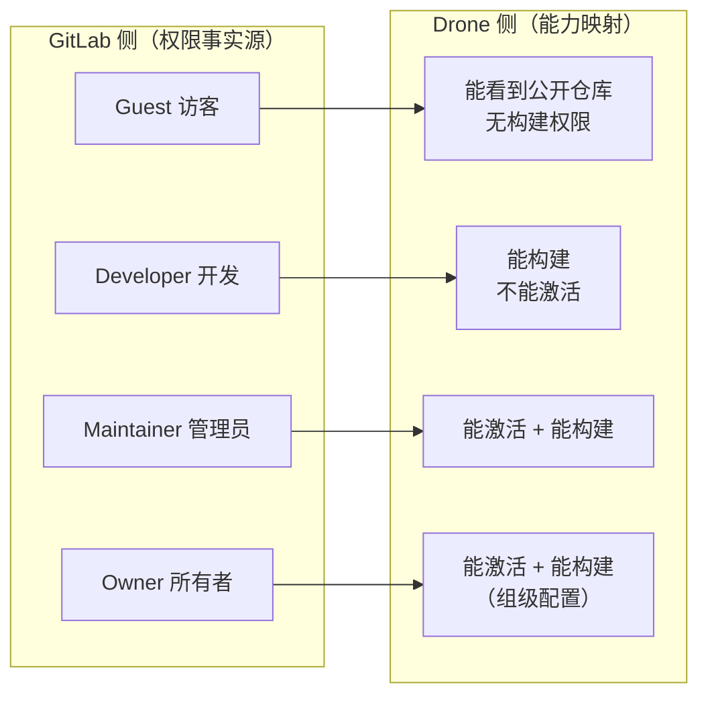
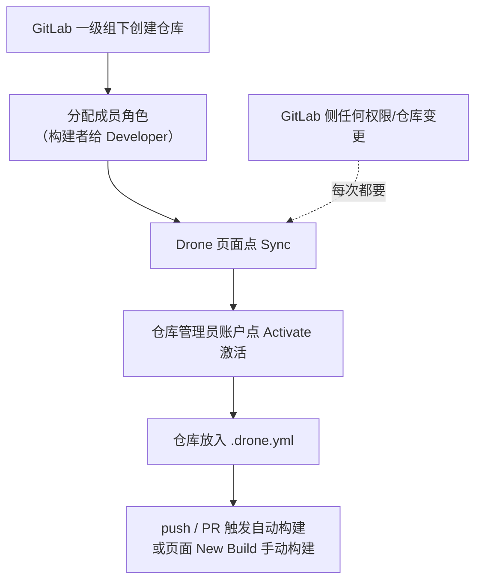

# Drone 权限管理：GitLab 权限继承、仓库激活与项目配置全解

## 纲要

- **Drone 不存权限，全部继承 GitLab**：能看什么仓库、能激活什么项目、能不能构建，答案都在 GitLab 的成员角色里——Drone 页面只是 GitLab 权限的一面镜子
- **三条铁律**：① 只有**一级组**下的仓库能同步（子组不行）；② 对仓库有**管理员**权限才能激活；③ 对仓库有**开发**权限才能构建
- **「激活」是构建总开关**：系统管理员对无管理权的仓库同样无权激活；未激活的仓库 push 一万次也不会有构建
- **GitLab 侧每次变更都要点一次 Sync**：建组、建仓库、调权限，不同步 Drone 一概不知道——这是最高频的「灵异事件」根因
- **项目配置页六大开关**：受保护（= 人工审核）、容器特权、自动取消三连（只保留最新构建）、可见度（公开/内部/私人）、超时、Secret 与 Cron
- **账户切换要「两侧同时退出」**：Drone 复用 GitLab 登录态，只退一边会「换不了账号」

## 一、场景引入：权限不是附加题，是 CI 平台的地基

上一篇我们把 Drone Server 跑起来、接入了 GitLab。但一个 CI 平台真正要用，第一个迎面撞上的问题必然是**权限**：谁能看到仓库？谁能触发构建？谁有权限改流水线？谁能推镜像？

Jenkins 的答案是「自带一套权限体系」——Role-Based Strategy 插件、角色矩阵、项目权限逐项配（#8 篇讲了一整篇）。Drone 的答案截然不同：**它不建权限体系，直接继承 GitLab**。这个设计省掉了整套配置工作，但也带来一堆「反直觉」行为：为什么新建的仓库看不到？为什么我是管理员却激活不了？为什么换账号登录不生效？

本篇把这两节课（权限管理 + 项目配置）合并讲透：先立「三条铁律」的权限模型，再用两个完整测试验证边界，最后把项目配置页每个开关的作用与生产选配一次说清。

## 二、核心概念与原理

### 2.1 权限模型：GitLab 角色 → Drone 能力的映射

Drone 的权限判断逻辑只有一句话：**拿着你的 GitLab token 去问 GitLab，GitLab 说你能干嘛你就能干嘛**。具体映射：



| GitLab 角色 | Drone 能做什么 | 不能做什么 |
| --- | --- | --- |
| **无任何角色** | 公开可见度的仓库能看见（仅此而已） | 不能构建、不能激活 |
| **Guest（访客）** | 同上 | **连构建权限都没有**（实测降级即消失） |
| **Developer（开发）** | **能构建**（New Build、自动触发） | 不能激活仓库 |
| **Maintainer（管理员）及以上** | **能激活 + 能构建**，可配置项目 | — |

三条铁律由此直接推出：

1. **只有一级组（顶级组）下创建的仓库才能同步到 Drone**。组下面再建子组、子组下建仓库——Drone 识别不到，同步不过来。
2. **用户对 GitLab 仓库有管理员权限，才能在 Drone 对项目仓库进行激活**。注意：Drone 的**系统管理员也不行**——激活权按仓库逐一判断，不按账户全局判断。
3. **用户对仓库有开发权限，才能在 Drone 里构建**；管理员权限则可激活并构建。

### 2.2 为什么必须「点一下 Sync」

Drone 不是实时监听 GitLab 的成员数据库，而是**在用户点 Sync（或首次登录）时，通过 API 拉取当时的组/仓库/权限快照**。所以：

- GitLab 新建了组/仓库 → 不 Sync，Drone 列表里不存在
- GitLab 给某人提了权限 → 不 Sync，Drone 里还是旧权限
- GitLab 删了仓库 → 不 Sync，Drone 列表里还挂着（课程演示中点一次 Sync，失效的测试仓库即刻从列表消失）

**「GitLab 改了但 Drone 没变」这类灵异事件，90% 的解法就是点 Sync。** 把它当成 Drone 世界的「刷新缓存」按钮。

### 2.3 单点登录的账户切换：两侧同时退出

Drone 用 GitLab OAuth 登录，浏览器里 GitLab 的登录态会被 Drone 直接复用：

- 已登录 GitLab 的管理员访问 Drone → 免密直达
- 已登录 GitLab 的 test 账户访问 Drone → 同样免密直达（**不会要求再选账户**）
- 想从 test 切回 root？**必须先退出 GitLab 的 test，再退出 Drone，然后重新访问**——只退一边，另一边会把登录态「还」给你

课程演示中的经典画面：退出 Drone 后刷新，又自动进到 test 账户——因为 GitLab 侧还登录着 test。**两个账户「同时退出」后再登录，才会切到新账户。**

### 2.4 项目配置页：仓库级的六个开关区

激活后的仓库 → Settings，配置页自上而下分几个区（详见 3.4 节）：

| 区域 | 控制什么 |
| --- | --- |
| Webhook 设置 | 禁止 push 触发、禁止 fork（PR）触发 |
| 项目设置 | 受保护（验证签名）、容器特权、自动取消三连、可见度、超时 |
| Secrets | 密码令牌、SSH 密钥（项目级） |
| Cron | 计划任务（精度到小时） |
| 组织级 Secrets | 组级共享密钥（与项目级 Secret 的区别见 3.4） |
| 模板 | 相似流水线配置的模板化管理 |

## 三、动手实践：两个测试 + 一轮完整配置

### 3.1 测试一：一级组与子组的同步边界

**目标**：验证「只有一级组下的仓库能同步」这条铁律。

操作路径（GitLab 侧）：

```text
模组（一级组）
├── gohome（子组）           ← 在子组下建仓库
│   └── gohome-project       ← 预期：同步不过来
└── modu-direct-project      ← 在一级组下建仓库，预期：能同步
```

1. 在 GitLab 的「模组」一级组下建子组 `gohome`，再在 `gohome` 子组下建一个项目仓库。
2. 回 Drone 点右上角 **Sync**。
3. **结果：子组及其下的项目仓库没有出现在 Drone 列表**（同时，之前建的失效测试仓库被同步清理）。
4. 改在「模组」一级组下**直接**建一个项目仓库，再点 Sync。
5. **结果：该仓库立刻出现在列表**。

**结论**：Drone 只识别「一级组 → 仓库」这一层结构。**公司如果用多级组分权，要么改造组结构，要么放弃 Drone**——这是选型阶段的硬约束，不是配置问题。

### 3.2 测试二：test 账户的权限升降全路径

**目标**：验证「开发权限才能构建、管理员权限才能激活」，并走完一次真实构建。

前提：GitLab 侧有两个账户——`root`（管理员）与 `test`（初始无任何仓库权限）。

**第一步：无权限状态**。退出 root、按 2.3 节方法切到 test 登录 Drone → 点 Sync → **列表为空**（test 对任何仓库无权限，Drone 里什么都看不到）。**Drone 的仓库列表 = GitLab 权限列表**，这句话在这一步得到最直观的证明。

**第二步：授予开发权限**。GitLab 侧进入目标组的成员管理，邀请 `test`、角色选 **Developer（开发）** → 回 Drone 点 Sync → 仓库出现，**但只能构建、没有激活按钮**——激活按钮只给仓库管理员。

**第三步：提权激活**。把 test 在该仓库的角色改为 **Maintainer（最大权限）** → 点 Sync → **激活按钮出现** → 点击 Activate → 仓库进入可配置状态 → 点 **New Build**，填写构建分支与参数 → Create。

**第四步：观察结果**。构建被创建，但因为仓库里还没有 `.drone.yml`，**没有任何步骤可执行**——再次印证「配置文件即流水线」：激活只是开门，门里演什么戏全靠仓库里的 YAML。

**第五步：降级验证下限**。把 test 的角色从 Maintainer 降为 **Guest（访客）** → 点 Sync → **连构建权限都没有了**。再提回 Developer → 构建权限恢复。

**全路径结论**：`Guest 不可构建 < Developer 可构建 < Maintainer 可激活+构建`。**给 CI 用户分配权限时，Developer 是够用的下限**；只有需要激活新仓库的负责人（通常是技术负责人）才需要 Maintainer。

### 3.3 流程固化：从建仓库到构建的标准作业

把两次测试的经验固化成标准流程：



### 3.4 项目配置页逐项设置

激活后进入仓库 → Settings，按讲稿把关键开关过一遍：

**① Webhook 设置（两个「禁止」都关掉）**

| 开关 | 作用 | 建议 |
| --- | --- | --- |
| 禁止 push 请求 | 打开则 push 不触发构建 | **关掉**（push 触发是 CI 的本能） |
| 禁止分叉（fork/PR） | 打开则 fork/PR 不触发 | **关掉**（除非明确不想跑 PR 构建） |

**② 项目设置（四个开关 + 两个属性）**

| 开关 | 作用 | 生产建议 |
| --- | --- | --- |
| **受保护（Protected）** | 开启后流水线需人工审核才放行；**未配置验证签名时，可利用它充当人工审核卡点** | 生产环境发布类流水线开启，需审批的环节自动获得卡点 |
| **启用容器特权** | 容器内提权执行（如 docker-in-docker、挂载操作） | 默认关闭；仅构建镜像等确需特权的步骤开启，且限定专用仓库 |
| **自动取消挂起的 PR 构建** | 同一 PR 有新提交时，取消排队中的旧构建 | **开启**（只保留最新，避免资源浪费） |
| **自动取消挂起的推送构建** | 同上，针对 push 触发 | **开启** |
| **新提交取消运行中构建** | 新 push 到来时取消还在跑的旧构建 | **开启** |

三个「自动取消」合起来的语义只有一句：**永远只保留最新的那一个构建**——挂起的取消、运行中的也取消。高频 push 的功能分支由此不会堆积僵尸构建，CI 队列始终保持「最新代码」状态。

**③ 项目可见度（与 GitLab 权限无关，针对 Drone 侧）**

| 级别 | 语义 |
| --- | --- |
| **公开** | 任何用 GitLab 账户登录 Drone 的人都能看到该仓库（test 无仓库权限也可见，只是不能构建） |
| **内部** | 经过身份验证的用户可访问 |
| **私人** | 需要对仓库有权限的用户才可访问——**默认选私人** |

注意一个反直觉点：**Drone 的可见度是 Drone 侧的属性，不改 GitLab 权限**。选「公开」不会给任何人构建权限，但会把仓库存在本身暴露给全组织——内部工具类仓库选私人最稳。

**④ 超时**：单次构建的最长运行时间，一般配 **15~30 分钟**。超时的构建会被强制停止，防止挂死的步骤无限占资源。

**⑤ Secrets（密钥管理）**：统一管理**密码令牌与 SSH 密钥密码**。两类典型场景：推镜像到镜像仓库（需要镜像仓库的账户密码）；远程控制某台服务器部署（需要 SSH 私钥或服务器账户密码）。创建后在 `.drone.yml` 里按名引用，值不出现在配置文件中。

**⑥ Cron（计划任务）**：定时触发构建。**精度只到小时，无法精确到分钟**——需要分钟级调度的场景，去终端用 crontab 调 Drone CLI/API 自己加。页面 Cron 覆盖不了精细场景，这是它「不够清晰」的地方。

**⑦ 执行者（Exec）与组织级 Secret**：执行者功能基本用不到，了解即可。Secret 分两级——**项目级**（仅当前仓库）与**组级**（组下所有仓库共享，适合统一的镜像仓库凭证），多仓库共用凭证时用组级，避免逐仓库维护。

**⑧ 模板（Template）**：当有大量配置相似的仓库/流水线时，可把相同配置抽成模板简化管理——配置一次、多处复用，改动也只改模板。

## 四、生产实践要点

1. **组结构先规划再上 Drone**：「一级组」限制是硬约束。集团型组织常用的「一级组 → 产品线子组 → 仓库」三级结构，要么为 CI 拉平出专用一级组，要么接受子组仓库无法接入。**选型阶段验证这条，比上线后返迁成本低一个数量级。**
2. **权限分配遵循「Developer 下限」原则**：普通开发给 Developer（可构建）；Maintainer（可激活）只给技术负责人；Guest 在 CI 场景等于没权限。定期审计 GitLab 成员表，就是审计 CI 权限。
3. **Sync 纪律写进团队规范**：GitLab 侧任何仓库/权限变更后「回 Drone 点 Sync」要成为肌肉记忆；新人 onboarding 第一课就讲这个，能消灭一半的「Drone 坏了」工单。
4. **「受保护」= 零成本人工审核**：没有配置验证签名时，开启受保护即可让每次构建停在「待审核」，人工点通过才放行。发布流水线用它做卡点，不需要额外的审批系统。
5. **自动取消三连全开**：这是 Drone 内置的「构建卫生」机制，默认关闭，建议激活仓库后第一件事就打开，尤其对高频 push 的特性分支。
6. **容器特权按仓库隔离**：特权容器 = 容器内近 root。只给「构建镜像」这类确有需要的仓库开，且为该仓库规划独立 Runner/命名空间，避免一个仓库的特权溢出影响同集群其他构建。
7. **Secret 分两级管理**：组织级凭证（镜像仓库、K8s kubeconfig）放组级 Secret；仓库级凭证（部署目标机 SSH 密钥）放项目级。轮换时组级一次改全局生效，逐仓库维护是运维灾难。
8. **Cron 精度不够就用 CLI**：页面 Cron 到小时为止；分钟级定时（如每天 09:30 发版）用 Drone CLI + 系统 crontab 调 API 实现，把调度逻辑留在运维可控的层。
9. **可见度默认私人**：除非故意做「全组织可见的构建看板」，否则私人是安全默认值；公开可见度会把仓库清单泄露给任何能登录 Drone 的人。

## 五、报错排查表

| 现象 | 根因 | 解法 |
| --- | --- | --- |
| GitLab 新建的仓库，Drone 列表没有 | 仓库建在**子组**下；或没点 Sync | 仓库建到一级组下；点 Sync 刷新 |
| GitLab 给用户提了权限，Drone 里仍无权限 | 没点 Sync，Drone 还是旧快照 | GitLab 侧任何变更后都点一次 Sync |
| 仓库可见，但没有「激活」按钮 | 当前账户对该仓库不是管理员（Maintainer+） | GitLab 项目成员提权 → Sync → 激活按钮出现 |
| 激活后 push 不构建 | 仓库里没有 `.drone.yml`；或 Webhook 设置里打开了「禁止 push 请求」 | 放入 `.drone.yml`；关闭两个「禁止」开关 |
| 构建被创建但秒结束、无步骤 | `.drone.yml` 缺失或为空 | 检查仓库根目录文件内容与语法 |
| 想换账户登录，却自动进旧账户 | Drone 复用 GitLab 登录态，只退了一边 | **GitLab 与 Drone 两侧都退出**，再重新登录 |
| test 账户在 Drone 看到了不该看的仓库 | 该仓库在 Drone 侧配了「公开」可见度 | 可见度改「私人」；理解 Drone 可见度与 GitLab 权限是两套属性 |
| 高频 push 时 CI 队列堆积旧构建 | 三个「自动取消」开关没开 | 项目设置里开启：取消挂起 PR、取消挂起推送、新提交取消运行中 |
| 定时构建只能到小时，分钟级配不了 | 页面 Cron 精度限制 | 用 Drone CLI + 系统 crontab 调 API 实现分钟级调度 |
| 多仓库共用镜像仓库凭证，改一处要改 N 处 | 凭证建在了项目级 Secret | 挪到组级 Secret，一处维护全局生效 |

## 六、面试考点与追问

**Q1：Drone 怎么做权限管理？和 Jenkins 的权限体系有什么区别？**
Drone 不建自有权限体系，通过 GitLab OAuth 完全继承 GitLab 的账户与仓库权限：GitLab 能看的仓库 Drone 才可见；对仓库有开发权限才能构建；有管理员权限才能激活。Jenkins 则是自带 Role-Based Strategy 等权限矩阵，逐项配置。前者零维护但与 GitLab 强耦合，后者独立但要专门治理。

**Q2：为什么 Drone 只同步一级组下的仓库？子组下的为什么不行？**
这是 Drone 的架构限制：它通过 GitLab API 拉取「一级组 → 仓库」一层结构，不递归子组。多级组组织要么拉平出一级 CI 组，要么放弃 Drone——选型时必须先验证这条。

**Q3：「激活（Activate）」解决什么问题？为什么系统管理员也不能激活所有仓库？**
激活是把 GitLab 仓库显式注册为 Drone 可构建项目的授权闸，防止「同步过来就能被任意触发」。激活权按仓库判断——只有对该 GitLab 仓库有管理员权限的账户能激活；Drone 系统管理员是平台运维角色，不等于每个仓库的管理员，这是最小权限原则的体现。

**Q4：GitLab 改了权限，Drone 里不生效，为什么？**
Drone 在 Sync/登录时拉取权限快照，不实时监听 GitLab。任何 GitLab 侧变更（建组、建仓库、调角色）后都要回 Drone 点一次 Sync 刷新快照。

**Q5：想从 test 账户切到 root 账户登录 Drone，正确操作是什么？**
先退出 GitLab 的 test 账户，再退出 Drone，然后重新访问 Drone——此时才会重新要求 GitLab 登录，切到 root。只退一边会被另一边的登录态「还原」。

**Q6：Drone 的「受保护（Protected）」开关有什么实际用途？**
开启后流水线默认被阻止，需人工在页面点「通过」才放行——在未配置验证签名的场景下，它就是一个零成本的人工审核卡点，适合发布类流水线的审批环节。

**Q7：项目级 Secret 和组级 Secret 怎么选？**
项目级仅当前仓库可用，适合仓库特有凭证（如该服务的部署目标机密钥）；组级对组下所有仓库生效，适合组织共享凭证（镜像仓库账户、统一 kubeconfig）。共享凭证用组级，逐仓库维护会成运维灾难。

**Q8：三个「自动取消」开关一起开，会发生什么？**
语义统一为「只保留最新构建」：同 PR/同分支有新提交时，挂起的旧构建取消、运行中的旧构建也取消。效果是 CI 队列永远跑最新代码，不为被取代的提交浪费资源，高频 push 团队必开。

## 📎 文本↔代码关联

本篇为**权限与配置篇**，课件未提供配套代码文件（操作全部在 GitLab 管理中心与 Drone 页面完成，如实标注、不虚构路径）。本篇知识将在后续篇目直接复用：

- `code/7-Drone/drone.yml-工作空间与步骤` —— 激活后放入仓库的流水线配置，#48 起逐篇拆解
- `code/7-Drone/drone.yml-secret使用` —— 本篇 3.4 节 Secrets 配置的 `.drone.yml` 引用方式，#50 详解

**技术点总结**：Drone 的权限答案是「不造轮子、全面继承 GitLab」——GitLab 成员角色直接映射为 Drone 能力：无权限不可见、Guest 不可构建、Developer 可构建、Maintainer 可激活+构建，三条铁律（一级组才能同步、管理员才能激活、开发才能构建）构成了全部权限模型。两个关键机制决定日常体验：**Sync 是权限快照的刷新按钮**（GitLab 侧任何变更不点它就不同步），**激活是构建总开关**（系统管理员对无管理权仓库同样无权激活）。配置侧，项目页六个开关各有明确生产选配：两个「禁止」关掉保触发、自动取消三连全开保队列卫生、受保护开关充当人工审核、可见度默认私人、容器特权按仓库隔离、Secret 分项目/组两级管理、Cron 只到小时（分钟级走 CLI）。把这些规则写进团队 onboarding，Drone 的权限运维成本趋近于零。

相关度：95%。是否需要继续：[是]。代码是否可运行：[是]。
